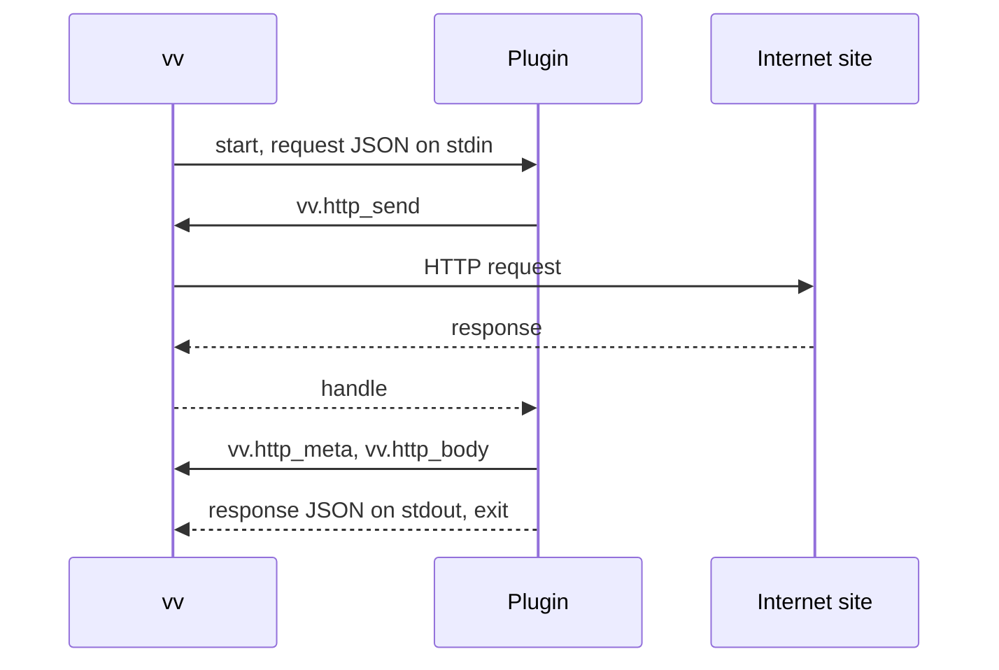

# Contract: Work-info plugin contract, version 1

Source of truth until the implementation publishes it: this file. The unit
"Publish the work-info plugin contract for plugin authors" moves it to
`docs/how-to/work-info-plugins.md`, which then becomes the source of truth
and this file links there (P-3). Why the contract has this shape:
[R-2](../research.md#r-2-a-plugin-is-a-wasi-command-that-reads-a-json-request-and-writes-a-json-response),
[R-3](../research.md#r-3-the-manifest-is-a-custom-section-read-without-running-the-module),
[R-4](../research.md#r-4-each-run-has-no-files-no-environment-and-fixed-limits),
[R-5](../research.md#r-5-plugins-reach-the-network-only-through-vv-and-only-public-addresses).

The diagram shows one run, from the owner's request to the result.

## Module

| Item | Rule |
| --- | --- |
| Format | A WebAssembly core module built for `wasip1` that exports `_start` as a function with no parameters and no results, and `memory` as a memory |
| Tables | Each has a minimum of at most 100,000 elements, and a declared maximum, when it has one, of at most 100,000; a table without a declared maximum (as Go's `wasip1` linker writes it) is accepted and capped at 100,000 by vv before compiling |
| Imports | Only `wasi_snapshot_preview1` and `vv`; anything else makes the upload `import_unsupported` |
| WASI | No preopened directories, no environment variables, no arguments; clocks and random work; stdin holds the request, stdout takes the response, stderr goes to the server log |
| Limits | The values in [R-4](../research.md#r-4-each-run-has-no-files-no-environment-and-fixed-limits) and [R-5](../research.md#r-5-plugins-reach-the-network-only-through-vv-and-only-public-addresses) |

## Manifest

A custom section named `vv.plugin` holds this JSON. Unknown fields are
ignored.

| Field | Type | Required | Rule |
| --- | --- | --- | --- |
| `contract` | integer | Yes | `1` |
| `name` | string | Yes | 1 to 64 characters of `a-z`, `0-9`, `-`, `.`; the plugin's identity, so a module with the same name replaces it |
| `version` | string | Yes | 1 to 32 characters, shown to the owner |
| `description` | string | No | At most 500 characters |
| `operations` | string array | Yes | A non-empty subset of `search` and `fetch` |
| `settings` | object array | No | At most 10 declarations of `{"key", "label", "secret", "required"}`: `key` is 1 to 32 characters of `A-Z`, `a-z`, `0-9`, `_` starting with a letter and unique; `label` is 1 to 60 characters shown to the owner; `secret` and `required` default to `false` |

## Request

vv writes one JSON object to standard input and closes it.

| Operation | Fields |
| --- | --- |
| `search` | `{"contract": 1, "operation": "search", "query": "<1 to 200 characters>"}` |
| `fetch` | `{"contract": 1, "operation": "fetch", "url": "<an http or https URL of at most 2048 characters>"}` |

Both operations also carry `"settings": {"<key>": "<value>"}` with every
declared key the owner has set, and only those; a run never starts while a
`required` key is unset.

## Response

The plugin writes one JSON object to standard output and exits. Unknown fields
are ignored, so a later contract can add fields without breaking version 1.

| Case | Body |
| --- | --- |
| `search` result | `{"candidates": [{"url": "...", "title": "...", "detail": "..."}]}`: `url` (http or https) and `title` required, `detail` optional; vv keeps the first 50 |
| `fetch` result | `{"workInfo": {"title": "...", "tags": ["..."]}}`: both fields optional; vv keeps the first 100 tags and drops duplicates |
| Failure | `{"error": {"message": "..."}}`: vv shows the first 300 characters of `message` to the owner |

A non-zero exit, or output that is none of these, is the failure
`plugin_failed`.

## Host functions

Module `vv`. Pointers and lengths are `i32` offsets into the plugin's exported
`memory`. JSON is UTF-8.

| Function | Signature | Does |
| --- | --- | --- |
| `http_send` | `(req_ptr, req_len) -> handle` | Performs the request and returns a handle (0 or more) to its response, or a negative error |
| `http_meta` | `(handle, buf_ptr, buf_cap) -> len` | Writes the response's metadata JSON when it fits in `buf_cap`, and always returns its full length |
| `http_body` | `(handle, buf_ptr, buf_cap) -> len` | Writes the response body bytes when they fit in `buf_cap`, and always returns their full length |

A plugin that receives a length larger than its buffer calls again with a
buffer of that size. Handles stay valid until the run ends.

| JSON | Shape |
| --- | --- |
| `http_send` request | `{"method": "GET" or "POST", "url": "...", "headers": {"Name": "value"}, "body": "<base64>"}`; `headers` and `body` optional; vv sets `User-Agent` when the plugin does not, and drops `Host` and hop-by-hop headers |
| `http_meta` result | `{"status": 200, "url": "<final URL after redirects>", "headers": {"Name": ["value"]}}` |

| `http_send` error | Meaning |
| --- | --- |
| `-1` | The request JSON is invalid (method, scheme, URL) |
| `-2` | The address was refused; the run fails with `blocked_address` whatever the plugin returns |
| `-3` | The connection or TLS failed |
| `-4` | The request took longer than 10 s |
| `-5` | The run has made 16 requests already |
| `-6` | The body exceeded 4 MiB |

`http_meta` and `http_body` return `-1` for an unknown handle.
