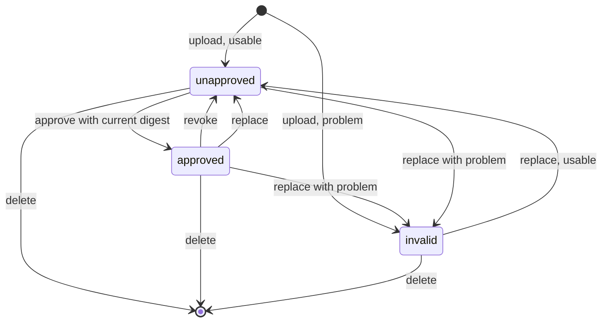

# Data model: Work-info plugins

The rest of the model is unchanged:
[internal/store/migrations/](../../internal/store/migrations/). A fetched
result is held in memory, not stored
([R-8](research.md#r-8-a-fetched-result-lives-in-memory-for-10-minutes-bound-to-the-video-and-the-plugins-digest)).

## Migration

`00043_work_info_plugins.sql` creates `work_info_plugins` and
`work_info_plugin_settings`. If another
migration lands on `main` first, the number moves to the next free one.

## `work_info_plugins`

| Field | Type | Null | Meaning |
| --- | --- | --- | --- |
| `id` | integer | No | Primary key; the screen API addresses a plugin by it |
| `name` | text | Yes | The manifest's `name`, unique; null when the manifest could not be read |
| `file_name` | text | No | The uploaded file's name, shown when `name` is null |
| `version` | text | Yes | The manifest's `version` |
| `description` | text | Yes | The manifest's `description` |
| `contract` | integer | Yes | The manifest's contract version |
| `operations` | text | Yes | The manifest's operations, comma-separated (`search`, `fetch`) |
| `settings` | text | Yes | The manifest's setting declarations as JSON ([contract](contracts/plugin-contract.md#manifest)) |
| `module` | blob | Yes | The module; null when `problem` is set |
| `digest` | text | No | Lowercase hex SHA-256 of the uploaded bytes |
| `problem` | text | Yes | Why the plugin cannot be approved (table below); null for a usable plugin |
| `approved_digest` | text | Yes | The digest the owner approved |
| `added_at` | integer | No | Unix seconds of the first upload |
| `updated_at` | integer | No | Unix seconds of the last upload or approval change |

**Relationships**: None. The table is owner data: it is not rebuilt by a
rescan and is listed as kept in
[Data and recovery](../../docs/how-to/running-vv.md#data-and-recovery).

| `problem` | Upload that sets it |
| --- | --- |
| `not_wasm` | The bytes do not compile as a WebAssembly module |
| `manifest_missing` | No `vv.plugin` custom section |
| `manifest_invalid` | The section is not the JSON of [the manifest](contracts/plugin-contract.md#manifest), or a field breaks its rule |
| `contract_unsupported` | `contract` is not a version this vv runs (only `1`) |
| `import_unsupported` | The module imports something outside `wasi_snapshot_preview1` and `vv` |
| `export_invalid` | The module does not export `_start` as a function taking and returning nothing, or does not export `memory` as a memory |
| `table_too_large` | A table's minimum, or its declared maximum, is over 100,000 elements (a table without a declared maximum is accepted and capped at 100,000) |

## `work_info_plugin_settings`

The values the owner entered
([R-13](research.md#r-13-plugin-settings-are-declared-in-the-manifest-and-passed-only-in-that-plugins-request)).

| Field | Type | Null | Meaning |
| --- | --- | --- | --- |
| `plugin_id` | integer | No | The plugin; part of the primary key |
| `key` | text | No | A key the plugin's manifest declares; part of the primary key |
| `value` | text | No | The value, at most 2000 characters |
| `updated_at` | integer | No | Unix seconds |

**Relationships**: `plugin_id` references `work_info_plugins.id` with
`on delete cascade`, so deleting a plugin deletes its values. The table is
owner data like `work_info_plugins`.

## Rules

| Rule | Enforced in |
| --- | --- |
| A plugin is approved exactly when `problem` is null and `approved_digest = digest` | `internal/domain` (state), `internal/store` (the read) |
| An upload whose manifest names an existing `name` replaces that row's module, metadata, digest and problem, and keeps `approved_digest`, which no longer matches | `internal/store`, in one transaction |
| An upload without a readable name is a new row | `internal/store` |
| Approving writes `approved_digest` only when the request's digest equals `digest` and `problem` is null; otherwise `plugin_changed` or `plugin_unusable` | `internal/app` decides, `internal/store` re-reads inside its transaction |
| Revoking clears `approved_digest` | `internal/store` |
| A replacement keeps the values of keys the new manifest declares and deletes the rest; a replacement with a `problem` keeps them all, since no declaration was read | `internal/store`, in the upload's transaction |
| A value can be written only for a key the plugin declares; writing one does not touch `approved_digest` | `internal/app` decides, `internal/store` writes |
| A secret value never leaves `internal/app` except in that plugin's run request | `internal/app`, `internal/httpapi` (response types carry no value field for secrets) |
| Applying a fetched result writes nothing unless, inside the same transaction, the plugin row still exists, is approved, and has the digest the result was fetched with | `internal/store` (`OverrideStore`'s apply) |
| `name` is 1 to 64 characters of `a-z`, `0-9`, `-` and `.`; `version` is 1 to 32 characters; `description` is at most 500 characters | `internal/domain` |
| `module` is at most 16 MiB | `internal/domain`, `internal/httpapi` (body limit) |

## State transitions

The diagram shows a plugin's state and what changes it; `invalid` is any row
with a `problem`.

## What does not change

The display name (`video_overrides`), tags and rejected tag names keep their
tables; applying a fetched result writes them through the existing rules
([R-9](research.md#r-9-the-title-and-the-tags-are-applied-in-one-transaction-and-skipped-names-are-reported)).
Work information from 047 is not written: fields other than the title and the
tags are out of scope in the Issue.
