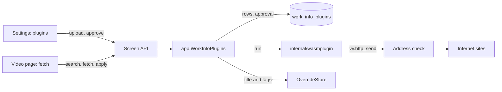
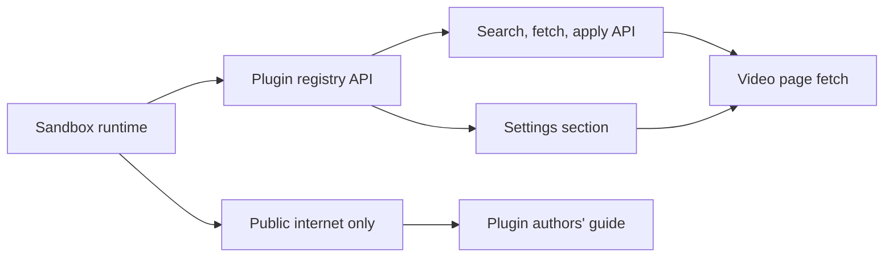

# Implementation Plan: Work-info plugins that fetch work information from external services

**Branch**: `feature/049-work-info-plugins` | **Parent Issue**: #968

**Input**: The parent Issue. It is this feature's specification.

## Summary

The owner uploads a work-info plugin, a WebAssembly module, on the settings
screen and approves it; on the video page they search with it or give it a
work's URL, compare the fetched title and tags with the current ones, and apply
the fields they select. vv runs each plugin inside the process with wazero, as
a WASI command with no files, no environment and fixed limits, and performs
the plugin's HTTP requests itself so that only public internet addresses are
reached. vv holds no code for any particular service.

The diagram shows the parts this feature adds and what each one talks to.



| Concern | Approach |
| --- | --- |
| Runtime | wazero in the process, pure Go ([R-1](research.md#r-1-wazero-runs-the-plugins-inside-the-vv-process)) |
| Plugin interface | WASI command, JSON on stdin and stdout, three `vv` host functions for HTTP ([R-2](research.md#r-2-a-plugin-is-a-wasi-command-that-reads-a-json-request-and-writes-a-json-response), [contracts/plugin-contract.md](contracts/plugin-contract.md)) |
| Name and version before approval | A `vv.plugin` custom section, read without running the module ([R-3](research.md#r-3-the-manifest-is-a-custom-section-read-without-running-the-module)) |
| Isolation and limits | No files, environment or arguments; 128 MiB, 30 s, 1 MiB output, one run at a time ([R-4](research.md#r-4-each-run-has-no-files-no-environment-and-fixed-limits)) |
| Network | vv's own HTTP client, address checked at every dial, a refused request fails the run ([R-5](research.md#r-5-plugins-reach-the-network-only-through-vv-and-only-public-addresses)) |
| Storage and approval | Blob rows; approved when the approved digest equals the module's digest; approving names the digest ([R-6](research.md#r-6-plugins-are-rows-in-sqlite-and-approval-is-bound-to-the-modules-digest), [R-7](research.md#r-7-approving-names-the-digest-the-owner-saw), [data-model.md](data-model.md)) |
| Fetch and apply | A 10-minute in-memory result bound to the video and the digest; title and tags applied in one transaction, skipped names reported ([R-8](research.md#r-8-a-fetched-result-lives-in-memory-for-10-minutes-bound-to-the-video-and-the-plugins-digest), [R-9](research.md#r-9-the-title-and-the-tags-are-applied-in-one-transaction-and-skipped-names-are-reported), [contracts/screen-api.md](contracts/screen-api.md)) |
| Plugin settings | Declared in the manifest, entered per plugin on the settings screen, passed only in that plugin's request; secret values never returned ([R-13](research.md#r-13-plugin-settings-are-declared-in-the-manifest-and-passed-only-in-that-plugins-request)) |
| Video page entry | Shown when the plugin list holds an approved plugin; candidates are text only ([R-10](research.md#r-10-search-candidates-are-text-only), [R-11](research.md#r-11-the-video-page-reads-the-plugin-list-to-decide-whether-to-show-the-fetch-action)) |

The Issue has the `ui` label, so the `design` stage writes `ui-design.md`
before the two screen units. It covers: the plugins section of the settings
screen (adding, the approval state and the approval prompt with the name,
version, network notice and the settings it receives, an invalid plugin
with its reason, entering setting values with secret ones never shown back,
revoking, deleting), and on the video page the secondary fetch action, choosing a
plugin, URL or search, the candidate list, the comparison rows with their
selection, the apply, the skipped-tag notice, and the failure and stale states.

Out of scope, as the parent Issue's `対象外` says: plugin sources and their
install, update and update notices; fetching on import, in bulk, and a review
queue; using a fetched image as the thumbnail; applying fields other than the
title and the tags; pages rendered by JavaScript; and any service's plugin,
the plugin SDK and samples; and LAN databases or local files as sources.

## Technical Context

**Canonical definitions**:

| Topic | Source |
| --- | --- |
| Boundaries, store roles, events, the authentication boundary, user data | [ARCHITECTURE.md](../../ARCHITECTURE.md), [.golangci.yml](../../.golangci.yml) |
| Port in `internal/app`, provider adapter behind it | [ai-layer.md](../../docs/design-docs/ai-layer.md) |
| Display name and its rule | [029 research](../029-video-overrides/research.md), [internal/domain/video_override.go](../../internal/domain/video_override.go), [internal/store/overrides.go](../../internal/store/overrides.go) |
| Tentative tags, rejected names, the tag-name rule | [031 research](../031-tentative-tags/research.md), [internal/domain/tag.go](../../internal/domain/tag.go), [internal/store/external_video_tags.go](../../internal/store/external_video_tags.go) |
| Multipart upload reading and blob storage | [046 research](../046-thumbnail-image-upload/research.md), [internal/httpapi/thumbnail_edits.go](../../internal/httpapi/thumbnail_edits.go) |
| Short-lived results in memory | [thumbnail-editing.md](../../docs/design-docs/thumbnail-editing.md) |
| Screen API, errors, generated code | [api/openapi.yaml](../../api/openapi.yaml), [023 error-api](../023-english-i18n/contracts/error-api.md), `task generate` |
| Settings screen, video page, screen rules, Web tests | [web/src/settings/](../../web/src/settings/), [web/src/player/VideoFacts.tsx](../../web/src/player/VideoFacts.tsx), [design-system.md](../../docs/design-docs/design-system.md), [web-testing.md](../../docs/design-docs/web-testing.md) |
| Checks | [Taskfile.yml](../../Taskfile.yml) (`task check`, `task check-docs`, `task test-e2e`) |

**Feature-specific context**:

- One new Go dependency, `github.com/tetratelabs/wazero`, which has no
  dependencies of its own and builds with `CGO_ENABLED=0` for the container
  and the Windows app ([R-1](research.md#r-1-wazero-runs-the-plugins-inside-the-vv-process)).
  No new Web dependency.
- One migration, `00043_work_info_plugins.sql`
  ([data-model.md, Migration](data-model.md#migration)).
- The first outbound HTTP in vv whose destination someone other than the
  owner's configuration chooses; the ComfyUI and Ollama clients reach LAN
  addresses on purpose and keep doing so. The address check lives only in
  the plugin adapter.
- The tests and the browser test build their plugins with
  `GOOS=wasip1 GOARCH=wasm` from sources under
  `internal/wasmplugin/testdata/`
  ([R-12](research.md#r-12-test-plugins-are-built-from-go-sources-when-the-tests-run)).

## Constitution Check

| Rule (source) | Verdict |
| --- | --- |
| Adapters import neither each other nor `internal/app`; `internal/app` imports no adapter (ARCHITECTURE.md, depguard) | Pass: `internal/wasmplugin` is a new adapter importing only `internal/domain`; `internal/app` declares the runtime port; depguard gains the package in the adapter rules |
| Store roles; work spanning roles runs in one transaction through package-private helpers (ARCHITECTURE.md) | Pass: a new `WorkInfoPluginStore` role owns the plugin rows; the apply is one `OverrideStore` operation reusing the package-private display-name and tag helpers ([R-9](research.md#r-9-the-title-and-the-tags-are-applied-in-one-transaction-and-skipped-names-are-reported)) |
| Events after commit (ARCHITECTURE.md) | Pass: the apply publishes the existing `VideoOverrideChanged` after its commit; plugin rows publish nothing, because only the settings screen and the open video page read them, and both re-read the list |
| User data survives a rebuild (ARCHITECTURE.md) | Pass: plugin rows have no link to videos; the apply writes the display name and tags under their existing keys |
| Every read knows its viewer (ARCHITECTURE.md) | Pass: every new route is owner only and absent from `accessRoutes`; the screens render the entries for the owner only (acceptance 7) |
| One owner for opening files (ARCHITECTURE.md) | Pass: plugins open no file; the module lives in SQLite |
| Do not hand-edit generated files (AGENTS.md) | Pass: `api/openapi.yaml` changes, then `task generate` |
| Complexity 25 or less; share code instead of copying it (AGENTS.md) | Pass: the upload reuses the multipart reader of 046; the apply reuses the display-name and tag helpers |
| Read design-system.md before a screen; test at the lowest level (AGENTS.md, web-testing.md) | Pass: limits, the address rule and manifest rules get Go unit tests, runs get adapter tests with built plugins, routes get handler tests, the screens page tests, the whole flow one browser test |
| Documentation with the change; design documents linked from the index (AGENTS.md, core-beliefs.md) | Pass: each unit names the document it adds or updates |

No violation, so no complexity tracking. The verdicts hold after Phase 1.

## Project Structure

### Documentation (this feature)

```text
specs/049-work-info-plugins/
├── plan.md
├── research.md
├── data-model.md
├── quickstart.md
└── contracts/
    ├── plugin-contract.md
    └── screen-api.md
```

`ui-design.md` is written by the `design` stage. `quickstart.md` exists
because CI's plugins never reach the internet and CI does not run the Windows
app.

### Source Code

**Affected boundaries**:

| Boundary | What it owns in this feature |
| --- | --- |
| `internal/domain` | The manifest with its setting declarations and its rules, plugin state and problems, the run request and result types, the limits, the run failures, the fetched result |
| `internal/wasmplugin` (new adapter) | Inspecting a module, running it in wazero with the limits, the `vv` host functions, the HTTP client and its address check |
| `internal/store` | The migration, `WorkInfoPluginStore`, the apply operation on `OverrideStore` |
| `internal/app` | `WorkInfoPlugins`: upload, approve, revoke, delete, search, fetch with its result cache, apply; the runtime port |
| `internal/httpapi`, `api/openapi.yaml` | The routes of [contracts/screen-api.md](contracts/screen-api.md), `Error.pluginMessage` and `Error.host` |
| `cmd/mdm` | Wiring the runtime, the store role and the use case |
| `web/src/api`, `web/src/settings`, `web/src/player`, `web/src/i18n` | Client functions, the plugins section, the fetch dialog, the catalog text |
| `web/e2e` | The browser test |
| `docs/`, `ARCHITECTURE.md`, `.golangci.yml` | The design document, the plugin authors' guide, the subsystem map and adapter list, depguard |

**New paths**: `internal/wasmplugin/`, `internal/wasmplugin/testdata/`,
`internal/store/migrations/00043_work_info_plugins.sql`,
`internal/store/work_info_plugins.go`, `internal/app/work_info_plugins.go`,
`internal/httpapi/work_info_plugins.go`,
`web/src/settings/WorkInfoPluginsSection.tsx`,
`web/src/player/workInfoFetch/`, `web/e2e/work-info-plugins.e2e.ts`,
`docs/design-docs/work-info-plugins.md`, `docs/how-to/work-info-plugins.md`.

**Structure decision**: The runtime and the HTTP client with its address
check are one adapter, `internal/wasmplugin`, because the client exists only
to serve the host functions and adapters may not import each other; the
existing provider adapters keep their own unrestricted clients. The fetch
dialog is its own directory under `web/src/player/` beside `thumbnailEdit/`,
as 046 did for the upload entry.

## Implementation Work

The diagram shows which units have to land first. The two screen units also
wait for the `design` stage's `ui-design.md`.



### Run work-info plugins in a WebAssembly sandbox

**Scope**: Add wazero and the adapter `internal/wasmplugin` with depguard and
ARCHITECTURE.md entries; inspecting a module (compile, the `vv.plugin`
manifest with its setting declarations, imports, the `_start` and `memory` exports and their types, the tables' total size of at most 100,000 elements, with a table without a declared maximum capped at 100,000 elements before compiling) into a manifest or a problem; running a fresh
instance per run with the request on stdin and the response from stdout, no
files, environment or arguments, the limits and the one-run slot of
[R-4](research.md#r-4-each-run-has-no-files-no-environment-and-fixed-limits);
the domain types and run failures; the `vv` host functions registered but
answering `-1` until the next unit; the fixture build helper of
[R-12](research.md#r-12-test-plugins-are-built-from-go-sources-when-the-tests-run);
`docs/design-docs/work-info-plugins.md` (sandbox and limits) linked from the
index.

**Dependencies**: None.

**Acceptance**: `task check` and `task check-docs` pass, and
`task build-windows-check` builds; adapter tests with built plugins show an
echo plugin's response read back, a plugin that loops forever stopped at 30 s
and a plugin that grows its memory stopped at 128 MiB, each with its failure
and the next run succeeding, a plugin writing 2 MiB stopped with
`output_too_large`, a plugin opening `/etc/hostname` or reading an environment
variable getting nothing, and a second concurrent run refused after 10 s;
inspection tests show each `problem` of
[data-model.md](data-model.md#work_info_plugins) for its malformed module
(a duplicate setting key and an 11th setting declaration, a `_start` with a parameter, no exported `memory`, a table whose minimum is
over 100,000 elements, one whose declared maximum is 1,000,000, and three
tables each declaring a maximum of 40,000 included)
and a manifest for a good one, without running it; a table without a declared
maximum, as Go's `wasip1` linker writes it, is accepted, and a module whose
table declares no maximum and whose `_start` grows it by 100,000 and then by
one more element gets `-1` from the second `table.grow`.

### Let work-info plugins reach public internet sites only

**Scope**: The `vv.http_send`, `vv.http_meta` and `vv.http_body` host
functions of [contracts/plugin-contract.md, Host functions](contracts/plugin-contract.md#host-functions);
vv's HTTP client with the dial-time address check, redirect handling, no
environment proxy, and the per-run request, time and size limits; a refused
request failing the run with `blocked_address` and the host
([R-5](research.md#r-5-plugins-reach-the-network-only-through-vv-and-only-public-addresses));
the network section of the design document.

**Dependencies**: Run work-info plugins in a WebAssembly sandbox.

**Acceptance**: `task check` and `task check-docs` pass; unit tests show the
address rule refusing one address from every range of R-5's table
(`0.0.0.0/8` and `fec0::/10` included), IPv4-mapped forms included, and
accepting a public IPv4 and IPv6 address; adapter tests with an injected resolver show a
plugin fetching a page through vv, a request to `127.0.0.1`, to a LAN
address, and to a public name that redirects or resolves to a LAN address
each failing the run with `blocked_address` and the host even when the plugin
ignores the error, and the 17th request, a 5 MiB body and an 11 s response
answered with their error codes.

### Add, approve and remove work-info plugins through the screen API

**Scope**: The migration and `WorkInfoPluginStore` with both tables
([data-model.md](data-model.md)); `app.WorkInfoPlugins` for upload (inspect,
store, replace by name keeping the values of still-declared settings),
approve with the digest, revoke, delete and writing setting values
([R-13](research.md#r-13-plugin-settings-are-declared-in-the-manifest-and-passed-only-in-that-plugins-request)); the
routes `GET`/`POST /api/work-info-plugins`, `PUT`/`DELETE …/{id}/approval`,
`PUT …/{id}/settings` and `DELETE …/{id}` with the multipart reader shared with 046
([contracts/screen-api.md](contracts/screen-api.md)); the client functions;
wiring in `cmd/mdm`; the plugin table in running-vv.md's Data and recovery.

**Dependencies**: Run work-info plugins in a WebAssembly sandbox.

**Acceptance**: `task check` and `task check-docs` pass with no diff from
`task generate`; store and app tests show an upload listed as `unapproved`,
approval with the listed digest making it `approved`, a same-name upload
making it `unapproved` again with the new digest, approval with the old
digest answered `plugin_changed`, a broken file listed as `invalid` with its
problem and refused with `plugin_unusable`, revoke and delete, a setting
value written while the plugin stays `approved`, a replacement keeping the
value of a still-declared key and deleting one no longer declared, and
deleting a plugin deleting its values; handler tests show a 17 MiB part
answered `413` `plugin_too_large`, an undeclared key answered `400`, a secret
value absent from every response body while `set` is `true`, and every route
answering `403` to a guest.

### Manage work-info plugins on the settings screen

**Scope**: `WorkInfoPluginsSection` on the settings page as
`ui-design.md` specifies: the list with state, name, version or file name,
problem, the network notice, the settings the plugin receives, entering
setting values with secret ones never shown back, add, approve, revoke and
delete; catalog text.

**Dependencies**: Add, approve and remove work-info plugins through the screen
API; the `design` stage.

**Acceptance**: `task check` passes; page tests show an added plugin listed
as unapproved with its name, version and network notice, approval switching
it to approved, an invalid plugin showing its reason with no approve action,
a secret setting saved and then shown only as set, and a failed request shown
in the section; the screen is checked visually at
the widths `ui-design.md` names.

### Search, fetch and apply work information through the screen API

**Scope**: In `app.WorkInfoPlugins`, search and fetch through the runtime
port, only for approved plugins with the declared operation, with that
plugin's setting values in the request and `plugin_settings_missing` before
the run when a required one is unset, the 10-minute
result cache bound to video and digest
([R-8](research.md#r-8-a-fetched-result-lives-in-memory-for-10-minutes-bound-to-the-video-and-the-plugins-digest)),
and the apply with tag names filtered by the tag-name rule; the
`OverrideStore` operation re-reading the plugin row's digest and approval,
then writing the display name and tentative tags in one transaction and
reporting rejected names
([R-9](research.md#r-9-the-title-and-the-tags-are-applied-in-one-transaction-and-skipped-names-are-reported));
the search, fetch and apply routes, `Error.pluginMessage`, `Error.host` and
`Error.settingKeys`
([contracts/screen-api.md](contracts/screen-api.md)); the client functions.

**Dependencies**: Add, approve and remove work-info plugins through the screen
API.

**Acceptance**: `task check` passes with no diff from `task generate`; app
and store tests with a fake runtime show search candidates returned, a run
request carrying the plugin's own setting values and none of another
plugin's, a missing required setting answered `plugin_settings_missing`
without calling the runtime, a fetch
leaving the video unchanged, applying only `title` and `tags` changing the
display name and adding the tags as tentative with nothing else changed, a
rejected name and an invalid name reported in `skippedTags` and not attached,
a failed apply leaving both fields unchanged, an unapproved plugin answered
`plugin_not_approved`, applying after 10 minutes, after a replacement and
after a revoke answered `work_info_fetch_stale`, a store test where the
plugin is replaced after the app's check but before the apply's transaction
writing nothing and answering `work_info_fetch_stale`; handler tests show each run
failure of the contract with its status and fields, and every route answering
`403` to a guest.

### Fetch work information from a plugin on the video page

**Scope**: The fetch action and dialog in `web/src/player/workInfoFetch/` as
`ui-design.md` specifies: shown to the owner only when an approved plugin is
listed ([R-11](research.md#r-11-the-video-page-reads-the-plugin-list-to-decide-whether-to-show-the-fetch-action)),
plugin choice, URL or search, candidates, comparison rows, apply, the
skipped-tag notice and the failure and stale states; catalog text; the browser
test `web/e2e/work-info-plugins.e2e.ts` with a fixture plugin that answers
from canned data without the network and declares a required secret
setting.

**Dependencies**: Search, fetch and apply work information through the screen
API; Manage work-info plugins on the settings screen; the `design` stage.

**Acceptance**: `task check` passes and CI's `Browser E2E` passes with the new
test, which adds the fixture plugin on the settings screen, enters its
secret setting, sees the fetch action absent before approval and present
after, searches, picks a candidate,
applies only the title and the tags, and sees the new display name and the
tentative tags, one of which the fixture returns only when it received the
secret value; page tests show no fetch action for a guest or without an
approved plugin, a field without a value not selectable, a plugin failure
and a stale result each shown with the video unchanged; the screen is checked
visually at the widths `ui-design.md` names.

### Publish the work-info plugin contract for plugin authors

**Scope**: `docs/how-to/work-info-plugins.md`: building a `wasip1` module,
adding the `vv.plugin` section with setting declarations, the request with its settings, the response and host functions, the
limits and the address rule, moved from
[contracts/plugin-contract.md](contracts/plugin-contract.md), which then links
there; a link from external-api.md's integration example to it.

**Dependencies**: Let work-info plugins reach public internet sites only.

**Acceptance**: `task check-docs` passes; the guide is listed in the
documentation site's how-to index, and the contract file in this directory
links to it instead of restating it.
