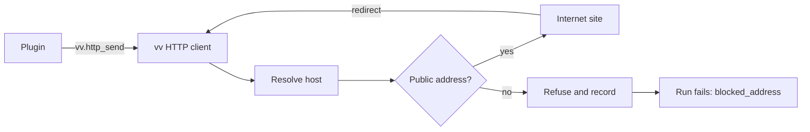

# Research: Work-info plugins

Inherited decisions: [ARCHITECTURE.md](../../ARCHITECTURE.md) (boundaries,
store roles, the authentication boundary),
[tech-stack-selection.md](../../docs/design-docs/tech-stack-selection.md)
(pure Go, `CGO_ENABLED=0`, one process),
[ai-layer.md](../../docs/design-docs/ai-layer.md) (a port in `internal/app`,
a provider adapter behind it), the tentative-tag and rejected-name rules of
[031](../031-tentative-tags/research.md), and the display-name rule of
[029](../029-video-overrides/research.md). This file records only the
decisions this feature adds.

## R-1: wazero runs the plugins inside the vv process

**Decision**: Plugins run in `github.com/tetratelabs/wazero` (v1.12.0 at the
time of writing), a WebAssembly runtime written in pure Go with no
dependencies of its own, inside the vv process.

| Option | Pure Go (`CGO_ENABLED=0`, Windows cross-build) | Limits time and memory per run | Verdict |
| --- | --- | --- | --- |
| **wazero** | Yes | Yes: a memory page cap per runtime, and closing the module when its context ends | Chosen |
| wasmtime-go, wasmer-go | No: both link a C library | Yes | Rejected: every build of vv, the Windows app included, runs with CGO disabled |
| Extism Go SDK (on wazero) | Yes | Yes | Rejected: adds its own ABI and framework dependency, and its built-in HTTP filters by host name, so [R-5](#r-5-plugins-reach-the-network-only-through-vv-and-only-public-addresses) would replace it anyway |
| A separate process per run (container or OS sandbox) | Depends on the OS | Through the OS | Rejected: the container and the Windows app would need different sandboxes, and the WebAssembly prototype already shows the in-process sandbox covers the Issue |

**Rationale**: A WebAssembly module can call nothing the host does not hand
it, so the sandbox is the list of imports vv provides, the same on Linux and
Windows. wazero compiles to machine code on amd64 and arm64 and interprets
elsewhere; a compiled module is cached in memory by its digest.

## R-2: A plugin is a WASI command that reads a JSON request and writes a JSON response

**Decision**: A plugin is a `wasip1` command module. Each run starts a fresh
instance, writes one JSON request to its standard input, and reads one JSON
response from its standard output; network access is host functions in the
`vv` import module ([contracts/plugin-contract.md](contracts/plugin-contract.md)).

| Option | What a plugin author writes | Verdict |
| --- | --- | --- |
| **WASI command, JSON on stdin and stdout, `vv` host functions for HTTP** | Ordinary sequential code; Go (`GOOS=wasip1`), TinyGo and Rust (`wasm32-wasip1`) build it unchanged | Chosen |
| A pure step protocol: the plugin outputs the requests it wants, vv runs it again with the responses | A state machine whose state round-trips through JSON | Rejected: every multi-page scrape becomes a hand-written continuation, and each step re-instantiates the module |
| Extism's ABI | Code against Extism's PDK | Rejected with Extism in [R-1](#r-1-wazero-runs-the-plugins-inside-the-vv-process) |
| The WebAssembly component model (WASI 0.2) | Generated bindings | Rejected: wazero does not run components |

**Rationale**: Standard input and output need no vv-specific code, so the only
part of the contract an author learns is the request and response shape and
three host functions. A fresh instance per run means no state leaks between
runs or between videos.

## R-3: The manifest is a custom section read without running the module

**Decision**: A plugin carries its name, version, description, contract
version and operations as JSON in a custom section named `vv.plugin`; vv reads
it, compiles the module and checks its imports at upload, and never runs a
module the owner has not approved.

| Option | Runs unapproved code | Verdict |
| --- | --- | --- |
| **Custom section** | No | Chosen |
| A `describe` operation run at upload | Yes | Rejected: requirement 2 shows the name and version before approval, so they would come from code the owner has not approved |
| A manifest file uploaded beside the module | No | Rejected: two files that can disagree, and requirement 1 adds one file |

## R-4: Each run has no files, no environment, and fixed limits

**Decision**: A run gets no preopened directory, no environment variables and
no arguments, and is stopped at the first limit it reaches; the codes the
screen sees are in
[contracts/screen-api.md, Run failures](contracts/screen-api.md#run-failures).

| Limit | Value | When it is reached |
| --- | --- | --- |
| Module size | 16 MiB | The upload is refused (`plugin_too_large`) |
| Linear memory | 128 MiB (2048 pages) | The run traps |
| Tables | 100,000 elements across all of a module's tables; a table without a declared maximum gets a maximum of 100,000 from vv before compiling | The upload is refused (`table_too_large`) when the tables sum to more than 100,000, each counted at its declared maximum or, without one, at the larger of its minimum and 100,000 |
| Run time | 30 s, HTTP included | The module is closed |
| Standard output | 1 MiB | The run is stopped |
| Standard error | 64 KiB kept, the rest discarded | Written to the server log only |
| Runs at the same time | 1; a second run waits up to 10 s | The second run is refused |

**Rationale**: Table elements are host memory outside wazero's page cap,
and wazero allows up to 2^27 tables per module, so vv bounds the module's
total of 100,000 elements and caps a table without a maximum, as Go's
`wasip1` linker writes it (`writeTableSec` in
`cmd/link/internal/wasm/asm.go`), at 100,000 before compiling; other
compile-time allocations grow with the module, which the 16 MiB cap bounds.
One run at a time keeps the plugins' memory within one module's 128 MiB,
which a single-owner server can spare and which gives the Go `wasip1` heap
room to parse a 1 MiB page (64 MiB was too tight). Go's runtime
needs a clock and a random source, and neither reaches outside the process.

## R-5: Plugins reach the network only through vv, and only public addresses

**Decision**: vv performs every HTTP request for the plugin and checks each
resolved address when it dials, so a redirect or a DNS answer that points at
vv or the LAN fails; a refused request fails the whole run with
`blocked_address`, whatever the plugin returns.

The diagram shows the path of one plugin request.

A dial is allowed only to an address, after unmapping an IPv4-mapped IPv6
address, that is global unicast and lies in no range of the IANA IPv4 and IPv6
Special-Purpose Address Registries whose "Globally Reachable" is not `True`;
`0.0.0.0/8`, `240.0.0.0/4`, `100.64.0.0/10`, `fc00::/7` and `100::/64` are
examples. Beyond the registries, vv also refuses `fec0::/10` (deprecated
site-local, still routed on some LANs), the prefixes that embed an IPv4
address (`64:ff9b::/96`, `64:ff9b:1::/48`, `2002::/16`, `2001::/32`), and the
addresses of the server's own interfaces. The ranges are one table in
`internal/wasmplugin`, and a test dials one address from each.

| Option | Survives DNS rebinding and redirects | Verdict |
| --- | --- | --- |
| **Check in the dialer's control hook, after resolution, on every connection** | Yes | Chosen |
| Resolve and check the host name before the request | No: the second resolution can differ, and a redirect skips the check | Rejected |
| A host-name allowlist per plugin | No: a public name can resolve to a LAN address | Rejected |
| Return the refusal to the plugin only | — | Rejected: a plugin can swallow it, and acceptance 5 requires the owner to see the failure |
| Honour `HTTP_PROXY` from the environment | No: the dial check would see only the proxy | Rejected |

Per run, vv allows 16 requests, `GET` and `POST`, `http` and `https`, 5
redirects per request, 10 s per request, 1 MiB of response headers and 4 MiB
per response body. The body reaches the plugin as bytes with the response
headers, so the plugin decodes the page's character set itself (vv cannot know
it before parsing the page).

## R-6: Plugins are rows in SQLite, and approval is bound to the module's digest

**Decision**: Each plugin is a row of `work_info_plugins` holding the module
as a blob and its SHA-256 digest; the plugin is approved exactly when
`approved_digest` equals `digest` ([data-model.md](data-model.md)).

| Option | Verdict |
| --- | --- |
| **Blob row with an approved digest** | Chosen |
| Module files under `MDM_DATA_DIR/plugins` with rows beside them | Rejected: the file and the row can disagree after a crash, and `internal/artifacts` owns only rebuildable files; 046 keeps uploaded images as blobs for the same reason |
| An `approved` flag cleared on replacement | Rejected: any write path that forgets to clear it approves unseen code; with a digest, replacement un-approves by construction (requirement 3) |

## R-7: Approving names the digest the owner saw

**Decision**: The approve request carries the digest from the list the owner
looked at, and fails with `plugin_changed` when the stored module has another
digest.

| Option | Verdict |
| --- | --- |
| **Approve with the digest** | Chosen |
| Approve the current module | Rejected: a replacement between opening the list and pressing approve would approve a module the owner never saw |

## R-8: A fetched result lives in memory for 10 minutes, bound to the video and the plugin's digest

**Decision**: A fetch answers with a result id; the result stays in memory for
10 minutes, and applying it fails with `work_info_fetch_stale` when it has
expired, was dropped by a restart, or the plugin's digest, approval or
`generation` ([data-model.md](data-model.md)) has changed since. A result
records all three when it is fetched, so re-approving the same digest after a
fetch still leaves the earlier result stale.

| Option | Verdict |
| --- | --- |
| **In-memory result with an id** | Chosen |
| The client sends the fetched values back with the apply | Rejected: the server cannot then tell a stale result from a fresh one, which the Issue's edge cases require |
| A SQLite table of results | Rejected: nothing about a result needs to outlive a restart; the owner fetches again |

The digest and the approval alone cannot tell a fetch made before a revoke
and re-approval, or before a replacement with the same bytes, from one made
after it; `generation` grows on each replacing upload and each revoke, and
re-approving needs one of them first. The apply re-reads the plugin row's
digest, approval and `generation` inside its own transaction, so a
replacement, revocation or deletion that commits between the check in
`internal/app` and the write still makes the apply stale.

**Rationale**: The same shape as the thumbnail edit sessions
([thumbnail-editing.md](../../docs/design-docs/thumbnail-editing.md)), with a
fixed lifetime because the external page, not the owner's activity, is what
goes stale.

## R-9: The title and the tags are applied in one transaction, and skipped names are reported

**Decision**: One store operation writes the selected title as the display
name and attaches the selected tags as tentative tags in one transaction; vv
drops names that break the tag-name rule before the store and reports them as
`invalid`, and the store skips rejected names as it does for the external API
and reports them as `rejected`.

| Option | Verdict |
| --- | --- |
| **One transaction, invalid names filtered first** | Chosen |
| The existing `SetDisplayName` and `ApplyVideoTags` one after the other | Rejected: a failure of the second leaves half of what the owner selected applied |
| Fail the apply on the first invalid tag name, as the external API does | Rejected: the Issue's edge case skips the name and tells the owner |

## R-10: Search candidates are text only

**Decision**: A candidate carries the work's ID, a title and an optional
detail line; no image. (The ID replaced a URL when parent Issue #1232 made
every fetch take an ID only.)

| Option | Verdict |
| --- | --- |
| **Text only** | Chosen |
| A remote image per candidate | Rejected: the browser would load it from the third-party site, revealing the viewer to it, and fetched images are out of scope in the Issue |

## R-11: The video page reads the plugin list to decide whether to show the fetch action

**Decision**: The video page reads `GET /api/work-info-plugins` and shows the
fetch action only when an approved plugin is in it (requirement 10).

| Option | Verdict |
| --- | --- |
| **The plugin list** | Chosen |
| A readiness endpoint like `GET /api/thumbnail-edits/readiness` | Rejected: the dialog needs the approved plugins' names and operations anyway, and the list is a few rows |

## R-12: Test plugins are built from Go sources when the tests run

**Decision**: The Go tests and the browser test build their fixture plugins
from Go sources with `GOOS=wasip1 GOARCH=wasm` and add the `vv.plugin` section
with a small helper; no `.wasm` file is checked in.

| Option | Verdict |
| --- | --- |
| **Build from source at test time** | Chosen |
| Commit the `.wasm` fixtures | Rejected: binary files cannot be reviewed, and a fixture would drift from its source |

## R-13: Plugin settings are declared in the manifest and passed only in that plugin's request

**Decision**: A plugin declares the settings it needs (an API key, a
language) in its manifest; the owner enters the values on the settings
screen; vv stores them per plugin and passes them only to that plugin's runs,
as `settings` in the request JSON
([contracts/plugin-contract.md, Request](contracts/plugin-contract.md#request)).

| Option | Verdict |
| --- | --- |
| **Declared in the manifest, passed in the request JSON** | Chosen |
| WASI environment variables per plugin | Rejected: requirement 7 keeps the environment out of reach, and an always-empty environment is the simplest rule to test; the JSON also carries the declaration's `secret` and `required` |
| Values built into the module | Rejected: changing a key means rebuilding, replacing and approving again, which is why requirement 11 exists |
| Encrypting stored values | Rejected: the key would sit beside the database in the same data directory; the ComfyUI API key is stored the same way |

| Case | Behaviour |
| --- | --- |
| A value marked `secret` | Written by the owner, never returned by the API or shown on the screen; the list says only whether it is set |
| A value is changed | Approval stays, since it is bound to the module's digest ([R-6](#r-6-plugins-are-rows-in-sqlite-and-approval-is-bound-to-the-modules-digest)) |
| The plugin is replaced | Values of keys the new manifest still declares are kept; the others are deleted in the same transaction |
| A `required` value is missing | Search and fetch fail with `plugin_settings_missing` before the module runs |
| The server log | Never contains a value; standard error is the plugin's own output and is logged as written |

**Rationale**: Most external work-information databases need a key
(the Issue's `背景`), and a per-plugin store keeps one plugin's key out of
every other plugin's run. A plugin can still send its own key to any public
site; the approval prompt names the settings it receives (requirement 2), and
that choice stays with the owner.
