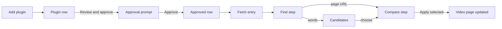
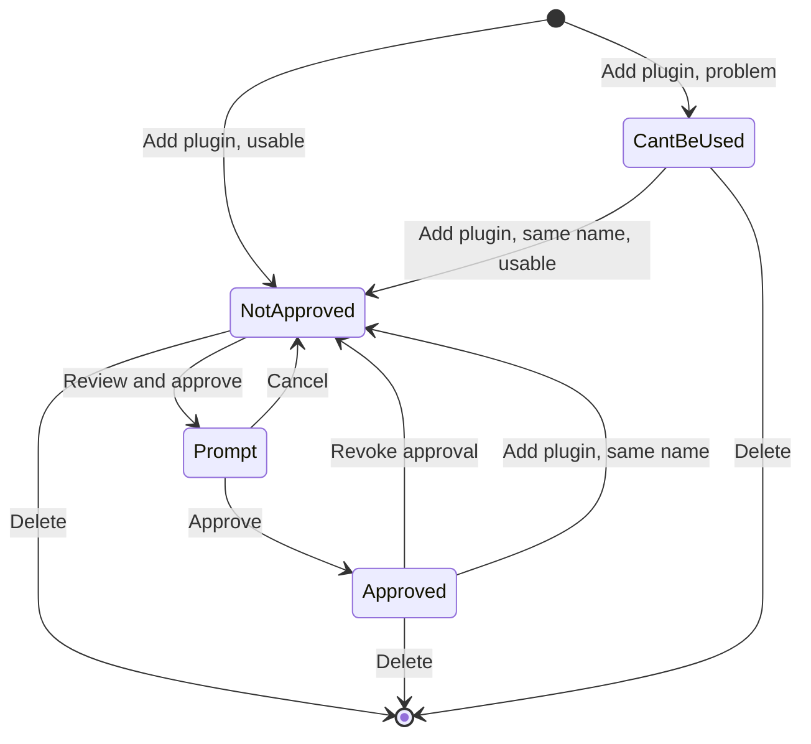
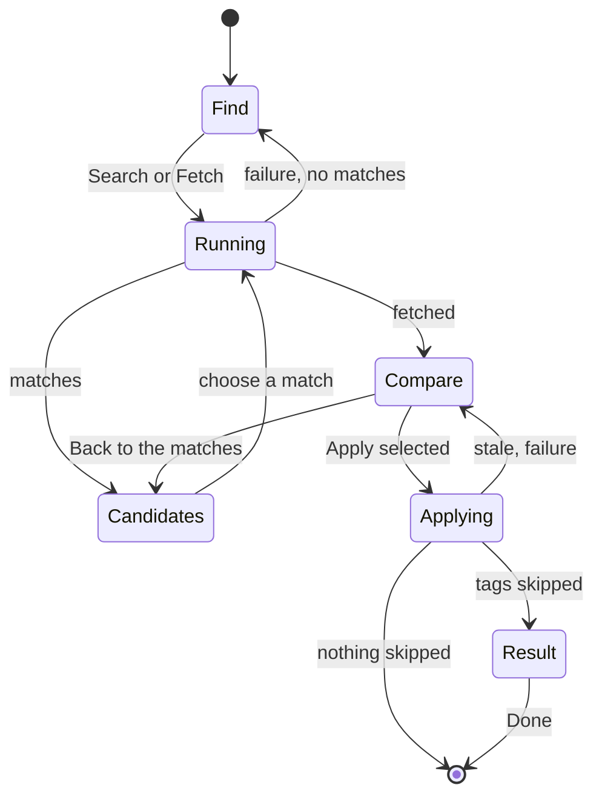

# UI design: Work-info plugins that fetch work information from external services

**Feature**: [parent Issue #968](https://github.com/syudead/vv/issues/968) ·
[plan.md](plan.md) · [contracts/screen-api.md](contracts/screen-api.md) ·
[data-model.md](data-model.md) ·
[research.md R-7](research.md#r-7-approving-names-the-digest-the-owner-saw) ·
[R-8](research.md#r-8-a-fetched-result-lives-in-memory-for-10-minutes-bound-to-the-video-and-the-plugins-digest) ·
[R-9](research.md#r-9-the-title-and-the-tags-are-applied-in-one-transaction-and-skipped-names-are-reported) ·
[R-10](research.md#r-10-search-candidates-are-text-only) ·
[R-11](research.md#r-11-the-video-page-reads-the-plugin-list-to-decide-whether-to-show-the-fetch-action) ·
[R-13](research.md#r-13-plugin-settings-are-declared-in-the-manifest-and-passed-only-in-that-plugins-request)

Sources that already decide things, linked rather than repeated here:

| Topic | Source |
| --- | --- |
| Tokens, closed scales, library and video-page density | [design-system.md, Foundations](../../docs/design-docs/design-system.md#foundations); the values in `@theme` of [`web/src/ui/tokens.css`](../../web/src/ui/tokens.css), named here and never copied |
| `SettingsPage`, `PageSection`, `FactList`, `FormDialog`, `ConfirmDialog`, `EmptyState`, `ErrorState` | [patterns.md](../../web/registry/rules/patterns.md) |
| `Button`, `Input`, `Field`, `Select`, `Checkbox`, `Badge`, `Alert`, `DropdownMenu`, `Skeleton`, `Spinner`, `Tooltip`, `TentativeMark` | [components.md](../../web/registry/rules/components.md) |
| A settings list with per-row actions, its failure line and its delete confirmation | The media folders section in [`SettingsPage.tsx`](../../web/src/settings/SettingsPage.tsx); [`APITokensSection.tsx`](../../web/src/settings/APITokensSection.tsx) |
| A write-only secret field and its "saved" hint | The ComfyUI API key, [045 UI design, Settings: ComfyUI section](../045-comfyui-thumbnails/ui-design.md#settings-comfyui-section) |
| A section reached by `/settings#<id>`, a guide link after the description | [`useSectionAnchor.ts`](../../web/src/settings/useSectionAnchor.ts), [`docsLinks.ts`](../../web/src/settings/docsLinks.ts) |
| The video page's information rows, their action group, the one failure line | [library-ui.md, Information rows](../../docs/design-docs/library-ui.md#information-rows) |
| Tentative tags and their mark | [031 UI design](../031-tentative-tags/ui-design.md) |
| Width breakpoints in CSS; layout checked by people | [library-ui.md, Width breakpoints](../../docs/design-docs/library-ui.md#width-breakpoints-in-css-and-the-sidebar-exception), [Layout verified by people](../../docs/design-docs/library-ui.md#layout-verified-by-people-not-machines) |
| Screen text | [`web/src/i18n/en.ts`](../../web/src/i18n/en.ts); this feature adds `settings.workInfoPlugins`, `player.workInfoFetch` and the error reasons below |

This feature adds two things, both for the owner only (acceptance criterion 7):

1. A **Work-info plugins section** in Settings: adding a plugin file, its
   state, the approval prompt, the setting values, revoking and deleting
   (requirements 1 to 3 and 11, acceptance criteria 1, 2 and 8).
2. A **fetch entry** among the video page's information-row actions and the
   **fetch dialog** it opens: search or a page URL, the candidates, the
   comparison, and the apply of the selected fields (requirements 4 to 6 and
   10, acceptance criteria 3 to 6).

The diagram shows the parts and where each action leads.

Unchanged: the player, the title and its pencil, the tags and their
suggestions, `Edit details` and its editor, the other information-row
actions, every other settings section, and every other screen, which show the
applied title and tags through the existing `Video`.

## Why this shape

The plugins are **one more settings section**, because adding, approving and
configuring a plugin is set-up the owner does once, like the ComfyUI
connection; the video page only uses what Settings has approved. Each plugin
is a row in the media folders section's form, led by its **state badge**, so
the state is the first thing read in every row (the Issue's `UI品質`).
Approval opens an **approval prompt**, a `FormDialog` that gathers everything
the owner is trusting in one view before the `Approve` button: the name and
version, what the plugin can do, the internet notice, the settings it
receives and the file's SHA-256. Approving inside the row was rejected: the
row has room for one line of each, and the network notice would compete with
the row's other text; a dialog also fixes the digest the owner approves to
the one shown ([R-7](research.md#r-7-approving-names-the-digest-the-owner-saw)).

Setting values are entered in a **settings dialog** per plugin, a
`FormDialog`, because the values of one plugin are saved together and
[patterns.md, Settings page](../../web/registry/rules/patterns.md#settings-page)
puts a group of values saved together in a `FormDialog`. A secret field is
always empty and says whether a value is saved, as the ComfyUI API key does.

On the video page the entry is **one more icon button in the action group**,
after `Edit details`, because fetching work information is another way of
filling the same details, at the same weight as its neighbours and quieter
than the title and the tags (the Issue's `UI品質`). It opens a **fetch
dialog** with two steps in one window: finding the work, then comparing.
A full-screen editor was rejected: the comparison is two rows today, and the
owner should still see the page behind it. Store and media-manager products
(music taggers, media servers' "fix match") converge on the same form:
search or paste a link, pick a match, review the fields, apply.

The find step has **one field for words or a page URL**: text that parses as
an `http` or `https` URL is fetched directly, anything else is searched. A
separate search/URL switch was rejected because the input already tells
which one the owner means, and the switch would be a control to read before
every fetch.

The comparison is **one row per field with a checkbox, the current value and
the fetched value side by side**, the fetched value in the body colour and the
current one muted, so what will be written reads first (the Issue's
`UI品質`). Fields that have a value and differ start selected: the owner sees
every selected row before pressing `Apply selected`, and deselecting is one
press; fields without a value cannot be selected (the Issue's edge cases).
Side by side needs more width than `FormDialog`'s `max-w-lg`, so the dialog
uses a new wide size ([Changes to the design system](#changes-to-the-design-system)).

When the apply skipped tag names, the dialog stays open on a **result step**
that lists them, because a toast can disappear before the owner reads which
names were left out; an apply that skipped nothing closes the dialog, and the
page's new title and tags are the confirmation.

## Words

The English is the draft the catalog takes; after implementation
[`web/src/i18n/en.ts`](../../web/src/i18n/en.ts) is canonical. The product
name on screen is `VVMDM`.

### Settings section text

| Place | Text | Notes |
| --- | --- | --- |
| Section title | Work-info plugins | Anchor `#work-info-plugins` |
| Section description | Plugins fetch work information from other sites for the video page. Approve a plugin before it can run. | Followed by the guide link |
| Guide link | How plugins work | To `docs/how-to/work-info-plugins` on the documentation site, new tab |
| Add button | Add plugin | `outline` `sm`, lucide `Upload` |
| Adding | Adding… | The add button's text while sending |
| Refused, too large | Choose a file up to 16 MB. | Before anything is sent |
| Add failed | Couldn't add the plugin: {reason} | Section failure line |
| Added (toast) | Added {name}. Approve it to use it. | `{name}` is the name, or the file name when there is none |
| Replaced (toast) | Replaced {name}. Approve it again to use it. | The upload was answered `200`; `201` shows Added, whatever the list held |
| Added, unusable (toast) | Added {name}, but it can't be used. | `state: invalid` |
| Empty | No plugins yet | `EmptyState` title |
| Empty hint | Add a .wasm plugin file to fetch titles and tags on the video page. | `EmptyState` description |
| Badge, approved | Approved | `success`, lucide `ShieldCheck` |
| Badge, unapproved | Not approved | `warning`, lucide `ShieldAlert` |
| Badge, invalid | Can't be used | `destructive`, lucide `CircleX` |
| Version | v{version} | After the name |
| Operations, search | Search | Joined by ` · ` |
| Operations, fetch | Fetch by ID or URL | |
| Internet notice (row) | Reaches internet sites | lucide `Globe` |
| Settings summary | Settings: {list} | `{list}` is each label, then `set` or `not set`, joined by `, ` |
| Required missing | Needs a value: {labels} | `warning` text with lucide `CircleAlert` |
| Approve button | Review and approve | `default` `sm`, only for `unapproved` |
| Settings button | Settings | `outline` `sm`, lucide `SlidersHorizontal`, only when the plugin declares settings and is not `invalid` |
| Row menu | More actions for {name} | `ghost` `icon-sm`, lucide `Ellipsis` |
| Row menu, revoke | Revoke approval | Only for `approved`; no confirmation |
| Row menu, delete | Delete | Destructive item; opens the delete confirmation |
| Row working | Revoking… · Deleting… | Muted status before the row's actions |
| Row failure | Couldn't change {name}: {reason} | Under the row |

### Invalid plugin reasons

One line under an `invalid` row, `text-destructive`, from its `problem`
([data-model.md, work_info_plugins](data-model.md#work_info_plugins)).

| `problem` | Text |
| --- | --- |
| `not_wasm` | The file isn't a WebAssembly module. |
| `manifest_missing` | The file has no plugin information for VVMDM. |
| `manifest_invalid` | The plugin information in the file is invalid. |
| `contract_unsupported` | The plugin is made for another version of VVMDM. |
| `import_unsupported` | The plugin asks for functions VVMDM doesn't offer. |
| `export_invalid` | The file isn't a plugin VVMDM can run. |
| `table_too_large` | The plugin asks for more memory tables than VVMDM allows. |

### Approval prompt text

| Place | Text | Notes |
| --- | --- | --- |
| Title | Approve {name}? | |
| Description | Approved plugins can run when you fetch work information on a video page. | |
| Facts | Version · File · Can · Description · SHA-256 | `FactList` terms; `Can` lists the operations, `Description` only when present |
| Internet notice title | This plugin can reach any site on the internet | `warning` `Alert`, lucide `Globe` |
| Internet notice body | It can send what it fetches and the values of its settings to those sites. VVMDM blocks its requests to VVMDM itself and to devices on your network. | |
| Settings heading | Settings it receives | |
| Setting row | {label} | With `Secret` and `Required` `secondary` badges when declared so |
| No settings | It receives no settings. | |
| Submit | Approve | |
| Changed meanwhile | The plugin was replaced while this was open. Close this and review it again. | `destructive` `Alert`; `Approve` disabled |

### Settings dialog text

| Place | Text | Notes |
| --- | --- | --- |
| Title | Settings for {name} | |
| Description | Values are sent only to this plugin when it runs. Changing them keeps the approval. | |
| Required mark | Required | Muted, after the label |
| Secret hint, saved | Saved. Type a new value to replace it. | |
| Secret hint, not saved | Not set. | |
| Forget a secret | Forget | `ghost` `sm`; only for a saved secret |
| Forgotten hint | Removed when you save. | With an `Undo` `link` button |
| Submit | Save | |
| Saved (toast) | Saved the settings for {name}. | |
| Save failed | Couldn't save the settings: {reason} | `destructive` `Alert` in the dialog |

### Delete confirmation text

| Place | Text | Notes |
| --- | --- | --- |
| Title | Delete {name}? | |
| Description | The plugin and the values of its settings are removed. Videos keep what was already applied. | |
| Action | Delete · Deleting… | `destructive` |
| Deleted (toast) | Deleted {name}. | |

### Video page text

| Place | Text | Notes |
| --- | --- | --- |
| Entry, name and tooltip | Fetch work info from a plugin | lucide `CloudDownload` |
| Dialog title | Fetch work info | |
| Dialog description | Nothing changes until you apply. | |
| Plugin label | Plugin | `Select` with several approved plugins; the name as text with one |
| Query label, words | Search words or the work's page URL | `Search words` when the plugin cannot fetch |
| Query label, ID | The work's ID or page URL | `ID` pressed, or a fetch-only plugin |
| Find by | Find by · Words · ID | `ToggleGroup` label and items, only for a plugin with `search` and `fetch` |
| Search button | Search | When the text is searched |
| Fetch button | Fetch | When the text is a URL or an ID |
| Running | Searching… · Fetching… | The button's text while the run lasts; a run can take up to 30 seconds |
| Candidates heading | {n} matches | |
| Candidate open link | Open page | `ghost` `icon-sm`, lucide `ExternalLink`, new tab |
| No candidates | No matches. Try other words, or choose ID and enter the work's ID. | The second sentence only when the plugin can fetch |
| Source line | From {plugin} · {host} | Muted, above the comparison; `{host}` links to the fetched URL, new tab. After a fetch by ID, `ID {id}` as text in place of the host |
| Back | Back to the matches | `ghost` `sm`, lucide `ArrowLeft`; only after a search |
| Column headings | Now · Fetched | |
| Field labels | Title · Tags | |
| No value | Not in the result | Muted; the row cannot be selected |
| Same value | Same as now | Muted; the row cannot be selected |
| Tag already on the video | On the video | Tooltip of a muted chip with lucide `Check` |
| New tag count | {n} new | Muted, after the fetched chips |
| More tags | +{n} more · Show fewer | `link` `sm`, as the work details row |
| Submit, compare | Apply selected | Disabled while nothing is selected |
| Applying | Applying… | |
| Applied (toast) | Applied to the video. | Only when nothing was skipped |
| Result title | Applied, but some tags were left out | `success` `Alert` for the applied part |
| Skipped, rejected | {name} — you rejected this tag before | One line per name |
| Skipped, invalid | {name} — not a valid tag name | One line per name |
| Submit, result | Done | Closes the dialog |
| Stale | This result is out of date. Fetch it again to apply it. | `destructive` `Alert`; `Fetch again` beside it |
| Fetch again | Fetch again | `outline` `sm` in the `Alert`'s action |
| Settings missing | {plugin} needs {labels} first. | `warning` `Alert` with an `Open Settings` `link` button to `/settings#work-info-plugins` |
| Run failed | Couldn't {search or fetch}: {reason} | `destructive` `Alert`; `{reason}` from [Error reasons](#error-reasons) |
| Apply failed | Couldn't apply: {reason} | `destructive` `Alert` above the comparison; `{reason}` from [Error reasons](#error-reasons) |
| Plugin's own message | The plugin said: "{message}" | Second line of the failure, muted, only with `pluginMessage` |

### Error reasons

Added to `web/src/i18n/errors.ts`. `{host}`, `{limit}` and the plugin's
message come from `Error`
([contracts/screen-api.md, Run failures](contracts/screen-api.md#run-failures)).

| Code or reason | Text |
| --- | --- |
| `plugin_too_large` | The file is over 16 MB. |
| `plugin_changed` | The plugin was replaced. Review it again. |
| `plugin_unusable` | The plugin can't be used. |
| `plugin_not_approved` | The plugin is no longer approved. |
| `plugin_settings_missing` | The plugin needs settings first. |
| `plugin_failed` | The plugin failed. |
| `blocked_address` | The plugin tried to reach {host}, which is VVMDM itself or a device on your network. |
| `network_error` | The plugin couldn't reach {host}. |
| `memory_exceeded` | The plugin used more than 128 MB of memory and was stopped. |
| `output_too_large` | The plugin's answer was over 1 MB. |
| `plugin_timed_out` | The plugin didn't finish in 30 seconds and was stopped. |
| `plugin_busy` | Another plugin is running. Try again in a moment. |
| `operation_unsupported` | The plugin can't do that. |
| `work_info_fetch_stale` | The result is out of date. Fetch it again. |

## Changes to the design system

Two options are added to `FormDialog` in the registry, its rules file
([patterns.md, Form dialog](../../web/registry/rules/patterns.md#form-dialog))
and [design-system.md](../../docs/design-docs/design-system.md#page-patterns)
before the fetch dialog uses it, by the "Fetch work information from a plugin
on the video page" unit.

| Change | What it is |
| --- | --- |
| `size="wide"` | The dialog stops at `max-w-2xl` instead of `max-w-lg`, for a form that sets values side by side for comparison. Below `sm` it spans the screen with the 16px margin, as the default size |
| `cancelLabel` optional | Without it the footer holds only the submit button, for a last step whose only action is closing (`Done`) |

No token is added and nothing is added to `pairs` in
`web/src/theme/tokens.test.ts`: the badges, alerts and chips use existing
roles. The icons are lucide `Upload`, `ShieldCheck`, `ShieldAlert`,
`CircleX`, `Globe`, `SlidersHorizontal`, `Ellipsis`, `CircleAlert`,
`CloudDownload`, `ExternalLink`, `ArrowLeft` and `Check`.

## Settings: Work-info plugins section

A `PageSection` titled `Work-info plugins`, placed after `ComfyUI` and before
`Transcoding`, so the sections that reach outside services sit together. It
is the target of `/settings#work-info-plugins` through `useSectionAnchor`.
The header's action is `Add plugin`; the body is the list, one row per plugin
in the API's order (by name, then file name), divided by `border` lines as the
media folders.

### Adding

`Add plugin` opens the browser's file picker limited to `.wasm` files. A file
over 16 MiB is refused on the section's failure line before anything is
sent. While the file is sent the button spins and reads `Adding…`, and the
rows' actions stay usable. On `201` or `200` the list is read again, the
toast names what happened by that status (`201` added, `200` replaced, as
the screen API defines them, not by the list on screen, which can be stale) ([Words, Settings section text](#settings-section-text)), and the focus moves
to the added row's first action. A failure shows the section's failure line,
a `destructive` `Alert` under the header, until the next add. A file with a
problem is still added, as an `invalid` row (the Issue's edge cases).

### Plugin row

| Part | Form |
| --- | --- |
| First line | The state `Badge`, then the name in `font-medium` and `v{version}` in `text-muted-foreground` `tabular-nums`; an `invalid` row without a name shows the file name in `font-mono`. The actions sit at the line's right end |
| Description | The manifest's description, `text-muted-foreground`, one line `truncate`, the full text in `title`. Absent when the manifest has none |
| Facts line | `text-xs text-muted-foreground`: the operations, `Reaches internet sites` with its icon, and the settings summary, separated by ` · ` and wrapping as a whole. Absent for `invalid` |
| Required missing | `Needs a value: {labels}` in `text-warning` with its icon, when a `required` setting is not set; the fetch dialog would refuse to run without it |
| Problem | For `invalid`, the problem's text in `text-destructive` in place of the facts line |
| Row failure | `Couldn't change {name}: {reason}` in `text-destructive` under the row, until the row's next action |

| State | Actions |
| --- | --- |
| `unapproved` | `Review and approve` (`default` `sm`), `Settings` when declared, the row menu with `Delete` |
| `approved` | `Settings` when declared, the row menu with `Revoke approval` and `Delete` |
| `invalid` | The row menu with `Delete` |

`Review and approve` is the only filled button in the section, so an
unapproved plugin and the way to approve it are what the eye finds first
(the Issue's `UI品質`); after approval the row is quiet, its badge the only
colour. Revoking runs at once without a confirmation, because approving
again restores it; the row shows `Revoking…` and then the `Not approved`
badge. `Delete` opens the [delete confirmation](#delete-confirmation), a
`ConfirmDialog` with `pending`, because the setting values go with the
plugin.

### Approval prompt

A `FormDialog` opened by `Review and approve`, built from the row's
`WorkInfoPlugin` as the list returned it. Top to bottom: a `FactList`
(`Version`, `File`, `Can`, `Description`, `SHA-256` in `font-mono text-xs
break-all`), the internet notice as a `warning` `Alert`, then `Settings it
receives` with one line per declared setting (its label and the `Secret` and
`Required` badges) or `It receives no settings.`. The footer is `Cancel` and
`Approve`.

`Approve` sends the digest the prompt shows
([R-7](research.md#r-7-approving-names-the-digest-the-owner-saw)) with
`pending`. On `200` the dialog closes, the row turns `Approved` and the focus
returns to the row. On `plugin_changed` or `plugin_unusable` the dialog stays
open with the `Changed meanwhile` `Alert` and a disabled `Approve`, and the
list is read again behind it, so reopening the prompt shows the new module.
The SHA-256 is there so an owner can compare the file with the one its author
published; the prompt does not explain it further.

### Settings dialog

A `FormDialog` opened by `Settings`, with one `Field` per declared setting in
the manifest's order: the label, `Required` after it when declared, and an
`Input` that stops at 2000 characters counted as Unicode code points, as the
server counts them. It does not use `maxLength`, which counts UTF-16 units and
would stop an emoji value early.

| Setting | Field |
| --- | --- |
| Not secret | `Input type="text"` holding the stored value; emptying it deletes the value on save |
| Secret, not saved | `Input type="password"`, `autocomplete="off"`, empty; hint `Not set.` |
| Secret, saved | The same input, empty; hint `Saved. Type a new value to replace it.` and `Forget`. An empty field keeps the saved value. `Forget` empties and disables the input and shows `Removed when you save.` with `Undo` |

`Save` is disabled while no key has changed, and sends only the keys that
changed (`null` for a deleted value) with `pending`. On `200` the dialog closes with the toast, and the row's settings
summary and required line update from the response; the approval badge does
not change (requirement 11). A failure shows the `Save failed` `Alert` in the
dialog and keeps every typed value. A secret value is never put back into a
field, in the dialog or anywhere else (acceptance criterion 8).

### Delete confirmation

A `ConfirmDialog` titled `Delete {name}?` with the description from
[Words](#delete-confirmation-text), `Cancel` and `Delete`. On `204` the row
leaves the list, the toast names it, and the focus moves to the next row's
first action, or to `Add plugin` when the list is empty, as the media folders
do. A failure shows a `destructive` `Alert` in the dialog.

### Section states

| State | What the section shows |
| --- | --- |
| Loading | Two `Skeleton` rows `h-10`, as the media folders |
| Load failed | `ErrorState` with `Retry`; `Add plugin` disabled |
| Empty | `EmptyState` with lucide `Puzzle`, `No plugins yet` and its hint |
| Rows | One row per plugin as above |
| Adding | `Add plugin` spinning, `Adding…`, `aria-disabled` |
| Add failed | The section's failure line under the header |

The diagram shows a row's states and the owner's actions between them; the
states are the server's ([data-model.md, State transitions](data-model.md#state-transitions)).

## Video page: fetch entry

An `ActionButton` (`ghost` `icon-sm`, lucide `CloudDownload`,
`text-muted-foreground`) right after `Edit details` and before
`Use current frame as thumbnail`, so the two ways of filling the details sit
together. When the page opens for the owner it reads
`GET /api/work-info-plugins`; the entry is placed only when the list holds an
`approved` plugin ([R-11](research.md#r-11-the-video-page-reads-the-plugin-list-to-decide-whether-to-show-the-fetch-action),
requirement 10), whether or not the player is shown. A guest gets no entry
and no request. While the list loads, and when it fails to load, there is no
entry and no message: the fetch is optional, and the page has nothing to say
about plugins it could not read. Pressing the entry pauses playback and opens
the fetch dialog.

## Fetch dialog

A `FormDialog` with `size="wide"`, titled `Fetch work info`. It holds three
steps in one window. Closing it before a successful apply discards the run
and changes nothing (requirement 5); the result step comes after the apply,
so closing it keeps what was applied.

The diagram shows the steps and what moves between them.

### Find

| Part | Form |
| --- | --- |
| Plugin | With one approved plugin, `Plugin` and its name as text. With several, a `Select` `sm` of the approved plugins in list order, the first selected. Changing it keeps the typed text and clears the candidates |
| Find by | For a plugin with both `search` and `fetch`, a `ToggleGroup` `outline` `sm` of `Words` and `ID` above the query, `Words` pressed first. Switching it while the query still holds the starting value replaces that value with the other mode's, and clears the candidates |
| Query | One `Input` labelled by the plugin's operations and Find by ([Words, Video page text](#video-page-text)). When text is searched it starts with the title the page shows, selected, so typing replaces it; when text is fetched as an ID it starts with the video's code, or empty without one |
| Button | `Search` or `Fetch`, the submit button, named by what the text is: an `http` or `https` URL is fetched by its URL when the plugin can fetch; other text is fetched as the work's ID when `ID` is pressed or the plugin cannot search, and searched otherwise. A search-only plugin searches a URL as words |

While a run lasts the button spins and reads `Searching…` or `Fetching…`,
the plugin and query are disabled, and `Cancel` stays usable: closing drops
the answer when it comes. A run ends within 30 seconds, or `plugin_timed_out`.

### Candidates

Under the query, in the same step, `{n} matches` and one row per candidate
in the plugin's order, up to 50, inside the dialog's scrolling body
([R-10](research.md#r-10-search-candidates-are-text-only)).

| Part | Form |
| --- | --- |
| Row | A full-width `ghost` button with left-aligned text, divided by `border` lines; pressing it fetches that candidate's URL |
| Title | `text-sm text-foreground`, two lines at most (`line-clamp-2`), full text in `title` |
| Detail | `text-xs text-muted-foreground`, one line `truncate`; absent when the plugin gave none |
| Host | `text-xs text-muted-foreground`, the URL's host, so two same-titled works from different sites can be told apart |
| Open page | A `ghost` `icon-sm` link to the URL, new tab, at the row's right end, outside the row's button |
| Fetching | The chosen row shows a `Spinner` at its right end; the other rows and the query are disabled |

When the plugin cannot fetch (search only), a row is not a button: it shows the
title, detail and host as plain text, and `Open page` is its only action.

With no candidates, one muted line, `No matches…`, in place of the list.

### Compare

The step replaces the find step's body. A muted source line,
`From {plugin} · {host}` with the host linking to the fetched URL, then
`Back to the matches` when the step came from a search, then the comparison:
a header row (`Now`, `Fetched`) and one row per field, `Title` then `Tags`.

| Column | Form |
| --- | --- |
| Field | A `Checkbox` and the field's label, `text-muted-foreground`, labelling each other |
| Now | `text-muted-foreground`. Title: the title the page shows, two lines at most. Tags: the video's tags as `secondary` chips, tentative ones with `TentativeMark`, folded as fetched tags are |
| Fetched | `text-foreground`. Title: the fetched title, two lines at most, full text in `title`. Tags: the fetched names as `secondary` chips with `TentativeMark`, because they are attached as tentative tags (requirement 6); a name already on the video is a muted chip with lucide `Check` and the tooltip `On the video`; then `{n} new` |

| Case | The row |
| --- | --- |
| Value differs | Selectable, selected when the step opens |
| No value in the result | `Not in the result` in the fetched column; the checkbox is disabled and clear (the Issue's edge cases) |
| Same as now | `Same as now` in the fetched column, muted; disabled and clear. For tags: every fetched name is on the video already |

A tag list longer than ten chips shows the first ten and `+{n} more`, which
shows the rest in place with `Show fewer`, as the work details row; a row
never grows to more than its ten chips until the owner opens it. Rows sit on
a five-column grid (field one, each value two) with the information rows'
`gap-x-4` and `text-sm`, rows `gap-y-2` apart with a `border` line between
them, so the comparison lines up with the information rows behind the dialog
(the Issue's `UI品質`).

The submit button is `Apply selected`, disabled while no row is selected; it
sends the selected fields with `pending`
([R-9](research.md#r-9-the-title-and-the-tags-are-applied-in-one-transaction-and-skipped-names-are-reported)).

| Answer | What the dialog and the page do |
| --- | --- |
| `200`, nothing skipped | The dialog closes, the response `Video` replaces the page's video, the toast `Applied to the video.` shows, the focus returns to the entry |
| `200`, names skipped | The page's video is replaced as above; the dialog moves to the [result](#result) |
| `work_info_fetch_stale` | The dialog stays on the comparison with the `Stale` `Alert` above it and `Fetch again`, which runs the same plugin and URL or ID and opens a new comparison; `Apply selected` is disabled (the Issue's edge cases) |
| Another failure | A `destructive` `Alert`, `Couldn't apply: {reason}`, above the comparison; the selection is kept; the video is unchanged |

### Result

A `success` `Alert`, `Applied, but some tags were left out`, then one line per
skipped name: the name in `font-medium` and its reason, `rejected` before
`invalid`, in the response's order. The footer holds only `Done`, which closes
the dialog and returns the focus to the entry.

### Failures

A failed run shows a `destructive` `Alert` in the find step, under the query,
and keeps the query and the candidates. The `Alert`'s title is
`Couldn't search: {reason}` or `Couldn't fetch: {reason}`; when the error has
`pluginMessage`, a second muted line quotes it, at most 300 characters as the
server cut it. The video is never changed (the Issue's edge cases).

| Code | Extra behaviour |
| --- | --- |
| `plugin_settings_missing` | A `warning` `Alert`, not `destructive`: `{plugin} needs {labels} first.` with the labels looked up from the list by `settingKeys`, and `Open Settings` to `/settings#work-info-plugins` |
| `plugin_failed` with `blocked_address` or `network_error` | The reason text names `{host}` (acceptance criterion 5) |
| `plugin_timed_out`, `memory_exceeded` | The reason text says the plugin was stopped (acceptance criterion 6); the dialog stays usable for another run |
| `plugin_not_approved`, `not_found` | The page reads the plugin list again; the `Select` drops the plugin, and when no approved plugin remains the find step's button is disabled and the entry is gone once the dialog closes |
| `plugin_busy` | Its text; the owner runs again |

## Responsive behaviour

Only Tailwind's default breakpoints are used, switched in CSS. The widths
judged are 360px, 768px and 1280px.

| Width | Settings section | Fetch entry | Fetch dialog |
| --- | --- | --- | --- |
| 1280px | Each row's first line holds the badge, name, version and the actions at the right end; the description and the facts line under it | One more icon in the action group, on its one line | `max-w-2xl`, centred; the comparison's three columns side by side; candidates one per row |
| 768px | As 1280px | As 1280px | As 1280px; the dialog fits inside the viewport's side margins |
| 360px | The actions move under the row's text, right-aligned, as the media folders; the facts line wraps; the name wraps with `break-words` | The action group stays on one line and the facts wrap above it, as the other entries | The dialog spans the screen with the 16px margin; each comparison row stacks: the checkbox and label, then `Now` and `Fetched` each on its own line with its heading in front; the header row is hidden; candidates keep the open-page link at the right; no horizontal scroll |

## Review criteria

Judged by looking at the running screen in vv's one dark scheme
([Layout verified by people](../../docs/design-docs/library-ui.md#layout-verified-by-people-not-machines)).
"It exists" alone does not pass (Q-4).

1. **Visual hierarchy**: on the video page the eye still goes player → title →
   tags; the fetch entry has the weight of its neighbours, with no fill,
   border or `primary` colour. In the settings section each row's badge is
   read before its name, and `Review and approve` is the only filled button,
   so an unapproved plugin stands out from approved ones at a glance. In the
   approval prompt the internet notice is the only coloured block above
   `Approve`.
2. **Information density**: at 1280px the comparison shows both fields with
   the current and the fetched value side by side without scrolling the
   dialog, with a title of 100 characters and 10 fetched tags. A plugin row
   is at most three lines (name, description, facts) at 1280px. A candidate
   row is at most four lines.
3. **Spacing rhythm**: the comparison rows share one gap and one divider,
   the same horizontal gap as the information rows; a long title is cut at
   two lines and a long tag list at ten chips, so no row is taller than the
   others for that reason alone. Plugin rows have the media folder rows'
   padding.
4. **Typography**: in the comparison the fetched column is `text-foreground`
   and the current one `text-muted-foreground`, so the fetched values are
   read first; tentative chips carry the dashed mark in the fetched column.
   Versions and SHA-256 do not shift between rows (`tabular-nums`,
   `font-mono`).
5. **Action priority**: `Apply selected` is the dialog's one filled button
   on the comparison; `Back to the matches` is a ghost link above it. In
   Settings, approving is two presses (`Review and approve`, `Approve`) with
   the internet notice between them; revoking is two presses (menu,
   `Revoke approval`); a fetch from words is search, choose, apply.
6. **Visible state**: after replacing an approved plugin with a file of the
   same name, its row shows `Not approved` and the fetch entry is gone on the
   next opened video page (acceptance criterion 2). A secret setting shows
   only `Saved.` after reload, and the approval badge stays `Approved` after
   saving settings (acceptance criterion 8). A blocked address names its
   host in the failure; a stopped run says it was stopped; the video's title
   and tags are unchanged after any failure or a stale result.
7. **Phone width**: at 360px the comparison stacks per field without
   sideways scrolling, the settings rows' actions sit under their text, and
   the dialog keeps its title and footer in view while its body scrolls.
8. **Guest**: signed out, the video page has no fetch entry and makes no
   plugin request, and Settings is not reachable (acceptance criterion 7).
9. **Examples that do not meet the requirement**: the fetch entry is a
   filled or labelled button; a field without a fetched value can be
   selected; the fetched value is muted and the current one bright; the
   comparison stacks the values above each other at 1280px; `Approve` sits
   in the row with no prompt; the secret field shows dots or the value after
   a save; an `invalid` row offers `Review and approve`; the apply closes
   silently after skipping tag names.

## Accessibility

The parent Issue does not ask for screen reader or contrast design, so only
names are decided.

- The entry is `Fetch work info from a plugin`; each row menu is
  `More actions for {name}`; each candidate's link is `Open page`.
- Each comparison checkbox is labelled by its field label; a disabled one
  says why through its row's `Not in the result` or `Same as now`.
- Spinners are `aria-hidden`; running controls are `aria-disabled`; the
  section's and the dialog's failures use `role="alert"`.
