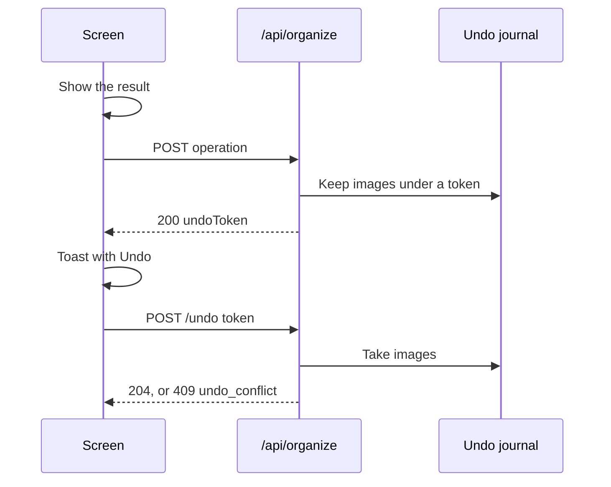

# Contract: Screen API for drag operations and undo

Source of truth: [api/openapi.yaml](../../../api/openapi.yaml). This file
lists only what this feature adds. `task generate` regenerates
`internal/httpapi/gen/` and `web/src/api/gen/`. Every route is owner only by
the `/api/*` default and joins `requiresJSONBody`; the external API and MCP do
not change.

The diagram shows a drop and its undo.



## Shared schemas

```yaml
OrganizeRef:                       # a dragged card (R-4)
  required: [kind, id]
  properties:
    kind: { type: string, enum: [video, group] }
    id: { type: integer, format: int64 }

OrganizeRefs:
  type: array
  minItems: 1
  maxItems: 20000
  items: { $ref: OrganizeRef }     # screen order

OrganizeResult:
  required: [undoToken]
  properties:
    undoToken: { type: string }
    groupId: { type: integer, format: int64 }   # the new group, from /group only
```

Every operation answers `200 OrganizeResult`.

## `POST /api/organize/reorder`

Moves dragged items of one group together (requirement 1).

| Field | Type | Required | Meaning |
| --- | --- | --- | --- |
| `groupId` | int64 | yes | The open group |
| `itemIds` | int64[] | yes | Group item ids in screen order, 1 to 20000 |
| `after` | int64 | no | The item they follow; absent is the top |

## `POST /api/organize/move`

Puts dragged cards into a group, moves them between groups, or takes them out
(requirements 3, 7 nest, 9, 10).

| Field | Type | Required | Meaning |
| --- | --- | --- | --- |
| `items` | `OrganizeRefs` | yes | The dragged cards |
| `from` | int64 | no | The open group they leave |
| `to` | int64 | no | The group they join; absent means the library |

`from` and `to` both absent is `400 invalid_request`.

## `POST /api/organize/group`

Makes a group of dragged videos and the target video (requirement 5).

| Field | Type | Required | Meaning |
| --- | --- | --- | --- |
| `items` | `OrganizeRefs` | yes | Videos only |
| `target` | int64 | yes | The video dropped on |
| `from` | int64 | no | The open group the new group is placed in |

## `POST /api/organize/merge`

Merges dragged groups into the target and appends dragged videos to it, in one
transaction (requirement 8).

| Field | Type | Required | Meaning |
| --- | --- | --- | --- |
| `items` | `OrganizeRefs` | yes | Dragged cards, at least one group |
| `into` | int64 | yes | The group dropped on |

## `POST /api/organize/bundle`

Bundles dragged videos with the target as the representative (requirement 6).

| Field | Type | Required | Meaning |
| --- | --- | --- | --- |
| `videoIds` | int64[] | yes | Dragged videos |
| `target` | int64 | yes | The video dropped on, the representative |

## `POST /api/organize/undo`

Puts back the state before the operation the token names (requirement 12).

| Field | Type | Required | Meaning |
| --- | --- | --- | --- |
| `token` | string | yes | `undoToken` of the operation |

**Response**: `204`.

## `PATCH /api/groups/{id}` with an undo token

048's rename gains one optional body field, so that "Make a group" and the
rename from its name field undo as one unit (requirement 12). Without the
field the route is 048's, unchanged. The body becomes its own schema,
`GroupRename`, because `GroupName` is also the body of `POST /api/groups`,
which takes no token.

| Field | Type | Required | Meaning |
| --- | --- | --- | --- |
| `name` | string | yes | As 048's `GroupName` |
| `undoToken` | string | no | `undoToken` of the `/group` that created group `id` |

When the rename succeeds and `undoToken` names a live `/group` operation
whose new group is `id`, the server replaces that token's after image with
the rows as they are after the rename, so the token's undo still deletes the
group ([data-model.md, Rename under an undo token](../data-model.md#rename-under-an-undo-token)).
A token that is unknown, used, older than 10 minutes, from another operation
or for another group changes nothing: the rename still happens, and the token
keeps its old image. The response and the errors are 048's; the field never
makes a rename fail.

## Errors

| Route | Status | `code` | When |
| --- | --- | --- | --- |
| Every operation | `400` | `invalid_request` | An empty list, a group in `/group` or `/bundle`, no group in `/merge`, or `after` among `itemIds` |
| Every operation | `404` | `group_target_not_found` | A video, group or item does not exist, or is not in `from` or `groupId`; nothing is written |
| `/move`, `/merge` | `409` | `group_cycle` | A dragged group is the target or one of its ancestors |
| `/bundle` | `400` | `too_many_videos` | More than 20 videos after expanding bundles, as `POST /api/video-bundles` |
| `/undo` | `409` | `undo_conflict` (new) | The rows changed after the operation; nothing is written |
| `/undo` | `410` | `undo_expired` (new) | The token is unknown, used or older than 10 minutes |

`undo_conflict` and `undo_expired` join the error reason enum.
