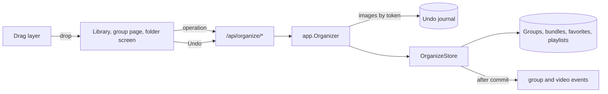
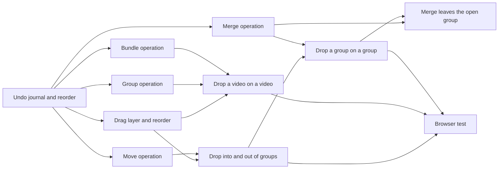

# Implementation Plan: Drag and drop to reorder, group, merge and bundle

**Branch**: `feature/050-drag-organize` | **Parent Issue**: #1075

**Input**: The parent Issue. It is this feature's specification.

## Summary

The owner drags cards on the library, the group page and the folder screen to
reorder a group, put cards into a group, take them out, make a group, merge
groups and bundle versions, and undoes any of them from a toast. Each drop is
one server operation in one transaction that returns an undo token; the
server keeps the rows the operation changed and writes them back on undo when
nothing changed them since. The screens share one `@dnd-kit` drag layer that
tells a drop onto a card from a drop between cards.

The diagram shows the parts this feature adds and what each one calls.



| Concern | Approach |
| --- | --- |
| Undo | Before and after row images, restored only when the rows still equal the after image ([R-1](research.md#r-1-undo-restores-the-rows-the-operation-changed-held-by-the-server)) |
| Undo lifetime | In memory in `internal/app`, 10 minutes, used once; the client forgets it with its toast ([R-2](research.md#r-2-the-undo-journal-lives-in-internalapp-in-memory-for-10-minutes)) |
| Operations | Five routes, one transaction each ([R-3](research.md#r-3-one-route-per-drag-operation-each-in-one-transaction), [contracts/screen-api.md](contracts/screen-api.md)) |
| Dragged cards | Video and group ids in screen order, plus `from` ([R-4](research.md#r-4-dragged-cards-are-named-by-video-and-group-id-in-screen-order)) |
| Merge | Favorites, playlists and parents follow the target ([R-5](research.md#r-5-a-merge-hands-the-dropped-groups-favorites-playlist-items-and-parents-to-the-target)) |
| Make a group | Target first, at the target's place ([R-6](research.md#r-6-make-a-group-puts-the-new-group-where-the-target-was)) |
| Drag layer | One `@dnd-kit` layer, onto or between, 8 px or a 200 ms press ([R-7](research.md#r-7-one-drag-layer-on-dnd-kit-for-cards-and-rows-over-and-between)) |
| Feedback | Result at once, restored on failure; undo as a toast action ([R-8](research.md#r-8-the-screen-applies-an-operation-at-once-and-puts-it-back-on-failure), [R-9](research.md#r-9-the-undo-toast-is-the-existing-toast-with-an-action)) |

The Issue has the `ui` label, so the `design` stage writes `ui-design.md`
before the screen units: the onto, between and refused indicators, the drag
preview with the selection count, the two drop menus, the trail band and the
library as drop targets, the undo toast and its failure messages, and the
folder screen's drag, judged against the parent Issue's `UI品質`.

## Technical Context

**Canonical definitions**:

| Topic | Source |
| --- | --- |
| Boundaries, store roles, events after commit | [ARCHITECTURE.md](../../ARCHITECTURE.md), [.golangci.yml](../../.golangci.yml) (depguard) |
| Groups, items, nesting, dissolving, the `group` event | [048 data-model](../048-groups/data-model.md), [048 contracts](../048-groups/contracts/screen-api.md) |
| Group page, selection bar, reordering, failed edits | [048 ui-design](../048-groups/ui-design.md) |
| Version bundles and user keys | [030 data-model](../030-video-versions/data-model.md) |
| Drag sensors and announcements | `web/src/videoList/reorder.tsx`, [044 R-9](../044-playlists/research.md#r-9-drag-reordering-with-dnd-kitcore-and-dnd-kitsortable) |
| Screen API and generated code | [api/openapi.yaml](../../api/openapi.yaml), `task generate` |
| Screens and Web tests | [design-system.md](../../docs/design-docs/design-system.md), [library-ui.md](../../docs/design-docs/library-ui.md), [web-testing.md](../../docs/design-docs/web-testing.md), [i18n.md](../../docs/design-docs/i18n.md) |
| Checks | [Taskfile.yml](../../Taskfile.yml) (`task check`, `task check-docs`, `task test-e2e`) |

**Feature-specific context**:

- No migration ([data-model.md](data-model.md)); one new store role,
  `OrganizeStore`, and one new use case, `app.Organizer`.
- Six routes and two error codes added, and one route changed: 048's
  `PATCH /api/groups/{id}` takes an optional `undoToken` in its own body
  schema, `GroupRename`
  ([contracts/screen-api.md](contracts/screen-api.md#patch-apigroupsid-with-an-undo-token)).
- The folder screen has no selection today, so it drags one card at a time;
  requirement 11 applies where selection exists (library and group page).
- `POST /api/organize/merge` takes an optional `from`, the open group, so a
  merge from the group page takes the dragged videos and groups out of it in
  the same transaction and under the same undo token, as Move does
  ([contracts/screen-api.md](contracts/screen-api.md#post-apiorganizemerge),
  [data-model.md, Operations](data-model.md#operations)); the unit that adds
  it is [Take merged cards out of the open group with `from` in the merge
  operation](#take-merged-cards-out-of-the-open-group-with-from-in-the-merge-operation).
- Accepted limitation: in the library's favorites filter, which lists groups
  of every depth side by side, a group dropped onto its own descendant is
  refused only by the server's `409 group_cycle`, which the screen shows as
  the failure toast with the cards restored (R-8); the screen marks no refusal
  beforehand. Nothing is written (requirement 15 holds), the contract does not
  change, and `ui-design.md` stays as it is.

## Constitution Check

| Rule (source) | Verdict |
| --- | --- |
| Adapters import neither each other nor `internal/app` (ARCHITECTURE.md, depguard) | Pass: `internal/httpapi` declares an `Organizer` interface that `app.Organizer` satisfies; `app.Organizer` declares the store interface `OrganizeStore` satisfies, and holds images as bytes |
| The domain decides, the store enforces (ARCHITECTURE.md) | Pass: nesting, the new group's name and the merge plan are `internal/domain` rules; the store reads their inputs in its transaction |
| Store roles (ARCHITECTURE.md) | Pass: the operations span groups and bundles, so they belong to the new role `OrganizeStore`, which shares package-private helpers with `GroupStore` and `VersionStore` instead of calling them |
| Events after commit (ARCHITECTURE.md) | Pass: operations and undo publish `GroupsChanged` and `VideoBundleChanged` after commit |
| User data survives a rebuild (ARCHITECTURE.md) | Pass: no table is added; the journal is memory only and undo restores rows by their own ids and keys |
| Every read knows its viewer (ARCHITECTURE.md) | Pass: every route is a write, owner only by the `/api/*` default; guests get no drag |
| Do not hand-edit generated files (AGENTS.md) | Pass: `api/openapi.yaml` changes, then `task generate` |
| Complexity 25 or less, no copied code (AGENTS.md) | Pass: `appendGroupMembers` is generalised to take one ordered list of videos and groups (it appends all videos before all groups today, which would break screen order), and the operations share it with `GroupStore`'s add along with `dissolveGroup`, `moveItemAfter` and the bundle body as shared helpers; the drag layer extends `videoList/reorder.tsx` rather than copying it |
| Read design-system.md before a screen; test at the lowest level (AGENTS.md) | Pass: screens follow `ui-design.md`; rules get domain tests, operations and undo store tests, screens page tests, the acceptance criteria one browser test |

No violation, so no complexity tracking.

## Project Structure

### Documentation (this feature)

```text
specs/050-drag-organize/
├── plan.md
├── research.md
├── data-model.md
└── contracts/
    └── screen-api.md
```

`ui-design.md` is written by the `design` stage. No `quickstart.md`: every
acceptance criterion and Edge Case is reachable in store, handler and page
tests or in the browser test below.

### Source Code

**Affected boundaries**:

| Boundary | What it owns in this feature |
| --- | --- |
| `internal/domain` | `PlanGroupMerge`, the new group's name, `ErrUndoConflict`, `ErrUndoExpired` |
| `internal/store` | `OrganizeStore`: the five operations, their images, the restore, and the rename under an undo token |
| `internal/app` | `Organizer`: the undo journal, and the rename under an undo token |
| `internal/httpapi`, `api/openapi.yaml`, `cmd/mdm` | The six routes, the error codes, the rename's `undoToken`, the wiring |
| `web/src/api` | `organize.ts`, the client of the six routes |
| `web/src/videoList`, `web/src/ui` | The drag layer; the toast action |
| `web/src/library`, `web/src/groups`, `web/src/folders`, `web/src/i18n` | Drops on each screen, the drop menus, the catalog text |
| `web/e2e` | The browser test |

**New paths**: `internal/store/organize.go`, `internal/app/organizer.go`,
`internal/httpapi/organize.go`, `web/src/api/organize.ts`,
`web/src/videoList/cardDrag.tsx`, `web/e2e/drag-organize.e2e.ts`.

**Structure decision**: The backend operations land one per unit behind the
journal unit, so each screen unit depends only on the operations it calls.

## Implementation Work

The diagram shows which units have to land first. The screen units also wait
for the `design` stage's `ui-design.md`.



### Undo drag operations with a server-side journal, starting with reordering a group

**Scope**: `OrganizeStore` with image capture, serialisation and the guarded
restore; `app.Organizer` with the journal; `POST /api/organize/reorder` and
`POST /api/organize/undo`, the `undo_conflict` and `undo_expired` codes, the
wiring in `cmd/mdm`, and `web/src/api/organize.ts` for both
([data-model.md, Undo image](data-model.md#undo-image),
[contracts/screen-api.md](contracts/screen-api.md)).

**Dependencies**: None.

**Acceptance**: `task check` passes with no diff from `task generate`; store
tests show three dragged items of five move together after the first and keep
their order, and undo puts the five back with the same item ids; an undo
after another reorder of that group is `ErrUndoConflict` and changes nothing;
app tests show a token is refused when used twice, after 10 minutes, and once
100 newer tokens are kept; handler tests show every status of the contract's
table for the two routes and `401` for a guest.

### Move, nest and take out cards between groups in one operation

**Scope**: `POST /api/organize/move` with the Move rule and its image
([data-model.md, Operations](data-model.md#operations)).

**Dependencies**: Undo drag operations with a server-side journal, starting
with reordering a group.

**Acceptance**: `task check` passes with no diff from `task generate`; store
tests show: a video moved from A to B is in B and not in A (acceptance
criterion 6); three refs join a group in screen order (acceptance criterion 7);
a video already in `to` only leaves `from`; a group moved into its own
descendant is `ErrGroupCycle` with nothing written; moving the last item of A
out dissolves A, and undo brings A back with its id, favorite and playlist
item; a folder member taken out writes its exclusion, and undo removes it.

### Make a group from a dragged video and its target in one operation

**Scope**: `POST /api/organize/group` with the Group rule
([R-6](research.md#r-6-make-a-group-puts-the-new-group-where-the-target-was)),
and the rename under that operation's token: the optional `undoToken` of
`PATCH /api/groups/{id}` in the `GroupRename` schema, the handler passing it
to `app.Organizer`, and the Organizer and `OrganizeStore` steps that replace
the token's after image
([contracts/screen-api.md](contracts/screen-api.md#patch-apigroupsid-with-an-undo-token),
[data-model.md, Rename under an undo token](data-model.md#rename-under-an-undo-token)).

**Dependencies**: Undo drag operations with a server-side journal, starting
with reordering a group.

**Acceptance**: `task check` passes with no diff from `task generate`; store
tests show: A dropped on B makes a group named B's title holding B then A
(acceptance criterion 2); with `from`, the group takes B's position and A and
B leave `from`; a 120-character title is cut to 100; undo deletes the group
and puts A and B back at their positions; after the new group is favorited,
added to a playlist, put in another group or renamed without the token, undo
is `ErrUndoConflict` and changes nothing; after a rename with the token, undo
deletes the renamed group and puts A and B back; app tests show a rename with
a token that is unknown, used, expired, from a reorder or for another group
renames the group and keeps the token's image, and an undo of that token
during its rename waits for it; handler tests show `PATCH /api/groups/{id}`
without `undoToken` answers as 048's, and with it answers the same and never
fails because of the token.

### Merge dragged groups into a target group in one operation

**Scope**: `POST /api/organize/merge`, `domain.PlanGroupMerge`
([R-5](research.md#r-5-a-merge-hands-the-dropped-groups-favorites-playlist-items-and-parents-to-the-target)).

**Dependencies**: Undo drag operations with a server-side journal, starting
with reordering a group.

**Acceptance**: `task check` passes with no diff from `task generate`; domain
tests cover the plan's rows (a parent that already holds Y, a parent that is
Y's descendant, a playlist holding both); store tests show: Y ends with its
items then X's in order and X is gone (acceptance criterion 4); a favorited X
leaves Y favorited; X's playlist item and parent item become Y's at X's
position; a selection of a video and X in that order appends the video then
X's items in one transaction; a merged automatic X writes `ungroup`; undo restores X with its id,
items, favorite, playlist items and parents, and Y as it was.

### Bundle a dragged video with its target as the representative in one operation

**Scope**: `POST /api/organize/bundle` on the bundle body shared with
`VersionStore.Bundle`, and the bundle's image
([data-model.md, Undo image](data-model.md#undo-image)).

**Dependencies**: Undo drag operations with a server-side journal, starting
with reordering a group.

**Acceptance**: `task check` passes with no diff from `task generate`; store
tests show: A dropped on B makes a bundle with B as the representative
(acceptance criterion 3); an A already bundled brings its whole bundle; undo
removes the new bundle and its copied user data, restores the absorbed bundle
with its id, and puts the group and playlist items back under their old keys;
`POST /api/video-bundles` tests still pass.

### Drag cards and reorder a group's items with an undo toast

**Scope**: The drag layer in `web/src/videoList/cardDrag.tsx` for the grid
and the list (sensors, onto and between, the refused state, the drag
preview, Esc), owner only; the toast action in `ui/Toast.tsx`; the undo
toast and its failures; the group page's reorder in grid and list through
`/api/organize/reorder`, replacing the per-item move on drag, with several
selected items moving together; the catalog text
([R-7](research.md#r-7-one-drag-layer-on-dnd-kit-for-cards-and-rows-over-and-between),
[R-8](research.md#r-8-the-screen-applies-an-operation-at-once-and-puts-it-back-on-failure),
[R-9](research.md#r-9-the-undo-toast-is-the-existing-toast-with-an-action)).

**Dependencies**: Undo drag operations with a server-side journal, starting
with reordering a group; the `design` stage's `ui-design.md`.

**Acceptance**: This unit changes a screen, so it needs a visual and
interaction review against `ui-design.md` and the parent Issue's `UI品質`,
with the mouse and with touch. `task check` passes; page tests show: dropping
the third card first sends `reorder` with `after` absent; two selected cards
move together in their order; pressing Undo sends `undo` and shows the old
order; a `409 undo_conflict` says the undo failed and reads the group again; a
failed reorder restores the order shown before; Esc mid-drag sends nothing; a
click without movement opens the card; a guest sees no drag.

### Drop cards into a group, onto the trail and out to the library

**Scope**: Group cards as drop targets on the library and the group page,
the trail band's groups and library as drop targets on the group page, the
selection dragged as one, and the refused drop onto the dragged group itself
or its descendants, through `/api/organize/move`.

**Dependencies**: Drag cards and reorder a group's items with an undo toast;
Move, nest and take out cards between groups in one operation.

**Acceptance**: This unit changes a screen, so it needs a visual and
interaction review against `ui-design.md`. `task check` passes; page tests
show: a video dropped on a group card in the library sends `move` with `to`;
on the group page a card dropped on another group sends `from` and `to`
(acceptance criterion 6); a card dropped on the trail's library sends `from`
only; three selected cards send three refs in screen order (acceptance
criterion 7); a group card over itself shows the refused state and its drop
sends nothing; Undo puts the cards back.

### Drop a video on a video to make a group or bundle versions

**Scope**: The video-on-video drop on the library, the group page and the
folder screen, its menu with "Make a group" and "Bundle as versions", the new
group's card with its name ready to rename, and the bundle without the
representative dialog, through `/api/organize/group` and
`/api/organize/bundle`.

**Dependencies**: Drag cards and reorder a group's items with an undo toast;
Make a group from a dragged video and its target in one operation; Bundle a
dragged video with its target as the representative in one operation.

**Acceptance**: This unit changes a screen, so it needs a visual and
interaction review against `ui-design.md`. `task check` passes; page tests
show: A on B with "Make a group" sends `group` with `target` B and shows one
group card named B's title (acceptance criterion 2); with "Bundle as versions"
it sends `bundle` with `target` B and opens no dialog (acceptance criterion 3);
on the group page the new card is at B's place; on the folder screen one card
drags; closing the menu sends nothing.

### Drop a group on a group to nest or merge it

**Scope**: The group-on-group drop on the library and the group page, its
menu with "Put in as a child group" and "Merge", through
`/api/organize/move` and `/api/organize/merge`.

**Dependencies**: Drop cards into a group, onto the trail and out to the
library; Merge dragged groups into a target group in one operation.

**Acceptance**: This unit changes a screen, so it needs a visual and
interaction review against `ui-design.md`. `task check` passes; page tests
show: X on Y with "Merge" sends `merge` with `into` Y and X's card leaves
(acceptance criterion 4); with "Put in as a child group" it sends `move` with
`to` Y (acceptance criterion 5); a selection of videos and groups dropped on a
group sends one request, `merge` or `move`, with every card in screen order.

### Take merged cards out of the open group with `from` in the merge operation

**Scope**: The optional `from` of `POST /api/organize/merge`
([contracts/screen-api.md](contracts/screen-api.md#post-apiorganizemerge)):
`api/openapi.yaml` and `task generate`; the Merge rule's removal from `from`
and its image in `OrganizeStore`, `domain.PlanGroupMerge`'s inputs where the
removal changes them, `app.Organizer` and the handler passing `from`
([data-model.md, Operations](data-model.md#operations),
[Undo image](data-model.md#undo-image)); `mergeGroups` in
`web/src/api/organize.ts` taking `from`; the group page's "Merge" sending
`from` the open group, as its "Put in as a child group" does. The library
sends no `from`. `ui-design.md`'s [Group page](ui-design.md#group-page) is
already the target ("the lifted cards leave") and does not change.

**Dependencies**: Merge dragged groups into a target group in one operation;
Drop a group on a group to nest or merge it.

**Acceptance**: `task check` passes with no diff from `task generate`; store
tests show: on group G holding video V, group X and group Y, merging V and X
into Y with `from` G leaves G holding Y only, and Y its items then V then X's
items in order, in one transaction; a dragged video that is not in `from` is
`ErrGroupTargetNotFound` with nothing written; without `from` the operation
answers as before; undo of the one token restores V and X in G at their
positions, X with its id, items, favorite, playlist items and parents, and Y
as it was. Handler tests show `from` reaches the Organizer and the contract's
statuses hold with it. Page tests show: on the group page a selection of a
video and a group dropped on a child group with "Merge" sends one `merge`
with `from` the open group and every card in screen order, the lifted cards
leave and the count lowers; Undo brings them back; the library's "Merge"
sends no `from`. Browser coverage: the unit adds this case (a video and a
group merged into a sibling on the group page leave the page and return on
Undo) to `web/e2e/drag-organize.e2e.ts` when the browser test is on the
feature branch by then, and otherwise says so in its PR body; the browser test
unit does not depend on this one.

### Cover drag organizing in a browser test

**Scope**: `web/e2e/drag-organize.e2e.ts` against the real server and media,
with the mouse and with a touch device profile
([web-testing.md, Test levels](../../docs/design-docs/web-testing.md#test-levels)).

**Dependencies**: Drop cards into a group, onto the trail and out to the
library; Drop a video on a video to make a group or bundle versions; Drop a
group on a group to nest or merge it.

**Acceptance**: `task test-e2e -- e2e/drag-organize.e2e.ts` passes and shows
the parent Issue's acceptance criteria 1 to 9: a reorder survives a reload and
the group card takes the new first video's thumbnail (1); A on B makes a group
named B's title (2) and a bundle with B as representative (3); a merge moves
X's members and favorite to Y (4); a nest shows X in Y (5); a move from A to B
(6); three selected cards keep their order (7); Undo after each restores the
state before (8); the video page has no draggable card or member (9).
