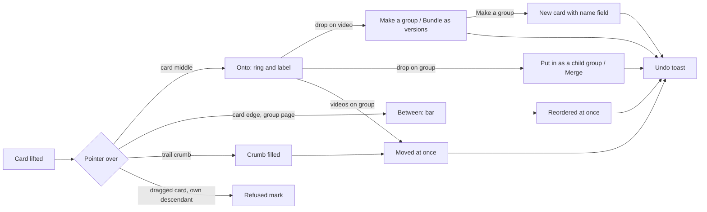
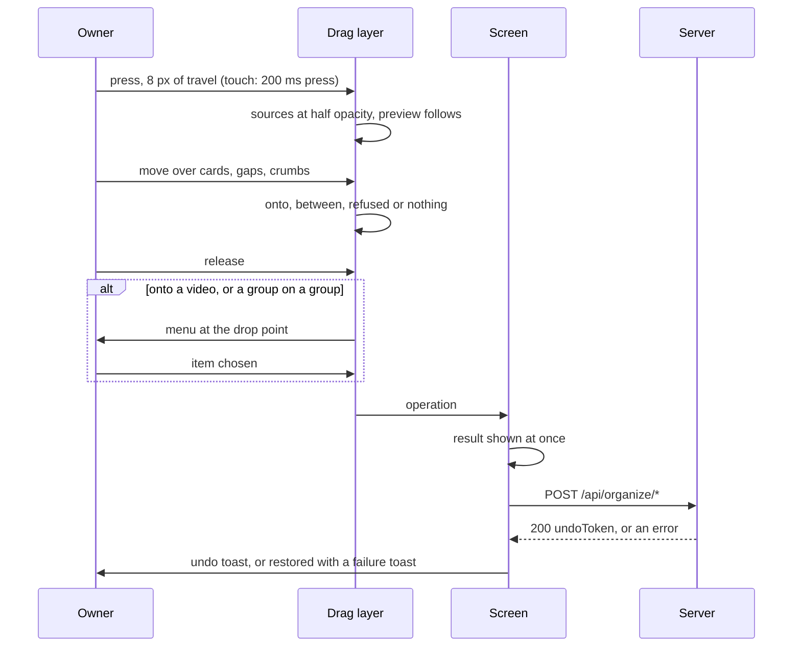
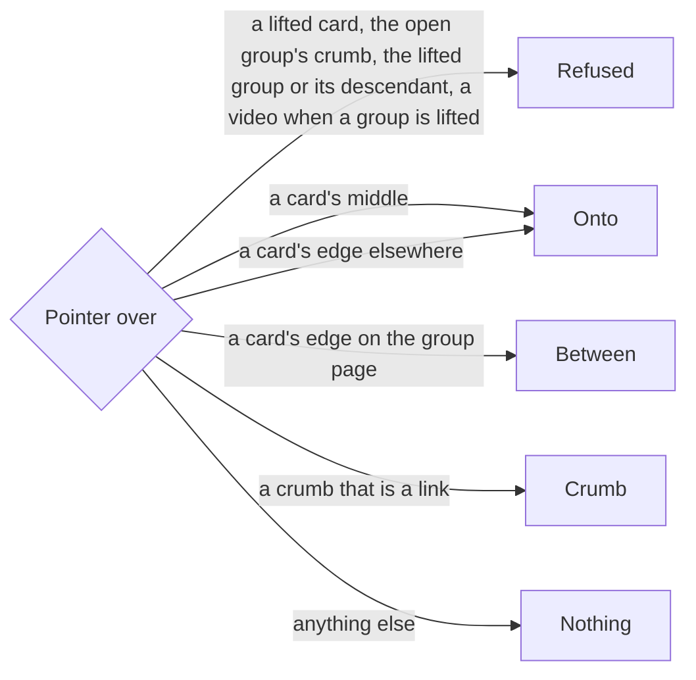
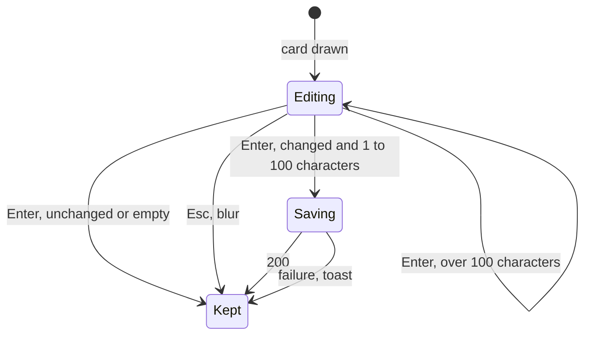
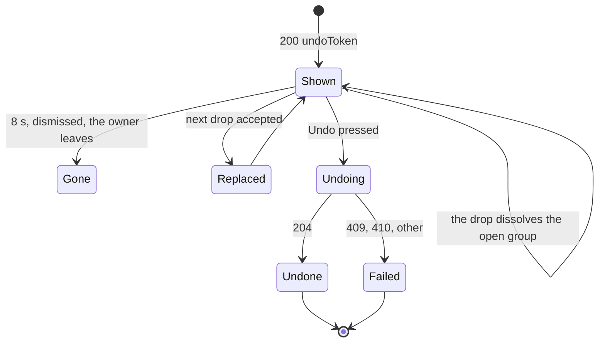

# UI design: Drag and drop to reorder, group, merge and bundle

**Feature**: [parent Issue #1075](https://github.com/syudead/vv/issues/1075) ·
[plan.md](plan.md) ·
[research.md R-4](research.md#r-4-dragged-cards-are-named-by-video-and-group-id-in-screen-order) ·
[R-6](research.md#r-6-make-a-group-puts-the-new-group-where-the-target-was) ·
[R-7](research.md#r-7-one-drag-layer-on-dnd-kit-for-cards-and-rows-over-and-between) ·
[R-8](research.md#r-8-the-screen-applies-an-operation-at-once-and-puts-it-back-on-failure) ·
[R-9](research.md#r-9-the-undo-toast-is-the-existing-toast-with-an-action) ·
[data-model.md, Operations](data-model.md#operations) ·
[contracts/screen-api.md](contracts/screen-api.md)

Sources that already decide things, linked rather than repeated here:

| Topic | Source |
| --- | --- |
| Tokens, closed scales, library density | [design-system.md, Foundations](../../docs/design-docs/design-system.md#foundations); the values in `@theme` of [`web/src/ui/tokens.css`](../../web/src/ui/tokens.css), named here and never copied |
| `DropdownMenu`, `Badge`, `Input`, `Sonner`, `VideoThumbnail`: what each is for | [components.md](../../web/registry/rules/components.md) |
| The library's cards and rows, the group card, selection and the selection bar | [library-ui.md, Cards](../../docs/design-docs/library-ui.md#cards), [List view and selection](../../docs/design-docs/library-ui.md#list-view-and-selection), [017 UI design, Group card](../017-folder-groups/ui-design.md#group-card) |
| What a group card's check selects, and how "Favorite" splits a selection into groups and videos | [017 UI design, Pressing and selection](../017-folder-groups/ui-design.md#pressing-and-selection), [035 UI design, Selection bar](../035-favorites/ui-design.md#selection-bar) |
| The group page: trail band, header, grid and list body, the handle's reordering, failed edits, the gone state | [048 UI design, Group page](../048-groups/ui-design.md#group-page), [Reordering](../048-groups/ui-design.md#reordering), [Edits that fail](../048-groups/ui-design.md#edits-that-fail), [Dissolving](../048-groups/ui-design.md#dissolving) |
| The playlist screen's lifted row and its keyboard path | [044 UI design, Reordering](../044-playlists/ui-design.md#reordering), [`web/src/videoList/reorder.tsx`](../../web/src/videoList/reorder.tsx) |
| The hover preview and the scrub band on a card | [032 UI design](../032-card-scrub-preview/ui-design.md) |
| The bundle dialog, the representative, the 20-video limit | [030 UI design](../030-video-versions/ui-design.md) |
| The folder screen's cards and breadcrumb band | [011 UI design](../011-folder-browser/ui-design.md), [`web/src/folders/Breadcrumbs.tsx`](../../web/src/folders/Breadcrumbs.tsx) |
| Where notices sit, how many show at once | [library-ui.md, Width breakpoints](../../docs/design-docs/library-ui.md#width-breakpoints-in-css-and-the-sidebar-exception), [`web/src/ui/Toast.tsx`](../../web/src/ui/Toast.tsx) |
| Guest degradation | [016 UI design, Guest degradation](../016-single-account-auth/ui-design.md#guest-degradation) |
| Screen text | [`web/src/i18n/en.ts`](../../web/src/i18n/en.ts) (`common`, `list.card`, `library.selection`, `groups`, `versions.bundle`, `errorCodes`); this feature adds `organize` and the words below |

The diagram shows the parts this feature adds and where each one leads.

Unchanged: the cards, rows, corner marks, selection check and selection bar;
the group page's handle, its keyboard reordering and its `×`; the 048 menus,
pickers and dialogs; the 030 bundle dialog from the selection bar; the folder
screen apart from its video cards becoming draggable; the video page and
every other detail screen, which drag nothing (requirement 13). No token is
added, and the contrast pairs in `web/src/theme/tokens.test.ts` gain nothing:
the indicators use `primary`, `primary-soft` and `overlay` where cards already
use them. The design system changes in two places. The `Sonner` rule in
[components.md](../../web/registry/rules/components.md#sonner) gains the undo
form, a notice with one action that stays 8 seconds
([Undo toast](#undo-toast)), and `useToast` takes that action (R-9).
`Breadcrumbs` gains an option that keeps its first crumb
below `md`, which the group page sets ([Group page](#group-page)).

## Why this shape

A drop is told from a reorder before the hand lets go, by two signs that do
not look alike: a card that will take the dragged cards shows a `primary`
ring around its whole box and a label on its thumbnail saying what will
happen ("Put in", "Group or bundle…"), while a place between cards shows a
thin `primary` bar in the gap and no ring (`UI品質`, the first point). The
ring is on the card's box, not on the thumbnail as the selection ring is, so
a selected card and a drop target are not confused. A label was chosen over
a ring alone because the same ring would mean three different things (put
in, a menu of two, a move), and the owner should know which before dropping,
not after. Moving the other cards aside to show the insertion point, as the
playlist rows do, was rejected for the grid: cards reflow across rows, so
the gap would jump between columns while the pointer moves, and the sign
for "between" would then look like the sign for "the grid is reloading".

The dragged cards stay in place at half opacity and a copy of the lifted
card follows the pointer with the count of what moves. The cards do not
leave their places until the drop, because a drop that is refused or a menu
that is closed must leave the screen as it was (Edge Cases), and a card that
had already gone would have to come back. The copy is the lifted card's
thumbnail and title at the card's width, not a reduced icon, because the
owner recognises the video by its thumbnail (`UI品質` of 048,
`情報密度`), and a count badge on it says how many move with it
(requirement 11).

A drop on a video and a drop of a group on a group open a two-item menu at
the drop point (requirements 4 and 7). The menu is the design-system
`DropdownMenu`, labelled with the target's name, because the question is "do
what with these two?" and a menu is the smallest control that asks it. A
modifier key to choose between the two was rejected: it has no form on touch
(requirement 14) and nothing on screen would say it exists. Videos dropped on
a group need no question, so they move at once (requirement 3).

"Make a group" leaves one group card where the target was, and the card's
name is an editable field with the title selected (requirement 5): typing
replaces the provisional name and Enter keeps it, as a new folder is named
on a desktop. The 048 rename dialog was rejected for this moment because the
drop was chosen to avoid a dialog; the dialog stays the way to rename later.
The folder screen lists a folder's videos one by one and never shows a group
card, so there the same field opens in a popover anchored to the target card,
and the two cards stay as videos of the folder.

Every operation ends in one toast with "Undo" (requirement 12). The toast is
the existing `Sonner` notice with an action and a longer stay; it sits where
notices already sit (bottom centre above the selection bar from `lg`,
under the top bar at the right below it), so it covers no card the owner is
working on and the next drag can start while it shows (`UI品質`, the fourth
point). Only the last operation's toast carries "Undo": a new drop replaces
the previous undo toast, because two undos on screen would raise the question
of order, and the server refuses an undo whose rows changed after it
(`409 undo_conflict`). The toast stays 8 seconds, long enough to read the
result and reach the button, short enough that it is gone before the next
few operations pile up.

## Words

Text in `web/src/i18n/en.ts` under `organize`, except where a key is named.
User data (a title, a group name) is embedded as an argument. `items`,
`videos` and `groups` are the catalog's "1 item" / "N items" helpers.

| Place | Text | Notes |
| --- | --- | --- |
| Drop label on a group card, videos dragged | Put in | `organize.drop.putIn` |
| Drop label on a video card | Group or bundle… | `organize.drop.groupOrBundle` |
| Drop label on a group card, a group among the dragged | Put in or merge… | `organize.drop.putInOrMerge` |
| Refused mark, accessible name | Can't drop here | `organize.drop.refused`; the `Ban` badge on the preview |
| Count badge on the preview, accessible name | 3 items | `items(count)`; the badge shows the number alone |
| Menu label | Dropped on "{name}" | `organize.menu.label(name)`; `DropdownMenuLabel` |
| Menu items, video on video | Make a group; Bundle as versions | `organize.menu.makeGroup`; `library.selection.bundle` |
| Bundle item disabled | Bundle up to 20 videos at a time | `library.selection.bundleOverLimit(20)`; a tooltip on the `disabled` item |
| Menu items, group on group | Put in as a child group; Merge | `organize.menu.nest`, `organize.menu.merge` |
| Name field, accessible name | Group name | `organize.name.label` |
| Name field, keyboard hint | Enter keeps the name, Esc keeps "{name}" | `organize.name.hint(name)`, with the provisional name ([The new group's name](#the-new-groups-name)); `aria-describedby`, not drawn |
| Name field rule | Use a name of 1 to 100 characters. | `groups.nameRule` |
| Rename failed | Couldn't rename the group: {reason} | `groups.renameDialog.failed`; a toast |
| Undo toast, reorder | Reordered "{name}" | `organize.done.reordered(name)` |
| Undo toast, move into a group | Moved {N items} to "{name}" | `organize.done.moved(count, name)` |
| Undo toast, move out to the library | Moved {N items} out of "{name}" | `organize.done.movedOut(count, name)` |
| Undo toast, group | Made the group "{name}" | `organize.done.grouped(name)` |
| Undo toast, merge | Merged {N groups} into "{name}"; Merged {N items} into "{name}" | `organize.done.merged(count, name, mixed)`; "items" when videos were dropped with the groups |
| Undo toast, bundle | Bundled {N videos} as versions of "{title}" | `versions.bundle.bundled(count, title)` |
| Undo action | Undo | `organize.undo` |
| Undone | Undone | `organize.undone`; a plain toast |
| Undo failed, `409 undo_conflict` | Couldn't undo: it changed in the meantime | `organize.undoFailed.conflict` |
| Undo failed, `410 undo_expired` | This can no longer be undone | `organize.undoFailed.expired` |
| Undo failed, other | Couldn't undo: {reason} | `organize.undoFailed.other(reason)` |
| Operation failed | Couldn't reorder: {reason}; Couldn't move: {reason}; Couldn't make the group: {reason}; Couldn't merge: {reason}; Couldn't bundle: {reason} | `organize.failed.reorder`, `.move`, `.group`, `.merge`; `versions.bundle.failed`; toasts |
| `group_cycle`, `group_target_not_found` | As 048 | `errorCodes.group_cycle`, `errorCodes.group_target_not_found`; the `{reason}` |
| Announcement, lifted | Picked up "{title}"; Picked up {N items} | `organize.announce.pickedUp(title, count)`; dnd-kit `onDragStart` |
| Announcement, over | Over "{name}": {label}; Between cards, position {n} of {count} | `organize.announce.over(name, label)`, `organize.announce.between(position, count)`; `onDragOver` |
| Announcement, dropped, cancelled | Dropped on "{name}"; Dropped at position {n} of {count}; Cancelled, nothing changed | `organize.announce.dropped(name)`, `.droppedAt(position, count)`, `.cancelled` |

"Put in" is the drop's word for requirement 3's "enter the group", the same
act the 048 picker calls "Add to group"; the drop label is short because it
sits on a thumbnail. "Merge" and "Bundle as versions" keep their 048 and 030
words. "Undo" is one word, because the toast already says what was done.

## Drag layer

One layer, `videoList/cardDrag.tsx`, wraps the grid and the list of the
library, the group page and the folder screen for the owner (R-7). It
decides what is lifted, what the pointer is over and what a drop means; the
screens decide what each drop sends. The diagram shows one drag.

### Lifting

| Event | Behaviour |
| --- | --- |
| Pointer down on a card's thumbnail or title (the link), or on a list row outside its controls, then 8 px of travel | The card is lifted. A release before 8 px is a click and opens the card as today, so a hover, a scrub over the thumbnail and a click feel as they do now (`UI品質`, the third point) |
| Touch: a press of 200 ms without 8 px of travel | Lifted; a swipe before 200 ms scrolls the page as today. The browser's context menu for the long press is suppressed on the cards |
| The lifted card is selected | Every selected card is lifted with it, in screen order; the group cards among them as groups and the videos that are not members of a selected group as videos, as "Favorite" splits the selection (requirement 11) |
| The lifted card is not selected, while a selection exists | That card alone is lifted; the selection stays as it was |
| Pointer down on a corner mark, the selection check, a tag chip, the handle or the `×` | Those controls do what they do today; the handle keeps the 044 keyboard reordering and lifts the row for the pointer as today |
| While lifted | Every lifted card stays in place at `opacity-50`; the preview follows the pointer; no hover preview starts and a running one stops; the window scrolls when the pointer comes within 48 px of its top or bottom edge, so a long list is reachable; the pointer is `cursor-grabbing` |
| Esc, or a release over nothing | The preview returns to its card over 150 ms (`animate-fade-in`'s length; none under reduced motion), the cards return to full opacity and nothing is sent (Edge Case) |
| Guest | Nothing lifts |

The preview is the lifted card's `VideoThumbnail` frame at the card's width
(the row's `w-list-thumb` in the list view), `rounded-md bg-card
shadow-elevated`, with the title under it in `text-sm font-medium` on one
line. When more than one card moves, a `Badge` `default` with the count sits
at the preview's top-end corner; the badge is the one place the brand colour
is drawn on the preview, so the number is read first. A group card's
preview is its folder art, as the card.

### Indicators

The pointer's place decides the sign, and the sign decides the drop. The
diagram shows the rule.

| Sign | Form |
| --- | --- |
| Onto | The target card's box (`article`, `rounded-md`) shows `ring-2 ring-primary`; on its thumbnail a label in the count face's form (`bg-overlay text-foreground text-xs font-medium rounded-md px-2 py-1`, centred) reads "Put in", "Group or bundle…" or "Put in or merge…". The ring is on the box, not the thumbnail, so it is not the selection ring. The card's corner marks and progress bar stay |
| Between | A `w-0.5 rounded-full bg-primary` bar the card's height, centred in the gap before or after the target card; in a one-column grid and in the list view, an `h-0.5` bar the card's or row's width at its top or bottom edge. No ring on any card |
| Crumb | The crumb's text takes `bg-primary-soft text-primary rounded-sm px-1`; nothing else in the band changes |
| Refused | The target shows no ring and no bar; the preview's count badge gives way to a `Badge` `destructive` with lucide `Ban` (`size-3`) named "Can't drop here", and the pointer is `cursor-not-allowed`. A release changes nothing (requirement 15, Edge Cases). The favorites filter's descendant is the one exception ([What a drop does](#what-a-drop-does)) |
| Nothing | No sign; a release changes nothing |

The middle is the card's inner 50 % along the grid's axis of flow (its width
in a grid of two or more columns, its height in a one-column grid and in the
list view); the edge is the 25 % on either side. On the library and the
folder screen, where nothing is reordered (the Issue's `対象外`), the edge
counts as the middle, so the whole card is "onto" and only the gaps are
nothing.

### What a drop does

| Lifted | Target | Result |
| --- | --- | --- |
| Videos only | A video card's middle | The menu "Make a group" / "Bundle as versions" ([Drop menus](#drop-menus)) |
| Videos only | A group card's middle | `move` with `to` the group and, on the group page, `from` the open group, at once (requirements 3, 9) |
| A group among them | A group card's middle | The menu "Put in as a child group" / "Merge" |
| A group among them | A video card | Refused: a group is not made from a group (contract `/group`, videos only) |
| Any | Between cards on the group page | `reorder` of the lifted items to that place, in their screen order (requirements 1, 11) |
| Any | The "Library" crumb | `move` with `from` and no `to` (requirement 10) |
| Any | An ancestor crumb | `move` with `from` the open group and `to` that ancestor (requirement 10) |
| Any | A lifted card, the open group's crumb, the lifted group or a descendant of it, the collapsed "…" | Refused |

A video already in the target group is skipped by the server and appears
once (Edge Case). The screen shows the result before the server answers
(R-8), and on a failure restores what it showed with the failure toast.

One exception to the Refused rule is accepted: in the library's favorites
filter, which lists groups of every depth side by side, a lifted group over
its own descendant shows the sign that card would show to any other group
("Onto", and the menu on release), because the screen does not know the
descendant there. The server refuses the operation with `409 group_cycle`;
the screen puts the lifted cards back and shows the failure toast with the
reason `errorCodes.group_cycle`, and no undo toast. Nothing is written
(requirement 15).

## Drop menus

The menu opens where the pointer let go, as a `DropdownMenu` anchored to the
target card (`side="bottom"`, inside the viewport), while the target keeps
its ring and label so the menu is read against the card it is about. Its
`DropdownMenuLabel` reads "Dropped on "{name}"". The lifted cards stay at
half opacity until an item is chosen or the menu closes.

| Menu | Items | Sends |
| --- | --- | --- |
| Video on video | "Make a group" (lucide `Group`); "Bundle as versions" (lucide `Layers`), `disabled` with the tooltip "Bundle up to 20 videos at a time" when the lifted cards and the target are more than 20 cards ([Bundle limit](#bundle-limit)) | `group` with `target` the video and, on the group page, `from`; or `bundle` with `target` the video as the representative, with no dialog (requirement 6) |
| Group on group | "Put in as a child group" (lucide `FolderInput`); "Merge" (lucide `Merge`) | `move` with `to` the group (and `from` on the group page); or `merge` with `into` the group, every lifted card in screen order in one request |

Esc, a press outside and Tab away close the menu, the cards return to full
opacity and nothing is sent. The menu has no third item and no "Cancel":
closing is cancelling, as every menu.

### Bundle limit

The screen counts cards, not versions: a list item carries no version count
(`VideoVersionsRef` is only on `GET /api/videos/{id}`), and a card that is
already a bundle's representative brings every member of its bundle
([data-model.md, Operations](data-model.md#operations), Bundle). The menu
therefore disables "Bundle as versions" only when the cards alone are over
20, which can never succeed, and leaves the rest to the server, which counts
after expanding bundles. Reading every card's versions before the menu opens
was rejected: a drop would wait on up to 20 requests before the menu could
show.

| Case | Behaviour |
| --- | --- |
| More than 20 cards, the target among them | The item is `disabled` with the tooltip "Bundle up to 20 videos at a time"; nothing is sent |
| 20 cards or fewer that expand to more than 20 videos (a bundle of 12 dropped on a bundle of 10) | The item is enabled. `bundle` answers `400 too_many_videos`; the screen puts the lifted cards back and shows "Couldn't bundle: {reason}" with the reason `errorCodes.too_many_videos` (limit 20), and no undo toast. Nothing is written (contract `/bundle`) |

## The new group's name

After "Make a group" the screen shows the new group's card where the target
was (R-6; on the group page at the target's item position, in the library
at the target's place until the next read puts it where the sort does), and
the card's name is an `Input` (`h-8 text-sm`, the card's title width) with
the provisional name as its value, selected, focused, named "Group name". The
provisional name is the name the server gave the group: the target's title
cut to its first 100 code points and trimmed, as `domain.ValidateGroupName`
keeps it ([data-model.md, Operations](data-model.md#operations), Group). A
title over 100 code points therefore starts the field at its first 100, never
at the whole title, so the field never starts in its over-100 error and Esc
keeps what the server stored. The diagram shows what the field does.

| Event | Behaviour |
| --- | --- |
| Enter with a changed, trimmed name of 1 to 100 code points | `PATCH /api/groups/{id}` (048's rename) with the "Make a group" `undoToken` in the body; the card's title shows the new name at once; a failure shows the toast "Couldn't rename the group: {reason}" and the title returns to the provisional name. The undo toast stays as it is, and its Undo still removes the group: the server folds a rename that carries the token into that operation ([contracts/screen-api.md](contracts/screen-api.md#patch-apigroupsid-with-an-undo-token)) |
| Enter with the name unchanged or empty after trimming, Esc, focus leaving | The field becomes the card's title with the provisional name; nothing is sent |
| Over 100 code points | "Use a name of 1 to 100 characters." under the field as a `FieldError`; Enter does nothing until the text changes |
| Folder screen | The same field in a `Popover` of `w-popover` anchored under the target card, because the folder lists videos one by one and draws no group card; Enter and Esc close it the same way, and the two cards stay as the folder's videos |

The field is the only text control on a card, and only for the seconds after
the drop; a card is never otherwise editable in place. The undo toast shows
beside it: Undo removes the group, name and all, also after a rename from
this field. A rename of the new group anywhere else (the 048 rename dialog,
another tab) carries no token, so it is a change made elsewhere and the undo
fails with "Couldn't undo: it changed in the meantime" (Edge Case).

## Undo toast

Every operation that the server accepts ends in one toast with the action
"Undo" (`Sonner`'s `action`), staying 8 seconds instead of the notice's
2.8, where notices sit on list screens. The diagram shows its life.

| State | What the screen shows |
| --- | --- |
| Shown | The toast with its text and "Undo" as the action button at its end; the screen already shows the result |
| Replaced | A new accepted drop dismisses the previous undo toast and shows its own, so one "Undo" is on screen and it is the last operation's |
| Undoing | "Undo" is `disabled` with a `Spinner` in the toast; `POST /api/organize/undo` |
| Undone | The toast closes, the plain toast "Undone" shows for 2.8 seconds, and the screen reads its list again so the cards return where they were, the new group's card leaves, or the merged group's card returns; on the group page the band, the title and the count follow the response |
| Failed | The toast closes and a failure toast shows: "Couldn't undo: it changed in the meantime" for `409`, "This can no longer be undone" for `410`, else the reason; the screen reads its list again, so it shows what the server has (Edge Case) |
| Gone | The toast timed out, was dismissed, or the owner left the screen (a route change the owner makes: a link, the sidebar, Back): the token is forgotten and the operation stays (Edge Case) |
| Carried | A drop that takes every item out of the open group dissolves it, and the screen leaves for the parent or the library as [048 Dissolving](../048-groups/ui-design.md#dissolving) does. That route change is the operation's own result, not the owner leaving, so the undo toast and its token stay through it, keep their 8 seconds from the drop, and Undo works on the screen it lands on |

A failed operation shows no undo toast: the screen restores what it showed
before the drop and a failure toast names the reason (Edge Case). A `404
group_target_not_found` on the group page also reads the group again with
the 048 toast "The group changed in the meantime, so it was reloaded".

## Group page

Both views reorder. In the grid a card is lifted as [Lifting](#lifting) says
and dropped between cards; in the list a row is lifted from anywhere on it
outside its controls, or by its handle as today, and dropped between rows.
The drop sends one `reorder` with the lifted items in screen order and
`after` the item before the bar (absent at the top), in place of the
per-item move the handle sent, and the order changes at once; the handle's
keyboard path (Space, arrows, Space) keeps the 044 form and sends the same
`reorder` with one item. The toolbar has no search or filter, so the Issue's
rule that reordering is done without a filter holds without a state.

The trail band's crumbs are drop targets ([Indicators](#indicators)): the
"Library" crumb and each ancestor. Below `md`, from four crumbs on, the
group page's band keeps "Library" and collapses only the ancestors between
it and the parent: "Library › … › {parent} › {name}". The folder band's form
"… › {parent} › {name}"
([048 Trail band](../048-groups/ui-design.md#trail-band)) would hide the
"Library" crumb on a phone, so taking a card out of a deep group would have
no target there (requirement 10). `Breadcrumbs` gains an option to keep its
first crumb, which the group page sets and the folder screen does not; the
band stays one line, and every crumb but the current one truncates as it
does today. The collapsed "…" is not a target; "Library" and the crumb
before the name are, so both the library and the level above are always one
drop away. A child group's card is a target like a group card in the
library.

| Drop | Screen |
| --- | --- |
| Reorder | The cards or rows take the new order; the numbers renumber; the selection stays |
| Into a child group, merge into a child, make a group | The lifted cards leave or become the new card; the selection is cleared; the child's card is read again on its `group` event so its art follows |
| Out to a crumb | The lifted cards leave, the count lowers and the selection is cleared. When the lifted cards were every item, the server dissolves the group and the screen leaves as [048 Dissolving](../048-groups/ui-design.md#dissolving) does; the undo toast and its token come along ([Undo toast](#undo-toast), Carried), and Undo brings the group back, which the screen then shows through its `group` event |

## Library

Group cards are targets for videos and for groups; video cards are targets
for videos. After a drop the lifted cards leave the top level, the target
group's card is read again on its `group` event (its art and count follow),
and after "Make a group" the new card stands at the target's place with the
name field. The list view drags rows the same way, with the row's thumbnail
and title as the preview. The cards are not reordered (`対象外`): the whole
card is "onto".

## Folder screen

A folder's video cards drag one at a time: the screen has no selection, so
the preview carries no count. Video cards are the only targets ("Group or
bundle…"); folder cards, the breadcrumb band and the root's folders are
nothing. After "Bundle as versions" the lifted card leaves (a version that is
not the representative appears in no list) and the target stays; after
"Make a group" both cards stay and the name field opens in its popover
([The new group's name](#the-new-groups-name)). The search results of a
folder drag the same way.

## Guest degradation

When drawing as a guest, nothing below is shown; nothing is `disabled` or
`aria-disabled` (as in 016).

| Place | Not shown | Instead |
| --- | --- | --- |
| Library, group page, folder screen | The drag layer: nothing lifts, no indicator, no menu, no undo toast | The cards and rows as today; the response has no `favorite`, which is the owner test the corner marks already use |

## Responsive behaviour

The widths below are the ones the implementation is judged at, with the
mouse at 1280px and 768px and with touch at 360px and 768px.

| Width | Layout |
| --- | --- |
| 360px | The grid is one column: the between zones are a card's top and bottom quarters and the bar is horizontal, the card's width; the onto label is centred on the thumbnail and fits on one line. The preview is the card's width less the gutters, so it covers the card under it and the ring of the target is still seen at its edges. The menu is `min-w-menu`, under the target card, inside the viewport; the name popover is `w-popover`, inside the viewport. The undo toast sits under the top bar at the right, the width the notices have there, with "Undo" on the same line as the text; it covers the top row's right edge only while it shows, and a drag can start under it. The trail band's crumbs are one line, "Library › … › {parent} › {name}" from four crumbs on; a drop on "Library" takes the cards out to the library and a drop on the crumb before the name goes up one level |
| 768px | Two or three columns by the zoom: the bars are vertical in the gaps; a bar never stands at a row's end beyond the last card, because the place after the last card of a row is the place before the first card of the next. The list view's rows lift from anywhere on them and from the handle. The toast is still at the top right |
| 1280px | The library's columns at the chosen zoom; the preview's shadow is seen against the cards it passes; the ring and the label are seen on a `card-0` card without hiding its title. The undo toast is at the bottom centre above the selection bar, so a drag to the top rows and to the trail band never crosses it; with the selection bar shown, the toast sits above the bar and both are readable |

## Review criteria

Judged by looking at the screen at 360px, 768px and 1280px, signed in as the
owner, with a library of three hand-made groups (one holding a child group
and eight videos), one automatic group and twelve single videos, with the
mouse at 1280px and 768px and with touch at 360px and 768px.

1. **Onto and between are told apart before the drop** (`UI品質`, the first
   point): with a video lifted on the group page, moving the pointer across a
   card shows the bar at the leading edge, then the ring and the label "Put
   in" or "Group or bundle…" in the middle, then the bar at the trailing
   edge, and never both at once; the bar is `primary` and as thin as a
   hairline is not (`w-0.5`), the ring is `primary` around the card's box,
   and a selected card beside them keeps its ring on the thumbnail only, so
   the three states are three looks (`視覚的な階層`).
2. **Refused is seen and does nothing**: lifting group A over A's own card,
   over its child's card and over the open group's crumb shows the `Ban`
   badge on the preview and no ring; releasing there leaves every card where
   it was and shows no toast (requirement 15, Edge Cases). Lifting three
   selected cards over one of them shows the same.
3. **Nothing changes by accident** (`UI品質`, the third point): clicking a
   card opens it; moving the mouse across a thumbnail scrubs it; pressing
   and moving 4 px then releasing opens the card and lifts nothing; on a
   phone a swipe over the cards scrolls the page and a 200 ms press lifts the
   card, after which the page scrolls only near its edges; Esc mid-drag puts
   the preview back with no request sent.
4. **The preview reads as the cards** (`情報密度`): the preview shows the
   lifted card's thumbnail and title at the card's width with
   `shadow-elevated`; with three cards selected and one lifted, the badge
   "3" is the only `primary` fill on it and the three source cards are at
   half opacity in their places.
5. **Reorder** (acceptance criterion 1): on the group page, dragging the
   third card to the bar before the first makes it first at once, the toast
   "Reordered "{name}"" shows, a reload shows the same order and the group's
   card in the library has that video's thumbnail; in the list view the
   same by dragging the row, and the handle's keyboard path still works.
6. **Group and bundle from a drop** (acceptance criteria 2, 3): in the
   library, dropping A on B shows the menu "Dropped on "B"" with "Make a
   group" and "Bundle as versions" and nothing else; "Make a group" leaves
   one group card where B was with its name field selected reading B's
   title, and Enter after typing renames it with no dialog; "Bundle as
   versions" leaves B's card alone, opens no dialog, and B's versions count
   reads 2. Closing the menu with Esc leaves A and B as they were.
7. **Nest and merge from a drop** (acceptance criteria 4, 5): dropping X on
   Y shows "Put in as a child group" and "Merge"; "Merge" removes X's card,
   Y's page lists X's members last in X's order, and a favorited X leaves Y
   favorited; "Put in as a child group" removes X's card and Y's page shows
   X as a card. The menu's items are `text-sm` rows with the catalog's icons,
   and no item is `destructive`.
8. **Move and the way out** (acceptance criteria 6, 7; requirement 10): on
   A's page, dropping a video on B's card removes it and B's page shows it
   last; dropping three selected cards on B puts them in B in their order;
   dropping a card on the "Library" crumb removes it from A and the library
   shows it at the top level; dropping the last card on the crumb leaves the
   page with the 048 toast and the undo toast beside it, and its Undo
   brings A back. At 360px on the page of C in Library › A › B › C, the
   band reads "Library › … › B › C" and dropping a card on "Library" takes it
   out to the library.
9. **Undo** (acceptance criterion 8; `UI品質`, the fourth point): after each
   operation above, the toast sits at the bottom centre above the selection
   bar at 1280px and under the top bar at the right at 360px, carries one
   "Undo" at its end, stays about 8 seconds, and covers no card the next drag
   needs; pressing "Undo" within that time puts every card, group, favorite
   and name back as before and shows "Undone"; a second drop while the toast
   shows replaces it, so one "Undo" is on screen; after the toast is gone, or
   after moving to another screen, no undo is offered. After "Make a
   group" and a rename in the name field, Undo removes the renamed group.
   Changing the group in a second tab before pressing "Undo" shows "Couldn't
   undo: it changed in the meantime" and leaves the second tab's change in
   place.
10. **Failures**: with the server stopped, a drop puts the cards back where
    they were within the round trip and shows "Couldn't move: {reason}"
    with no "Undo"; nothing stays half done.
11. **Folder screen**: a video card drags alone with no count badge, a
    folder card shows no sign under it, "Make a group" opens the name
    popover under the target card and both cards stay, "Bundle as versions"
    removes the lifted card.
12. **Video page and guests** (acceptance criterion 9): on the video page no
    card, member row or related row lifts; signed in as a guest, nothing
    lifts on the library, the group page or the folder screen, and the cards
    look as they did.
13. **Spacing and typography** (`余白のリズム`, `タイポグラフィ`): the bar sits
    in the grid's `gap-3` without moving any card; the label is the count
    face's size on the thumbnail; the menu and the toast are the design
    system's at their usual sizes; the name field is the card's title height
    and does not change the card's height; nothing on a card is drawn in
    `primary` except the ring, the bar, the badge and what was already
    (`視覚的な階層`).
14. **Failing examples**: cards that shift aside to show the insertion
    point in the grid; the same ring for a selected card and a drop target;
    a drop target with no sign until the release; a toast that asks "Make a
    group or bundle?" after the drop; a dialog for the representative or for
    the new group's name; a drag that starts from a click or a scrub; a
    preview that is an icon or a number alone; an "Undo" button that stays
    after the operation can no longer be undone; two undo toasts on screen;
    a `destructive` "Merge" item; a folder card that lights up under a
    dragged video.
