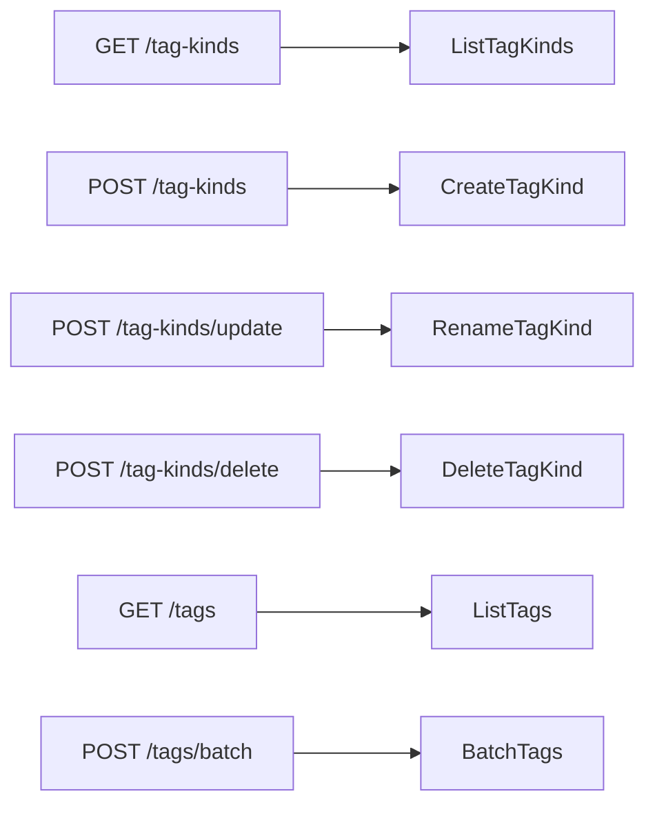

# Contract: Tag kinds in the external API v1 and MCP

Source of truth: [`api/external-v1.yaml`](../../../api/external-v1.yaml). This
document describes only what this feature adds; the shared rules stay as in
[026 Common rules](../../026-external-api/contracts/external-api.md#common-rules),
and the tag operations as in
[039 external-api](../../039-external-tag-admin/contracts/external-api.md).
Following the compatibility policy, only fields, parameters, operations and
`reason` values are added. Each operation calls the store operation the screen
route of [screen-api.md](screen-api.md) calls, so the rules there hold
(requirement 6, acceptance criterion 4).

The kind operations follow the shape of the people operations
([047 external-api](../../047-video-work-info/contracts/external-api.md)):
list and create on the collection, `update` and `delete` as `POST` sub-paths.

## Schema changes

| Schema | Added | Rule |
| --- | --- | --- |
| `TagKindRef`, `TagKind`, `TagKindList` (new) | As in [screen-api.md, Schema changes](screen-api.md#schema-changes) | |
| `Tag` | `kind: TagKindRef`, nullable, `required` | |
| `TagBatchRequest` | `action` gains `setKind` and `clearKind`; optional `kindId` | As [`POST /api/tags/batch` changes](screen-api.md#post-apitagsbatch-changes) |
| `ErrorReason` | `tag_kind_not_found`, `tag_kind_name_taken` | |

`ExternalVideoTag` does not gain `kind`; a client reads kinds from
`GET /api/v1/tags`.

## `GET /api/v1/tag-kinds` (`listTagKinds`)

Returns every kind: `200 TagKindList`.

## `POST /api/v1/tag-kinds` (`createTagKind`)

Creates a kind from `{ "name": string }` and answers `200 TagKind`, not `201`,
like the other external writes. Errors as
[`POST /api/tag-kinds`](screen-api.md#post-apitag-kinds).

## `POST /api/v1/tag-kinds/update` (`renameTagKind`)

Renames a kind from `{ "id": int64, "name": string }`: `200 TagKind`. Errors
as [`PATCH /api/tag-kinds/{id}`](screen-api.md#patch-apitag-kindsid).

## `POST /api/v1/tag-kinds/delete` (`deleteTagKinds`)

Deletes the kinds in `{ "ids": int64[] }` (1 to 20,000 entries, as `deletePeople`); their tags
remain without a kind. Answers `200 { deletedIds, notFoundIds }`, two arrays
that do not overlap and together equal the deduplicated `ids`. `ids` empty or
over 20,000 entries is `400 invalid_request`.

## `GET /api/v1/tags` parameter `kind`

As [`GET /api/tags` parameter `kind`](screen-api.md#get-apitags-parameter-kind).

## `POST /api/v1/tags/batch` changes

As [`POST /api/tags/batch` changes](screen-api.md#post-apitagsbatch-changes).

## MCP tools

Added to the table in
[026 mcp.md, Tools](../../026-external-api/contracts/mcp.md#tools). Input and
output have the shape of the operation's request and response.

| Tool | Operation | Hints |
| --- | --- | --- |
| `list_tag_kinds` | `listTagKinds` | `readOnlyHint: true` |
| `create_tag_kind` | `createTagKind` | `destructiveHint: false`, `idempotentHint: false` |
| `rename_tag_kind` | `renameTagKind` | `destructiveHint: false`, `idempotentHint: true` |
| `delete_tag_kinds` | `deleteTagKinds` | `destructiveHint: true`, `idempotentHint: true` |
| `list_tags` (changed) | `listTags` | Input gains `kind` |
| `batch_tags` (changed) | `batchTags` | `action` enum gains `setKind` and `clearKind`; input gains `kindId` |

## `docs/how-to/external-api.md`

`Tidy up tags` gains a subsection `Tag kinds`: list, create, rename and delete
kinds, and set a kind on tags with `batchTags`.
