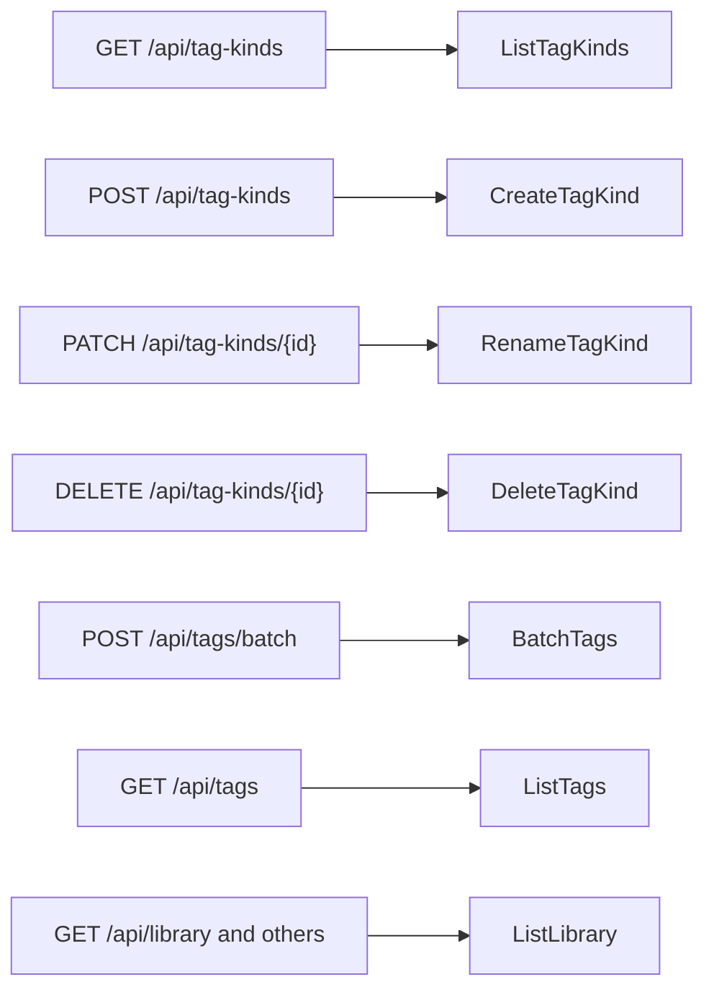

# Contract: Tag kinds in the screen API

Source of truth: [`api/openapi.yaml`](../../../api/openapi.yaml). This document
describes only the routes, parameters, fields and error codes this feature adds
or changes; the tag routes' other rules stay as in
[014 tags-api](../../014-video-tags/contracts/tags-api.md) and
[036 screen-api](../../036-tag-admin-scale/contracts/screen-api.md). Every route
here is owner only by the `/api/*` default.

The diagram shows which store operation each new or changed route reaches.

## Schema changes

| Schema | Added | Rule |
| --- | --- | --- |
| `TagKindRef` (new) | `id: int64`, `name: string` (both `required`) | [R-4](../research.md#r-4-every-tag-shape-carries-the-kinds-id-and-name) |
| `TagKind` (new) | `id`, `name`, `tagCount: integer`, `createdAt: date-time` (all `required`) | `tagCount` counts the kind's tags, tentative ones included |
| `TagKindList` (new) | `items: TagKind[]` (`required`) | Every kind, in id order; the screen sorts by name with `compareNatural` |
| `Tag`, `TagRef`, `VideoTag` | `kind: TagKindRef`, nullable, `required` | null is a tag without a kind |
| `TagBatchRequest` | `action` enum gains `setKind` and `clearKind`; `kindId: int64` (optional) | [`POST /api/tags/batch` changes](#post-apitagsbatch-changes) |
| `ErrorReason` | `tag_kind_not_found`, `tag_kind_name_taken` | The kind routes and `setKind` |

## `GET /api/tag-kinds`

Returns every kind: `200 TagKindList`.

## `POST /api/tag-kinds`

Creates a kind from `{ "name": string }`: `201 TagKind`.

| Status | `code` / `reason` | When |
| --- | --- | --- |
| `400` | `invalid_request` / `tag_name_empty`, `tag_name_control_characters`, `tag_name_too_long` | The name breaks [R-6](../research.md#r-6-kind-names-follow-the-tag-name-rules-in-their-own-namespace) |
| `409` | `conflict` / `tag_kind_name_taken` | Another kind has the name (Edge Case). Nothing changes |

## `PATCH /api/tag-kinds/{id}`

Renames a kind from `{ "name": string }`: `200 TagKind`. The same name as now
changes nothing and returns `200`.

| Status | `code` / `reason` | When |
| --- | --- | --- |
| `400` | as `POST /api/tag-kinds` | The name breaks the rules |
| `404` | `not_found` / `tag_kind_not_found` | No kind has the id |
| `409` | `conflict` / `tag_kind_name_taken` | Another kind has the name |

## `DELETE /api/tag-kinds/{id}`

Deletes a kind; its tags remain without a kind: `204`. `404 not_found` /
`tag_kind_not_found` when no kind has the id.

## `POST /api/tags/batch` changes

| Field | Type | Required | Meaning |
| --- | --- | --- | --- |
| `action` | adds `setKind`, `clearKind` | yes | `setKind` gives each tag the kind `kindId`; `clearKind` removes each tag's kind. Neither confirms a tentative tag |
| `kindId` | int64 | with `setKind` only | The kind to set |

**Response**: `200 TagBatchResponse` as today. `notApplicableIds` holds the
tags that already had the requested kind (or had none, for `clearKind`).

| Status | `code` / `reason` | When |
| --- | --- | --- |
| `400` | `invalid_request` | `setKind` without `kindId`, or `kindId` with another action |
| `404` | `not_found` / `tag_kind_not_found` | `setKind` names a kind that does not exist. Nothing changes |

`POST /api/tags/impact` does not take the two actions: changing a kind deletes
nothing, so the screen asks no confirmation.

## `GET /api/tags` parameter `kind`

| Name | Type | Default | Meaning |
| --- | --- | --- | --- |
| `kind` | string: a positive integer or `none` | None | Only tags of that kind, or only tags without a kind ([R-8](../research.md#r-8-the-tag-list-filters-by-one-kind-or-by-no-kind)) |

- ANDs with `q`, `tentative` and `unused`; `total` counts with it, `totalAll`
  does not.
- An id with no kind gives an empty list. Any other value is
  `400 invalid_request`.
- The tag management URL carries it as `kind`, beside `tentative` and
  `unused` (`web/src/tags/tagListUrl.ts`).

## List parameter `tagKind`

Added to every list route that takes `person`: `listVideos`, `listLibrary` and
`listLibraryIds` ([047 contract](../../047-video-work-info/contracts/screen-api.md#list-parameters-person-and-organization)).

| Name | Type | Default | Meaning |
| --- | --- | --- | --- |
| `tagKind` | int64 | None | Only videos with at least one tag of that kind, manual or from the folder ([R-5](../research.md#r-5-the-library-filters-videos-by-one-tag-kind)) |

- ANDs with every other filter; `total` counts with it.
- An id with no kind gives an empty list and no report; the screen learns the
  kind is gone when `GET /api/tag-kinds` no longer lists it, removes the
  parameter, and says so, as for `person`.
- A value that is not a positive integer is `400 invalid_request`; from a guest,
  `400 invalid_request` / `guest_filter_not_allowed`.
- The library URL carries it as `tagKind`; "Clear filters" removes it with
  `tag`, and the list snapshot key includes it.

## `web/src/api` functions

`web/src/api/tagKinds.ts` holds `listTagKinds`, `createTagKind`,
`renameTagKind` and `deleteTagKind`, and keeps one cached kind list as
`api/tags.ts` does for tags. After a rename or delete it calls `refreshTags`,
because every cached tag carries the kind's name.
