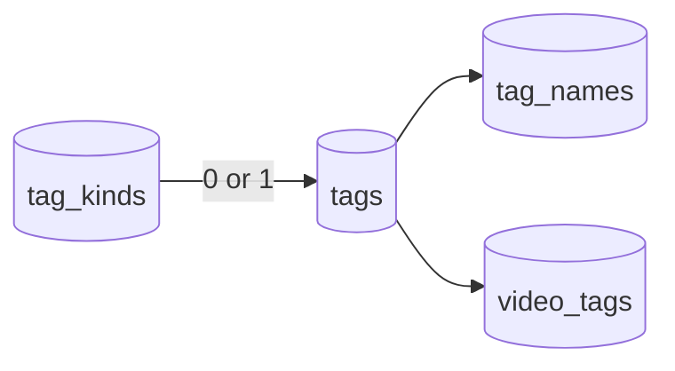

# Data model: Tag kinds

The rest of the model is unchanged: tags, names, assignments and rejected names
stay as in [014 data-model](../014-video-tags/data-model.md),
[031](../031-tentative-tags/contracts/screen-api.md) and
[036 data-model](../036-tag-admin-scale/data-model.md); the migrations are in
[`internal/store/migrations/`](../../internal/store/migrations).

The diagram shows the new table and the column that points to it.

## Migration

`00048_tag_kinds.sql` creates `tag_kinds`, inserts the four preset kinds
([R-2](research.md#r-2-preset-kinds-are-seeded-rows-with-no-special-status)),
adds `tags.kind_id` with an index, and drops both in its `Down` section.
SQLite accepts `add column ... references` because the column defaults to null.

## `tag_kinds`

| Field | Type | Null | Meaning |
| --- | --- | --- | --- |
| `id` | `integer primary key autoincrement` | No | Never reused, as `tags.id` |
| `name` | `text`, `unique` | No | The kind's name ([Rules](#rules)) |
| `created_at` | `text` | No | RFC 3339 UTC, as `tags.created_at` |

The seeded rows are `Genre`, `Work`, `Place` and `Character`, in that id order.

## `tags.kind_id`

| Field | Type | Null | Meaning |
| --- | --- | --- | --- |
| `kind_id` | `integer references tag_kinds(id) on delete set null` | Yes | The tag's kind; null is a tag without a kind |

**Index**: `tags_kind_id` on `kind_id`, used by the tag list's `kind` filter
and the library's `tagKind` filter.

Like tags, a kind is user data that survives a rebuild: it is keyed by its own
id ([ARCHITECTURE.md, Cross-cutting invariants](../../ARCHITECTURE.md#cross-cutting-invariants)).

## Values added to `domain`

| Value | Fields | Use |
| --- | --- | --- |
| `TagKind` | `ID`, `Name`, `TagCount`, `CreatedAt` | One row of the kind list; `TagCount` counts tags of the kind, tentative ones included |
| `TagKindRef` | `ID`, `Name` | The `kind` of `Tag`, `TagRef` and `VideoTag` ([R-4](research.md#r-4-every-tag-shape-carries-the-kinds-id-and-name)) |
| `TagKindFilter` | a kind id, or "none" | `TagListQuery.Kind` |
| `TagBatchSetKind`, `TagBatchClearKind` | | New `TagBatchAction` values; `TagBatchRequest` carries the `KindID` of `setKind` |
| `ErrTagKindNotFound`, `TagKindNameConflict` | | Errors of the kind operations |

`VideoQuery` gains `TagKindID`, a kind id or zero.

## Rules

| Rule | Enforced in |
| --- | --- |
| A kind name is normalised by `NormalizeTagName` ([R-6](research.md#r-6-kind-names-follow-the-tag-name-rules-in-their-own-namespace)) | `internal/domain` |
| No two kinds share a name; a rename to the kind's own name changes nothing | `tag_kinds.name` unique, read in the store's transaction |
| Deleting a kind leaves its tags without a kind (requirement 4) | `on delete set null` |
| `setKind` writes `kind_id` on tags whose kind differs, and does not change `tentative` ([R-3](research.md#r-3-a-tags-kind-is-set-and-cleared-through-the-tag-batch)) | `TagStore.BatchTags` |
| `setKind` with a kind id that does not exist changes nothing | `TagStore.BatchTags`, which reads the kind first in the same transaction |
| Ids already of the requested kind (or already without one, for `clearKind`) go to `notApplicableIds` | `domain.TagBatchApplies` |
| A merge keeps the target's `kind_id`, null included; the sources' kinds go with the sources (Edge Case) | `mergeTagsInto`, which does not write `tags.kind_id` |
| Confirming a tentative tag keeps its `kind_id` (Edge Case) | `confirmTagInTx`, which writes only `tentative` |
| A video matches `tagKind` when one of its tags, manual or from its folder, has that kind | The list condition beside `tagConditions` |

## What does not change

- `tag_names`, `video_tags`, `rejected_tag_names` and `auto_tag_rejections`:
  a kind belongs to the tag, not to a name or an assignment.
- Events: tag changes publish no event
  ([`internal/store/tags.go`](../../internal/store/tags.go)), and kind changes
  publish none either; screens re-read the lists they show.
- Auto-tagging does not assign kinds.
