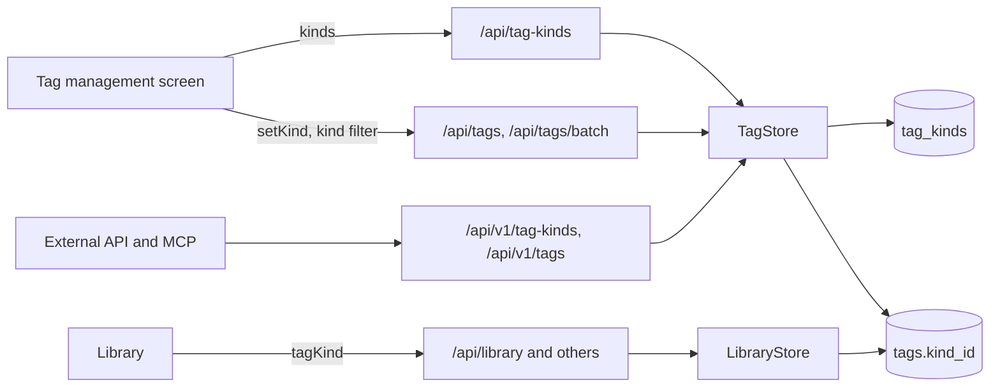
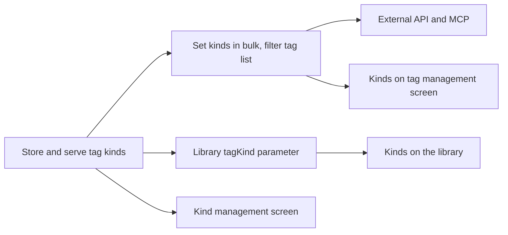

# Implementation Plan: Tag kinds

**Branch**: `feature/051-tag-kinds` | **Parent Issue**: #1136

**Input**: The parent Issue. It is this feature's specification.

## Summary

The owner gives each tag at most one kind (`Genre`, `Work`, `Place`,
`Character`, or a kind they add), sets it on many tags at once from the tag
management screen, renames and deletes kinds, and filters the tag list and the
library by kind; the external API and MCP read and write the same kinds. A
kind is a row of a new `tag_kinds` table that `tags.kind_id` points to, set
through the existing tag batch.

The diagram shows the parts this feature adds and what each one calls.



| Concern | Approach |
| --- | --- |
| Storage | `tag_kinds` and a nullable `tags.kind_id`, `on delete set null` ([R-1](research.md#r-1-a-kind-is-a-row-that-tags-point-to)) |
| Presets | Four seeded rows the owner may rename or delete ([R-2](research.md#r-2-preset-kinds-are-seeded-rows-with-no-special-status)) |
| Setting a kind | `setKind` and `clearKind` in the tag batch, without confirming ([R-3](research.md#r-3-a-tags-kind-is-set-and-cleared-through-the-tag-batch)) |
| Reading a kind | `kind: { id, name } \| null` on every tag shape ([R-4](research.md#r-4-every-tag-shape-carries-the-kinds-id-and-name)) |
| Library | `tagKind`: videos with any tag of one kind ([R-5](research.md#r-5-the-library-filters-videos-by-one-tag-kind)) |
| Kind names | Tag name rules, own namespace ([R-6](research.md#r-6-kind-names-follow-the-tag-name-rules-in-their-own-namespace)) |
| Look | Name only, no stored colour ([R-7](research.md#r-7-a-kind-has-a-name-and-nothing-else)) |
| Tag list | `kind`: one id or `none` ([R-8](research.md#r-8-the-tag-list-filters-by-one-kind-or-by-no-kind)) |

The Issue has the `ui` label, so the `design` stage writes `ui-design.md`
before the screen units: how a kind shows on a tag row, an active filter chip
and (if at all) a card tag, the kind filter in the tag management and library
filter menus, the `Set kind` selection action, and the kind management dialog,
judged against the parent Issue's `UI品質`.

## Technical Context

**Canonical definitions**:

| Topic | Source |
| --- | --- |
| Boundaries, store roles, events after commit | [ARCHITECTURE.md](../../ARCHITECTURE.md), [.golangci.yml](../../.golangci.yml) (depguard) |
| Tags, names, the tag filter | [014 data-model](../014-video-tags/data-model.md), [014 tags-api](../014-video-tags/contracts/tags-api.md) |
| Tentative tags | [031 screen-api](../031-tentative-tags/contracts/screen-api.md) |
| Tag list paging, bulk actions, the selection bar | [036 screen-api](../036-tag-admin-scale/contracts/screen-api.md), [036 ui-design](../036-tag-admin-scale/ui-design.md) |
| External tag administration and MCP | [039 external-api](../039-external-tag-admin/contracts/external-api.md), [external-api how-to](../../docs/how-to/external-api.md) |
| List filters `person` and `organization` | [047 screen-api](../047-video-work-info/contracts/screen-api.md#list-parameters-person-and-organization) |
| Screen API, external API, generated code | [api/openapi.yaml](../../api/openapi.yaml), [api/external-v1.yaml](../../api/external-v1.yaml), `task generate` |
| Screens and Web tests | [design-system.md](../../docs/design-docs/design-system.md), [library-ui.md](../../docs/design-docs/library-ui.md), [web-testing.md](../../docs/design-docs/web-testing.md), [i18n.md](../../docs/design-docs/i18n.md) |
| Checks | [Taskfile.yml](../../Taskfile.yml) (`task check`, `task check-docs`, `task test-e2e`) |

**Feature-specific context**:

- One migration, `00048_tag_kinds.sql`, and the repository's first seeded
  rows ([data-model.md, Migration](data-model.md#migration)).
- No new store role: kind operations belong to `TagStore`, which already owns
  every write to `tags`; the library condition belongs to `LibraryStore`.
- Four screen routes and four external operations are added; `GET /api/tags`,
  `POST /api/tags/batch`, the list routes that take `person`, and their
  external counterparts change ([contracts/screen-api.md](contracts/screen-api.md),
  [contracts/external-api.md](contracts/external-api.md)).
- No event: kind changes, like tag changes, commit without publishing
  ([data-model.md, What does not change](data-model.md#what-does-not-change)).

## Constitution Check

| Rule (source) | Verdict |
| --- | --- |
| Adapters import neither each other nor `internal/app` (ARCHITECTURE.md, depguard) | Pass: `internal/httpapi` extends its `Tags` interface; values cross as `domain.TagKind` and `domain.TagKindRef` |
| The domain decides, the store enforces (ARCHITECTURE.md) | Pass: name rules and `TagBatchApplies` stay in `internal/domain`; uniqueness and the kind's existence are read in the store's transaction |
| Store roles (ARCHITECTURE.md) | Pass: kind writes and `setKind` are `TagStore` methods; the `tagKind` condition is `LibraryStore`'s, beside `tagConditions` |
| Events after commit (ARCHITECTURE.md) | Not at stake: nothing is published, as for tags |
| User data survives a rebuild (ARCHITECTURE.md) | Pass: `tag_kinds` is keyed by its own id and `tags.kind_id` by the tag's id; neither refers to `videos` |
| Every read knows its viewer (ARCHITECTURE.md) | Pass: kind routes are owner only; `tagKind` from a guest is `guest_filter_not_allowed` |
| Do not hand-edit generated files (AGENTS.md) | Pass: both YAML files change, then `task generate` |
| Complexity 25 or less, no copied code (AGENTS.md) | Pass: the kind name check reuses `NormalizeTagName`; the `tagKind` condition shares `videoHasTagCondition`'s manual-or-folder form instead of copying it; the batch gains two cases in `TagBatchApplies` |
| Read design-system.md before a screen; test at the lowest level (AGENTS.md) | Pass: screens follow `ui-design.md`; rules get domain tests, writes store tests, routes handler tests, screens page tests, acceptance criteria 1 and 2 one browser test |

No violation, so no complexity tracking.

## Project Structure

### Documentation (this feature)

```text
specs/051-tag-kinds/
├── plan.md
├── research.md
├── data-model.md
└── contracts/
    ├── screen-api.md
    └── external-api.md
```

`ui-design.md` is written by the `design` stage. No `quickstart.md`: every
acceptance criterion and Edge Case is reachable in store, handler and page
tests or the browser test below.

### Source Code

**Affected boundaries**:

| Boundary | What it owns in this feature |
| --- | --- |
| `internal/store/migrations` | `00048_tag_kinds.sql` |
| `internal/domain` | `TagKind`, `TagKindRef`, `TagKindFilter`, the two batch actions, the errors, `VideoQuery.TagKindID` |
| `internal/store` | Kind create, rename, delete and list; `setKind` and `clearKind`; `kind` on tag reads; the `kind` and `tagKind` conditions |
| `internal/httpapi`, `api/*.yaml` | The routes, parameters, error codes and MCP tools |
| `web/src/api` | `tagKinds.ts`; `kind` on the tag types |
| `web/src/tags`, `web/src/library`, `web/src/i18n` | The screens and their text |
| `docs/how-to/external-api.md` | The `Tag kinds` subsection |
| `web/e2e` | The browser test |

**New paths**: `internal/store/migrations/00048_tag_kinds.sql`,
`internal/domain/tag_kind.go`, `internal/store/tag_kinds.go`,
`internal/httpapi/tag_kinds.go`, `internal/httpapi/external_tag_kinds.go`,
`web/src/api/tagKinds.ts`, `web/e2e/tag-kinds.e2e.ts`.

**Structure decision**: Follows the existing tag layout, one file per concern
beside the tag files; the external handlers call the same `TagStore` methods
as the screen ([039 R-6](../039-external-tag-admin/research.md#r-6-the-external-handlers-call-the-same-tags-methods-as-the-screen-with-no-new-write-path)).

## Implementation Work

The diagram shows which units have to land first. The screen units also wait
for the `design` stage's `ui-design.md`.



### Store tag kinds and serve them in the screen API

**Scope**: The migration with the presets
([data-model.md](data-model.md)); the domain values and name rule; `TagStore`
list, create, rename and delete of kinds; `kind` on `Tag`, `TagRef` and
`VideoTag` reads; the four `/api/tag-kinds` routes and two `reason` values
([contracts/screen-api.md](contracts/screen-api.md)); `web/src/api/tagKinds.ts`
and `kind` on the Web tag types.

**Dependencies**: None.

**Acceptance**: `task check` passes with no diff from `task generate`; a store
test on a fresh database lists `Genre`, `Work`, `Place`, `Character`; store
tests show a second kind with the same name is `TagKindNameConflict` with
nothing written, and that a kind added, renamed and deleted leaves its tags
present with `kind` null (acceptance criterion 3); a merge keeps the target's
kind, null included, and confirming a tentative tag keeps its kind (Edge
Cases); handler tests show every status of the four routes' tables and `401`
for a guest.

### Set tag kinds in bulk and filter the tag list by kind

**Scope**: `setKind` and `clearKind` in `POST /api/tags/batch`, and the
`kind` parameter of `GET /api/tags`
([contracts/screen-api.md](contracts/screen-api.md#post-apitagsbatch-changes)).

**Dependencies**: Store tag kinds and serve them in the screen API.

**Acceptance**: `task check` passes; store tests show `setKind` over ten tags
gives all ten the kind (acceptance criterion 2), leaves a tentative tag
tentative, puts ids already of that kind in `notApplicableIds`, and with a
missing kind is `ErrTagKindNotFound` with nothing written; a tag of kind
`Genre` is listed by `kind=<Genre id>` and not by `kind=none` (acceptance
criterion 1); handler tests show `400` for `setKind` without `kindId` and for
`kind=abc`.

### Filter library videos by tag kind

**Scope**: The `tagKind` parameter on `listVideos`, `listLibrary` and
`listLibraryIds` ([contracts/screen-api.md, List parameter
`tagKind`](contracts/screen-api.md#list-parameter-tagkind)).

**Dependencies**: Store tag kinds and serve them in the screen API.

**Acceptance**: `task check` passes; store tests show a video matches through
a manual tag and through a folder tag of the kind, a video whose tags have
another kind or none does not, `tagKind` ANDs with `tag`, and a missing kind
gives an empty list; handler tests show `400 guest_filter_not_allowed` for a
guest and `400 invalid_request` for `tagKind=0`.

### Read and write tag kinds through the external API and MCP

**Scope**: The four `/api/v1/tag-kinds` operations, `kind` on `listTags` and
`Tag`, the batch actions in `batchTags`, the four new MCP tools and the two
changed ones ([contracts/external-api.md](contracts/external-api.md)); the
`Tag kinds` subsection of `docs/how-to/external-api.md`.

**Dependencies**: Set tag kinds in bulk and filter the tag list by kind.

**Acceptance**: `task check` and `task check-docs` pass with no diff from
`task generate`; a handler test sets a kind with `POST /api/v1/tags/batch` and
then reads it from the screen's `GET /api/tags` (acceptance criterion 4); MCP
tests list the four new tools with their hints and call `batch_tags` with
`setKind`.

### Manage tag kinds on the tag management screen

**Scope**: Creating, renaming and deleting kinds from the tag management
screen, as `ui-design.md` lays out, with the duplicate name and delete
messages.

**Dependencies**: Store tag kinds and serve them in the screen API; the
`design` stage's `ui-design.md`.

**Acceptance**: `task check` passes; page tests show a kind added, renamed and
deleted, the tag list re-read after the rename and delete with the deleted
kind gone from its tags (acceptance criterion 3), and a duplicate name shown
as an error with the kind unchanged (Edge Case); the screen is reviewed
visually against `ui-design.md`.

### Show, set and filter tag kinds on the tag management screen

**Scope**: The kind on each tag row, the kind filter (each kind and `No
kind`) in the filter menu and its chip, the `kind` URL parameter, and the
`Set kind` selection action with clearing, as `ui-design.md` lays out.

**Dependencies**: Set tag kinds in bulk and filter the tag list by kind; the
`design` stage's `ui-design.md`.

**Acceptance**: `task check` passes; page tests show the selection action
applies to the selected tags and the filter round-trips through the URL;
`web/e2e/tag-kinds.e2e.ts` gives the tag `Robot` the kind `Genre`, finds it
under the `Genre` filter and not under `No kind` (acceptance criterion 1), and
sets a kind on ten selected tags and finds all ten under it (acceptance
criterion 2); the screen is reviewed visually against `ui-design.md`.

### Filter the library by tag kind and show kinds on library tags

**Scope**: The kind filter in the library filter menu and its active filter
chip, the `tagKind` URL parameter and its removal when the kind is gone, and
the kind on active tag chips and card tags as far as `ui-design.md` shows it.

**Dependencies**: Filter library videos by tag kind; the `design` stage's
`ui-design.md`.

**Acceptance**: `task check` passes; page tests show choosing a kind lists
only matching videos, the chip removes the filter, "Clear filters" removes
it, and a kind missing from `GET /api/tag-kinds` is dropped from the URL with
a message; the library and a card are reviewed visually against
`ui-design.md`, with no card row wider or taller than before (`UI品質`).
