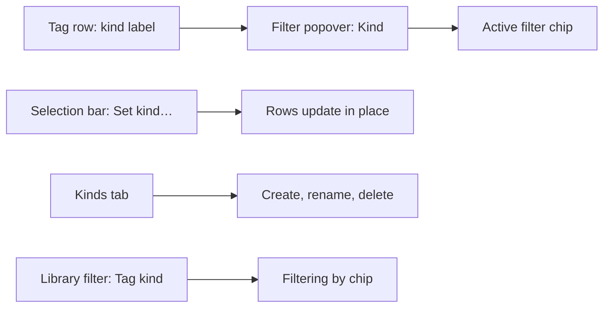
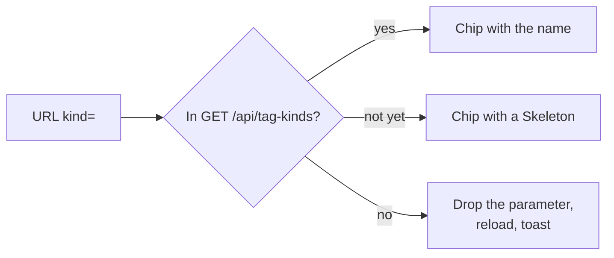
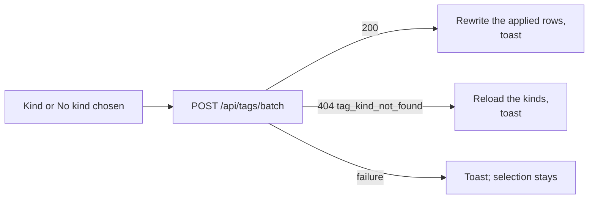
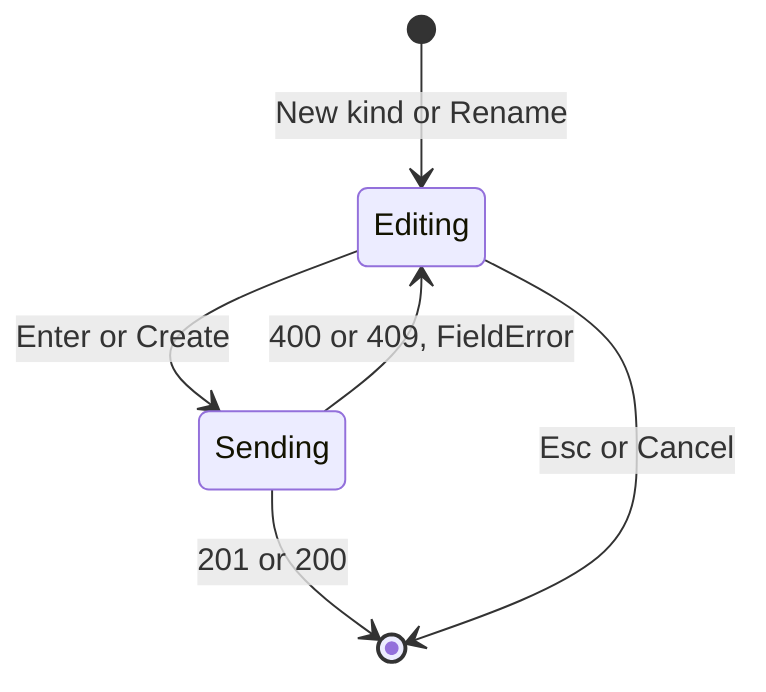

# UI design: Tag kinds

**Feature**: [parent Issue #1136](https://github.com/syudead/vv/issues/1136) ·
[plan.md](plan.md) · [research.md](research.md) (R-2 to R-5, R-7, R-8) ·
[contracts/screen-api.md](contracts/screen-api.md)

Sources that already decide the look and are not decided again here:
[design-system.md](../../docs/design-docs/design-system.md) and its rules
([components.md](../../web/registry/rules/components.md),
[patterns.md](../../web/registry/rules/patterns.md)),
[library-ui.md](../../docs/design-docs/library-ui.md), the tokens in
`web/src/ui/tokens.css`, the tag management screen of
[036 UI design](../036-tag-admin-scale/ui-design.md) (top bar, URL state,
band, rows, selection bar, bulk actions) and the library's active filter row
of [014 UI design](../014-video-tags/ui-design.md#active-tag-filters) and
[047 UI design](../047-video-work-info/ui-design.md#library-filter-by-a-person-or-organization).
This document adds only what kinds change on those screens. It changes
nothing in the design system: every part is an existing component.

The diagram shows where a kind appears and what each part does.

## Why this shape

- **The kind is a small outlined label after the tag's name, on the same
  line.** The name keeps its weight and colour (`font-medium`,
  `text-foreground`) and the label is `text-xs text-muted-foreground` with a
  `border` and no fill, so the eye reads the name first and the kind second
  (`UI品質`: the name is primary). It follows the tentative mark, which already
  sits after the name, so a row with a kind is as tall as a row without one. A
  `Kind` column was rejected: at 360px the name column is about 160px wide,
  and a column would halve it. A muted line under the name, like the synonyms
  line, was rejected: a tag with synonyms would take three lines, and rows
  would stop being equal in height. The label has no fill because a filled
  chip is what a tag looks like on a card (`Badge` `secondary`), and a kind
  must not read as a second tag.
- **The kind filter is a `Select` in the existing `Filter` popover, and shows
  as a chip under the tabs like `Tentative only`.** The popover is where the
  tag list's other conditions live, so the owner finds it where they already
  look. A `Select` holds any number of kinds in one row of the popover; a
  `ToggleGroup` like the library's watch status was rejected because the
  owner adds kinds and the popover would grow with each one; a `Combobox` was
  rejected because ten kinds need no typing
  ([components.md, Select](../../web/registry/rules/components.md#select-and-radiogroup)).
  The chip reads `Kind: Genre` and `No kind`, not the bare name, so it cannot
  be mistaken for a tag.
- **Setting a kind is one action of the selection bar, `Set kind…`, that
  opens a menu of the kinds.** Requirement 3 asks for the same flow as the
  other bulk actions: select rows, press one action. Choosing a kind applies
  at once with no dialog, because the batch deletes nothing
  ([contracts/screen-api.md, `POST /api/tags/batch` changes](contracts/screen-api.md#post-apitagsbatch-changes)).
  `No kind` is the last entry of the same menu, after a separator, so
  clearing is found where setting is. A `Set kind` submenu in each row's
  menu was rejected: it would be a second flow for the same change, and on
  touch it would nest a submenu inside the row's `Actions` menu.
- **Kinds are managed on a third tab, `Kinds`, beside `Tags` and `Rejected
  names`.** The tags page already has a tab for a second list with its own
  rows and row actions, and a list of kinds with create, rename and delete
  is the same shape as the tag list, with the same create row, rename input
  and `ConfirmDialog`. A kind management dialog was rejected: a list with an
  inline create row, a rename and a delete confirmation inside one `Dialog`
  stacks a dialog on a dialog, and the plan names the dialog only as a
  placeholder for what this document decides. The tab stays in the band, so
  it is reachable at any scroll depth, and its count tells the owner how many
  kinds exist before opening it.
- **The library filters by kind from the `Filter` popover, and the chip joins
  the `Filtering by` row.** A video has no kind of its own; "videos with a
  tag of this kind" is a condition on the list, so it sits with watch status
  and playability, and the chip sits with the tag and person chips that also
  narrow the list by what a video carries. The filter button counts it, as
  it counts watch status, because it is set from the popover.
- **Cards and the video page do not show kinds.** The card's tag row is one
  measured line, and a kind on each chip would hide more tags behind `+N`
  (`UI品質`: cards do not get more crowded). The video page's tag chips are
  the same chips. The kind is read on the tag management screen and chosen
  in the filters; a chip's `title` keeps the tag name only.

## Words

Labels the catalog already holds are written as `web/src/i18n/en.ts` shows
them; tag and kind names are user data and are embedded untranslated.

| Place | Text | Notes |
| --- | --- | --- |
| Row kind label | `Genre` | The kind's name; `Kind:` before it for screen readers only; `title` `Kind: Genre` |
| Filter popover, kind row | `Kind` | The `Select`'s visible label |
| Filter popover, kind options | `Any kind` / `Genre`, `Work`, … / `No kind` | `Any kind` is the default; the kinds in natural name order; `No kind` last after a separator |
| Active filter chip | `Kind: Genre` / `No kind` | Leading lucide `Shapes`, trailing `X` |
| Accessible name of the chip | `Remove the filter "Kind: Genre"` / `Remove the filter "No kind"` | The existing `Remove the filter "{name}"` form |
| Chip before the kind list has loaded | `Remove the kind filter` | A `Skeleton` stands in for the name |
| Kind gone from the URL filter (tags page and library) | `Removed a kind that no longer exists from the filter` | Toast; the parameter leaves the URL |
| Empty result, kind filter alone | `No tags of the kind "Genre"` / `No tags without a kind` | Button `Show all tags` |
| Empty result, kind with search or another filter | `No tags match the current search and filters` | Button `Show all tags`, which clears the search and every filter |
| Selection bar action | `Set kind…` | Lucide `Shapes`; opens the menu |
| Set kind menu | `Genre`, `Work`, … / `No kind` | Radio items; `No kind` after a separator |
| Set kind menu with no kinds | `No kinds yet. Add them on the Kinds tab.` | A `DropdownMenuLabel` above `No kind` |
| Set kind toast | `Set the kind "Genre" on 10 tags` / `Set the kind "Genre" on 6 tags. 4 already had it.` | `appliedIds` and `notApplicableIds` counts |
| Clear kind toast | `Removed the kind from 8 tags` / `Removed the kind from 6 tags. 2 had none.` | |
| Set kind with a kind that no longer exists | `That kind no longer exists, so the kinds were reloaded` | Toast on `404 tag_kind_not_found`; the kind list reloads |
| Tab | `Kinds {count}` | After `Rejected names`; the count is the number of kinds |
| Kinds tab description | `A tag has one kind or none. Set it from the Tags tab's selection bar. Deleting a kind leaves its tags without one.` | Under the tabs, like the `Rejected names` description |
| Header button on the Kinds tab | `New kind` | Lucide `Plus`; in the place of `New tag` |
| Column header | `Name` / `Tags` | |
| Row tag count | `12 tags` / `1 tag` / `0 tags` | `tagCount` |
| Accessible name of the row name | `Show the tags of the kind "Genre"` | Pressing it opens the `Tags` tab filtered by the kind |
| Create row | `New kind name` / `Kind name` / `Create` / `Creating…` | Accessible name, placeholder, button, button while sending |
| Rename input | `New name for "Genre"` | Accessible name |
| Row actions | `Rename` / `More actions` → `Delete…` | As a tag row; `Actions` on touch and below `sm` |
| Name taken | `A kind named "Genre" already exists.` | `FieldError` under the input, from `409 tag_kind_name_taken` |
| Name rules | `Enter a name` / `Line breaks and tabs aren't allowed` / `Use 100 characters or fewer (currently 120)` | The name field's local reasons, shared with tags |
| Delete dialog title | `Delete the kind "Genre"?` | |
| Delete dialog text | `The 12 tags of this kind stay, without a kind. This can't be undone.` / `No tags have this kind. This can't be undone.` | The second when `tagCount` is 0 |
| Delete dialog buttons | `Cancel` / `Delete` / `Deleting…` | |
| Delete toast | `Deleted the kind "Genre"` | |
| Kind gone during rename or delete | `This kind no longer exists, so the list was reloaded` | Toast on `404 tag_kind_not_found` |
| Kinds tab empty | `No kinds yet` / `A kind groups tags, such as Genre, Work or Place. Add one to give tags a kind.` / `New kind` | `EmptyState` with lucide `Shapes` |
| Kinds tab load failed | `Couldn't load the kinds` / `Retry` | `ErrorState` |
| Library filter popover | `Tag kind` / `Any kind`, `Genre`, `Work`, … | A `Select`; no `No kind` entry ([R-5](research.md#r-5-the-library-filters-videos-by-one-tag-kind)) |
| Library chip | `Kind: Genre` | Lucide `Shapes`, after the person and organization chips |
| Accessible name of the library chip | `Remove the filter for the kind "Genre"` / `Remove the kind filter` | The second before the name is known |

- "Kind" is the product term; "type", "category" and "attribute" are not used.
- A kind's name in text is quoted (`"Genre"`), as a tag's name is.

## Tag management screen

### Kind on a row

The row of [036, Rows](../036-tag-admin-scale/ui-design.md#rows) gains one
part: after the name and the tentative mark, a `Badge` `outline` with the
kind's name, `text-xs`, `font-normal`, `text-muted-foreground`, `shrink-0`,
truncated at `max-w-1/2` of the name line below `sm` and at
`sm:max-w-chip-label` from `sm`, with the full text in `title`. The cap below
`sm` keeps half of the name line for the name: at 360px the name column is
about 160px ([036, Actions on touch and narrow widths](../036-tag-admin-scale/ui-design.md#actions-on-touch-and-narrow-widths)),
narrower than `max-w-chip-label` (12rem). A tag without a kind shows nothing
there. The label is not pressable: the row's name link
and the kind filter already lead to the lists the owner needs, and a second
press target beside the name would compete with it.

| Row | Name line |
| --- | --- |
| Confirmed, with a kind | Name → kind label |
| Tentative, with a kind | Name → tentative mark → kind label |
| Renaming | The rename input alone; the kind label is hidden with the name and returns with it |
| Long name | The name truncates first; the label keeps its width up to its cap |
| Long name and long kind | Both truncate: the label at its cap, the name in the rest of the line, and the row does not scroll sideways |

### Kind filter

The `Filter` popover of [036, Top bar](../036-tag-admin-scale/ui-design.md#top-bar)
gains a third row after `Unused only`: a `Field` with the label `Kind` and a
`Select` whose value is `Any kind`, one kind, or `No kind`. Choosing a value
reloads the first page with `kind=<id>` or `kind=none`, leaves the popover
open, counts as one applied filter on the button, and adds a chip after the
`Tentative only` and `Unused only` chips. `Clear filters` resets it with the
other two. The chip is the existing chip with lucide `Shapes`; pressing it
removes only the kind, and the focus moves as for the other chips. The
`Select` is disabled with the rest of the popover's rows under the same
conditions as the `Filter` button.

The diagram shows what the screen does with a `kind` id it cannot resolve.

The kind list is read when the screen opens, after the `Kinds` tab changes
it, and after a tag action that changes how many tags a kind has. Those
actions are a `Set kind` or `No kind` with any `appliedIds`, and a delete,
reject or merge of tags, single or bulk, because the tags that leave take
their kind with them. Each one marks the cached list stale, and the `Kinds`
tab reads it again when opened, so its counts and the delete dialog's text
use the current `tagCount`. Until the list arrives the chip holds a
`Skeleton` (`w-12`), as a library tag chip before the tag list loads. A
`kind=<id>` with no kind in a list that was read successfully leaves the URL
with a `replace`, the list reloads without it, and the toast of
[Words](#words) says so; the other conditions stay. A failed read removes
nothing: the filter stays applied, the chip keeps its `Skeleton` and the
accessible name `Remove the kind filter`, and the next read tries again.

The empty result under a kind filter uses the two headings of
[Words](#words): the kind alone names the kind, and a kind with a search or
another filter uses the one heading for every combination, because the
combinations of four conditions would otherwise need sixteen headings. Both
end with `Show all tags`, which clears the search and every filter.

### Set kind

`Set kind…` is a `ghost` `sm` `Button` with lucide `Shapes` in the selection
bar of [036, Selection bar](../036-tag-admin-scale/ui-design.md#selection-bar),
after `Confirm` and before `Merge into one tag…`. It is shown for every
selection, because every tag can take or lose a kind, and it is `disabled`
with the other actions while a bulk action sends or the selection is over
the limit.

It opens a `DropdownMenu` (`align="end"`) with one `DropdownMenuRadioGroup`
that holds a `DropdownMenuRadioItem` for each kind in natural name order, a
`DropdownMenuSeparator`, and `No kind` as the group's last
`DropdownMenuRadioItem`. The separator is only a visual boundary: every item
is in the one group, so one checked state covers them all. The checked item
is the kind every selected tag shares (`No kind` when none of them has one);
with mixed kinds nothing is checked. With no kinds a `DropdownMenuLabel`
`No kinds yet. Add them on the Kinds tab.` sits above the group, which then
holds `No kind` alone and no separator: the line has no behaviour, its value
is telling the owner where kinds come from, and the muted label style and
the lack of a radio mark keep it from reading as a choice (Q-5).

The diagram shows what one choice does.

| Response part | Screen result |
| --- | --- |
| `appliedIds` | Those rows get the chosen kind's label, or lose it, within the loaded rows, with no reload, and leave the selection. Under `kind=none` a row that got a kind leaves the list, and under `kind=<id>` a row that lost that kind leaves it, so `total` drops as it does after a bulk confirm under `Tentative only` |
| `notApplicableIds` | Stay selected; the toast adds the count |
| `notFoundIds` not empty | The list reloads from the top with the toast of [036, Bulk confirm](../036-tag-admin-scale/ui-design.md#bulk-confirm) |
| `404 tag_kind_not_found` | Nothing changes; the kind list reloads and the menu shows the current kinds next time |
| Failure | A toast with `errorText`; nothing changes and the selection stays |

The focus after the action follows the rule of
[036, Bulk confirm](../036-tag-admin-scale/ui-design.md#bulk-confirm), with
`Set kind…` in the place of `Confirm` as the button the focus returns to.

### States

| State | What the screen shows |
| --- | --- |
| Kind filter applies, rows match | The count `90 of 1,000 tags`, the chip under the tabs, rows whose labels all read the same kind, or none under `No kind` |
| Kind filter applies, nothing matches | The empty state of [Words](#words); the `Filter` button stays enabled so the filter can be removed |
| Kind in the URL no longer exists | The parameter leaves, the list reloads, the toast shows |
| Kinds not loaded yet | A `Skeleton` in the chip; the `Select` lists `Any kind` and `No kind` only until the kinds arrive |
| Set kind sending | The selection bar's buttons `disabled`, the `Set kind…` icon a `Spinner` |

## Kinds tab

The tab `Kinds {count}` follows `Rejected names` in the band's `TabsList`
([036, Tabs](../036-tag-admin-scale/ui-design.md#tabs)). Switching to it
follows the tab rules there: the selection, the create row and a rename on
the `Tags` tab close, and the tab does not switch while a create or rename
sends. The URL carries `tab=kinds`. While it is open the top bar holds
nothing, as on `Rejected names`: search, filters and sort do not apply to
kinds. The header row shows the `h1` and `New kind` in the place of
`New tag`, without the tag count. Under the tabs, one line
`text-sm text-muted-foreground` carries the tab description of
[Words](#words).

### Rows

The body is a `DataTable` with the columns `Name` (`w-full`) and `Tags`
(right-aligned, `tabular-nums`), and the row actions column; there is no
checkbox column and no selection bar, because kinds have no bulk action.
Kinds are listed in natural name order, every kind at once (no paging: the
list is at most tens of rows).

| Part | Form |
| --- | --- |
| Name | A link in the tag row's name style; pressing it switches to the `Tags` tab with `kind=<id>` (the other conditions stay), so a kind's tags are one press away |
| Count | `12 tags`, `text-muted-foreground`, including tentative tags |
| Actions | `Rename` (`Pencil`) and `More actions` (`Ellipsis`) → `Delete…` (`destructive`), the tag row's `RowIconButton` and `RowMoreMenu`; on touch and below `sm` one `Actions` menu with the two items |
| Create | `New kind` inserts the create row of [036, Band](../036-tag-admin-scale/ui-design.md#band) at the top of the list and focuses its input; `Create` sends `POST /api/tag-kinds`, and on `201` the row joins the list at its name position and the focus moves to its name |
| Rename | The tag row's rename input in the name column; Enter sends `PATCH`, Esc cancels; on `200` the row is rewritten in place and moves to its name position |
| Delete | `Delete…` opens a `ConfirmDialog` with the title and text of [Words](#words), `Cancel` first and a `destructive` `Delete`; on `204` the row leaves, the toast shows, and the focus moves to the next row's `Rename`, else the previous row's, else `New kind`; while the row actions are collapsed (touch, below `sm`) the target is that row's `Actions` button in the place of `Rename`, as [036, Actions on touch and narrow widths](../036-tag-admin-scale/ui-design.md#actions-on-touch-and-narrow-widths) does for tag rows |

The diagram shows the states of the create row and the rename input.

A `409 tag_kind_name_taken` and a `400` name reason show as a `FieldError`
under the input and keep the input open with its text (Edge Case: the owner
sees the name cannot be used and changes it). A rename to the kind's own
name sends and returns `200` with nothing changed.

A rename or delete changes the text on every tag of the kind, so leaving the
`Kinds` tab after one reloads the `Tags` tab's first page and the shared tag
list ([contracts/screen-api.md, `web/src/api` functions](contracts/screen-api.md#websrcapi-functions));
without a rename or delete, returning shows the same rows as before, as
[036, Tabs](../036-tag-admin-scale/ui-design.md#tabs) says.

### States

| State | What the screen shows |
| --- | --- |
| Loading | `LoadingState` `table` rows in the body; `New kind` disabled |
| Loaded | The rows; the four presets on a fresh database |
| Empty | `EmptyState` with lucide `Shapes`, the title, description and `New kind` of [Words](#words) |
| Load failed | `ErrorState` with `Retry` |
| Kind gone (`404` on rename or delete) | The dialog or input closes, the toast shows, the list reloads |
| Create or rename failed on the name | The `FieldError` under the input; the input keeps its text |

## Library

### Kind filter

The owner's `Filter` popover of
[library-ui.md, Shell and toolbar](../../docs/design-docs/library-ui.md#shell-and-toolbar)
gains a last row after `Playable only`: a `Field` with the label `Tag kind`
and a `Select` whose value is `Any kind` or one kind, in natural name order.
The kinds come from the one cached kind list
([contracts/screen-api.md, `web/src/api` functions](contracts/screen-api.md#websrcapi-functions)),
read from `GET /api/tag-kinds` when the popover first opens or when a
`tagKind` applies and the list is not cached yet, as on a URL opened
directly; the two share one request. Choosing a kind
applies at once as the other rows do: the URL gains `tagKind=<id>`, the list
reloads from the top with `total` counting it, and the popover stays open.
The button counts it as one applied filter. `Clear filters` removes it with
`tag`, `person` and `organization`. A guest sees no row and a guest URL with
`tagKind` is reset before the request, as `fav=1` is.

### Chip

While `tagKind` applies, the `Filtering by` row shows one more chip after the
person and organization chips, in the same `Toggle` form: lucide `Shapes`,
`Kind: Genre`, `×`. The name comes from the cached kind list, which the chip
starts reading when it is not cached ([Kind filter](#kind-filter-1)); until
it arrives a `Skeleton` (`w-12`) stands in. Pressing the chip removes only
`tagKind`, and the focus moves as for the other chips. A `tagKind` whose id
is not in a kind list that was read successfully leaves the URL with a
`replace`, the chip goes, the list reloads and the toast of [Words](#words)
shows; the tag, person and organization filters stay, as a `404` person is handled in
[047, Library](../047-video-work-info/ui-design.md#library-filter-by-a-person-or-organization).
A failed read removes nothing: the filter stays applied, the chip keeps its
`Skeleton` and the accessible name `Remove the kind filter`, and the read is
tried again when the popover opens.

### States

| State | What the screen shows |
| --- | --- |
| Kind applies, videos match | The chip, the count row with the narrowed `total`, the cards unchanged |
| Kind applies, nothing matches | The chip above the no-match state of [014, Active tag filters](../014-video-tags/ui-design.md#active-tag-filters) |
| Kind gone | The chip and the parameter go, the toast shows, the list reloads |
| Kinds not loaded | The `Select` shows `Any kind` alone until the kinds arrive; the chip holds a `Skeleton` |
| Kind list failed to load | The filter stays applied; the chip keeps its `Skeleton` and stays removable |

## Responsive behaviour

Width variants use Tailwind's default breakpoints in CSS
([library-ui.md, Width breakpoints in CSS, and the sidebar exception](../../docs/design-docs/library-ui.md#width-breakpoints-in-css-and-the-sidebar-exception)).
The judged widths are 360px, 768px and 1280px.

| Width | Tag rows | Filters and selection bar | Kinds tab | Library |
| --- | --- | --- | --- | --- |
| 1280px | Name, mark and kind label on one line; the label at its full width up to `max-w-chip-label` | The `Select` fills the popover's width (`w-popover`); `Set kind…` sits in the bar's row with the other actions | Name, count and two `RowIconButton`s, as the tag rows | The `Select` fills the popover; the chip sits in the `Filtering by` row with the others |
| 768px | As above | As above; the `Filter` button shows the icon and count | As above | As above |
| 360px | The name truncates before the label does; the label stays visible after a name of any length, capped at half the name line so the name keeps the other half and nothing scrolls sideways | The selection bar's actions wrap under the count, `Set kind…` among them; the menu opens within the viewport (`align="end"`) | Name, count and one `Actions` menu; the create row and rename input span the row | The chip truncates its name at `max-w-chip-label`; the row wraps |

- The kind label adds no height to a row at any width.
- The `Set kind` menu scrolls when the kinds exceed the viewport's height
  (Radix keeps the menu inside the viewport).
- The kinds tab's rows stay one line each at 360px: the longest preset,
  `Character`, the count and the `Actions` button take about 220px.

## Review criteria

Judge on a real screen
([library-ui.md, Layout verified by people, not machines](../../docs/design-docs/library-ui.md#layout-verified-by-people-not-machines));
presence alone does not pass (Q-4). Check at 1280×800 first, then 768px and
360px (touch emulation for the collapsed row actions).

1. **Visual hierarchy, tag rows**: with every row carrying a kind, the eye
   still goes to the names first; the labels read as a quieter second column
   of text after the names, in the muted colour with a thin border and no
   fill. Covering the labels with a hand changes nothing about how the names
   read. A tentative tag's mark stays between the name and the label. No row
   with a kind is taller than a row without one (`UI品質`: the name is primary,
   rows not more crowded). At 360px a 100-character tag name with a
   100-character kind shows both truncated on one line, the name taking at
   least half of it, and the table does not scroll sideways.
2. **Kind against tag**: a kind label on a tag row and a tag chip on a library
   card are told apart at a glance: the label has a border and no fill, the
   chip a fill and no border. The active filter chip `Kind: Genre` is told
   apart from both by its `Shapes` icon, its `soft` surface and the `Kind:`
   prefix.
3. **Density and spacing**: the label sits `gap-1` after the mark or the name,
   the same gap as between the name and the mark. In the `Filter` popover the
   `Kind` row keeps the `gap-3` of the two checkbox rows above it and the
   `Select` is `h-8`, the popover's control height. On the `Kinds` tab the
   column header's `Name` and `Tags` sit exactly above the rows' name and
   count, and rows have the tag rows' `py-2`.
4. **Typography**: the label is `text-xs font-normal`, one step below the
   name's `text-sm font-medium`; the chip, the `Select` and the menu items
   use the components' own sizes, unchanged. The kinds tab description is
   `text-sm text-muted-foreground`, the same as the rejected names
   description.
5. **Action priority**: in the selection bar `Confirm` stays the only primary
   action; `Set kind…` is a `ghost` button like `Merge into one tag…`, placed
   between them. Setting a kind on ten tags takes two presses after the
   rows are selected: `Set kind…` → the kind, and the toast reads `Set the
   kind "Genre" on 10 tags` (acceptance criterion 2). Clearing takes the
   same two presses with `No kind`. The `Kinds` tab's `New kind` is the one
   primary button on that tab, and `Delete…` sits behind `More actions`.
6. **Kind filter**: giving `Robot` the kind `Genre`, then choosing `Genre` in
   the `Filter` popover, shows the chip `Kind: Genre`, the count `N of M
   tags`, and `Robot` in the list; choosing `No kind` shows `No kind` and a
   list without `Robot` (acceptance criterion 1). Reloading keeps the filter
   from the URL. The `Filter` button shows the count `1`, and `Clear filters`
   removes the chip.
7. **Kinds tab**: on a fresh database the tab reads `Kinds 4` and lists
   `Character`, `Genre`, `Place`, `Work` in that order. Adding `Studio`,
   renaming it to `Studios` and deleting it leaves the tags that had it in
   the `Tags` tab without a label (acceptance criterion 3). Creating a second
   `Genre` shows `A kind named "Genre" already exists.` under the input with
   the text kept (Edge Case). Pressing a kind's name opens the `Tags` tab
   filtered by that kind.
8. **Library**: choosing `Genre` under `Tag kind` shows the chip `Kind:
   Genre` in the `Filtering by` row, lists only videos with a tag of that
   kind, and the filter button counts it; the chip's `×` and `Clear filters`
   both remove it. Deleting the kind on the tags page and returning shows the
   toast and a list without the filter. No card's tag row is wider or taller
   than before the feature (`UI品質`).
9. **External change**: setting a kind through the external API and
   reloading the tags page shows the label on that tag (acceptance criterion
   4).
10. **Keyboard**: Tab reaches the `Select` in the `Filter` popover after
    `Unused only`; in the selection bar `Set kind…` follows `Confirm` and the
    menu's arrow keys move between kinds; on the `Kinds` tab Tab goes `New
    kind` → tabs → rows' name → `Rename` → `More actions`. Esc in the menu
    returns the focus to `Set kind…`.
11. **Examples that do not meet the requirement** (`UI品質`): kind labels
    catch the eye before names, or are filled like tag chips. A row with a
    kind is taller than one without. The kind filter is a row of toggles
    that grows with each kind. `Set kind` asks for confirmation. A kind on a
    card's tag row hides tags behind `+N` that were visible before. The kinds
    list is a dialog whose delete confirmation opens over it. The chip reads
    `Genre` alone and looks like a tag filter.
