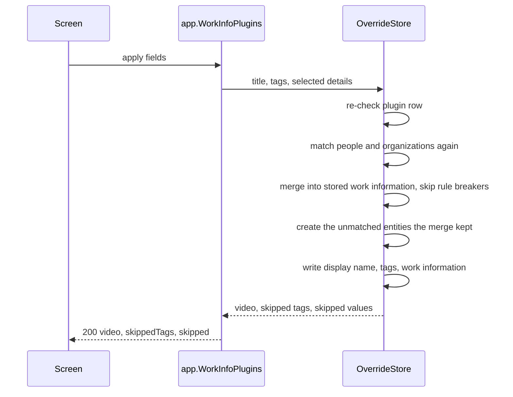

# Contract: Work details in the fetch and apply screen API

Source of truth: [api/openapi.yaml](../../../api/openapi.yaml), operations
`fetchWorkInfo` and `applyWorkInfoFetch`; Go and TypeScript are generated by
`task generate`. This file lists only what this feature adds to
[049 screen-api.md](../../049-work-info-plugins/contracts/screen-api.md).
Both routes stay owner only. The external API, MCP, the plugin list and the
search do not change.

## `WorkInfoField`

The enum grows from `title` and `tags` to one value per selectable row
([R-2](../research.md#r-2-one-selectable-row-per-field-per-date-kind-and-per-role)).

| Value | Row | Apply rule ([R-4](../research.md#r-4-the-apply-merges-the-selected-fields-into-the-stored-work-information-in-one-transaction-and-skips-each-value-that-breaks-a-rule)) |
| --- | --- | --- |
| `title`, `tags` | As in 049 | Unchanged |
| `cover` | Cover | Makes the fetched cover image the video's thumbnail, before the other fields, with the checks and fit of an uploaded image; an image that cannot be used, or a video whose content changed, is skipped as `invalid` |
| `code`, `description` | Code, Description | Replaces the stored value |
| `dates.release`, `dates.recorded`, `dates.published` | Released, Recorded, Published | Replaces the stored date of that kind |
| `people.performer`, `people.director`, `people.photographer`, `people.streamer` | Performers, Directors, Photographers, Streamers | Appends the entries not linked in that role yet |
| `organizations.maker`, `organizations.label` | Makers, Labels | Appends the entries not linked in that role yet |
| `urls` | Links | Appends the URLs not stored yet |
| `externalIds` | IDs | Appends the `(source, value)` pairs not stored yet |

## `POST /api/videos/{id}/work-info-fetches`

The request does not change. `WorkInfoFetch` gains the fetched work details,
each list required and `[]` when the plugin returned none, so a plugin of
049 answers the same body plus empty lists.

| Field | Type | Meaning |
| --- | --- | --- |
| `code`, `description` | string, optional | As the plugin returned them, trimmed; absent when it returned none |
| `dates` | `[{ kind, date }]` | In kind order; `date` as returned |
| `people` | `[{ role, name, externalIds: [{ source, value }], match }]` | In `(role, fetched)` order; `match` is below |
| `organizations` | `[{ role, name, externalIds, match }]` | The same |
| `urls` | string[] | As returned |
| `externalIds` | `[{ source, value }]` | As returned |
| `cover` | `{ width, height }`, optional | The fetched cover image's size; absent when the plugin returned none or VVMDM could not fetch or read it. `GET /api/videos/{id}/work-info-fetches/{fetchId}/cover` serves the image from VVMDM, so the browser does not contact the site |

`match` is the entity the entry resolves to at fetch time
([R-3](../research.md#r-3-people-and-organizations-are-matched-by-external-id-then-by-folded-name-or-alias-and-an-ambiguous-match-links-nothing)).

| `match.state` | Other `match` fields | The comparison shows |
| --- | --- | --- |
| `existing` | `id`, `name`: the matched entity and its current name | The entity's name; muted with `Check` when the video already links it in that role, which the screen reads from its own `workInfo` |
| `new` | — | The fetched name with the `New` mark; the apply creates the entity |
| `ambiguous` | — | The fetched name with the `Not linked` mark; the apply skips it |

A value that breaks a field rule is not removed here: the apply decides and
reports it (R-4).

## `POST /api/videos/{id}/work-info-fetches/{fetchId}/apply`

`fields` accepts every `WorkInfoField`; each named field must have a value
in the result, as before. The response gains `skipped`, beside the unchanged
`skippedTags`.

| Field | Type | Meaning |
| --- | --- | --- |
| `skipped` | `[{ field, value, reason }]` | The values of the selected fields the apply left out, in field order then fetched order; `field` is a `WorkInfoField`, `value` the text the comparison showed (a date, a URL, a name, `source: value`; the first 100 characters of a description) |
| `skipped[].reason` | `invalid` / `too_many` / `ambiguous` | A field rule, an entry limit counted after the stored entries, or an ambiguous match |

The response `Video` carries `workInfo` after the apply, as
`PUT /api/videos/{id}/details` does. The errors of 049 are unchanged;
`invalid_request` also answers a field whose row has no value.

The diagram shows the apply's transaction.

## `ErrorReason` and `Error`

No new reason or field. A `work_info_*` rule never fails the apply: the value
is skipped instead (R-4).
