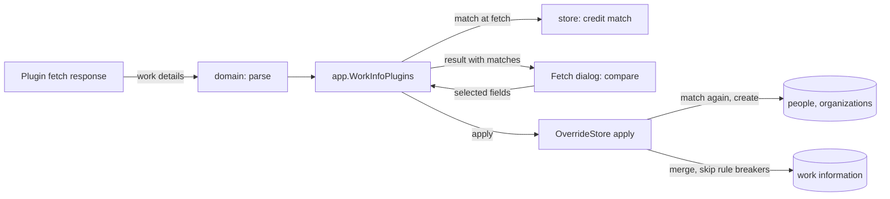
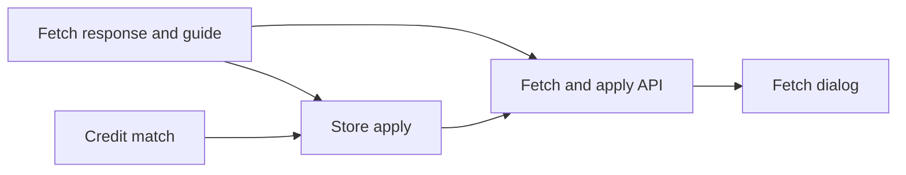

# Implementation Plan: Work details from work-info plugins

**Branch**: `feature/052-plugin-work-info-fields` | **Parent Issue**: #1143

**Input**: The parent Issue. It is this feature's specification.

## Summary

A work-info plugin's `fetch` response may now carry the work details of 047
(code, description, dates, people, organizations, links, IDs) beside the
title and the tags; the comparison on the video page shows each fetched
field against the current value, one row per field, date kind and role, and
the apply writes the selected rows in the same transaction as the title and
the tags. People and organizations are matched to existing entities by
external ID, then by folded name or alias, created when nothing matches, and
left alone when several match; a value that breaks a field rule is skipped
and reported after the apply. The plugin contract stays version 1, and a
plugin that returns only the title and the tags is unchanged.

The diagram shows the parts this feature changes and what flows between them.



| Concern | Approach |
| --- | --- |
| Plugin contract | Optional fields in the `fetch` response, contract 1 unchanged ([R-1](research.md#r-1-the-fetch-response-gains-optional-work-detail-fields-in-contract-1), [contracts/plugin-contract.md](contracts/plugin-contract.md)) |
| Selection | One row per field, per date kind and per role; `WorkInfoField` grows to fifteen values ([R-2](research.md#r-2-one-selectable-row-per-field-per-date-kind-and-per-role), [contracts/screen-api.md](contracts/screen-api.md)) |
| People and organizations | Matched by external ID, then folded name or alias, in the store, at fetch time and again inside the apply; ambiguous entries link nothing ([R-3](research.md#r-3-people-and-organizations-are-matched-by-external-id-then-by-folded-name-or-alias-and-an-ambiguous-match-links-nothing)) |
| Apply | Selected fields merged into the stored object and written with 047's replace path in 049's one transaction; each rule-breaking value skipped and reported ([R-4](research.md#r-4-the-apply-merges-the-selected-fields-into-the-stored-work-information-in-one-transaction-and-skips-each-value-that-breaks-a-rule)) |

The Issue has the `ui` label, so the `design` stage writes `ui-design.md`
before the screen unit. It revises the comparison step of
[049 ui-design.md, Compare](../049-work-info-plugins/ui-design.md#compare):
the rows for the new fields in the order of
[contracts/screen-api.md, `WorkInfoField`](contracts/screen-api.md#workinfofield),
which rows a result shows when it lacks a field, what each row's `Now` and
`Fetched` cells show for a single value and for a list that is added to
(which entries are new to the video), the subdued
`New` mark for an entity the apply creates and the `Not linked` mark for an
ambiguous one, the row states for a list row, and the result step's lines
for `skipped` beside the skipped tags, within the Issue's `UI品質`.

Out of scope, as the parent Issue's `対象外` says: tag kinds (#1136);
updating an existing person's or organization's name, aliases, external IDs
or parent from a result; a mode that links only to existing entities without
creating; images or dates on search candidates; fetching on import or in
bulk.

## Technical Context

**Canonical definitions**:

| Topic | Source |
| --- | --- |
| Boundaries, store roles and package-private helpers, events after commit | [ARCHITECTURE.md](../../ARCHITECTURE.md) |
| Plugin sandbox, run, result cache and apply | [work-info-plugins.md](../../docs/design-docs/work-info-plugins.md), [049 research](../049-work-info-plugins/research.md), [internal/app/work_info_fetch.go](../../internal/app/work_info_fetch.go), [internal/store/work_info_fetch.go](../../internal/store/work_info_fetch.go) |
| Plugin contract for authors | [work-info-plugins.md (how-to)](../../docs/how-to/work-info-plugins.md) |
| Work information tables, field rules, entities, `CreditStore` | [047 data-model.md](../047-video-work-info/data-model.md), [internal/store/work_info.go](../../internal/store/work_info.go), [internal/store/credits.go](../../internal/store/credits.go) |
| Folded matching form | [013 data-model.md](../013-library-search/data-model.md), `domain.FoldForMatch` |
| Screen API, errors, generated code | [api/openapi.yaml](../../api/openapi.yaml), [023 error-api](../023-english-i18n/contracts/error-api.md), `task generate` |
| Fetch dialog, work details row, screen rules, Web tests | [web/src/player/workInfoFetch/](../../web/src/player/workInfoFetch/), [web/src/player/WorkInfo.tsx](../../web/src/player/WorkInfo.tsx), [design-system.md](../../docs/design-docs/design-system.md), [web-testing.md](../../docs/design-docs/web-testing.md) |
| Browser test and its fixture plugin | `web/e2e/work-info-plugins.e2e.ts` (since removed), `internal/wasmplugin/testdata/e2eworks/` (since removed) |
| Checks | [Taskfile.yml](../../Taskfile.yml) (`task check`, `task check-docs`) |

**Feature-specific context**: No new dependency, no migration and no new
route: the feature changes the two fetch routes' bodies, the plugin response
and the store's apply. The result cache of 049 R-8 holds the work details
and their matches beside the title and the tags, with the same lifetime.

## Constitution Check

| Rule (source) | Verdict |
| --- | --- |
| Store roles; work spanning roles runs in one transaction through package-private helpers (ARCHITECTURE.md) | Pass: `OverrideStore.ApplyFetchedWorkInfo` keeps owning the apply and reaches the work information and entity rows through the package-private helpers of `work_info.go` and `credits.go`; the match is one new read on `CreditStore` |
| Events after commit (ARCHITECTURE.md) | Pass: `VideoWorkInfoChanged` joins `VideoOverrideChanged` after the apply's commit ([R-4](research.md#r-4-the-apply-merges-the-selected-fields-into-the-stored-work-information-in-one-transaction-and-skips-each-value-that-breaks-a-rule)) |
| User data survives a rebuild (ARCHITECTURE.md) | Pass: the apply writes the 047 tables under the user key and the entity tables, which carry no link to `videos` |
| Every read knows its viewer (ARCHITECTURE.md) | Pass: both routes stay owner only; the fetched result reaches nobody else |
| Do not hand-edit generated files (AGENTS.md) | Pass: `api/openapi.yaml` changes, then `task generate` |
| Complexity 25 or less; share code instead of copying it (AGENTS.md) | Pass: the merge produces a `domain.WorkInfo` that 047's `replaceWorkInfo` writes; entity creation reuses `writeCreditNames` and `writeCreditExternalIDs`; the rule check reuses `NormalizeWorkInfo` on each value |
| Read design-system.md before a screen; test at the lowest level (AGENTS.md, web-testing.md) | Pass: parsing, matching and merging get Go unit tests, the routes handler tests, the dialog page tests, the whole flow the existing browser test extended |
| Documentation with the change (AGENTS.md, core-beliefs.md) | Pass: the authors' guide, the design document and the ARCHITECTURE subsystem row are updated by the units that change the behaviour |

No violation, so no complexity tracking. The verdicts hold after Phase 1.

## Project Structure

### Documentation (this feature)

```text
specs/052-plugin-work-info-fields/
├── plan.md
├── research.md
└── contracts/
    ├── plugin-contract.md
    └── screen-api.md
```

`ui-design.md` is written by the `design` stage. No `data-model.md`: no
table or column changes, and the match and merge rules are R-3 and R-4. No
`quickstart.md`: the Go tests and the browser test cover the feature without
the internet, so nothing is run by hand.

### Source Code

**Affected boundaries**:

| Boundary | What it owns in this feature |
| --- | --- |
| `internal/domain` | Parsing the extended `fetch` response with its limits; the extended fetched result with per-entry matches; the fifteen `WorkInfoField` values; the merge of selected fields into a `WorkInfo` with the skipped values |
| `internal/store` | The credit match read on `CreditStore`; the extended `OverrideStore.ApplyFetchedWorkInfo` that matches again, creates entities and writes the work information |
| `internal/app` | Matching at fetch time, holding the details in the result cache, validating the selected fields |
| `internal/httpapi`, `api/openapi.yaml` | The extended `WorkInfoFetch`, `WorkInfoField` and `WorkInfoFetchApplied` |
| `web/src/api`, `web/src/player/workInfoFetch`, `web/src/i18n` | The client types, the comparison rows and the result step, the catalog text |
| `web/e2e`, `internal/wasmplugin/testdata/e2eworks` | The browser test and its fixture plugin returning work details |
| `docs/`, `ARCHITECTURE.md` | The authors' guide, the design document's apply section, the subsystem row |

**New paths**: None.

**Structure decision**: The match lives in `internal/store`, not in
`internal/domain` or the screen, because the folded spellings it compares
are the stored `search_key` rows and the apply must repeat it inside its
transaction ([R-3](research.md#r-3-people-and-organizations-are-matched-by-external-id-then-by-folded-name-or-alias-and-an-ambiguous-match-links-nothing)).
The merge of selected fields into the stored object is a pure
`internal/domain` function over two `WorkInfo` values and the fetched
details, so the skip rules are unit-tested without SQLite, and the store
only writes what it returns.

## Implementation Work

The diagram shows which units have to land first. The screen unit also waits
for the `design` stage's `ui-design.md`.



### Accept work details in a plugin's fetch response and publish them in the plugin guide

**Scope**: `domain.FetchedWorkInfo` gains the fields of
[contracts/plugin-contract.md](contracts/plugin-contract.md), and
`ParseWorkInfoResponse` reads them with the trimming, dropping and limits it
lists; the `Response` section of `docs/how-to/work-info-plugins.md` lists the
fields, their rules and the external-ID advice (requirement 9), and
`contracts/plugin-contract.md` of this feature links there.

**Dependencies**: None.

**Acceptance**: `task check` and `task check-docs` pass; domain tests show a
response with every field parsed in order, surrounding whitespace trimmed,
an entry with an unknown `role` or `kind` dropped, the second `release`
date dropped, the 101st performer and the 21st URL dropped, a repeated
`(source, value)` kept once, and a response with only `title` and `tags`
parsed exactly as before; the guide's `Response` table names every field
and its limit.

### Match fetched people and organizations to existing ones

**Scope**: A read on `CreditStore` that takes the fetched entries of one
kind and returns, per entry, the matched entity or `new` or `ambiguous` by
[R-3](research.md#r-3-people-and-organizations-are-matched-by-external-id-then-by-folded-name-or-alias-and-an-ambiguous-match-links-nothing):
external IDs first, then `FoldForMatch(name)` against every name and alias
row's `search_key`; the match result types in `internal/domain`.

**Dependencies**: Accept work details in a plugin's fetch response and
publish them in the plugin guide.

**Acceptance**: `task check` passes; store tests show an entry whose
external ID one person holds matched to that person even when its name
equals another person's name, an entry whose name equals an alias in another
width matched, an entry whose name two people share answered `ambiguous`,
an entry whose two external IDs two people hold answered `ambiguous`, an
entry matching nothing answered `new`, an organization matched only against
organizations, and the same entry twice answered the same.

### Apply fetched work details to the video in one transaction

**Scope**: A pure `internal/domain` merge of the selected fields into the
stored `WorkInfo` by
[R-4](research.md#r-4-the-apply-merges-the-selected-fields-into-the-stored-work-information-in-one-transaction-and-skips-each-value-that-breaks-a-rule)
(replace, append without repeats, each rule-breaking or over-limit value
returned as skipped, a `new` entry checked with `NormalizeCredit` and against
the role's limit and kept without an ID); `OverrideStore.ApplyFetchedWorkInfo`
extended to match again inside its transaction, merge, create only the `new`
entities the merge kept with their fetched name and external IDs, fill in
their IDs, write through `replaceWorkInfo`,
advance the edit time and publish `VideoWorkInfoChanged` after the commit;
the apply section of `docs/design-docs/work-info-plugins.md` and the
`internal/app` row of ARCHITECTURE.md's subsystem map.

**Dependencies**: Match fetched people and organizations to existing ones.

**Acceptance**: `task check` and `task check-docs` pass; domain tests show
`code` replaced, a selected date kind replaced while the other kinds stay, a
performer appended after the stored ones, a stored URL not repeated, a date
in another form and a URL without a scheme returned as `invalid` while the
rest of the row is applied, the 101st performer returned as `too_many`, and
a `new` performer with an empty name or a name over the entity limit
returned as `invalid`;
store tests show the Issue's acceptance 2 to 5 and its edge cases: a second
performer added beside the stored one, an entry with an existing person's
external ID linked without a new row, a `new` entry creating a person that
carries the fetched external ID, the same person twice in the result and a
person already linked in the role linked once, a person created between the
fetch and the apply linked instead of duplicated, an ambiguous entry neither
linked nor created and reported, a `new` performer on a video that already
links 100 performers reported as `too_many` with no new person row, a `new`
performer whose name is over the entity limit reported as `invalid` while
a selected `code` is written, and a missing video leaving no new person
and no work information row; `VideoWorkInfoChanged` published once after
the commit when a work detail changed and not when only the title changed.

### Return work details from a fetch and apply the selected fields through the screen API

**Scope**: `app.WorkInfoPlugins` matches the fetched people and
organizations through the store at fetch time, keeps the details and
matches in the result cache, and validates the fifteen fields against the
result; `fetchWorkInfo` and `applyWorkInfoFetch` with the schema changes of
[contracts/screen-api.md](contracts/screen-api.md); the client functions and
types in `web/src/api/workInfoPlugins.ts`.

**Dependencies**: Accept work details in a plugin's fetch response and
publish them in the plugin guide; Apply fetched work details to the video in
one transaction.

**Acceptance**: `task check` passes with no diff from `task generate`; app
tests with a fake runtime show a fetch result carrying each field with its
`match.state`, a fetch from a title-and-tags plugin carrying empty lists and
no `code`, and `dates.release` selected on a result without a release date
answered `ErrWorkInfoApplyInvalid`; handler tests show the fetch body of
the contract, an apply of `code`, `dates.release` and `people.performer`
answering `200` with the video's `workInfo` holding them, an apply whose
date breaks the form answering `200` with that date in `skipped` as
`invalid` and the code written, and both routes answering `401`
`unauthenticated` to a guest.

### Compare and apply work details in the fetch dialog

**Scope**: The comparison and result steps of
`web/src/player/workInfoFetch/` as `ui-design.md` specifies: one row per
field in the contract's order, the `Now` cell from the page's `workInfo`,
the `Fetched` cell with the new and not-linked marks and the count of
entries new to the video, the row states of a list row, the selection of
rows with a value that differs, the response `Video` replacing the page's,
and the `skipped` lines in the result step; catalog text; the fixture
plugin `e2eworks` returning a code, a release date, a performer with an
external ID and a maker, and `web/e2e/work-info-plugins.e2e.ts` extended.

**Dependencies**: Return work details from a fetch and apply the selected
fields through the screen API; the `design` stage.

**Acceptance**: `task check` passes and CI's `Browser E2E` passes with the
extended test, which applies the code, the release date, the performer and
the maker and sees them in the work details row, then fetches again for a
video that already has another performer, applies the performer and sees
both, and sees the performer on the people screen with the fixture's
external ID; page tests show a `new` entry with its mark, an `ambiguous`
entry with its mark and not counted as new, an entity already linked in the
role making the row `Same as now`, a field without a value not selectable,
a title-and-tags result compared as before, and a `skipped` date shown in the result step with the other fields applied;
the screen is checked visually at the widths `ui-design.md` names.
