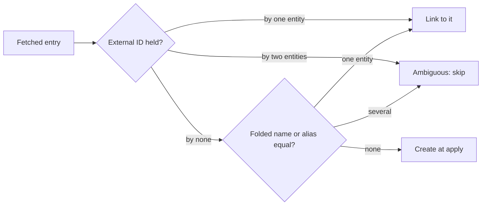

# Research: Work details from work-info plugins

Inherited decisions: the plugin contract, the in-memory fetched result and
the one-transaction apply of
[049](../049-work-info-plugins/research.md) (R-2, R-8, R-9), the work
information model, its field rules and its id entities of
[047](../047-video-work-info/data-model.md) and
[047 research](../047-video-work-info/research.md) (R-3, R-4, R-11, R-13),
and the folded matching form `FoldForMatch` of
[013](../013-library-search/data-model.md). This file records only the
decisions this feature adds.

## R-1: The fetch response gains optional work-detail fields in contract 1

**Decision**: A plugin's `fetch` response `workInfo` may carry `code`,
`description`, `dates`, `people`, `organizations`, `urls` and `externalIds`
beside `title` and `tags`, each optional, in the shapes of
[contracts/plugin-contract.md](contracts/plugin-contract.md); the manifest's
`contract` stays `1`.

| Option | A title-and-tags plugin keeps working unchanged (requirement 8) | What an author changes to return more | Verdict |
| --- | --- | --- | --- |
| **Optional fields in contract 1** | Yes: a field it does not write is absent | Writes the fields | Chosen |
| Contract 2 with the fields, contract 1 kept | Yes | Rewrites the manifest and rebuilds, and vv reads two response shapes | Rejected: contract 1 already says vv ignores unknown fields so that fields can be added, and nothing in the request changes |
| A second operation (`details`) | Yes | Implements a second run per fetch | Rejected: one page fetch yields all of a work's fields; a second run doubles the plugin's requests and time |

**Rationale**: The request does not change and every new field is optional,
so the contract is extended, not replaced. People and organizations carry a
name and a list of external IDs, the shape the external API's entity create
takes, so an author who has written a scraper against it knows the fields.

## R-2: One selectable row per field, per date kind and per role

**Decision**: The comparison and the apply select by field; a date kind
(`dates.release`) and a role (`people.performer`, `organizations.maker`) are
each a field of their own, so `WorkInfoField` grows from `title` and `tags`
to the fifteen values of
[contracts/screen-api.md, `WorkInfoField`](contracts/screen-api.md#workinfofield).

| Option | Rows for a result with a release date, two performers and a maker | Matches the Issue's rules | Verdict |
| --- | --- | --- | --- |
| **A row per field, per date kind and per role** | Released, Performers, Makers | Yes: requirement 4 adds people and organizations role by role, and `UI品質` keeps one item per row | Chosen |
| One row for all dates, one for all people, one for all organizations | Dates, People, Organizations | No: a row would mix roles, and the owner could not take the performers without the director | Rejected |
| One checkbox per entry (each person, each URL) | Released, performer 1, performer 2, maker 1 | No: requirement 2 selects per item as today, and a result with twenty URLs would be twenty rows | Rejected |

**Rationale**: A role is how the screen already labels work details
(`Performers`, `Makers` in [047](../047-video-work-info/ui-design.md)), so a
row per role reads as the information rows do, and the apply's add rule of
requirement 4 is per role.

## R-3: People and organizations are matched by external ID, then by folded name or alias, and an ambiguous match links nothing

**Decision**: Each fetched person or organization is matched against the
entities of its kind: first by any of its external IDs, then by its name
against every stored name and alias in the folded form `FoldForMatch`
(the `search_key` of the name rows). Exactly one match links the entity; no
match creates one at apply time with the fetched name and external IDs; two
or more matches, or external IDs held by different entities, link nothing
and create nothing, and the entry is reported as ambiguous. The match runs
at fetch time, for the comparison, and again inside the apply's transaction,
which decides.

The diagram shows the rule for one fetched entry.

| Option | Full-width and half-width spellings match | Where the rule lives | Verdict |
| --- | --- | --- | --- |
| **Folded equality on the stored `search_key`, external ID first, in the store** | Yes | `internal/store`, once, used by the fetch and the apply | Chosen |
| Exact string equality | No: Japanese sites spell the same performer with different widths and spaces, which is what aliases exist for | Store | Rejected |
| The screen looks each name up with `GET /api/people?q=` | Substring match, not equality | Screen, and the apply would repeat it | Rejected: one request per entry, and the apply must decide inside its transaction anyway (the Issue's race edge case) |
| Match only at apply time | — | Store | Rejected: requirement 6 shows on the comparison which entries will be created |

**Rationale**: The Issue's edge cases (external ID over name, several name
matches link nothing) are a precedence rule, and the stored folded keys are
the one place the spelling rule already lives, so the match is one query per
kind. Matching again inside the transaction is what makes an entity created
between the fetch and the apply get linked instead of duplicated, and what
makes the apply's answer true when the comparison was a minute old.

## R-4: The apply merges the selected fields into the stored work information in one transaction, and skips each value that breaks a rule

**Decision**: The apply reads the stored work information, lays the selected
fields over it (`code`, `description` and a date kind replace; a role,
`urls` and `externalIds` append what is not there yet, in the fetched order),
and writes the result with the existing replace path of 047 in the same
transaction as the title and the tags. A value that breaks a field rule of
[047 data-model.md, Fields](../047-video-work-info/data-model.md#fields) is
left out and reported in `skipped`, with the rest of the row applied: a
`description` over 10,000 code points, a date in another form, a URL that is
not absolute, the 101st performer. An ambiguous entry of R-3 is skipped the
same way. An entry R-3 found no entity for is checked before anything is
created: its name and external IDs against the entity rules of
`domain.NormalizeCredit` (an empty name or one over its length is
`invalid`), and its place against the role's limit counted after the stored
entries (`too_many`). The apply then creates only the entities of the
entries the merge kept, so a skipped entry leaves no entity behind and a bad
fetched name never fails the apply.

| Option | A result with a bad date and a good code (acceptance 5) | Verdict |
| --- | --- | --- |
| **Skip the value, apply the rest, report it after the apply** | The code is written, the date is reported | Chosen |
| Refuse the apply with `400` and `field`, as `PUT /api/videos/{id}/work-info` does | Nothing is written, and the owner cannot deselect one date inside a row | Rejected: requirement 7 |
| Drop the value at fetch time and show `Not in the result`, as the title does | The date is not shown, and the owner does not learn it existed; the entry limits depend on the current values, which the fetch does not read | Rejected: requirement 7 reports after the apply, and acceptance 5 names the date |

`skipped` carries the field, the value as the comparison showed it and a
reason: `invalid` (a field rule), `too_many` (an entry limit, counted after
the stored entries) or `ambiguous` (R-3). The existing `skippedTags` keeps its
shape (requirement 8). The apply writes `VideoWorkInfoChanged` after its
commit when the work details changed, beside `VideoOverrideChanged`, and
advances the edit time of the user key's members as
[047 R-13](../047-video-work-info/research.md#r-13-work-information-writes-advance-the-edit-time-entity-edits-do-not)
does, so the page and the list re-read as they do after the editor saves.

**Rationale**: The replace path of 047 already enforces the limits and the
uniqueness constraints, so the merge only has to produce an object it
accepts, and the one transaction of 049 R-9 extends to the new rows and the
created entities, which gives the Issue's "a failed apply leaves nothing"
edge case for free. Deciding the skips before creating is what keeps a
successful apply from leaving an entity linked to no video in the people
list.
