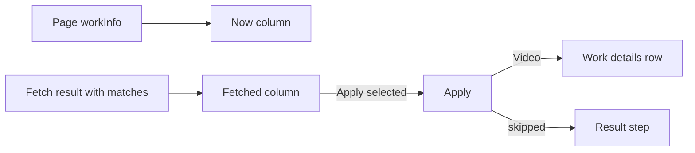
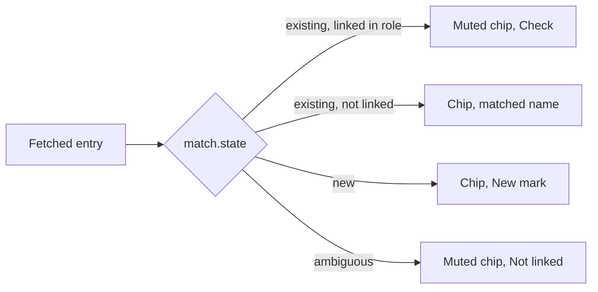
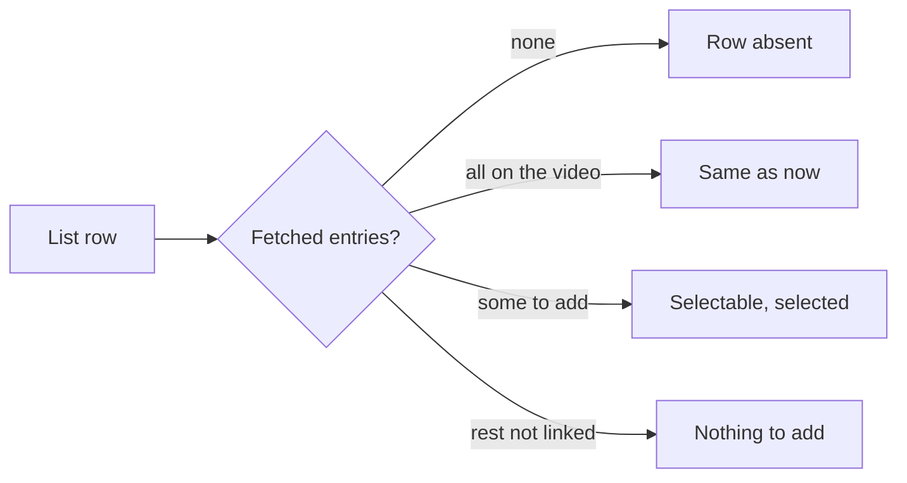

# UI design: Work details from work-info plugins

**Feature**: [parent Issue #1143](https://github.com/syudead/vv/issues/1143) ·
[plan.md](plan.md) · [contracts/screen-api.md](contracts/screen-api.md) ·
[research.md R-2](research.md#r-2-one-selectable-row-per-field-per-date-kind-and-per-role) ·
[R-3](research.md#r-3-people-and-organizations-are-matched-by-external-id-then-by-folded-name-or-alias-and-an-ambiguous-match-links-nothing) ·
[R-4](research.md#r-4-the-apply-merges-the-selected-fields-into-the-stored-work-information-in-one-transaction-and-skips-each-value-that-breaks-a-rule)

Sources that already decide things, linked rather than repeated here:

| Topic | Source |
| --- | --- |
| Tokens, closed scales, the video-page density | [design-system.md, Foundations](../../docs/design-docs/design-system.md#foundations); the values in `@theme` of [`web/src/ui/tokens.css`](../../web/src/ui/tokens.css), named here and never copied |
| `FormDialog`, `Checkbox`, `Badge`, `Alert`, `Tooltip`, `Button`, `TentativeMark` | [patterns.md](../../web/registry/rules/patterns.md), [components.md](../../web/registry/rules/components.md) |
| The fetch dialog: its steps, the comparison's grid, the tag chips, the fold at ten chips, the stale and failure states, the result step | [049 UI design, Fetch dialog](../049-work-info-plugins/ui-design.md#fetch-dialog), [Compare](../049-work-info-plugins/ui-design.md#compare), [Result](../049-work-info-plugins/ui-design.md#result); [`CompareStep.tsx`](../../web/src/player/workInfoFetch/CompareStep.tsx), [`TagChips.tsx`](../../web/src/player/workInfoFetch/TagChips.tsx) |
| The work details row: its item labels, the date text, the link text without its scheme, `{source}: {value}`, the folded description | [047 UI design, Video page: work details row](../047-video-work-info/ui-design.md#video-page-work-details-row); [`WorkInfo.tsx`](../../web/src/player/WorkInfo.tsx) |
| The `New` mark on a chip for an entity that does not exist yet | [047 UI design, Words, Editor](../047-video-work-info/ui-design.md#editor) (`Chip mark for an unsaved new entry`) |
| Width breakpoints in CSS; layout checked by people | [library-ui.md, Width breakpoints](../../docs/design-docs/library-ui.md#width-breakpoints-in-css-and-the-sidebar-exception), [Layout verified by people](../../docs/design-docs/library-ui.md#layout-verified-by-people-not-machines) |
| Screen text | [`web/src/i18n/en.ts`](../../web/src/i18n/en.ts); this feature extends `player.workInfoFetch` |

This feature changes two steps of the fetch dialog, for the owner only: the
**comparison** gains one row per work detail the result carries, with the
`New` and `Not linked` marks on people and organizations (requirements 2, 5
and 6), and the **result step** lists the values the apply left out beside
the skipped tags (requirement 7). Nothing else on the screen changes: the
find step, the candidates, the stale and failure states, the toast, and the
work details row, which shows the applied values through the response
`Video` as it shows the editor's.

The diagram shows what the comparison reads and where the apply's answer
goes.

## Why this shape

A work detail gets a row only when the result carries it, while `Title` and
`Tags` keep their `Not in the result` rows. A plugin of 049 returns no work
detail, so its comparison stays the two rows it has today (requirement 8),
and a result with four details is six rows, not fifteen: thirteen rows of
`Not in the result` would push the fetched values below the fold at 768px
for nothing, against the Issue's density rule. The alternative, every row
always present so the owner sees which details a plugin cannot give, was
rejected: the comparison is about this result, and a plugin's capabilities
are read in Settings.

Entries of a list row (people, organizations, links, IDs) are chips, as the
tag rows' entries are, with the same muted-with-`Check` chip for an entry
the video already has, the same `{n} new` count, and the same fold at ten.
The work details row joins names with commas, but a comparison has to mark
each entry (on the video, new, not linked), and a chip carries a mark where
a comma-joined name cannot. The `New` mark is the editor's: `text-xs`
muted text after the name, subdued so the name is read first (`UI品質`).
`Not linked` is the same size and colour, on a muted chip, so an entry that
will not be applied reads like one that is already there, not like a value
to take; its tooltip says why. A coloured badge or an icon for either mark
was rejected: the row would then have three kinds of mark competing with
the names.

`{n} new` keeps its 049 meaning, the number of entries the apply adds to
the video, and so counts a `New` person and a matched person alike and
leaves out a `Not linked` one. A second count for created entities was
rejected: the chips' `New` marks already show which entries those are, and
the Issue asks for the count of what is added.

## Words

The English is the draft the catalog takes; after implementation
[`web/src/i18n/en.ts`](../../web/src/i18n/en.ts) is canonical. Codes,
descriptions, dates, names, URLs and IDs are user data and are embedded
untranslated.

| Place | Text | Notes |
| --- | --- | --- |
| Field labels, new rows | Code · Description · Released · Recorded · Published · Performers · Directors · Photographers · Streamers · Makers · Labels · Links · IDs | After `Title` and `Tags`, in the order of [contracts/screen-api.md, `WorkInfoField`](contracts/screen-api.md#workinfofield); role labels are always plural, as the editor's |
| Description fold | Show more · Show less | `link` `sm`, as the work details row's folded description |
| Entry already on the video | On the video | Tooltip of a muted chip with lucide `Check`, as a tag (049) |
| Entry that will be created | New | `text-xs text-muted-foreground` after the name inside the chip, as the editor's unsaved chip; read as `{name}, new`; tooltip `Created when you apply` |
| Entry that matches several | Not linked | Same form, on a muted chip; read as `{name}, not linked`; tooltip `Matches more than one person, so it isn't linked or created` (`organization` for an organization row) |
| Matched under another spelling | Fetched as "{name}" | Tooltip of a chip whose matched entity's name differs from the fetched name |
| List row with nothing to add | Nothing to add | Muted, after the chips, in place of `{n} new`; the row cannot be selected |
| Result title | Applied, but some values were left out | Replaces `Applied, but some tags were left out`; the `success` `Alert` |
| Skipped line | {label}: {value} — {reason} | One line per skipped tag or value; `{label}` is the row's field label, `{value}` in `font-medium` |
| Skipped tag reasons | you rejected this tag before · not a valid tag name | Unchanged (049) |
| Skipped, `invalid`, a date | not a date in the form YYYY-MM-DD, YYYY-MM or YYYY | |
| Skipped, `invalid`, a link | not a full URL starting with http:// or https:// | |
| Skipped, `invalid`, other | too long or contains characters that can't be used | Code, description, a name, an ID |
| Skipped, `too_many` | over the limit for {label} | `{label}` lowercased: `over the limit for performers` |
| Skipped, `ambiguous` | matches more than one person · matches more than one organization | By the row's kind |

## Compare

The comparison keeps its grid, header row, source line and `Back to the
matches` ([049, Compare](../049-work-info-plugins/ui-design.md#compare)).
The rows are `Title`, `Tags`, then one row per work detail the result
carries, in the `WorkInfoField` order, so a code and a release date come
before the names, as they do in the work details row.

| Row | Now (`text-muted-foreground`) | Fetched (`text-foreground`) | Same as now when |
| --- | --- | --- | --- |
| Title, Tags | As 049 | As 049 | As 049 |
| Code | The stored code, `tabular-nums` | The fetched code, `tabular-nums`, as returned even when it breaks a rule | The strings are equal |
| Description | The stored text, `whitespace-pre-line`, folded at three lines with `Show more` | The fetched text, folded the same way | Equal |
| Released, Recorded, Published | The stored date of that kind, `tabular-nums` | The fetched date as returned, `tabular-nums`; a date in another form is shown, not fixed | Equal |
| Performers, Directors, Photographers, Streamers, Makers, Labels | The names linked in that role, in position order, as `secondary` chips | One chip per fetched entry in fetched order, by its `match` (below), then `{n} new` | Every entry is `existing` and linked in that role |
| Links | The stored URLs without their scheme, as chips, full URL in `title` | One chip per URL without its scheme, as returned; a stored one muted with `Check`; then `{n} new` | Every URL is stored |
| IDs | `{source}: {value}` chips, `tabular-nums` | The same; a stored pair muted with `Check`; then `{n} new` | Every pair is stored |

A chip in a `Now` cell has no mark: the video's entries are facts, not
candidates. No chip in this step carries `TentativeMark`; only tags are
tentative.

The diagram shows how a fetched person or organization chip is drawn from
its `match`.

Whether an `existing` entity is linked in the row's role is read from the
page's `workInfo`, not from the result. The chip shows the matched entity's
current name; when the fetched spelling differs, the tooltip
`Fetched as "{name}"` shows what the plugin returned, so a match through an
alias can be checked without leaving the dialog. A `New` chip shows the
fetched name. A list longer than ten chips folds as the tag rows do.

### States

The diagram shows how a list row's state is decided; the other rows keep
049's three states.

| State | What the row shows |
| --- | --- |
| Row absent | The result has no value for the field: no row. `Title` and `Tags` instead show `Not in the result` (049) |
| Selectable | At least one entry is added on apply (`{n} new` with `n` over zero); the checkbox is enabled and selected when the step opens |
| Same as now | `Same as now` in the fetched cell, muted; the checkbox is disabled and clear |
| Nothing to add | Every entry is on the video or `Not linked`, and at least one is `Not linked`: the chips stay, with their marks, and `Nothing to add` follows them; the checkbox is disabled and clear (the Issue's edge case: the owner sees which entry is not applied) |

A single-value row (`Code`, `Description`, a date) is selectable whenever
its value differs from the stored one, including a value that breaks a rule:
the apply decides and reports it ([R-4](research.md#r-4-the-apply-merges-the-selected-fields-into-the-stored-work-information-in-one-transaction-and-skips-each-value-that-breaks-a-rule)),
and a value the owner cannot see cannot be reported as skipped.

`Apply selected`, its disabled rule, the stale `Alert` and the failure
`Alert` are unchanged. The apply's `200` replaces the page's video with the
response `Video`, so the work details row shows the applied values when the
dialog closes.

## Result

The step keeps its `success` `Alert`, now titled
`Applied, but some values were left out`, and lists every skipped item on
one line each: the skipped tags first, in their 049 order, then the
`skipped` values in the response's order (field order, then fetched order).
Each line is `{label}: {value} — {reason}`, with the value in `font-medium`,
so a glance down the list reads the values and the labels say which row
each came from. A description's value is the first 100 characters the
response carries, on a wrapping line. The dialog is shown when either list
is non-empty; with both empty the toast closes it as before.

## Responsive behaviour

The widths judged are 360px, 768px and 1280px, as 049; the grid's
behaviour at each is unchanged.

| Width | Comparison | Result step |
| --- | --- | --- |
| 1280px | Three columns side by side; a result with a title, tags, a code, a release date, two performers and a maker (acceptance criterion 1) shows all six rows without scrolling the dialog body at 1280×800 | One line per skipped item, wrapping only for a long value |
| 768px | As 1280px; the list rows' chips wrap inside their two-column cell | As 1280px |
| 360px | Each row stacks (checkbox and label, `Now`, `Fetched`), the chips wrap, the `New` and `Not linked` marks stay inside their chips, and `{n} new` sits after the last chip; no horizontal scroll | Long values wrap under their label |

## Review criteria

Judged by looking at the running screen in vv's one dark scheme
([Layout verified by people](../../docs/design-docs/library-ui.md#layout-verified-by-people-not-machines)).
"It exists" alone does not pass (Q-4).

1. **Visual hierarchy**: in a performers row the eye reads the names first;
   `New` and `Not linked` are found only on a second look, as small muted
   text inside the chip, never a coloured badge, an icon or a bolder
   weight. The fetched column stays the bright one and the current column
   the muted one in every row; a `Not linked` chip is as muted as an
   `On the video` chip, so what will not be applied looks like what is
   already there, not like a value to take.
2. **Information density**: a title-and-tags plugin's comparison is the
   same two rows as before, with no extra row, line or notice; a result with
   a code, a release date, two performers and a maker is six rows, each one
   line at 1280px, and no row of `Not in the result` appears for a detail
   the plugin did not return. A role with twelve names shows ten chips and
   `+2 more`, so the row is not taller than the tags row for that reason.
3. **Spacing rhythm**: the new rows share the comparison's gap and divider;
   a chip's `New` mark sits inside the chip at the chip's own gap, not
   beside it; `{n} new` or `Nothing to add` follows the last chip at the
   same baseline as the tags row's count.
4. **Typography**: codes, dates and IDs are `tabular-nums` in both columns;
   a date is shown as the plugin returned it, in the same `text-sm` as the
   work details row, never reformatted; a description is three lines and
   `Show more`, as it is on the page; field labels are the editor's words,
   plural for roles.
5. **Action priority**: `Apply selected` is still the dialog's one filled
   button, and the result step's only button is `Done`; a `New` chip, a
   `Not linked` chip and a `Show more` fold do nothing to the selection.
   Taking a code, a release date, a performer and a maker is one fetch and
   one press (acceptance criterion 1).
6. **Visible state**: after applying a performer to a video that already
   has another, the work details row behind the dialog shows both
   (acceptance criterion 2); after applying a `New` performer, the people
   screen lists them with the fetched external ID (acceptance criterion 4);
   a result whose release date is `2024/03/01` applies the code and shows
   the result step with `Released: 2024/03/01 — not a date in the form
   YYYY-MM-DD, YYYY-MM or YYYY` (acceptance criterion 5); fetching again
   after that apply shows the performer as `On the video` and the row as
   `Same as now`.
7. **Phone width**: at 360px every new row stacks as the title row does,
   the chips wrap without a horizontal scroll, and the marks stay readable
   inside their chips.
8. **Examples that do not meet the requirement**: a row of `Not in the
   result` for every detail the plugin did not return; `New` or `Not
   linked` as a coloured badge, an icon or bold text; a `Not linked` entry
   counted in `{n} new` or selectable on its own; a date reformatted or a
   rule-breaking value hidden before the apply; the result step naming a
   value without its row's label; the dialog closing silently after a value
   was skipped; a role's row showing all 100 names unfolded.

## Accessibility

The parent Issue does not ask for screen reader or contrast design, so only
names are decided.

- A chip's mark is part of its name: `{name}, new`, `{name}, not linked`,
  `{name}, on the video`, as the 049 chips.
- A disabled checkbox of a list row is described by its row's `Same as
  now` or `Nothing to add`, as 049's `Not in the result`.
