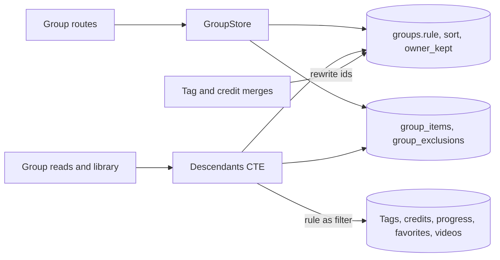
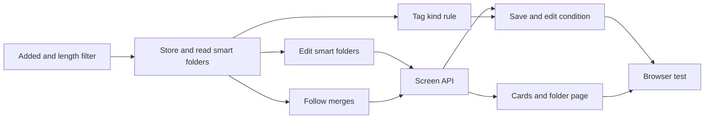

# Implementation Plan: Smart folders whose videos follow a saved condition

**Branch**: `feature/052-smart-folders` | **Parent Issue**: #1139

**Input**: The parent Issue. It is this feature's specification.

## Summary

The owner saves a condition over tags, tag kinds, people, organizations and
video facts as a smart folder: a group whose videos are the ones matching the
condition, plus the ones the owner adds and minus the ones the owner removes.
A smart folder is a `groups` row with a stored rule, so favorites, playlists,
nesting, guests, cards, the group page and `Up next` reach it by its group id
as they reach a group; its matched videos are computed in the reads that
already compute a group's descendants, from the same filter SQL the library
uses.

The diagram shows the parts this feature adds or changes and what each one
reads or writes.



| Concern | Approach |
| --- | --- |
| Storage | A group with `rule` and `sort` ([R-1](research.md#r-1-a-smart-folder-is-a-group-with-a-stored-rule), [data-model.md, Migration](data-model.md#migration)) |
| Membership | Evaluated on read ([R-2](research.md#r-2-matched-videos-are-computed-when-a-group-is-read-not-stored)) within a budget ([R-12](research.md#r-12-a-read-budget-at-20000-videos-and-50-smart-folders)) |
| Condition | The library filter's fields, AND, one SQL builder ([R-3](research.md#r-3-the-rule-is-the-library-filter-combined-with-and-built-by-the-same-sql)); the filter gains added within and length ([R-4](research.md#r-4-the-library-filter-gains-added-within-and-length)) |
| Hand edits | Items and exclusions ([R-5](research.md#r-5-hand-added-videos-are-items-hand-removed-videos-are-exclusions)) |
| Order | Child groups by position, videos by the folder's sort ([R-6](research.md#r-6-child-groups-keep-their-positions-videos-follow-the-folders-sort)) |
| Library | Members leave the top level ([R-7](research.md#r-7-matched-videos-leave-the-librarys-top-level-as-group-members-do)); an empty folder stays for the owner ([R-8](research.md#r-8-an-empty-smart-folder-stays-and-is-shown-to-the-owner-only)) |
| Merged and deleted references | Rewritten on merge; a missing one matches nothing ([R-9](research.md#r-9-merges-rewrite-rules-a-deleted-reference-makes-the-rule-match-nothing)) |
| Owner's record | `owner_kept` on every group ([R-10](research.md#r-10-owner_kept-marks-every-group-the-owner-made-or-edited)) |
| Guests | Owner's facts, viewer's visibility ([R-11](research.md#r-11-the-rule-reads-the-owners-facts-visibility-is-the-viewers)) |
| Events | `GroupsChanged` for edits only ([R-13](research.md#r-13-no-new-event-smart-folder-edits-publish-groupschanged)) |

The Issue has the `ui` label, so the `design` stage writes `ui-design.md`
before the screen units: saving the library filter as a smart folder, the
condition editor and its parts for added within and length, the smart folder
mark on cards (shown only when wanted), the folder page with hand-added and
removed videos and restoring a removed one, the empty folder and the missing
condition notice, and the refusals of `smart_folder_sorted` and
`smart_folder_merge` in drag organizing, judged against the parent Issue's
`UI品質`.

## Technical Context

**Canonical definitions**:

| Topic | Source |
| --- | --- |
| Boundaries, dependency direction, user data, the authentication boundary | [ARCHITECTURE.md](../../ARCHITECTURE.md), [.golangci.yml](../../.golangci.yml) (depguard) |
| Groups, items, exclusions, nesting, play order, visibility, `GroupsChanged` | [048 data-model](../048-groups/data-model.md), [048 research](../048-groups/research.md) |
| Drag organizing and undo | [050 contracts/screen-api.md](../050-drag-organize/contracts/screen-api.md) |
| Library filter and its URL | `domain.VideoQuery` in [internal/domain/library.go](../../internal/domain/library.go), [web/src/videoList/listCriteria.ts](../../web/src/videoList/listCriteria.ts), [web/src/library/tagCriteria.ts](../../web/src/library/tagCriteria.ts), [web/src/library/creditCriteria.ts](../../web/src/library/creditCriteria.ts) |
| Tag kinds and the `tagKind` filter | #1136, `specs/051-tag-kinds/` on `feature/051-tag-kinds` |
| User key, bundles | [030 data-model, User key](../030-video-versions/data-model.md#user-key) |
| Screen API and generated code | [api/openapi.yaml](../../api/openapi.yaml), `task generate` |
| Screens and Web tests | [design-system.md](../../docs/design-docs/design-system.md), [library-ui.md](../../docs/design-docs/library-ui.md), [web-testing.md](../../docs/design-docs/web-testing.md), [i18n.md](../../docs/design-docs/i18n.md) |
| Checks | [Taskfile.yml](../../Taskfile.yml) (`task check`, `task check-docs`, `task test-e2e`) |

**Feature-specific context**:

- One migration, numbered when it lands
  ([data-model.md, Migration](data-model.md#migration)).
- Schema changes and one route on the screen API
  ([contracts/screen-api.md](contracts/screen-api.md)); the external API and
  MCP do not change.
- The `tagKind` rule field needs #1136's library `tagKind` filter on `main`.
  The units that need it say so; the others do not wait for it.
- Read budget: 500 ms for the first library page and a folder page with 20,000
  videos and 50 smart folders
  ([R-12](research.md#r-12-a-read-budget-at-20000-videos-and-50-smart-folders)).

## Constitution Check

| Rule (source) | Verdict |
| --- | --- |
| Adapters import neither each other nor `internal/app` (ARCHITECTURE.md, depguard) | Pass: the routes extend `internal/httpapi`'s `Groups` interface that `GroupStore` satisfies; no new package |
| The domain decides, the store enforces (ARCHITECTURE.md) | Pass: `domain.SmartRule` parses, validates and turns a rule into a `VideoQuery`; the store builds SQL from it and checks references in its transaction |
| Store roles (ARCHITECTURE.md) | Pass: smart folder edits are `GroupStore`'s; the rule rewrite in tag and credit merges is a package-private helper called inside `TagStore` and `CreditStore` transactions |
| Events after commit (ARCHITECTURE.md) | Pass: `GroupsChanged` after commit, as 048 |
| User data survives a rebuild (ARCHITECTURE.md) | Pass: the new columns are on `groups`, already user data; the rule names tag, kind and credit ids, which a rebuild keeps |
| Every read knows its viewer (ARCHITECTURE.md) | Pass: the matched videos are cut to the viewer's visibility; `smartFolder`, `manual` and `/excluded` are owner only; the new list parameters reveal nothing hidden |
| Only a scan reads the media folders' files (ARCHITECTURE.md) | Pass: rules read SQLite only |
| Do not hand-edit generated files (AGENTS.md) | Pass: `api/openapi.yaml` changes, then `task generate` |
| Complexity 25 or less, no copied code (AGENTS.md) | Pass: the rule reuses the library's filter conditions instead of a second translation ([R-3](research.md#r-3-the-rule-is-the-library-filter-combined-with-and-built-by-the-same-sql)) |
| Read design-system.md before a screen; test at the lowest level (AGENTS.md) | Pass: screens follow `ui-design.md`; rules get domain tests, the store its tests and a benchmark, screens page tests, the acceptance criteria one browser test |

No violation, so no complexity tracking.

## Project Structure

### Documentation (this feature)

```text
specs/052-smart-folders/
├── plan.md
├── research.md
├── data-model.md
└── contracts/
    └── screen-api.md
```

`ui-design.md` is written by the `design` stage. No `quickstart.md`: every
acceptance criterion and Edge Case is reachable in domain, store and page tests,
the benchmark or the browser test below.

### Source Code

**Affected boundaries**:

| Boundary | What it owns in this feature |
| --- | --- |
| `internal/domain` | `SmartRule`, `ValidateSmartSort`, the new `VideoQuery` fields, smart folder errors |
| `internal/store` | The migration, the filter conditions for added within and length, matched videos in `groupDescendantsCTE`, smart folder edits, `owner_kept`, rule rewrites in merges, the benchmark |
| `internal/httpapi`, `api/openapi.yaml` | The list parameters, the changed schemas, the excluded route, the new error codes |
| `web/src/api`, `web/src/library`, `web/src/videoList`, `web/src/groups`, `web/src/i18n` | Clients, the filter parts, saving and editing a smart folder, the card mark, the folder page |
| `web/e2e` | The browser test |

**New paths**: `internal/store/migrations/000NN_smart_folders.sql`,
`internal/domain/smart_rule.go`, `internal/store/smart_folders.go`,
`web/e2e/smart-folders.e2e.ts`.

**Structure decision**: Follows the existing layout; smart folder edits sit in
`GroupStore` beside the group edits they branch from.

## Implementation Work

The diagram shows which units have to land first. The screen units also wait
for the `design` stage's `ui-design.md`.



### Filter library videos by how long ago they were added and by length

**Scope**: `VideoQuery` fields and their filter conditions, the `addedWithin`,
`minDuration` and `maxDuration` list parameters on `listVideos`,
`listLibrary` and `listLibraryIds`, guest access to them, and their API client
parameters; no screen change
([R-4](research.md#r-4-the-library-filter-gains-added-within-and-length),
[contracts/screen-api.md, List parameters added](contracts/screen-api.md#list-parameters-added)).

**Dependencies**: None.

**Acceptance**: `task check` passes with no diff from `task generate`; store
tests show `addedWithin=7` lists a video added 6 days ago and not one added 8
days ago, `minDuration=60&maxDuration=600` lists 60 s and 600 s videos and not
59 s, 601 s or unknown-length ones, and both AND with a tag filter; handler
tests show `400 invalid_request` for `addedWithin=0` and for `minDuration`
over `maxDuration`, and a guest is answered `200`.

### Store smart folders and read their matched videos in group and library reads

**Scope**: The migration, `domain.SmartRule` with `Query()` and `Refs()`,
`ValidateSmartSort`, matched videos in `groupDescendantsCTE` with exclusions,
the play order of child groups then sorted videos, the missing-reference rule,
the owner seeing an empty smart folder, `LibraryGroup.smart`, the invariants,
and `BenchmarkSmartFolderReads`
([data-model.md, Members](data-model.md#members),
[R-6](research.md#r-6-child-groups-keep-their-positions-videos-follow-the-folders-sort),
[R-7](research.md#r-7-matched-videos-leave-the-librarys-top-level-as-group-members-do),
[R-8](research.md#r-8-an-empty-smart-folder-stays-and-is-shown-to-the-owner-only),
[R-11](research.md#r-11-the-rule-reads-the-owners-facts-visibility-is-the-viewers),
[R-12](research.md#r-12-a-read-budget-at-20000-videos-and-50-smart-folders)).
Smart folders are written by test fixtures only until the next unit.

**Dependencies**: Filter library videos by how long ago they were added and by
length.

**Acceptance**: `task check` passes; domain tests reject each out-of-range
rule member and `random` as a sort; store tests show: a folder with rule
`tags:[猫]` holds a video once `猫` is attached and not after it is detached,
with no other write (acceptance criterion 1); `watch: unwatched` drops a video
once its progress completes; the matched videos leave the library's top level
and the folder is one card; a hand-added item that does not match is listed
and an excluded video that matches is not; child groups come before videos and
videos follow `sort`; a bundle counts once; a guest sees only public matched
videos and no folder with none; the owner's library lists a folder with no
match and a guest's does not; a rule whose tag was deleted matches nothing;
`?group`, `Up next`, a playlist item and a favorite of the folder follow its
play order; the folder nested in a group is listed when that group is opened
(acceptance criterion 4); the benchmark result for 20,000 videos and 50
folders is under 500 ms and recorded in the PR.

### Create and edit smart folders in the store with hand-added and removed videos

**Scope**: Create with `rule` and `sort`, change `rule` and `sort`, add and
remove videos with items and exclusions, no dissolve on empty, the refusals in
move and organize, `owner_kept` set by every owner write to any group, and
`GroupsChanged` for each
([data-model.md, Edits](data-model.md#edits),
[R-5](research.md#r-5-hand-added-videos-are-items-hand-removed-videos-are-exclusions),
[R-10](research.md#r-10-owner_kept-marks-every-group-the-owner-made-or-edited)).

**Dependencies**: Store smart folders and read their matched videos in group
and library reads.

**Acceptance**: `task check` passes; store tests show: removing a matching
video writes its exclusion and attaching its tag again does not bring it back;
adding a non-matching video keeps it in after any tag change (acceptance
criterion 3); adding an excluded matching video deletes the exclusion without
an item; removing the last video leaves an empty folder; moving a video is
`ErrSmartFolderSorted`, moving a child group works; organize merge of a smart
folder is `ErrSmartFolderMerge` with nothing written; every owner write sets
`owner_kept` on the groups it changes, and the folder sync leaves a new
automatic group at 0; each edit publishes `GroupsChanged` for the folder and
its ancestors.

### Follow tag, person and organization merges in smart folder rules

**Scope**: The rule rewrite in `mergeTagsInto` and `CreditStore.Merge`, and
`GroupsChanged` for the rewritten folders
([data-model.md, Merges and deletions](data-model.md#merges-and-deletions),
[R-9](research.md#r-9-merges-rewrite-rules-a-deleted-reference-makes-the-rule-match-nothing)).

**Dependencies**: Store smart folders and read their matched videos in group
and library reads.

**Acceptance**: `task check` passes; store tests show: merging tag A into B
turns a rule `tags:[A]` into `tags:[B]` and `tags:[A,B]` into `tags:[B]`, and
the folder then holds B's videos; merging person or organization X into Y
rewrites `person` or `organization`; a merge publishes `GroupsChanged` for the
rewritten folders after commit and none when no rule names a source.

### Match smart folders by tag kind

**Scope**: The `tagKind` rule member through #1136's `VideoQuery.TagKindID`,
its missing-reference check after a kind is deleted, and the `SmartRule`
schema's `tagKind`; merge `main` into the feature branch first.

**Dependencies**: Store smart folders and read their matched videos in group
and library reads; #1136's unit "Filter library videos by tag kind" merged
into `main`.

**Acceptance**: `task check` passes; store tests show a rule `tagKind: Genre,
watch: unwatched` holds only unwatched videos with a Genre tag and drops one
once watched (acceptance criterion 2), and deleting the kind makes the rule
match nothing and lists it as missing.

### Add smart folders to the screen API

**Scope**: The schema changes, `GET /api/groups/{id}/excluded`, the error
codes and their messages in the catalog, the handlers, and the client
functions in `web/src/api/groups.ts`; the SPA keeps working with optional
`GroupItem.id`
([contracts/screen-api.md](contracts/screen-api.md)).

**Dependencies**: Create and edit smart folders in the store with hand-added
and removed videos; Follow tag, person and organization merges in smart folder
rules.

**Acceptance**: `task check` passes with no diff from `task generate`; handler
tests show each status of the contract's table, `smartFolder`, `manual` and
`/excluded` absent or refused for a guest, `missing` naming a deleted tag, and
`TestAccessClassificationMatchesOpenAPISecurity` passes; existing group page
tests pass.

### Save the library filter as a smart folder and edit its condition

**Scope**: The added-within and length parts in the library filter and URL,
saving the current filter as a smart folder with a name, the condition editor
built from the library filter's parts (tag kind included) and its sort, and
the catalog text; layout follows `ui-design.md`.

**Dependencies**: Add smart folders to the screen API; Match smart folders by
tag kind; the `design` stage's `ui-design.md`.

**Acceptance**: This unit changes a screen, so it needs a visual and
interaction review against `ui-design.md` and the parent Issue's `UI品質`.
`task check` passes; page tests show: the library URL keeps `addedWithin`,
`minDuration` and `maxDuration` and sends them; saving with tag `猫` and
`watch=unwatched` sends a `rule` with those fields (acceptance criterion 5);
the editor opens on a folder's rule, sends the changed one and an invalid one
cannot be sent; a guest sees no save action.

### Show smart folders as cards and on their page with hand-added and removed videos

**Scope**: The smart folder mark on cards and rows, the folder page's hand-added
marks, the removed videos and restoring one, removing videos by `videoIds`,
the empty and missing-condition states, the `smart_folder_sorted` and
`smart_folder_merge` refusals in drag organizing, and the catalog text; layout
follows `ui-design.md`.

**Dependencies**: Add smart folders to the screen API; the `design` stage's
`ui-design.md`.

**Acceptance**: This unit changes a screen, so it needs a visual and
interaction review against `ui-design.md` and the parent Issue's `UI品質`.
`task check` passes; page tests show: a hand-added video carries its mark and
a matched one none; removing a matched video sends its id in `videoIds` and it
then appears among the removed, from where restoring sends an add; an empty
folder says it is empty; a missing tag in the rule is named; dragging a video
to a new place in a smart folder shows the refusal; a guest sees neither marks
nor removed videos.

### Cover smart folders in a browser test

**Scope**: `web/e2e/smart-folders.e2e.ts` against the real server and media
([web-testing.md, Test levels](../../docs/design-docs/web-testing.md#test-levels)).

**Dependencies**: Save the library filter as a smart folder and edit its
condition; Show smart folders as cards and on their page with hand-added and
removed videos.

**Acceptance**: `task test-e2e -- e2e/smart-folders.e2e.ts` passes and shows
the parent Issue's acceptance criteria 1 to 5: tagging a video `猫` puts it in
the `タグ: 猫` folder and untagging takes it out (1); a Genre-and-unwatched
folder drops a video once it is watched (2); a removed video stays out after
retagging and an added one stays in (3); a folder put in a group shows when the
group is opened (4); a folder saved from a filtered library holds the same
videos (5).
