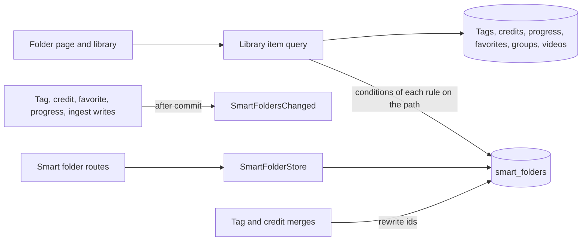
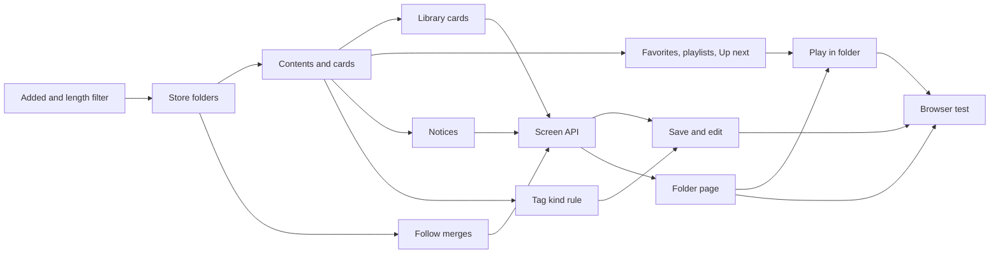

# Implementation Plan: Smart folders whose contents follow a saved condition

**Branch**: `feature/052-smart-folders` | **Parent Issue**: #1139

**Input**: The parent Issue. It is this feature's specification.

## Summary

The owner saves a library filter as a smart folder: a virtual folder whose
contents are always what the library shows for that filter, groups as cards
and videos as videos, and which moves no video. A child folder narrows its
parent's filter. Smart folders are a new entity beside groups; their contents
are the existing library item query run with the folder's conditions, and
root folders are cards in the unfiltered library.

The diagram shows the parts this feature adds or changes and what each one
reads or writes.



| Concern | Approach |
| --- | --- |
| Storage | Own table and item kind ([R-1](research.md#r-1-a-smart-folder-is-its-own-entity-not-a-group), [data-model.md, Migration](data-model.md#migration)) |
| Contents | The filtered library, evaluated on read ([R-2](research.md#r-2-contents-are-computed-when-read-not-stored), [R-3](research.md#r-3-a-rule-is-the-library-filters-fields-contents-are-the-filtered-library)) within a budget ([R-13](research.md#r-13-a-read-budget-at-20000-videos-and-50-smart-folders)) |
| Filter fields | The library filter gains added within and length ([R-4](research.md#r-4-the-library-filter-gains-added-within-and-length)) |
| Nesting | Every rule on the path, ANDed ([R-5](research.md#r-5-a-childs-effective-rule-is-every-rule-on-its-path-anded)) |
| Order | A stored library sort ([R-6](research.md#r-6-videos-follow-the-folders-sort-random-is-refused)) |
| Library | Root folders as cards in the unfiltered library ([R-7](research.md#r-7-root-smart-folders-are-cards-in-the-unfiltered-library)); an empty one for the owner only ([R-8](research.md#r-8-an-empty-folder-stays-and-is-shown-to-the-owner-only)) |
| Merged and deleted references | Rewritten on merge; a missing one matches nothing ([R-9](research.md#r-9-merges-rewrite-rules-a-deleted-reference-makes-the-rule-match-nothing)) |
| Owner's record | `owner_kept` ([R-10](research.md#r-10-owner_kept-records-the-owners-folders)) |
| Guests | Owner's facts, viewer's visibility ([R-11](research.md#r-11-the-rule-reads-the-owners-facts-visibility-is-the-viewers)) |
| Events | `SmartFoldersChanged` and the `smartFolder` screen event ([R-12](research.md#r-12-writes-that-can-change-a-match-publish-smartfolderschanged)) |

The Issue has the `ui` label, so the `design` stage writes `ui-design.md`
before the screen units: saving the library filter as a folder, the condition
editor and the added-within and length parts, the folder card and the mark
that tells it from a group card when wanted, the folder page with its trail,
its children and its conditions, moving a folder under another, deleting it,
the empty and missing-condition states, and the video page's folder line,
judged against the parent Issue's `UI品質`.

## Technical Context

**Canonical definitions**:

| Topic | Source |
| --- | --- |
| Boundaries, dependency direction, user data, the authentication boundary | [ARCHITECTURE.md](../../ARCHITECTURE.md), [.golangci.yml](../../.golangci.yml) (depguard) |
| Library items, partly matching groups, group play order and visibility, `?group` | [048 data-model](../048-groups/data-model.md), [048 research](../048-groups/research.md), [027 library-api.md](../027-partial-group-search/contracts/library-api.md) |
| Library filter and its URL | `domain.VideoQuery` in [internal/domain/library.go](../../internal/domain/library.go), [web/src/videoList/listCriteria.ts](../../web/src/videoList/listCriteria.ts), [web/src/library/tagCriteria.ts](../../web/src/library/tagCriteria.ts), [web/src/library/creditCriteria.ts](../../web/src/library/creditCriteria.ts) |
| Favorites, playlists | [035 data-model](../035-favorites/data-model.md), [044 data-model](../044-playlists/data-model.md) |
| Tag kinds and the `tagKind` filter | #1136, `specs/051-tag-kinds/` on `feature/051-tag-kinds` |
| Screen API and generated code | [api/openapi.yaml](../../api/openapi.yaml), `task generate` |
| Screens and Web tests | [design-system.md](../../docs/design-docs/design-system.md), [library-ui.md](../../docs/design-docs/library-ui.md), [web-testing.md](../../docs/design-docs/web-testing.md), [i18n.md](../../docs/design-docs/i18n.md) |
| Checks | [Taskfile.yml](../../Taskfile.yml) (`task check`, `task check-docs`, `task test-e2e`) |

**Feature-specific context**:

- One migration, numbered when it lands
  ([data-model.md, Migration](data-model.md#migration)).
- Six routes, several schemas and one screen event kind on the screen API
  ([contracts/screen-api.md](contracts/screen-api.md)); the external API and
  MCP do not change.
- A new SPA route for the folder page, and a `smartFolder` query on the video
  page.
- The `tagKind` rule member needs #1136's library `tagKind` filter on `main`;
  only the units that say so wait for it.

## Constitution Check

| Rule (source) | Verdict |
| --- | --- |
| Adapters import neither each other nor `internal/app` (ARCHITECTURE.md, depguard) | Pass: `internal/httpapi` declares a `SmartFolders` interface that the new store role satisfies |
| The domain decides, the store enforces (ARCHITECTURE.md) | Pass: `domain.SmartRule`, `ValidateSmartSort` and `ValidateSmartFolderParent` decide; foreign keys and checks guard the table |
| Store roles (ARCHITECTURE.md) | Pass: `SmartFolderStore` is new; the rule rewrite in merges and the notices are package-private helpers inside the `TagStore`, `CreditStore`, `FavoriteStore`, `PlaybackStore` and ingest transactions |
| Events after commit (ARCHITECTURE.md) | Pass: `SmartFoldersChanged` is published after commit ([data-model.md, Notices](data-model.md#notices)) |
| User data survives a rebuild (ARCHITECTURE.md) | Pass: `smart_folders` and `smart_folder_favorites` are user data with no foreign key to `videos`; the invariant's list and running-vv.md gain them |
| Every read knows its viewer (ARCHITECTURE.md) | Pass: contents are cut to the viewer; reads join `accessRoutes` as guest-readable; `settings` is owner only |
| Only a scan reads the media folders' files (ARCHITECTURE.md) | Pass: rules read SQLite only |
| Do not hand-edit generated files (AGENTS.md) | Pass: `api/openapi.yaml` changes, then `task generate` |
| Complexity 25 or less, no copied code (AGENTS.md) | Pass: contents call the library item query instead of a second translation of the filter ([R-3](research.md#r-3-a-rule-is-the-library-filters-fields-contents-are-the-filtered-library)) |
| Read design-system.md before a screen; test at the lowest level (AGENTS.md) | Pass: screens follow `ui-design.md`; rules get domain tests, the store its tests and a benchmark, screens page tests, the acceptance criteria one browser test |

No violation, so no complexity tracking.

## Project Structure

### Documentation (this feature)

```text
specs/052-smart-folders/
├── plan.md
├── research.md
├── data-model.md
└── contracts/
    └── screen-api.md
```

`ui-design.md` is written by the `design` stage. No `quickstart.md`: every
acceptance criterion and Edge Case is reachable in domain, store and page
tests, the benchmark or the browser test below.

### Source Code

**Affected boundaries**:

| Boundary | What it owns in this feature |
| --- | --- |
| `internal/domain` | `SmartRule`, the sort and parent rules, the new `VideoQuery` fields, `SmartFoldersChanged`, the errors |
| `internal/store` | The migration, the filter conditions for added within and length, `SmartFolderStore`, folder contents and cards in the library item query, favorites, playlists and the video context by folder, rule rewrites in merges, the notices, the benchmark |
| `internal/httpapi`, `api/openapi.yaml`, `cmd/mdm` | The routes, the changed schemas, the `smartFolder` event, the wiring |
| `web/src/api`, `web/src/library`, `web/src/videoList`, `web/src/smartFolders` (new), `web/src/player`, `web/src/app`, `web/src/i18n` | Clients, the filter parts, saving and editing, the card, the folder page and its route, the video page's folder context |
| `web/e2e` | The browser test |

**New paths**: `internal/store/migrations/000NN_smart_folders.sql`,
`internal/domain/smart_folder.go`, `internal/store/smart_folders.go`,
`internal/httpapi/smart_folders.go`, `web/src/api/smartFolders.ts`,
`web/src/smartFolders/`, `web/e2e/smart-folders.e2e.ts`.

**Structure decision**: Follows the existing layout, with smart folders as a
store role and a screen folder of their own beside groups
([R-1](research.md#r-1-a-smart-folder-is-its-own-entity-not-a-group)).

## Implementation Work

The diagram shows which units have to land first. The screen units also wait
for the `design` stage's `ui-design.md`.



### Filter library videos by how long ago they were added and by length

**Scope**: `VideoQuery` fields and their filter conditions, the `addedWithin`,
`minDuration` and `maxDuration` list parameters, guest access to them, and
their API client parameters; no screen change
([R-4](research.md#r-4-the-library-filter-gains-added-within-and-length),
[contracts/screen-api.md, Schemas and parameters changed](contracts/screen-api.md#schemas-and-parameters-changed)).

**Dependencies**: None.

**Acceptance**: `task check` passes with no diff from `task generate`; store
tests show `addedWithin=7` lists a video added 6 days ago and not one added 8
days ago, `minDuration=60&maxDuration=600` lists 60 s and 600 s videos and not
59 s, 601 s or unknown-length ones, and both AND with a tag filter; handler
tests show `400 invalid_request` for `addedWithin=0` and for `minDuration`
over `maxDuration`, and a guest is answered `200`.

### Store smart folders with their rules and parents

**Scope**: The migration, `domain.SmartRule` with `Query()` and `Refs()`,
`ValidateSmartSort`, `ValidateSmartFolderParent`, and `SmartFolderStore`
create, change, move and delete with `owner_kept`, the invariants, and the
user-data lists in ARCHITECTURE.md and running-vv.md with their
`translations/ja/` counterparts
([data-model.md, Edits](data-model.md#edits),
[R-10](research.md#r-10-owner_kept-records-the-owners-folders)).

**Dependencies**: Filter library videos by how long ago they were added and by
length.

**Acceptance**: `task check` and `task check-docs` pass; domain tests reject
each out-of-range rule member and `random` as a sort; store tests show:
creating with a parent nests the folder; moving A under its own child is
`ErrSmartFolderCycle` with nothing written; deleting a parent deletes its
children; a rule naming a deleted tag is stored and reported as missing;
every write sets `owner_kept` to 1.

### List a smart folder's contents with its children and card values

**Scope**: The effective rule along the path, contents through the library
item query with each rule's conditions, child folders first, the play order,
the card values, owner and guest visibility, missing references matching
nothing, and `BenchmarkSmartFolderReads`
([data-model.md, Contents](data-model.md#contents),
[R-3](research.md#r-3-a-rule-is-the-library-filters-fields-contents-are-the-filtered-library),
[R-5](research.md#r-5-a-childs-effective-rule-is-every-rule-on-its-path-anded),
[R-8](research.md#r-8-an-empty-folder-stays-and-is-shown-to-the-owner-only),
[R-11](research.md#r-11-the-rule-reads-the-owners-facts-visibility-is-the-viewers),
[R-13](research.md#r-13-a-read-budget-at-20000-videos-and-50-smart-folders)).

**Dependencies**: Store smart folders with their rules and parents.

**Acceptance**: `task check` passes; store tests show: a folder `tags:[猫]`
holds a video once `猫` is attached and not after, with no other write, and
the video is still listed by the library (acceptance criterion 1); a group
whose part1 and part2 both carry `猫` is one card and a group with only part1
tagged lists part1 alone (acceptance criterion 3); a child `watch: unwatched`
under `tags:[猫]` holds only unwatched `猫` videos and its parent lists the
child first (acceptance criterion 4); the contents equal `ListLibrary` for the
same filter (acceptance criterion 5); a bundle counts once; a guest sees only
public videos and gets `ErrNotFound` for a folder with none, while the owner
reads an empty folder; a rule naming a deleted tag lists only child folders,
and so does its child; the benchmark result for 20,000 videos is under 500 ms
and recorded in the PR.

### Show root smart folders as cards in the library

**Scope**: The `smartFolder` item kind in the library item query and
`LibraryIDs`, its sort values and cursor, leaving folders out under a search
or filter, and favorited folders under favorites only
([data-model.md, Library items](data-model.md#library-items),
[R-7](research.md#r-7-root-smart-folders-are-cards-in-the-unfiltered-library)).

**Dependencies**: List a smart folder's contents with its children and card
values.

**Acceptance**: `task check` passes; store tests show: the unfiltered library
lists a root folder among groups and videos in its sort position, and lists
the folder's videos too; a child folder is not listed at the top; a search or
a tag filter lists no folder; favorites only lists a favorited child folder;
paging across a folder item returns every item once; a guest's library has no
empty folder.

### Follow tag, person and organization merges in smart folder rules

**Scope**: The rule rewrite in `mergeTagsInto` and `CreditStore.Merge`
([data-model.md, Merges](data-model.md#merges),
[R-9](research.md#r-9-merges-rewrite-rules-a-deleted-reference-makes-the-rule-match-nothing)).

**Dependencies**: Store smart folders with their rules and parents.

**Acceptance**: `task check` passes; store tests show: merging tag A into B
turns `tags:[A]` into `tags:[B]` and `tags:[A,B]` into `tags:[B]` in the
merge's transaction; merging person or organization X into Y rewrites
`person` or `organization`; a merge rolled back rewrites nothing.

### Tell open screens to read smart folders again

**Scope**: `SmartFoldersChanged`, publishing it from each write in
[data-model.md, Notices](data-model.md#notices), and its `smartFolder`
screen event; the tag kind rows join when #1136 is on `main`
([R-12](research.md#r-12-writes-that-can-change-a-match-publish-smartfolderschanged)).

**Dependencies**: List a smart folder's contents with its children and card
values.

**Acceptance**: `task check` passes; store tests show: with one folder,
attaching a tag publishes one `SmartFoldersChanged` naming it after commit; a
progress save that keeps the watch state publishes nothing and the one that
completes the video publishes; with no folder nothing is published; a
rolled-back write publishes nothing; an `/api/events` subscriber gets a
`smartFolder` event after a tag is attached.

### Favorite, add to playlists and play from smart folders in the store

**Scope**: `smart_folder_favorites`, `playlist_items.smart_folder_id`, the
`smartFolder` context of the video reads (`Up next`, the neighbours, the
member window, `Video.smartFolder`), and playlist playback in the folder's
play order
([contracts/screen-api.md, Schemas and parameters changed](contracts/screen-api.md#schemas-and-parameters-changed)).

**Dependencies**: List a smart folder's contents with its children and card
values.

**Acceptance**: `task check` passes; store tests show: a favorited folder is
favorite on its card; a playlist item of a folder plays its play order at play
time and gains a video tagged later; for a video in a folder, `nextId` follows
the folder's play order with `smartFolder` and the group's with `group`;
deleting the folder removes its favorite and playlist item and renumbers the
playlist.

### Match smart folders by tag kind

**Scope**: The `tagKind` rule member through #1136's `VideoQuery.TagKindID`,
its missing-reference check after a kind is deleted, and the tag kind rows of
the notices; merge `main` into the feature branch first.

**Dependencies**: List a smart folder's contents with its children and card
values; #1136's unit "Filter library videos by tag kind" merged into `main`.

**Acceptance**: `task check` passes; store tests show a folder `tagKind:
Genre, watch: unwatched` holds only unwatched videos with a Genre tag and
drops one once watched (acceptance criterion 2), and deleting the kind makes
it match nothing and reports it missing.

### Add smart folders to the screen API

**Scope**: The six routes, the schemas and parameters, the statuses and their
catalog messages, the handlers, the wiring in `cmd/mdm`, and the client
functions in `web/src/api/smartFolders.ts` and the changed favorites,
playlist and video clients; the SPA keeps working with the new `LibraryItem`
kind by skipping it until the screen units
([contracts/screen-api.md](contracts/screen-api.md)).

**Dependencies**: Show root smart folders as cards in the library; Follow tag,
person and organization merges in smart folder rules; Tell open screens to
read smart folders again; Favorite, add to playlists and play from smart
folders in the store.

**Acceptance**: `task check` passes with no diff from `task generate`; handler
tests show each status of the contract's table, a guest gets `401` on every
write and no `settings`, `missing` names a deleted tag, and
`TestAccessClassificationMatchesOpenAPISecurity` passes; existing library page
tests pass.

### Save the library filter as a smart folder and edit its conditions

**Scope**: The added-within and length parts in the library filter and URL,
saving the current filter and sort as a folder with a name and an optional
parent, the condition editor built from the library filter's parts (tag kind
included), changing the name, sort and parent, deleting, and the catalog
text; layout follows `ui-design.md`.

**Dependencies**: Add smart folders to the screen API; Match smart folders by
tag kind; the `design` stage's `ui-design.md`.

**Acceptance**: This unit changes a screen, so it needs a visual and
interaction review against `ui-design.md` and the parent Issue's `UI品質`.
`task check` passes; page tests show: the library URL keeps `addedWithin`,
`minDuration` and `maxDuration` and sends them; saving with tag `猫` and
`watch=unwatched` sends a `rule` with those fields (acceptance criterion 5);
the editor opens on a folder's rule, sends the changed one and an invalid one
cannot be sent; moving a folder under its own child says it cannot; a guest
sees no save or edit action.

### Open a smart folder onto its children and contents

**Scope**: The folder card in the library, the `/smart-folders/{id}` screen
with its trail, children, contents in order, paging, the conditions it
filters by, the empty and missing-condition states, play from the folder,
reading again on a `smartFolder` event, guest access, its route and the
catalog text; layout follows `ui-design.md`.

**Dependencies**: Add smart folders to the screen API; the `design` stage's
`ui-design.md`.

**Acceptance**: This unit changes a screen, so it needs a visual and
interaction review against `ui-design.md` and the parent Issue's `UI品質`.
`task check` passes; page tests show: a folder card opens its page; the page
lists child folders then items in the response's order; opening a child
extends the trail and names its parent; an empty folder says it is empty; a
missing tag is named; a `smartFolder` event for the shown id reads it again;
a guest sees the page without edit actions; the library shows the card among
groups and videos.

### Play a video in the smart folder it was opened from

**Scope**: The video page reading `?smartFolder`, passing it to the video
reads, keeping it on `Up next`, the arrows and the member list, and the
folder line linking to the folder page; favoriting and adding a folder to a
playlist from its card menu.

**Dependencies**: Favorite, add to playlists and play from smart folders in
the store; Open a smart folder onto its children and contents; the `design`
stage's `ui-design.md`.

**Acceptance**: This unit changes a screen, so it needs a visual and
interaction review against `ui-design.md`. `task check` passes; page tests
show: with `?smartFolder=1` the reads carry `smartFolder=1`, the autoplay
notice names the folder's next video, and advancing keeps the query; the
folder line links to `/smart-folders/1`; the card menu favorites the folder
and adds it to a playlist.

### Cover smart folders in a browser test

**Scope**: `web/e2e/smart-folders.e2e.ts` against the real server and media
([web-testing.md, Test levels](../../docs/design-docs/web-testing.md#test-levels)).

**Dependencies**: Save the library filter as a smart folder and edit its
conditions; Open a smart folder onto its children and contents; Play a video
in the smart folder it was opened from.

**Acceptance**: `task test-e2e -- e2e/smart-folders.e2e.ts` passes and shows
the parent Issue's acceptance criteria 1 to 5: tagging a video `猫` puts it in
the `タグ: 猫` folder open in another tab without a reload, untagging takes it
out, and the video stays in the library throughout (1); a Genre-and-unwatched
folder drops a video once it is watched (2); a group tagged on both parts is
one card and on part1 only shows part1 (3); a child `未視聴` under `タグ: 猫`
holds only unwatched `猫` videos and shows on its parent's page (4); a folder
saved from a filtered library shows what the library showed (5).
