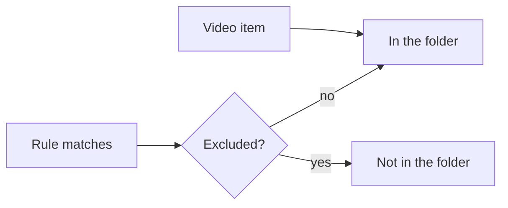

# Research: Smart folders whose videos follow a saved condition

Parent Issue: #1139. Groups, their items, exclusions, nesting, play order and
visibility are inherited from [048 research](../048-groups/research.md) and
[048 data-model](../048-groups/data-model.md); drag organizing from
[050 research](../050-drag-organize/research.md); tag kinds from #1136
(`specs/051-tag-kinds/`, in review when this plan was written). The library
filter is `domain.VideoQuery` and its SQL in `internal/store/listing.go` and
`internal/store/library_items.go`. This file records only the decisions this
feature adds.

## R-1: A smart folder is a group with a stored rule

**Decision**: A smart folder is a `groups` row whose new `rule` column holds
its condition and whose new `sort` column holds the order of its videos; a
group with a null `rule` is a group as before
([data-model.md, Migration](data-model.md#migration)).

| Option | Verdict |
| --- | --- |
| **A group row with `rule` and `sort`** | Chosen |
| A separate `smart_folders` table with its own ids | Rejected: favorites, playlists, nesting, the group page, `?group` and drag organizing all address a group by `groups.id` (048 R-10, R-9), so a second id space would need every one of them duplicated |
| Turning a group into a smart folder and back | Rejected: the Issue never asks for it, and a rule removed from a folder would leave its matched videos with no item rows |

**Rationale**: Requirement 5 and requirement 7 ask a smart folder to do
everything a group does. Keeping one id lets every existing group read and
write reach it with one branch where the members are computed.

## R-2: Matched videos are computed when a group is read, not stored

**Decision**: A smart folder's matched videos are evaluated inside the reads
that already compute a group's descendants (`groupDescendantsCTE` and the
library item query), from the rule and the current tags, credits, progress,
favorites and video facts. No membership is written anywhere.

| Option | Verdict |
| --- | --- |
| **Evaluate on read** | Chosen |
| A membership table refreshed after each change | Rejected: every write that can change a match (tags, credits, progress, favorites, bundling, imports) would have to update it in its own transaction, and one missed write leaves a wrong member until the next full refresh |
| A background job that rebuilds memberships | Rejected: the folder lags its condition until the job runs, against acceptance criterion 1 (`操作なしで`) |

**Rationale**: Requirement 3 then holds on every read whatever wrote the
facts, and an import never waits on a rule (Edge Case on tens of thousands of
videos). Telling open screens to read again stays a separate, best-effort
notice ([R-13](#r-13-writes-that-can-change-a-match-publish-groupschanged-for-every-smart-folder)):
a missed notice delays a screen, never corrupts a member. The cost moves to
the reads; the budget for it is in
[R-12](#r-12-a-read-budget-at-20000-videos-and-50-smart-folders).

## R-3: The rule is the library filter, combined with AND, built by the same SQL

**Decision**: A rule holds the fields of the library filter (search text,
watch state, playable only, favorites only, tags, tag kind, person,
organization) plus the added-date and length fields of
[R-4](#r-4-the-library-filter-gains-added-within-and-length); every field set
must hold. The store turns a rule into a `domain.VideoQuery` and uses the
filter conditions `ListLibrary` uses, so one builder decides both.

| Option | Verdict |
| --- | --- |
| **The library filter's fields, AND** | Chosen |
| An expression tree with OR, NOT and nested groups | Rejected: the condition UI must use the library filter's words and parts (`UI品質`), and the library filter has no OR between fields; search text already accepts `OR` and `-` |
| A smart-folder-only condition language | Rejected: acceptance criterion 5 (saved filter equals the library) would then hold only by keeping two translations in step |

**Rationale**: Acceptance criteria 1, 2 and 5 are all AND of filter fields.
Sharing the condition builder makes criterion 5 true by construction and
follows the rule against copied code (AGENTS.md).

## R-4: The library filter gains added within and length

**Decision**: `VideoQuery` and the library URL gain `addedWithin` (days, 1 to
36,500: added at or after now minus that many days) and `minDuration` and
`maxDuration` (seconds, inclusive; a video with no known length matches
neither). Guests may use them, as they reveal nothing the guest's list does
not.

| Option | Verdict |
| --- | --- |
| **Add them to the shared filter** | Chosen |
| Smart folder only | Rejected: the condition editor would need parts the library lacks, and a saved library filter could not carry them back (`UI品質`) |
| An absolute date range for the added date | Rejected: a fixed range never gains a new video, so it is a one-off filter rather than a folder that keeps filling; the Issue's example facts are relative to now |

**Rationale**: Requirement 2 names the added date and the length as facts a
rule uses. Watch state and favorites are already filter fields.

## R-5: Hand-added videos are items; hand-removed videos are exclusions

**Decision**: A video the owner adds to a smart folder is a `group_items` row,
as in any group; a video the owner removes is a `group_exclusions` row. A
smart folder's videos are its matched videos minus its exclusions, plus its
video items. Adding an excluded video deletes the exclusion and inserts an
item only when the video does not match; removing a video deletes its item and
always writes an exclusion.

| Option | Verdict |
| --- | --- |
| **Items and exclusions, as automatic groups use them** | Chosen |
| One override table with an include or exclude flag | Rejected: `group_items` and `group_exclusions` already carry the same meaning for automatic groups (048 R-3), and re-keying on bundling and succession already moves both (`rekeyGroupItems`) |
| Exclusion only when the removed video matches | Rejected: a video removed while it does not match would come back the moment it matches, against acceptance criterion 3 |

**Rationale**: Requirement 4 asks the owner's additions and removals to win
over the rule. An exclusion wins over a match, and an item is in the folder
whether or not it matches, so the rule never overrides either.

## R-6: Child groups keep their positions; videos follow the folder's sort

**Decision**: A smart folder's play order is its child groups in position
order, then its videos ordered by its `sort`, which takes the library's sorts
other than `random`. The default is `addedDesc`. Moving a video inside a smart
folder is refused with `409 smart_folder_sorted`; moving a child group works
as in a group.

| Option | Verdict |
| --- | --- |
| **Groups by position, then videos by sort** | Chosen |
| A position for every video | Rejected: a matched video has no row to hold a position, and a new match would need a place chosen for it |
| `random` as a folder sort | Rejected: the play order would change on every read, so `Up next` and the member window would disagree between two requests |

**Rationale**: Requirement 6 asks for an order of the matched videos. Hand-added
videos take the same sort, so the owner does not have to place each one.

## R-7: Matched videos leave the library's top level as group members do

**Decision**: A video in a smart folder counts as a group member for the
library item query: it is listed at the top level only through a partly
matching search (048 R-6), and a top-level smart folder is a card.

| Option | Verdict |
| --- | --- |
| **Members leave the top level** | Chosen |
| The card is added and the videos stay listed | Rejected: the library would list each matched video twice, unlike a group (requirement 7), and the AI organizing the Issue prepares for needs videos to move into folders |

**Rationale**: Requirement 5 and `UI品質` ask a smart folder to behave as a
group card. A broad rule takes many videos off the top level; nesting the
folder in a group is how the owner keeps it out of the way.

## R-8: An empty smart folder stays and is shown to the owner only

**Decision**: A smart folder is never dissolved because it has no video: the
removal of its last video and the organize move that empties it leave it in
place (048's "an edit never leaves an empty group" rule does not apply). The
owner's library and group lists show an empty smart folder as a card; for
guests 048's visibility rule (at least one visible video) is unchanged.

| Option | Verdict |
| --- | --- |
| **Keep it, owner sees it** | Chosen |
| Hide it from everyone, as an empty group | Rejected: the owner could not open it to change its condition, against the Edge Case `空であることが分かる` |
| Dissolve it | Rejected: the rule would be lost the first time nothing matches |

## R-9: Merges rewrite rules; a deleted reference makes the rule match nothing

**Decision**: Merging tags, people or organizations rewrites every rule that
names a source id to the target id, in the merge's transaction. A rule that
names a tag, tag kind, person or organization that no longer exists matches no
video (its video items still show), and the owner's reads of the folder name
the missing references.

| Option | Verdict |
| --- | --- |
| **Rewrite on merge; match nothing on a missing reference** | Chosen |
| Drop the missing field and evaluate the rest, as the library drops a missing tag (`MissingTagIDs`) | Rejected: a folder `タグ: 猫` whose tag is deleted would match every video and take the whole library off the top level ([R-7](#r-7-matched-videos-leave-the-librarys-top-level-as-group-members-do)) |
| A foreign key per reference | Rejected: the references sit in a JSON rule ([data-model.md](data-model.md#groupsrule)); four link tables would be read whole every time the rule is |

**Rationale**: The Edge Case asks a merge to follow the target and a deletion
to show the condition as not working. Tag kinds have no merge (#1136), so only
deletion applies to them.

## R-10: `owner_kept` marks every group the owner made or edited

**Decision**: `groups` gains `owner_kept`. Every screen API write that
creates a group or smart folder, renames it, changes its rule or sort, or
adds, removes or reorders its items sets it to 1 on that group; the folder
scan sync never does. Every group that exists when the migration runs starts
at 1.

| Option | Verdict |
| --- | --- |
| **One flag on every group, set by owner writes** | Chosen |
| On smart folders only | Rejected: the AI organizing that will read the flag also rearranges hand-made and automatic groups, and edits made before the flag exists could not be recovered later |
| A `created_by` value (owner, scan, AI) | Rejected: requirement 8 also asks an edited AI folder to count as the owner's, which a creator field does not record |
| Existing automatic groups at 1 only when an edit is detectable (a hand item, an exclusion, a changed name) | Rejected: a reorder, or a name changed and changed back, leaves no trace, so an edited group would start at 0 and the AI would rearrange it |

**Rationale**: Requirement 8 asks for the record so the AI leaves these
folders alone. The AI write path is out of scope; it will be the one path that
does not set the flag.

## R-11: The rule reads the owner's facts; visibility is the viewer's

**Decision**: A rule is evaluated with the owner's tags, progress, favorites
and full search, whoever views the folder; the result is then cut to the
videos the viewer may see (048 Visibility).

| Option | Verdict |
| --- | --- |
| **Owner's facts, viewer's visibility** | Chosen |
| Evaluate the rule as the viewer | Rejected: the guest filter refuses tags, credits, watch state and favorites (`guest_filter_not_allowed`), so a folder would hold different videos for a guest than for the owner |

**Rationale**: Requirement 7 and the Edge Case on hidden videos ask a guest
to see the folder the owner built, minus what the guest may not see.

## R-12: A read budget at 20,000 videos and 50 smart folders

**Decision**: The first library page and a smart folder's group page each
return within 500 ms with 20,000 videos and 50 smart folders, measured by a
store benchmark; the matched-video CTE runs once per read, not once per
listed group.

| Option | Verdict |
| --- | --- |
| **A benchmark with a stated budget** | Chosen |
| A time limit inside a unit test | Rejected: CI runners vary, and a timing assertion fails without a code change |
| No budget | Rejected: [R-2](#r-2-matched-videos-are-computed-when-a-group-is-read-not-stored) moves the cost to every library read, which the Edge Case on tens of thousands of videos is about |

**Rationale**: `BenchmarkRebuildFolderIndex` sets the same kind of measured
budget for the folder index. When the budget is missed, the fallback is a
per-request cache of matched keys, not stored membership.

## R-13: Writes that can change a match publish `GroupsChanged` for every smart folder

**Decision**: Rule, sort, item and exclusion changes publish `GroupsChanged`
for the folder and its ancestors (048 R-13). A committed write that can change
which videos match any rule publishes `GroupsChanged` for every smart folder
and their ancestors, and nothing when no smart folder exists
([data-model.md, Notices](data-model.md#notices)). A progress save publishes
only when it changes the video's watch state.

| Option | Verdict |
| --- | --- |
| **One notice naming every smart folder** | Chosen |
| Only edits of the folder publish | Rejected: the SPA re-reads a group only on a `group` event naming it (`web/src/api/useGroupRefresh.ts`) and the library re-reads its pages only on a `group` event, so a newly tagged video would stay outside an open folder and on the library's top level |
| Work out which folders the write changed | Rejected: it evaluates every rule before and after each write, the cost [R-2](#r-2-matched-videos-are-computed-when-a-group-is-read-not-stored) keeps off the write path |
| Every progress save | Rejected: progress is saved every few seconds during playback, and each notice makes the library re-read its loaded pages |

**Rationale**: Acceptance criterion 1 asks the folder to change with no
operation, and the open screens learn of a change only from an event. The
existing `group` event and its handlers carry the notice, so the SPA needs no
change.
