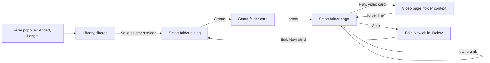
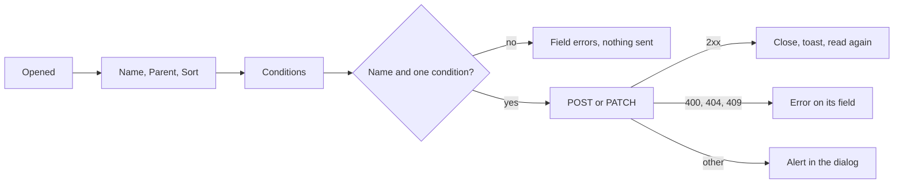
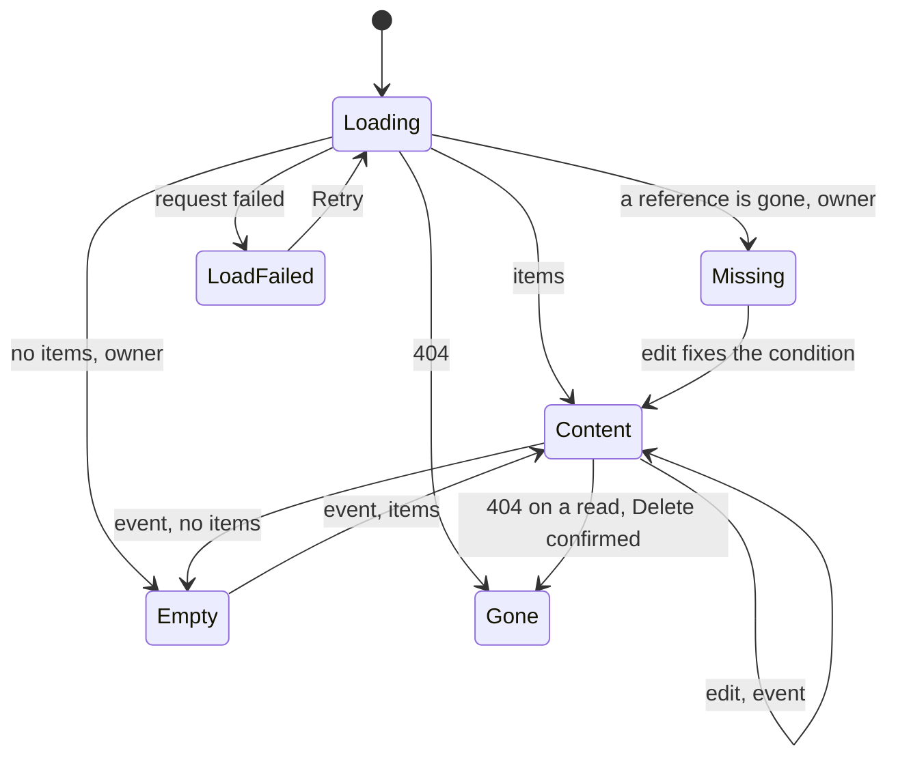

# UI design: Smart folders whose contents follow a saved condition

**Feature**: [parent Issue #1139](https://github.com/syudead/vv/issues/1139) ·
[plan.md](plan.md) ·
[research.md R-3](research.md#r-3-a-rule-is-the-library-filters-fields-contents-are-the-filtered-library) ·
[R-4](research.md#r-4-the-library-filter-gains-added-within-and-length) ·
[R-5](research.md#r-5-a-childs-effective-rule-is-every-rule-on-its-path-anded) ·
[R-6](research.md#r-6-videos-follow-the-folders-sort-random-is-refused) ·
[R-7](research.md#r-7-root-smart-folders-are-cards-in-the-unfiltered-library) ·
[R-8](research.md#r-8-an-empty-folder-stays-and-is-shown-to-the-owner-only) ·
[R-9](research.md#r-9-merges-rewrite-rules-a-deleted-reference-makes-the-rule-match-nothing) ·
[R-12](research.md#r-12-writes-that-can-change-a-match-publish-smartfolderschanged) ·
[data-model.md, Contents](data-model.md#contents) ·
[contracts/screen-api.md](contracts/screen-api.md)

Sources that already decide things, linked rather than repeated here:

| Topic | Source |
| --- | --- |
| Tokens, closed scales, library density | [design-system.md, Foundations](../../docs/design-docs/design-system.md#foundations); the values in `@theme` of [`web/src/ui/tokens.css`](../../web/src/ui/tokens.css), named here and never copied |
| `ListPage`, `PageHeader`, `CardGrid`, `DataTable`, the state blocks | [patterns.md, List page](../../web/registry/rules/patterns.md#list-page), [Sections](../../web/registry/rules/patterns.md#sections), [States](../../web/registry/rules/patterns.md#states) |
| `FormDialog`, `ConfirmDialog`: `pending`, the failure `Alert` inside them | [patterns.md, Form dialog](../../web/registry/rules/patterns.md#form-dialog), [Confirm dialog](../../web/registry/rules/patterns.md#confirm-dialog) |
| `Select`, `Badge`, `Breadcrumb`, `TagCommand`, `CreditCommand`, `DropdownMenu`, `Tooltip`, `Sonner`: what each is for | [components.md](../../web/registry/rules/components.md) |
| The library's toolbar, the `Filter` popover and the sort menu | [library-ui.md, Shell and toolbar](../../docs/design-docs/library-ui.md#shell-and-toolbar), [013 UI design, Filter menu](../013-library-search/ui-design.md#filter-menu), [035 UI design, Filter menu](../035-favorites/ui-design.md#filter-menu) |
| The active filter row (`Filtering by`) and its chips | [014 UI design, Active tag filters](../014-video-tags/ui-design.md#active-tag-filters), [047 UI design, Library](../047-video-work-info/ui-design.md#library-filter-by-a-person-or-organization) |
| The tag kind filter row and its chip | #1136, `specs/051-tag-kinds/ui-design.md` on `feature/051-tag-kinds` (`Library`) |
| The group card and row, their art, count face and corner marks | [library-ui.md, Cards](../../docs/design-docs/library-ui.md#cards), [048 UI design, Group card and row](../048-groups/ui-design.md#group-card-and-row), [044 UI design, Add to playlist](../044-playlists/ui-design.md#add-to-playlist) |
| The group page: its trail band, header, body, states and the gone state | [048 UI design, Group page](../048-groups/ui-design.md#group-page) |
| The name dialog and the name rule | [048 UI design, New group](../048-groups/ui-design.md#new-group), [048 research R-14](../048-groups/research.md#r-14-a-group-name-is-1-to-100-characters-after-trimming-names-may-repeat) |
| The video page's group line, `Up next`, the arrows and the autoplay notice | [library-ui.md, Group members](../../docs/design-docs/library-ui.md#group-members), [048 UI design, Video page](../048-groups/ui-design.md#video-page), [044 UI design, Video page in a playlist](../044-playlists/ui-design.md#video-page-in-a-playlist) |
| Dragging cards: what is a drop target and what refuses | [050 UI design, Drag layer](../050-drag-organize/ui-design.md#drag-layer) |
| Guest degradation | [016 UI design, Guest degradation](../016-single-account-auth/ui-design.md#guest-degradation) |
| Width breakpoints in CSS; layout checked by people | [library-ui.md, Width breakpoints](../../docs/design-docs/library-ui.md#width-breakpoints-in-css-and-the-sidebar-exception), [Layout verified by people](../../docs/design-docs/library-ui.md#layout-verified-by-people-not-machines) |
| Screen text | [`web/src/i18n/en.ts`](../../web/src/i18n/en.ts) (`list.filter`, `list.sort`, `library.activeTags`, `library.group`, `groups`, `player.group`); this feature adds `smartFolders` and the words below |

The diagram shows the parts this feature adds or changes and where each
action leads.

Unchanged: the video card and the group card, the favorite heart,
`Add to playlist` and `Add to group`, the selection bar and its actions, the
group page, the folder screen, the playlists screens, the sidebar and the
autoplay notice. Every part below is a registry component or pattern, and
the contrast pairs in `web/src/theme/tokens.test.ts` gain nothing. No token
is added: the smart folder card reuses the group card, the dialog is a
`FormDialog`, the folder page reuses the group page's band, header and body,
and the two new filter rows are `Select`s of the `Filter` popover's width.

## Why this shape

A smart folder is a saved library filter, so every screen of it is the
library's own part with one word changed. The card is the group card
(requirement 6; `UI品質`, the first point), the page is the group page
(048) with the conditions where the group page shows its folder line, the
conditions are the `Filter` popover's rows, the tag chips and the person
chips the owner already sets in the library (requirement 2; `UI品質`, the
second point), and the folder context on the video page is the group line
with another icon. A screen of its own for smart folders (a tree, a table of
rules) was rejected because the owner would then learn a second way of
reading the same videos, and because requirement 4 defines the contents as
the filtered library, which the library's cards already show.

Saving is one `outline` action in the library's header, `Save as smart
folder`, drawn only while a condition applies (requirement 10). The library
page has had no header action; the slot is the pattern's place for the one
main action of a list page, and the action is the reason the owner filtered.
Putting it inside the `Filter` popover was rejected because the search text,
the tag chips and the person chips are not in the popover, so the owner
could read it as saving the popover's rows alone; putting it in the
`Filtering by` row was rejected because that row holds removable chips and
nothing else. Without a condition the action is absent rather than disabled:
an empty rule matches every video, and a folder of everything is not what
requirement 10 describes. A child is made from its parent's page, where the
parent is in view.

One dialog creates and edits. Its conditions section is the library's
filter parts laid out as a form: the search field, the watch status toggle,
the two checkboxes, the tag kind `Select`, the tag chips with the video
page's tag field, the person and organization fields of the details
editor, and the two `Select`s this feature adds to the popover. The owner
reads the same words in the same shapes in both places, so a filter saved
from the library opens in the dialog as the owner set it (acceptance
criterion 5). A free-text rule language and a row-per-condition builder with
operators were rejected (R-3): the library filter has no operators, and a
builder would invent words the library does not use. The dialog also holds
the name, the parent and the sort, because requirement 1 lets the owner
change all of them later and one dialog keeps "change the folder" one
action.

The added date and the length join the `Filter` popover as two `Select`s of
presets, `Added` and `Length`, rather than as number fields. The popover's
rows act at once on choosing (`ToggleGroup`, `Checkbox`, the tag kind
`Select`), and a number field in a popover acts on every keystroke or needs
a button; presets keep the row one press. A value outside the presets, set
by a URL or by a rule, is shown as its own option so nothing is lost
([Added and length](#added-and-length)).

A smart folder is told from a group only on a closer look (`UI品質`, the
first point): the card's box, art, count face, name and marks are the group
card's, and the one difference is the small smart folder icon before the
count on the face and in the row's count line, which the eye passes over
and the pointer finds. A badge or a label on the card was rejected as a
second class of card for a difference that changes no browsing action; no
mark at all was rejected because the owner who wonders why a video is in two
places must be able to find out without opening the folder.

On a child's page, the way up is the trail band and the narrowing is the
conditions line: the child's own conditions first, then one line per
ancestor, `From {parent}:` and that parent's conditions, outermost last
(`UI品質`, the third point; R-5). Merging the path into one list of chips
was rejected because the owner then cannot tell which folder to edit to
loosen a condition.

## Words

Text in `web/src/i18n/en.ts` under `smartFolders`, except where a key is
named. User data (a folder name, a tag name, a title) is embedded as an
argument. `videos` is the catalog's "1 video" / "N videos" helper.

| Place | Text | Notes |
| --- | --- | --- |
| Library header action | Save as smart folder | `smartFolders.save`; lucide `FolderSearch` + text |
| Filter popover rows | Added; Length | `list.filter.added`, `list.filter.length`; `Select` labels |
| Added options | Any time; Last 24 hours; Last 7 days; Last 30 days; Last 90 days; Last year; Last {N} days | `list.filter.addedOptions`; the last form only for a value outside the presets |
| Length options | Any length; Under 5 minutes; 5 to 20 minutes; 20 to 60 minutes; Over an hour; {min} to {max} minutes; Under {max} minutes; Over {min} minutes | `list.filter.lengthOptions`; the last three only for values outside the presets |
| Dialog title, creating | New smart folder | `smartFolders.dialog.newTitle` |
| Dialog title, creating a child | New smart folder in "{parent}" | `smartFolders.dialog.newChildTitle(parent)` |
| Dialog title, editing | Edit smart folder | `smartFolders.dialog.editTitle` |
| Name field label; rule | Name; Use a name of 1 to 100 characters. | `groups.nameLabel`, `groups.nameRule` (048's name rule) |
| Parent field label; top-level option | Parent; None (top level) | `smartFolders.dialog.parent`, `.noParent` |
| Parent option that would be a cycle | (the folder itself and its descendants are not listed) | [Parent](#parent) |
| Sort field label | Sort | `list.sort.heading`; options from `list.sort.kinds` and `list.sort.wording` as "Date added, newest first" |
| Sort hint when the library sort was random | Random can't be saved; the folder is sorted by date added | `smartFolders.dialog.randomSort` |
| Conditions section heading | Conditions | `smartFolders.dialog.conditions` |
| Conditions hint | Videos that match every condition are in the folder. | `smartFolders.dialog.conditionsHint` |
| Search field label | Search | `list.search.placeholder` |
| Watch status, Favorites only, Playable only, Tag kind | As the popover | `list.filter.*` |
| Tags field label; field placeholder | Tags; Add tag | `library.tagRow.label`, `player.tags.add` |
| Person and organization field labels | Person; Organization | The details editor's role labels under `credits` |
| Added, Length | As the popover | `list.filter.added`, `list.filter.length` |
| Nothing set in the conditions | Add at least one condition. | `smartFolders.dialog.noConditions`; the `FieldError` of the section |
| Create action; while sending | Create; Creating… | `smartFolders.dialog.submit`, `.submitting` |
| Save action; while sending | Save; Saving… | `smartFolders.dialog.saveSubmit`, `.saving` |
| Create failed; save failed | Couldn't create the smart folder: {reason}; Couldn't save the smart folder: {reason} | `smartFolders.dialog.createFailed`, `.saveFailed`; a `destructive` `Alert` in the dialog |
| `smart_folder_cycle` | A smart folder can't be put inside itself or inside one of its children. | `errorCodes.smart_folder_cycle`; the `FieldError` of the parent field |
| `smart_folder_not_found` as a parent | That smart folder no longer exists. | `errorCodes.smart_folder_not_found`; the parent field's `FieldError`, and the parent list is read again |
| `invalid_smart_rule` | A condition is out of range. | `errorCodes.invalid_smart_rule`; the conditions section's `FieldError` |
| Created; saved | Created "{name}"; Saved "{name}" | `smartFolders.created(name)`, `.saved(name)`; toasts |
| Card accessible name | {name}, smart folder of 12 videos; {name}, smart folder of 12 videos, 3 watched | `library.smartFolder.label(name, count, watched)` |
| Card mark tooltip and `title` | Smart folder | `smartFolders.kind` |
| Card favorite, add to playlist | Favorite smart folder "{name}"; Add smart folder "{name}" to a playlist | `library.smartFolder.favorite(name)`, `.addToPlaylist(name)` |
| Trail band accessible name | Smart folder path | `smartFolders.trail` |
| First crumb | Library | `library.title` |
| Header count | 12 videos · 1:32:10; 0 videos | `groups.detail.count(count, duration)` |
| Conditions line label | Conditions: | `smartFolders.detail.conditions` |
| Inherited conditions line label | From "{parent}": | `smartFolders.detail.fromParent(name)` |
| Condition chips | Search: kyoto; Unwatched; In progress; Watched; Favorites; Playable; Kind: Genre; Tag: 猫; Person: {name}; Organization: {name}; Added in the last 7 days; 5 to 20 minutes | `smartFolders.condition.*`; the watch and length words are the popover's |
| Condition chip whose reference is gone | Tag: deleted; Kind: deleted; Person: deleted; Organization: deleted | `smartFolders.condition.deleted(kind)`; `warning` `Badge` with lucide `TriangleAlert` |
| Empty body, nothing matches | Nothing matches these conditions yet; Videos that match appear here as soon as they are tagged or added. | `smartFolders.detail.empty.title`, `.description`; the owner's action is "Edit conditions…" |
| Empty body, a reference is gone | A condition no longer works; A tag, kind, person or organization in the conditions was deleted, so nothing matches. | `smartFolders.detail.missing.title`, `.description`; the owner's action is "Edit conditions…" |
| Play action, accessible name | Play; Play "{name}" | `groups.detail.play`, `.playFor(name)` |
| More button, tooltip and accessible name | More | `common.more` |
| Menu items | Edit…; New child smart folder…; Delete… | `smartFolders.detail.edit`, `.newChild`, `.delete` |
| Edit action in the empty states | Edit conditions… | `smartFolders.detail.editConditions` |
| Delete dialog title | Delete "{name}"? | `smartFolders.deleteDialog.title(name)` |
| Delete dialog description | The smart folder is deleted. Its videos stay in the library. | `smartFolders.deleteDialog.description` |
| Delete dialog, folder with children | Its {N} child smart folders are deleted with it. | `smartFolders.deleteDialog.children(count)`; a second sentence |
| Delete action; while sending | Delete; Deleting… | `smartFolders.deleteDialog.submit`, `.submitting`; `destructive` |
| Delete failed | Couldn't delete the smart folder: {reason} | `smartFolders.deleteDialog.failed` |
| Deleted | Deleted "{name}" | `smartFolders.deleted(name)`; a toast |
| Gone title | This smart folder no longer exists | `smartFolders.detail.gone.title` |
| Gone description | It was deleted, maybe in another tab. | `smartFolders.detail.gone.description` |
| Gone action | Back to library | `groups.detail.gone.action` |
| Load failed | Couldn't load the smart folder | `smartFolders.detail.loadFailed` |
| Load more failed | Couldn't load more of the smart folder | `smartFolders.detail.moreFailed` |
| Folder line on the video page, accessible name | Smart folder "{name}", video 3 of 12. Open the smart folder | `player.smartFolder.line(name, position, count)` |
| Drop refused on a smart folder card | Can't drop here | `organize.drop.refused` |

"Smart folder" is the product term for the whole feature; "rule" is not
shown on a screen, where the word is "conditions", and "condition" is one
part of them. "Child smart folder" is a folder under another; "parent" is
the one above. "Delete" ends a smart folder, because nothing is dissolved
(no video is in it). A smart folder's name is quoted in text as a group's
is.

## Library

### Added and length

The `Filter` popover gains two rows after `Playable only` (and after the tag
kind row of #1136 when it is present), each a `Field` with a label and a
`Select` of the popover's width, in this order: `Added`, `Length`. Both are
shown to the owner and to guests (R-4). Choosing applies at once, the URL
gains `addedWithin=<days>` or `minDuration=<s>` and `maxDuration=<s>`, the
list reloads from the top, and the popover stays open. The button counts
each as one applied filter; `Clear filters` removes both. No chip joins the
`Filtering by` row: the two are counted on the button as watch status is,
because they name no entity.

| Option | Sent |
| --- | --- |
| Any time | nothing |
| Last 24 hours | `addedWithin=1` |
| Last 7 days, Last 30 days, Last 90 days, Last year | `addedWithin=7`, `30`, `90`, `365` |
| Any length | nothing |
| Under 5 minutes | `maxDuration=299` |
| 5 to 20 minutes | `minDuration=300&maxDuration=1199` |
| 20 to 60 minutes | `minDuration=1200&maxDuration=3599` |
| Over an hour | `minDuration=3600` |

A URL whose value matches no preset (`addedWithin=14`, `minDuration=90`)
draws one more option, `Last 14 days` or `1.5 to … minutes`, selected, after
the presets; it goes when another option is chosen. A value out of range or
`minDuration` over `maxDuration` is dropped before the request with a
`replace` of the URL, as a guest's `fav=1` is, so the list never sends a
`400` for a hand-edited URL. The sort stays.

### Save as smart folder

The library's `PageHeader` gains, for the owner, the `outline` `sm` action
`Save as smart folder` (lucide `FolderSearch`), drawn while any condition
applies: search text, watch status, favorites only, playable only, tag
kind, a tag, a person, an organization, added or length. It opens the
[smart folder dialog](#smart-folder-dialog) with the conditions set from
the URL and the sort set from the current sort, the name empty and the
parent `None (top level)`. The selection, the scroll position and the list
are untouched; on `201` the toast `Created "{name}"` shows and the library
reads its first page again in place, so the new card stands where its sort
value puts it (R-7). A `random` sort opens the dialog with `Date added,
newest first` and the hint of [Words](#words) under the sort field (R-6).

### Smart folder card and row

A `smartFolder` item of the library draws the group card with these
differences, and otherwise the group card's box, art (`FolderArt` of the
response's `previews`), count face, watched bar, name, tag row and corner
marks:

| Part | Smart folder |
| --- | --- |
| Count face | Lucide `FolderSearch` `size-3`, then "12 videos", then the sum; the icon has the tooltip `Smart folder` and is the one visible difference |
| Link | `/smart-folders/{id}` with `state.from` the list URL; accessible name "{name}, smart folder of 12 videos" |
| Corner marks | The heart and `Add to playlist` only; no `Add to group` (`対象外`: a smart folder does not go in a group) |
| Selection check | None; `Select all` skips the card. Its videos are their own cards in the library and are selected there |
| Drag | Not lifted and not a drop target: a card dragged onto it shows `Can't drop here` ([050 UI design, Indicators](../050-drag-organize/ui-design.md#indicators)) |
| Empty folder (owner) | The art with no sheet, the face "0 videos", the name in `text-muted-foreground`; a guest never sees one (R-8) |

In the list view the row is the group row with the `FolderSearch` icon in
the count line in place of `Folder`, no check column and no `Add to group`
column.

The card is read again, without a skeleton, on a `smartFolder` event that
carries its id (R-12), as a group card is on a `group` event; a `404`
removes it. A filtered library lists no smart folder card, and favorites
only lists the favorited ones at any depth (R-7), so a child folder's card
can stand in the library only there.

## Smart folder dialog

One `FormDialog` of `size="wide"`, for creating from the library, creating a
child from a folder page and editing a folder. Its body scrolls inside the
dialog; the footer holds `Cancel` and the `default` `Create` or `Save`,
`submitDisabled` while editing until something differs from the folder.
The focus opens on the name field.

| Part | Form |
| --- | --- |
| Name | The name field of [048 UI design, New group](../048-groups/ui-design.md#new-group): `Label` "Name", `Input`, the code-point count, the rule as `FieldError` on submit |
| Parent | A `Select`, "None (top level)" first, then every smart folder the owner has in natural name order, nested ones indented by one `pl-4` step per level, from `GET /api/smart-folders`; [Parent](#parent) says what is left out |
| Sort | A `Select` of the library's sort kinds and directions as "Date added, newest first", 15 options, without `Random`; the default `Date added, newest first` |
| Conditions | A `FieldSet` with the legend "Conditions" and the hint, holding the rows of [Conditions](#conditions) in the order of the table, `gap-3` between rows as the popover has |

A condition that is empty is absent from the rule; a rule with no member is
refused before sending with the section's `FieldError`. The `400`, `404`
and `409` statuses of [contracts/screen-api.md, Statuses](contracts/screen-api.md#statuses)
land on the field named in [Words](#words); any other failure is the
`destructive` `Alert` under the fields, the dialog stays open. `Cancel`,
`×` and Esc drop the draft without asking: the dialog holds a few values,
not a page of work.

### Conditions

| Row | Control | Rule member |
| --- | --- | --- |
| Search | An `Input` with the library's search placeholder; trimmed, at most 500 characters | `q` |
| Watch status | The popover's `ToggleGroup` (`All`, `Unwatched`, `In progress`, `Watched`) | `watch`; `All` is absent |
| Favorites only, Playable only | The popover's two checkboxes | `favorite`, `playable` |
| Tag kind | The popover's `Select` (`Any kind`, then the kinds); drawn only once #1136 is merged, as the popover's row is | `tagKind` |
| Tags | The chips of the video page's tag unit with their `×`, and after them the `TagCommand` in `dropdown` layout, whose create row is absent (a condition names an existing tag); at most 16 chips, then the field is `disabled` with the hint "Up to 16 tags" | `tags` |
| Person, Organization | One chip each with `×`, else the details editor's `CreditCommand` in `dropdown` layout without its create row | `person`, `organization` |
| Added | The popover's `Select` | `addedWithin` |
| Length | The popover's `Select` | `minDuration`, `maxDuration` |

A rule member the screen cannot draw (a `q` over the field's length, a
length that matches no preset) is drawn as its own option or kept as is, so
saving the other fields never drops it. A chip whose tag, kind, person or
organization no longer exists is the `warning` chip of [Words](#words) with
its `×`, so the owner removes it or replaces it.

### Parent

The parent `Select` leaves out the folder being edited and its descendants,
from the tree of `GET /api/smart-folders`, so the one choice that is a cycle
cannot be made. A race (a folder moved in another tab) still answers
`409 smart_folder_cycle`, drawn as the parent field's error (Edge Case).
Creating a child from a folder page opens the dialog with that folder
selected; the owner may change it.

## Smart folder page

`/smart-folders/{id}` is a `ListPage` inside `AppShell`, loaded when used,
for the owner and for guests, built as the group page is
([048 UI design, Group page](../048-groups/ui-design.md#group-page)) with
the differences below. `document.title` is the folder's name. There is no
`?trail`: the parents are stored, and the response's `trail` is what the
band draws.

### Trail band

The folder screen's breadcrumb band, named "Smart folder path": "Library",
each ancestor of `trail` as a link to its page, outermost first, and the
folder's name as the current crumb; below `md` it collapses to
"… › {parent} › {name}" from four crumbs on, as the group band does.

### Header

| Part | Form |
| --- | --- |
| Title | The name, `text-xl font-semibold`, two lines at most, the full name in `title` |
| Count | "12 videos · 1:32:10" from the card values; "0 videos" for an empty folder |
| Description | The conditions lines ([Conditions lines](#conditions-lines)) |
| Actions | The `default` `sm` "Play" (lucide `Play`), drawn while the play order is not empty, and the owner's `ghost` `icon-sm` "More" (lucide `Ellipsis`) opening a `DropdownMenu`: "Edit…" (lucide `Pencil`), "New child smart folder…" (lucide `Plus`), a separator, "Delete…" (lucide `Trash2`, `variant="destructive"`) |

"Play" opens `/videos/{openVideoId}?smartFolder={id}` with
`state: { from: <this page's URL>, autoplay: true }`.

### Conditions lines

Under the count, one `text-xs text-muted-foreground` line per folder on the
path, each a label and a wrapping row of `outline` `Badge`s `gap-1`, the
chip text in `text-xs font-normal`:

| Line | When | Content |
| --- | --- | --- |
| "Conditions:" | Always | The folder's own conditions as chips, in the order of [Conditions](#conditions); a folder with an empty rule shows no chip after the label |
| "From "{parent}":" | For each ancestor, nearest first | That ancestor's conditions; the label is a `link`-variant link to that ancestor's page |

A chip is read-only: pressing nothing, no `×`. Every viewer sees the lines,
because they say what the folder is; the owner's `settings` adds the
`missing` list, which turns the chips it names into the `warning` chip of
[Words](#words). The names for tag, kind, person and organization chips
come from the shared tag list, the kind list and `GET /api/people/{id}` or
`/organizations/{id}`, with a `Skeleton` `w-12` until they arrive, as the
`Filtering by` chips do. A guest's chips name tags, people and organizations
too: the names are what the folder filters by, and the folder is shown to
the guest only with public videos in it (R-11).

### Body

The toolbar is the group page's: the view toggle and the zoom, no search,
filter or sort (the sort is the folder's, changed in the dialog). The body
is the library's grid or list view of the response's `items`, in the
response's order: child smart folders first, by name, then the videos and
groups in the folder's sort ([data-model.md, Contents](data-model.md#contents)).

| Item | Card and link |
| --- | --- |
| Child smart folder | The [smart folder card](#smart-folder-card-and-row), opening `/smart-folders/{childId}` |
| Video | The library's `VideoCard`, opening `/videos/{videoId}?smartFolder={id}` with `state.from` this page's URL, so `×` and Esc return here and `Up next` follows this folder |
| Group | The library's `GroupCard`, opening `/groups/{groupId}` as the library does; a partly matching group lists its matching videos as video cards instead (027, R-3) |

The list view uses the library's rows, not the playlist screen's: a smart
folder has no order to drag and no `×`, so the rows keep the library's
columns. Pressing a tag on a card opens `/?tag=<id>`, as on the group page.
Selection is the library's for the video and group cards (owner), with the
library's selection bar and its actions; the child folder cards have no
check. Paging reads `GET /api/smart-folders/{id}/items` from `nextCursor`
when the sentinel comes within 600px, as the library grid does; a failed
page shows the `LoadMoreRow` `Alert` with `Retry`.

### Editing

"Edit…" opens the [smart folder dialog](#smart-folder-dialog) with the
folder's name, parent, sort and conditions, the name's text selected. On
`200` the dialog closes, the toast `Saved "{name}"` shows, the title, the
band's last crumb, the conditions lines, `document.title` and the body are
read again, and focus returns to "More"; a changed parent redraws the band
and, when the new parent is a folder further up or down, the page stays on
this folder. A `404 not_found` on the folder itself shows the gone state.

### New child

"New child smart folder…" opens the dialog with the parent set to this
folder, the conditions empty and the sort `Date added, newest first`. On
`201` the toast `Created "{name}"` shows and the body is read again, so the
child's card stands first among the children.

### Deleting

"Delete…" opens a `ConfirmDialog`: the title `Delete "{name}"?`, the
description of [Words](#words), and for a folder with children the second
sentence naming their number (from the tree of `GET /api/smart-folders`),
then `Cancel` and the `destructive` "Delete". The description names what
stays, because losing videos is the one fear here (requirement 5), and the
second sentence is the one place the Edge Case on a deleted parent is
spoken.

| Event | Behaviour |
| --- | --- |
| Confirm | `pending`; `DELETE /api/smart-folders/{id}` |
| `204` | The dialog closes, the screen leaves for the parent's page or, with no parent, for `/`, and a toast there says `Deleted "{name}"` |
| `404` | Already deleted: the same as `204` without the toast |
| Other failure | A `destructive` `Alert` with the reason; the dialog stays open |
| Cancel, Esc | Nothing changes |

### Reading again

A `smartFolder` event that carries this folder's id (R-12) reads the folder
again without a skeleton, keeping the scroll position and the selection; the
band, the title, the count, the conditions lines and the items follow the
response, so a video tagged in another tab is in the body without a reload
(acceptance criterion 1). The library does the same for its folder cards
and, because every match-changing write names every folder, reads a folder
card's values again at most once per event. A `404` on any read is the gone
state.

### States

The diagram shows the body's states and what moves it between them.

| State | What the screen shows |
| --- | --- |
| Loading | The band with "Library" and a `Skeleton` crumb; the header with a `Skeleton` line in the title's place; `LoadingState` of the current view |
| Load failed | `ErrorState` "Couldn't load the smart folder" with `Retry`; the band "Library" alone; no actions |
| Gone | `EmptyState` with lucide `FolderX`, "This smart folder no longer exists", "It was deleted, maybe in another tab." and the `default` `sm` "Back to library"; the band "Library" alone; the title "Library" |
| Content | The grid or the list; the header with the count, the conditions lines, "Play" and "More" |
| Empty | The header with "0 videos", the conditions lines and "More" (no "Play"); child folder cards when there are any, then `EmptyState` with lucide `FolderSearch`, "Nothing matches these conditions yet", its description and the `outline` `sm` "Edit conditions…" that opens the dialog. Drawn for the owner only; a guest gets the gone state from the server (R-8) |
| Missing | As Empty, with the `warning` chips in the conditions lines and the `EmptyState`'s title and description of the missing case; the icon is lucide `TriangleAlert`. A child under a folder with a missing reference shows the same state with the warning chip on the inherited line, and "Edit conditions…" opens this folder's dialog, where the inherited condition is not editable, so the description of that state adds "The condition is in "{parent}"." |
| Loading more, load more failed | The `LoadMoreRow` after the items |
| Editing, deleting | The dialog in its `pending` form over the unchanged body |

## Video page

With `?smartFolder=<id>` the page's reads carry `smartFolder`, and the
folder line, the arrows, the `Up next` member list and the autoplay notice
follow the folder's play order; `group` wins when both are present and a
playlist context overrides both
([contracts/screen-api.md, Schemas and parameters changed](contracts/screen-api.md#schemas-and-parameters-changed)).
A folder that no longer holds the video is ignored by the server, and the
page then shows what it shows without the query.

| Part | Form |
| --- | --- |
| Folder line | One line above the title in the group line's form, with lucide `FolderSearch` `size-4` in place of `Folder`: the name truncated, `·`, "3 / 12"; a `Link` to `/smart-folders/{id}` with `state.from` carried over and the accessible name of [Words](#words). The same for a guest |
| Actions after the line | None: a smart folder has no "Remove from" (nothing is in it by hand), and editing is on the folder's page one press away |
| `Up next`, arrows, notice | The folder's play order; the rows, the arrows and the notice keep `?smartFolder` on the URLs they open |
| Action group | Unchanged: the heart, `Add to playlist` and `Add to group` act on the video |

## Guest degradation

When drawing as a guest, the following are not shown. They are neither
`disabled` nor `aria-disabled` (as in 016).

| Place | Not shown | Instead |
| --- | --- | --- |
| Library | `Save as smart folder`; the folder card's marks and selection | The cards and rows of the folders with public videos; the `Added` and `Length` rows stay in the popover (R-4) |
| Dialogs | All | None |
| Smart folder page | "More", the selection, the `missing` warning chips | The band, the title, the count, the conditions lines, "Play" and the items as plain cards or rows; an empty folder is the gone state |
| Video page | Nothing changes beyond 048's rules | The folder line stays a link |

## Responsive behaviour

The widths below are the ones the implementation is judged at. The folder
page's grid changes with the width and the zoom as the library's does; the
band collapses below `md`; the dialog is centred `max-w-2xl` from `sm` and
spans the screen with the 16px margin below it.

| Width | Layout |
| --- | --- |
| 360px | Library: the header's title, count and `Save as smart folder` share one row, the action at the row's end with its text whole; the popover's `Added` and `Length` `Select`s fill the popover. Dialog: one column; the name, parent and sort stack; in the conditions the watch toggle is the popover's two-column grid, the tag field and chips wrap, and the dialog scrolls inside itself with the footer in view. Folder page: the band is one line, "… › {parent} › {name}" with two or more ancestors; the conditions lines wrap chip by chip under their label and a long ancestor name truncates; the grid is one column. Video page: the folder line truncates its name before the position |
| 768px | Dialog: `max-w-2xl` centred, the name and parent on one row, the sort under them, the conditions in one column; the whole dialog fits 768×1024 without scrolling for a rule of four conditions. Folder page: the band shows the whole path; the header's name, count and the two actions fit one row for a name of up to about 40 characters; the conditions lines each fit one line for up to about five chips |
| 1280px | Library: the header's action sits at the right of the count; the grid is the library's columns. Folder page: the conditions lines sit under the count at the body's left edge, the chips one line each; the grid has both edges on the header's. Video page: two columns, the line above the title |

## Review criteria

Judged by looking at the screen at 360px, 768px and 1280px, signed in as the
owner, with a library of tags `猫` and `犬`, a kind `Genre` on `猫`, one
group whose two parts both carry `猫`, one group with `猫` on part1 only,
one person credited on two videos, one unwatched and one watched `猫` video,
one video added today and one 90 minutes long; then a folder `タグ: 猫`
with a child `未視聴` (`watch: unwatched`) and a folder whose tag was
deleted.

1. **Same look as a group** (`UI品質`, the first point; requirement 6): the
   folder card beside a group card has the same box, art, count face, name
   size, tag row and corner reveal; covering the small icon on the face
   leaves the two indistinguishable at every zoom, and resting on the icon
   reads "Smart folder". The icon is `size-3` in the face's text colour and
   no larger or brighter than the duration next to it. In the list view the
   folder row and the group row differ only in that icon and in the absent
   check and `Add to group` columns (`視覚的な階層`, `情報密度`).
2. **Same words and parts** (`UI品質`, the second point; requirement 2):
   opening the dialog from a library filtered by `猫`, `Unwatched`,
   `Kind: Genre` and `Last 7 days` shows the same four values in the same
   shapes as the popover and the chips: the toggle pressed on `Unwatched`,
   the `Select`s on `Genre` and `Last 7 days`, the `猫` chip with its `×`;
   no word appears in the dialog that the library does not use for the same
   condition. The two new popover rows have the `gap-3`, the `h-8` `Select`
   and the label weight of the tag kind row above them (`タイポグラフィ`,
   `余白のリズム`).
3. **Visual hierarchy on the folder page**: the name is the only `text-xl`;
   the band is `text-sm` muted and reads as a path; the count and the
   conditions lines are `text-xs` muted, the chips bordered without fill,
   and none of them catches the eye before a card's title. "Play" is the
   one filled control; "More" is muted. The `warning` chip is the one
   coloured element in the header and only on a folder with a deleted
   reference (`視覚的な階層`).
4. **Priority of actions**: in the filtered library, Tab reaches `Save as
   smart folder` right after the count; the action is `outline`, not
   `default`, so it does not outrank the cards. On the folder page Tab
   reaches "Play" before "More", and "More" holds "Edit…", "New child
   smart folder…" and "Delete…" with "Delete…" last after a line.
   Deleting takes "More", "Delete…" and "Delete"; Cancel or Esc changes
   nothing (`操作の優先度`).
5. **The way up and the narrowing** (`UI品質`, the third point;
   requirement 7): on the child's page the band reads `Library › タグ: 猫 › 未視聴` at 1280px and
   `… › タグ: 猫 › 未視聴` at 360px and stays under
   the top bar while the cards scroll; under the count, `Conditions: Unwatched` and then
   `From "タグ: 猫": Tag: 猫`, the parent's name a
   link that opens the parent with the band one crumb shorter; the child
   lists only the unwatched `猫` video and the parent's page shows the
   child's card first, then its own cards (acceptance criterion 4).
6. **Contents follow the condition** (acceptance criterion 1): with the
   folder `タグ: 猫` open in one tab, attaching `猫` to the `犬` video in
   another tab puts its card in the open page without a reload; removing
   the tag takes it out; the library in a third tab shows the video
   throughout and the folder card's count follows. The folder page draws no
   skeleton for the change.
7. **Groups** (acceptance criterion 3): the group tagged on both parts is one
   group card in the folder, with the same art as in the library; the group
   tagged on part1 only shows part1 as a video card and no group card.
8. **Save from the library** (acceptance criterion 5): filtering the library
   by `猫` and `Unwatched`, pressing `Save as smart folder`, naming it and
   pressing Enter closes the dialog, shows the toast, and the new card is in
   the unfiltered library; opening it shows the same cards the filtered
   library showed, in the same order. With the library sorted by `Random`,
   the dialog's sort reads `Date added, newest first` with the hint under
   it.
9. **Empty and missing** (Edge Cases): the folder with no match shows "0
   videos", its conditions and the `EmptyState` with "Edit conditions…";
   the folder whose tag was deleted shows the chip `Tag: deleted` in the
   warning colour with its icon, and the missing `EmptyState`; opening its
   dialog shows the warning chip with `×`, and replacing it with `犬` and
   saving fills the body. Signed in as a guest, both folders are the gone
   state and have no card in the library.
10. **Cycle and delete** (Edge Cases): editing `タグ: 猫`, the parent
    `Select` lists no `未視聴`; moving `未視聴` under a third folder redraws
    the band with the third folder. "Delete…" on `タグ: 猫` reads "Its 1
    child smart folder is deleted with it.", and after "Delete" the library
    shows neither folder and every video still.
11. **Video page in a folder**: opening a video from `タグ: 猫` shows the
    line `タグ: 猫 · 2 / 4` with the smart folder icon above the title and
    `Up next` in the folder's order; the line is as small and as muted as
    the group line and opens the folder's page; no actions button follows
    it. Advancing keeps the line on the next video.
12. **Guests**: a guest sees the folder with public videos as a card with
    no marks and no check, opens its page with the band, the name, the
    count, the conditions lines, "Play" and plain cards, and the `Filter`
    popover with `Added` and `Length` but no `Save as smart folder`.
13. **Failing examples** (`UI品質`): a folder card with a badge, a label or
    a different art, box or name size from a group card; the smart folder
    icon drawn larger than the duration text or in `primary`; a conditions
    builder with operators, a free-text rule, or a dialog that names a
    condition with a word the popover does not use; number fields for the
    added date or the length in the popover; `Save as smart folder` as a
    `default` button, drawn without a condition, or hidden in the popover;
    the conditions lines merged into one list without the ancestor's name;
    the band drawn as a second heading; "Delete" without a dialog; an
    actions menu after the video page's folder line; a child folder's card
    with a selection check; the cycle refused only after a toast.
