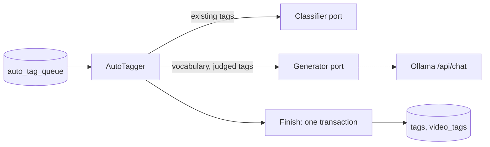
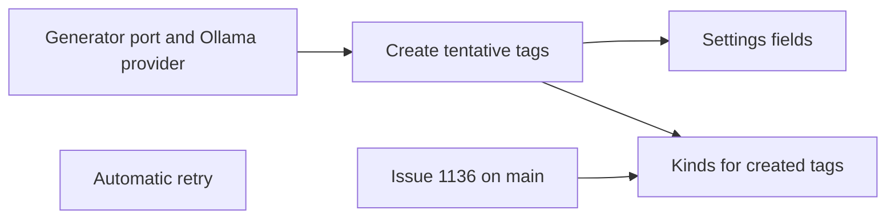

# Implementation Plan: Tag creation by the AI during auto-tagging

**Branch**: `feature/053-ai-tag-generation` | **Parent Issue**: #1138

**Input**: The parent Issue. It is this feature's specification.

## Summary

When auto-tagging runs on a video, a generative vision model reads the same
images and facts as judging and names tags for it; names that match an
existing tag attach that tag, and new names become tentative tags with a kind.
The model is reached through a new task-agnostic generator port, served by
Ollama's `/api/chat` with `gemma4:e4b` by default.

The diagram shows one auto-tagging job after this feature.



| Concern | Decision |
| --- | --- |
| Port | `app.Generator`: facts, images, instructions and a JSON Schema in, JSON out ([R-1](research.md#r-1-a-second-task-agnostic-port-for-generation)) |
| Provider | Ollama `/api/chat` with `format`, `num_ctx` 16384 and no reasoning ([R-2](research.md#r-2-the-ollama-provider-uses-apichat-with-a-vision-model)) |
| Model | `ollama.generation_model`, default `gemma4:e4b`; the connection test checks both models ([R-3](research.md#r-3-a-separate-generation-model-default-gemma4e4b)) |
| Job | Judge, then generate, then one `Finish`; any error fails the job and leaves the video's tags unchanged ([R-4](research.md#r-4-judging-and-creation-are-one-job-with-one-result)) |
| Reuse | Up to 500 tags in the prompt, then exact name and synonym lookup ([R-5](research.md#r-5-reuse-comes-from-the-prompt-and-from-name-lookup)) |
| Kinds | Kind names with examples and preset hints; the schema restricts the choice ([R-6](research.md#r-6-kinds-are-described-by-name-examples-and-preset-hints)) |
| Attaching | At most 5 new tentative tags per video; matched confirmed tags as suggested ([R-7](research.md#r-7-how-a-returned-name-is-attached)) |
| Settings | "Create new tags" on by default, "Language for new tags" `Japanese` ([R-8](research.md#r-8-settings-for-tag-creation)) |
| Failures | Three automatic retries after 10 minutes, 1 hour and 6 hours ([R-9](research.md#r-9-failed-jobs-retry-automatically-three-times)) |

Requirement 7 needs no change: a created tag is an ordinary tentative tag, so
the tag screen, the external API and MCP confirm, reject and merge it as they
do today. Initial tags (#1137) are ordinary confirmed tags, so this feature
does not wait for them; they enter the prompt's vocabulary when they exist.

## Technical Context

**Canonical definitions**:

| Topic | Source |
| --- | --- |
| Boundaries, store roles, events after commit | [ARCHITECTURE.md](../../ARCHITECTURE.md), [.golangci.yml](../../.golangci.yml) (depguard) |
| Classifier port, Ollama provider, connection settings | [ai-layer.md](../../docs/design-docs/ai-layer.md) |
| Auto-tagging queue, images, facts, thresholds, Settings | [auto-tagging.md](../../docs/design-docs/auto-tagging.md) |
| Tentative tags, rejected names, `resolveTagNames` | [031 data-model](../031-tentative-tags/data-model.md) |
| Tag kinds | [051 plan](https://github.com/syudead/vv/blob/feature/051-tag-kinds/specs/051-tag-kinds/plan.md) on `feature/051-tag-kinds` (#1136) |
| Screen API and generated code | [api/openapi.yaml](../../api/openapi.yaml), `task generate` |
| Screens and Web tests | [design-system.md](../../docs/design-docs/design-system.md), [web-testing.md](../../docs/design-docs/web-testing.md), [i18n.md](../../docs/design-docs/i18n.md) |
| Checks | [Taskfile.yml](../../Taskfile.yml) (`task check`, `task check-docs`) |

**Feature-specific context**:

- One migration for the queue's retry columns, numbered when it lands
  ([data-model.md, Migration](data-model.md#migration)).
- No new Go or npm dependency: the provider is plain HTTP, as
  `internal/ollama` is today.
- Kinds need #1136's `tag_kinds` and `tags.kind_id` on `main`. Every unit but
  the last works without them, and the last waits for #1136 to be merged into
  `main` and `main` into the feature branch.
- `gemma4:e4b`'s time per video on a CPU is not measured; the trial used
  `gemma-4-26b-a4b-it` on Workers AI. [quickstart.md](quickstart.md) measures
  it.

## Constitution Check

| Rule (source) | Verdict |
| --- | --- |
| `internal/app` does not import a provider; adapters do not import each other (ARCHITECTURE.md, depguard) | Pass: `app.Generator` is declared in `internal/app`, `internal/ollama` implements it, `cmd/mdm` wires it; values cross as `domain.GeneratorRequest` |
| The domain decides, the store enforces (ARCHITECTURE.md) | Pass: the prompt, the schema, the parsing, the limit of 5 and the retry delays are pure functions in `internal/domain`; `Finish` re-reads tags, kinds and rejected names in its transaction |
| Store roles: no role calls another role's public methods (ARCHITECTURE.md) | Pass: `AutoTagStore.Finish` creates tags through the package-private `resolveTagNames` that `TagStore` uses, in its own transaction |
| Events after commit (ARCHITECTURE.md) | Pass: `Finish` publishes `AutoTagApplied` after commit, as today |
| User data survives a rebuild (ARCHITECTURE.md) | Pass: the new queue columns are rebuildable; created tags are user data keyed as every tag |
| The server sends requests only to the saved connection (ai-layer.md) | Pass: the generator reads the saved URL on every call, as the classifier does |
| Do not hand-edit generated files (AGENTS.md) | Pass: `api/openapi.yaml` changes, then `task generate` |
| Complexity 25 or less, no copied code (AGENTS.md) | Pass: name resolution reuses `resolveTagNames`; the POST and the Ollama error handling are taken out of `Classifier.post` and shared by both calls in `internal/ollama` |

The verdicts are the same after Phase 1. No violation, so no complexity
tracking.

## Project Structure

### Documentation (this feature)

```text
specs/053-ai-tag-generation/
├── plan.md
├── research.md
├── data-model.md
├── quickstart.md
└── contracts/
    └── screen-api.md
```

The parent Issue has no `ui` label, so there is no `ui-design.md`; the Settings
fields follow the existing Auto-tagging and Ollama sections.

### Source Code

**Affected boundaries**:

| Boundary | What it owns in this feature |
| --- | --- |
| `internal/domain` | `GeneratorRequest`, the prompt and schema, proposal parsing, the new settings, retry delays |
| `internal/app` | `Generator`; `AutoTagger` runs generation after judging |
| `internal/ollama` | The `/api/chat` generator and the two-model connection test |
| `internal/store` | The migration, retry in `Claim` and `Fail`, the vocabulary read, proposals in `Finish`, the new settings keys |
| `internal/httpapi`, `api/openapi.yaml` | The settings fields |
| `web/src/settings`, `web/src/i18n` | The Auto-tagging and Ollama sections |
| `cmd/mdm` | Wiring the generator |
| `scripts/clefrelay` | The `/api/chat` relay to Workers AI |
| `docs/design-docs` | `ai-layer.md`, `auto-tagging.md`; ARCHITECTURE.md's subsystem map |

**New paths**: `internal/app/generator.go`, `internal/domain/generator.go`,
`internal/domain/auto_tag_generation.go`, `internal/ollama/generator.go`,
`internal/store/migrations/000NN_auto_tag_retry.sql`.

**Structure decision**: Generation stays inside `AutoTagger` and its queue
rather than a new use case, because one job carries both results
([R-4](research.md#r-4-judging-and-creation-are-one-job-with-one-result)).

## Implementation Work

The diagram shows which units have to land first.



### Add a generator port and its Ollama provider

**Scope**: `domain.GeneratorRequest`, `app.Generator`, `internal/ollama`'s
`/api/chat` implementation, `ollama.generation_model` and `generationModel`
on the Ollama settings API, the two-model connection test, the `/api/chat`
relay in `scripts/clefrelay`, and `ai-layer.md`
([R-1](research.md#r-1-a-second-task-agnostic-port-for-generation)–[R-3](research.md#r-3-a-separate-generation-model-default-gemma4e4b),
[contracts/screen-api.md](contracts/screen-api.md)).

**Dependencies**: None

**Acceptance**: `task check` passes. `internal/ollama` tests against a fake
server show the request carries the images, `format`, `num_ctx` 16384 and
`think: false`, and that an Ollama error's text is returned; the connection
test answers unavailable and names the generation model when only it is
missing; `GET /api/settings/ollama` returns `generationModel: "gemma4:e4b"` with
nothing saved.

### Create tentative tags from the video during auto-tagging

**Scope**: The prompt, schema and parsing in `internal/domain`; the vocabulary
read; `AutoTagger` asking the generator after judging, also when there is no
candidate to judge; `Finish` attaching proposals by the table in R-7 without
kinds; `auto_tag.create_tags`, `auto_tag.tag_language` and their API fields;
`auto-tagging.md` and the ARCHITECTURE.md subsystem map
([R-4](research.md#r-4-judging-and-creation-are-one-job-with-one-result),
[R-5](research.md#r-5-reuse-comes-from-the-prompt-and-from-name-lookup),
[R-7](research.md#r-7-how-a-returned-name-is-attached),
[R-8](research.md#r-8-settings-for-tag-creation),
[data-model.md, Rules](data-model.md#rules)).

**Dependencies**: Add a generator port and its Ollama provider

**Acceptance**: `task check` passes. App tests with a fake generator show
acceptance criteria 1 (a video with no tags gets tentative tags), 2 (a returned
`猫` attaches the existing `猫`, and the prompt lists it), 3 (a rejected name is
not created on a rerun) and 4 (with `createTags` off the generator is not
called), and that a generator error or invalid JSON fails the job with the
video's tags unchanged. Store tests show the R-7 table row by row, the limit of
5, an invalid name dropped, and two jobs proposing the same new name creating
one tag.

### Retry failed auto-tagging jobs automatically

**Scope**: The migration, `Fail`, `Claim`, the reset in `queue`, the worker's
wait for the earliest retry, and `auto-tagging.md`'s Failures section
([R-9](research.md#r-9-failed-jobs-retry-automatically-three-times),
[data-model.md, `auto_tag_queue`](data-model.md#auto_tag_queue)).

**Dependencies**: None

**Acceptance**: `task check` passes. Store tests show the delays of 10 minutes,
1 hour and 6 hours, no retry after the third, a trigger resetting `attempts`,
and a `failed` row from before the migration not claimed; an app test shows
the worker claims a retry when its time passes without a wake.

### Show tag creation and the generation model in Settings

**Scope**: "Create new tags" and "Language for new tags" in the Auto-tagging
section, and "Generation model" in the Ollama section, with their catalog
text ([contracts/screen-api.md](contracts/screen-api.md)).

**Dependencies**: Create tentative tags from the video during auto-tagging

**Acceptance**: `task check` passes. Page tests show both sections load and save
the new fields, and an empty language shows the server's message. The implementation owes a visual review of both sections.

### Give tags created by auto-tagging a kind

**Scope**: The kinds and their examples and hints in the prompt, the `kind`
enum in the schema, and `kind_id` on tags `Finish` creates
([R-6](research.md#r-6-kinds-are-described-by-name-examples-and-preset-hints)).

**Dependencies**: Create tentative tags from the video during auto-tagging;
#1136 merged into `main` and `main` merged into the feature branch

**Acceptance**: `task check` passes. Domain tests show the prompt lists the
preset hint only for a kind still named as seeded; store tests show a created
tag gets the chosen kind, a kind deleted before `Finish` leaves the tag
without one, and an existing tag's kind is not changed.
