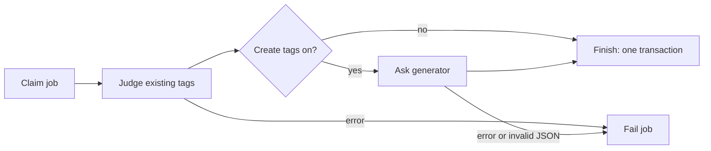
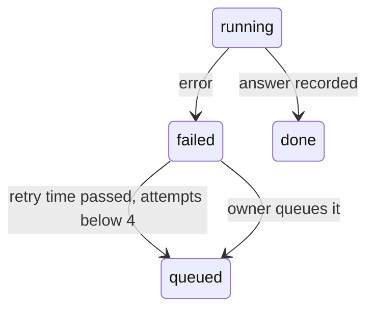

# Research: Tag creation by the AI during auto-tagging

Inherited decisions: the classifier port and the Ollama provider
([ai-layer.md](../../docs/design-docs/ai-layer.md)), the auto-tagging queue,
images and facts ([auto-tagging.md](../../docs/design-docs/auto-tagging.md)),
tentative tags and rejected names
([031 data-model](../031-tentative-tags/data-model.md)), and tag kinds
([051 data-model](https://github.com/syudead/vv/blob/feature/051-tag-kinds/specs/051-tag-kinds/data-model.md)
on `feature/051-tag-kinds`). This file records only the decisions this feature
adds.

## R-1: A second, task-agnostic port for generation

**Decision**: `internal/app` declares `Generator`, which takes the same facts
and images as the classifier plus instructions, a prompt and a JSON Schema, and
returns one JSON document that matches the schema; the feature parses it.

| Option | Verdict |
| --- | --- |
| **`app.Generator` with a JSON Schema** | Chosen |
| Ask `app.Classifier` for names | Rejected: Clef returns a probability per given option and cannot write a name ([auto-tagging.md, Tags it adds](../../docs/design-docs/auto-tagging.md#tags-it-adds)) |
| A port shaped for tags (`SuggestTags(video) []Tag`) | Rejected: the provider would hold the tag prompt and rules, and a second feature using a generative model would need another port, against the split in [ai-layer.md](../../docs/design-docs/ai-layer.md) |
| Free text parsed by the feature | Rejected: in the trial below every model returned valid JSON when given a schema, and free text has no shape to reject |

**Rationale**: The port keeps the rule of the classifier port: the feature owns
the wording and the meaning, the provider owns transport and limits. The input
type `domain.ClassifierInput` is reused as is, because the facts and images are
the same.

## R-2: The Ollama provider uses `/api/chat` with a vision model

**Decision**: `internal/ollama` implements `Generator` with Ollama's native
`POST /api/chat`: images in the user message, the schema in `format`,
`stream: false`, `think: false`, `options.num_ctx: 16384`, the same 10-minute
timeout and `keep_alive` as the classifier.

| Option | Verdict |
| --- | --- |
| **Ollama `/api/chat`** | Chosen |
| Ollama's OpenAI-compatible `/v1/chat/completions` | Rejected: it has no `num_ctx`, and Ollama's default context would cut the prompt of 9 images and up to 500 tag names (R-5) |
| Cloudflare Workers AI as a product provider | Rejected: frames of the owner's videos would leave their network, and vv's providers are self-hosted; the development relay below covers containers without Ollama |
| Reasoning on (`think` omitted) | Rejected: on a CPU-only machine every reasoning token costs time, and the trial got usable answers with reasoning at its lowest |

**Rationale**: `/api/chat` is the only Ollama route that takes images, a JSON
Schema and a context size together. `scripts/clefrelay` gains a relay from
`/api/chat` to Workers AI's chat completions, so a container without Ollama
runs the feature as it runs judging today.

## R-3: A separate generation model, default `gemma4:e4b`

**Decision**: The Ollama connection gains `ollama.generation_model`, default
`gemma4:e4b`, beside the judging model; the connection test checks that both
models exist and names each missing one.

| Option | Verdict |
| --- | --- |
| **Separate setting, `gemma4:e4b`** | Chosen |
| One model for judging and generation | Rejected: Clef cannot generate, and a general model gives no calibrated probability for the thresholds |
| `gemma4:26b` (the trial's model) | Rejected as the default: 16–19 GB does not fit the 15 GB CPU machine that already could not hold Clef-flash with 64 questions ([ai-layer.md](../../docs/design-docs/ai-layer.md#ollama-provider)); the owner may set it |
| The connection test checks only the judging model | Rejected: tag creation is on by default (R-8), so a passing test would be followed by every video failing |

**Rationale**: `gemma4:e4b` takes text and images, has a 128K context and is
6.6–9.5 GB. It is not on Workers AI, so its quality and time on a CPU are
measured by [quickstart.md](quickstart.md), not by the trial.

The trial ran on 2026-10-15 through Workers AI with three generated photos
(a cat on a sofa with coffee, a rocket launch in a desert, two hikers on a snowy
mountain), a schema of `{name, kind}` items and the prompt of R-5 and R-6.

| Model | Seconds | Reused `猫` and `雪山` | Returned a rejected name |
| --- | --- | --- | --- |
| `gemma-4-26b-a4b-it` | 18–26 | Yes | No |
| `mistral-small-3.1-24b-instruct` | 3–13 | Yes | Yes (`寝る`) |
| `llama-4-scout-17b-16e-instruct` | 3–7 | `猫` (the only one asked) | Not asked; it misspelled `ソファ` as `ソフィ` |

## R-4: Judging and creation are one job with one result

**Decision**: The worker judges existing tags, then asks the generator with the
judged tags as context, and `Finish` writes both results in one transaction;
an error in either step fails the whole job and changes no tag.

| Option | Verdict |
| --- | --- |
| **One job, judge then generate** | Chosen |
| A second queue for generation | Rejected: two rows per video, two failure states, and the generator would not know which tags judging added |
| Generate first, judge after | Rejected: the generator could not be told what is already on the video, so it would name the same things again |
| Keep the judging result when generation fails | Rejected: the Edge Case requires the video's tags to stay unchanged on an AI error |

**Rationale**: One row keeps the queue's states and Settings counts as they are,
and the generator sees the tags judging just chose.

## R-5: Reuse comes from the prompt and from name lookup

**Decision**: The prompt lists the tags judging chose for the video, then up to
500 other tags (confirmed before tentative, then by video count, then by name)
with their synonyms and kinds, and up to 200 most recently rejected names; every
returned name is then resolved through tag names and synonyms, so a name that
matches a tag attaches that tag.

| Option | Verdict |
| --- | --- |
| **Prompt vocabulary of 500 plus exact lookup** | Chosen |
| Every tag in the prompt | Rejected: the tag screen is built for 30,000 tags ([036 plan](../036-tag-admin-scale/plan.md)), about 300,000 tokens, beyond `num_ctx` (R-2) |
| Embedding search for similar tags | Rejected: a second model and an index for a duplicate that the owner can merge in one action (requirement 7) |
| Lookup only, no vocabulary | Rejected: lookup is exact, so `ねこ` would not find `猫` (acceptance criterion 2) |

**Rationale**: In the trial, every model returned the listed `猫` and `雪山`
instead of a new spelling. Initial tags (#1137) are confirmed tags, so
they rank ahead of tentative ones. A near-duplicate of a tag outside the 500
becomes a tentative tag the owner merges.

## R-6: Kinds are described by name, examples and preset hints

**Decision**: The prompt lists every kind with up to 5 of its tags as examples,
plus a fixed English hint for a kind whose name is still `Genre`, `Work`,
`Place` or `Character`; the schema restricts `kind` to the kind names, and a
kind deleted before `Finish` leaves the tag without a kind.

| Option | Verdict |
| --- | --- |
| **Names, examples and preset hints** | Chosen |
| Kind names only | Rejected: in the trial `mistral-small` put `猫` under `Character`, `コーヒー` under `Work` and `ソファ` under `Place`; with hints it chose `Genre`, `Genre` and `Genre` |
| Hints stored on `tag_kinds` | Rejected: 051 keeps a kind to a name ([051 R-7](https://github.com/syudead/vv/blob/feature/051-tag-kinds/specs/051-tag-kinds/research.md#r-7-a-kind-has-a-name-and-nothing-else)), and the hint is only prompt text |

## R-7: How a returned name is attached

**Decision**: The table decides what each returned name does; at most 5 new
tags are created per video, in the model's order, and the prompt asks for at
most 10 names.

| Returned name | Result |
| --- | --- |
| Fails `NormalizeTagName` | Dropped (Edge Case) |
| In `rejected_tag_names` | Dropped (requirement 5) |
| Matches a tentative tag | That tag attached as an ordinary assignment |
| Matches a confirmed tag rejected for this video | Dropped ([auto-tagging.md, Tags it adds](../../docs/design-docs/auto-tagging.md#tags-it-adds)) |
| Matches a confirmed tag not on the video | That tag attached as a suggested tag |
| Matches a tag already on the video | Nothing changes |
| New, within the first 5 new names | A tentative tag with the chosen kind, attached as an ordinary assignment |
| New, after 5 | Dropped (Edge Case) |

| Option | Verdict |
| --- | --- |
| **A tentative tag is attached as ordinary; a confirmed one as suggested** | Chosen |
| New tags attached as suggested | Rejected: the tag's own tentative state already asks for review, and two marks on one chip mean the same thing |
| Confirmed tags attached as ordinary | Rejected: judging already scored that tag below "Probability to suggest" or did not ask, so the generator alone is not enough to add it unchecked |
| 10 new tags per video | Rejected: every new tag is a review item; the trial's models returned 3 to 8 names and put the subject, the action and the place among the first five |

**Rationale**: Judging never asks about tentative tags, so without the generator
a tentative tag would stay on the one video that created it. Name resolution
uses the store's `resolveTagNames`, which already creates tentative tags,
skips rejected names and runs in the same transaction as the lookup
([031 R-6](../031-tentative-tags/research.md#r-6-rejection-and-a-tentative-attach-of-the-same-name-rely-on-sqlite-write-serialization)),
so two videos naming the same new tag get one tag.

## R-8: Settings for tag creation

**Decision**: The Auto-tagging section gains "Create new tags" (on by default)
and "Language for new tags" (free text up to 40 characters, default
`Japanese`), stored as `auto_tag.create_tags` and `auto_tag.tag_language`.

| Option | Verdict |
| --- | --- |
| **Switch on by default, language setting** | Chosen |
| Switch off by default | Rejected: requirement 1 makes creation part of auto-tagging when auto-tagging is on, and auto-tagging itself is off by default |
| Language from the existing tags | Rejected: acceptance criterion 1 starts with no tags |
| Language from the screen | Rejected: the screen is English only, with no language selection ([i18n.md](../../docs/design-docs/i18n.md)) |

## R-9: Failed jobs retry automatically, three times

**Decision**: A failed job returns to the queue after 10 minutes, 1 hour and
6 hours; after the third retry fails it stays `failed` until the owner queues
it.

| Option | Verdict |
| --- | --- |
| **Three timed retries** | Chosen |
| No automatic retry (today) | Rejected: the Edge Case requires a retry later |
| Retry until it succeeds | Rejected: with Ollama stopped, every video would be sent again every interval for good |

**Rationale**: The owner queuing a video resets its attempts, so the Settings
buttons keep their meaning.
