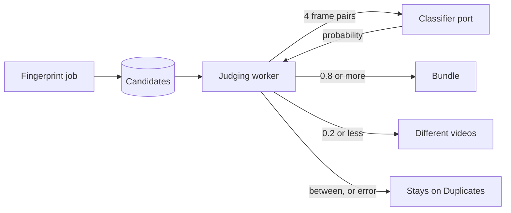
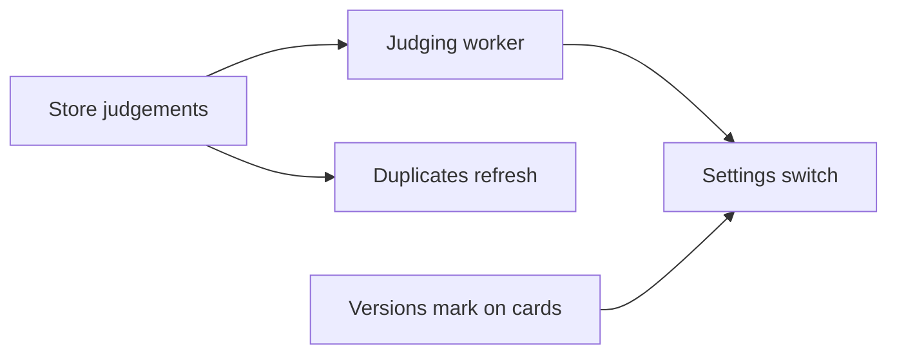

# Implementation Plan: Judging possible duplicates automatically and bundling the same ones

**Branch**: `feature/054-auto-dup` | **Parent Issue**: #1141

**Input**: The parent Issue. It is this feature's specification.

## Summary

A worker asks the classifier port, for each possible duplicate, whether the two
files show the same picture; "same video" bundles them as the owner's bundling
does, "different videos" dismisses them, and anything else stays on the
Duplicates page. Video cards gain a versions mark, read from the `versions`
summary that list items now carry.

The diagram shows one candidate from the fingerprint to its outcome.



| Concern | Decision |
| --- | --- |
| Model | One yes/no question through `app.Classifier` ([R-1](research.md#r-1-one-yesno-question-through-the-existing-classifier-port)) |
| Input | 4 images, each a frame of A beside the frame of B at the same position ([R-2](research.md#r-2-the-images-are-four-side-by-side-frame-pairs)) |
| Verdict | 0.8 or more same, 0.2 or less different, fixed ([R-3](research.md#r-3-the-question-wording-and-two-fixed-thresholds)) |
| Queue | Judgement columns on the candidate row; a null judgement waits ([R-4](research.md#r-4-the-judgement-is-columns-on-the-candidate-row)) |
| Failures | Retry after 10 minutes, 1 hour, 6 hours, then daily ([R-5](research.md#r-5-a-failed-judgement-retries-on-a-backoff-that-never-ends)) |
| Conflicts | No bundle across a dismissed or unbundled pair ([R-6](research.md#r-6-a-same-pair-joins-two-sides-unless-a-pair-across-them-is-known-to-differ)) |
| Representative | The bundle's, else more pixels ([R-7](research.md#r-7-the-representative-is-the-bundles-else-the-larger-picture)) |
| Removing a version | Records the pairs, never judged again, candidates rebuilt ([R-8](research.md#r-8-removing-a-version-records-the-pairs-and-rebuilds-its-candidates)) |
| Card mark | `versions` on every screen-API `Video`, one query per page ([R-9](research.md#r-9-list-items-carry-the-existing-versions-summary-read-per-page)) |
| Duplicates page | Refetches on a new `candidates` notification ([R-10](research.md#r-10-the-duplicates-page-refreshes-on-a-candidates-notification)) |
| Model | `clef-flash` stays the default; Settings names `clef` for bundling ([R-11](research.md#r-11-the-default-model-is-left-as-it-is-and-settings-names-the-one-that-bundles)) |

## Technical Context

**Canonical definitions**:

| Topic | Source |
| --- | --- |
| Boundaries, store roles, events after commit | [ARCHITECTURE.md](../../ARCHITECTURE.md), [.golangci.yml](../../.golangci.yml) (depguard) |
| Fingerprints, candidates, dismissals, bundles, `Unbundle` | [030 data-model](../030-video-versions/data-model.md), [030 research](../030-video-versions/research.md) |
| Classifier port, Ollama provider and its settings | [ai-layer.md](../../docs/design-docs/ai-layer.md) |
| Queue and single-worker shape, seek frames as model input | [auto-tagging.md](../../docs/design-docs/auto-tagging.md) |
| Screen API and generated code | [api/openapi.yaml](../../api/openapi.yaml), `task generate` |
| Screens and Web tests | [design-system.md](../../docs/design-docs/design-system.md), [web-testing.md](../../docs/design-docs/web-testing.md), [i18n.md](../../docs/design-docs/i18n.md) |
| Checks | [Taskfile.yml](../../Taskfile.yml) (`task check`, `task check-docs`) |

**Feature-specific context**:

- The thresholds rest on a synthetic trial; the [quickstart](quickstart.md)
  repeats it on real files before the worker unit merges.
- With `clef-flash`, the default model, same-video pairs scored 0.29 and stay
  undecidable, so acceptance criterion 1 holds with `clef` only (R-11).
- Other feature branches add migrations; this feature's migration takes the
  next number on `main` when its unit is written.

## Constitution Check

| Rule | Verdict |
| --- | --- |
| Dependency direction (ARCHITECTURE.md) | Pass: the worker is in `internal/app` behind interfaces it declares; frame pairs come from `internal/artifacts` through the image-source adapter in `cmd/mdm`; no adapter imports another |
| The domain decides, the store enforces | Pass: the verdict thresholds, the conflict check, the representative rule and the retry times are `internal/domain`; the store re-reads members, dismissals and unbundled pairs in the bundling transaction |
| Only a scan reads the media folders' files | Pass: the model sees seek-preview frames under the data directory (R-2) |
| User data survives a rebuild | Pass: `video_version_unbundles` is keyed by content keys with no foreign key to `videos`, and listed as user data |
| Events after commit | Pass: bundling publishes `VideoBundleChanged` as today; every judgement result and removal from versions publishes `VersionCandidatesChanged` after commit |
| Generated files never hand-edited (AGENTS.md) | Pass: `api/openapi.yaml` changes, then `task generate` |
| Complexity 25 and no copied code (AGENTS.md) | Pass by design: the automatic bundle reuses `VersionStore.Bundle`'s steps and the dismissal reuses `Dismiss`'s, not copies of them |
| Documentation with the change (core-beliefs.md) | Pass: the worker unit adds a design document and updates ai-layer.md, ARCHITECTURE.md and running-vv.md |

## Project Structure

### Documentation (this feature)

```text
specs/054-auto-dup/
├── plan.md
├── research.md            # R-1..R-11
├── data-model.md          # Two tables, the rules, the setting
├── quickstart.md          # The real-model check
└── contracts/
    └── screen-api.md      # Video.versions on lists, the setting resource
```

The `design` stage adds `ui-design.md` for the card mark and the Settings
section.

### Source Code

**Affected boundaries**:

| Package | Change |
| --- | --- |
| `internal/domain` | Verdict, conflict check, representative choice, retry times |
| `internal/store` | Migration, judgement claim and results, `VersionCandidatesChanged`, `Unbundle`, successions re-keying, the setting, `versions` on listed videos |
| `internal/artifacts` | Side-by-side frame pairs from two seek previews |
| `internal/app` | `VersionJudge`: settings, worker, wake-up |
| `internal/httpapi`, `api/openapi.yaml` | The settings resource; `versions` on list items; the `candidates` notification |
| `cmd/mdm` | Wiring the worker and its wake-ups in `events.go` |
| `web/src/settings`, `web/src/videoList`, `web/src/versions` | The Settings section; the card mark; the Duplicates page refetch |

**New paths**: `internal/app/version_judge.go`,
`internal/store/version_judgements.go`, and
`docs/design-docs/duplicate-judging.md`.

**Structure decision**: The worker is its own use case beside `AutoTagger`,
not a job kind in `jobs`: a judgement is about a pair, and the job queue's
claim and uniqueness rules are per video.

## Implementation Work

The diagram shows which units have to land first. The screen units also wait
for the `design` stage's `ui-design.md`. The real-model run of the
[quickstart](quickstart.md) is the last unit's, since it needs the switch and
the mark.



### Store duplicate judgements and the pairs removed from versions

**Scope**: The migration with the candidate columns and
`video_version_unbundles`; the domain rules (verdict, conflict check,
representative, retry times) and `VersionCandidatesChanged`; the store's claim,
recovery and three results with the conflict check; the
`version_judging.enabled` setting's read and write; `Unbundle` recording pairs
and rebuilding candidates; successions re-keying `video_version_unbundles`;
and the user-data list in ARCHITECTURE.md and running-vv.md
([data-model.md](data-model.md),
[R-4](research.md#r-4-the-judgement-is-columns-on-the-candidate-row) to
[R-8](research.md#r-8-removing-a-version-records-the-pairs-and-rebuilds-its-candidates)).

**Dependencies**: None.

**Acceptance**: `task check` and `task check-docs` pass; store tests show: a
"same" result bundles the pair with the R-7 representative and the candidate
is gone; a "same" for a new video and a bundle member adds it to that bundle,
also after that bundle was split and bundled again by hand; "different" writes
a dismissal and removes the candidate; a "same" across a dismissed pair leaves
the candidate `undecided`; a pair in `video_version_unbundles` or `undecided`
is not claimed; a `failed` row is claimed only after its `retry_at`, and its
`attempts` survive recovery; `Unbundle` writes the pairs and the matching
candidate is listed again; each result publishes `VersionCandidatesChanged`.

### Judge possible duplicates with the classifier

**Scope**: Side-by-side frame pairs in `internal/artifacts`; `app.VersionJudge`
(claim one at a time while the setting is on, ask the R-3 question, apply the
result, wait for the next `retry_at`); a log line with each pair's
probability; wiring and wake-ups (startup, `ProcessingChanged`,
`VersionCandidatesChanged`, settings saved); `docs/design-docs/duplicate-judging.md`
linked from the index; and the AI-layer and subsystem-map entries
([R-1](research.md#r-1-one-yesno-question-through-the-existing-classifier-port)
to [R-5](research.md#r-5-a-failed-judgement-retries-on-a-backoff-that-never-ends)).

**Dependencies**: Store duplicate judgements and the pairs removed from
versions.

**Acceptance**: `task check` and `task check-docs` pass; app tests with a fake
classifier show 0.85 bundles, 0.1 dismisses, 0.5 leaves the candidate, an error
or a reply without the question's key sets a `failed` row with its retry time, and nothing is claimed while the
setting is off; an artifacts test shows 4 JPEGs each twice the width of one
frame.

### Refresh the Duplicates page when candidates are judged

**Scope**: The `candidates` notification on `/api/events` for
`VersionCandidatesChanged`, and the Duplicates page refetching on it
([contracts/screen-api.md, `GET /api/events`](contracts/screen-api.md#get-apievents-candidates),
[R-10](research.md#r-10-the-duplicates-page-refreshes-on-a-candidates-notification)).

**Dependencies**: Store duplicate judgements and the pairs removed from
versions.

**Acceptance**: `task check` passes with no diff from `task generate`; a
handler test shows the event reaches an owner's event stream as `candidates`;
a Web test shows the open Duplicates page refetches on `candidates` and drops
a pair that is gone.

### Show a versions mark on video cards

**Scope**: `versions` filled on every screen-API `Video` for a bundle member,
read once per page; the `api/openapi.yaml` description; the mark on cards and
list rows from `ui-design.md`; and the superseded card rule in 030
ui-design.md
([contracts/screen-api.md, `Video` delta](contracts/screen-api.md#video-delta),
[R-9](research.md#r-9-list-items-carry-the-existing-versions-summary-read-per-page)).

**Dependencies**: None.

**Acceptance**: `task check` and `task check-docs` pass; store tests show the
library, video list, folder and group reads give a bundle's representative
`versions.count` 2 and an unbundled video none; the library, search, folder,
group and home cards of a bundled video show the mark and a plain video's do
not, in a visual review at the widths in `ui-design.md`.

### Turn automatic duplicate judging on and off in Settings

**Scope**: `GET` and `PUT /api/settings/version-judging`, saving that wakes the
worker, and the Settings section from `ui-design.md` with its note on the
model ([contracts/screen-api.md](contracts/screen-api.md),
[R-11](research.md#r-11-the-default-model-is-left-as-it-is-and-settings-names-the-one-that-bundles)).

**Dependencies**: Judge possible duplicates with the classifier; Show a
versions mark on video cards.

**Acceptance**: `task check` passes with no diff from `task generate`; handler
tests show `GET` answers `enabled: false` before any save and `PUT` answers the
saved value, and a request with no owner session gets
`401 unauthenticated`; a Web test shows the switch saving; every
[quickstart](quickstart.md) row passes with `clef` and the PR records each
pair's probability; the Settings section passes a visual review at the widths
in `ui-design.md`.
