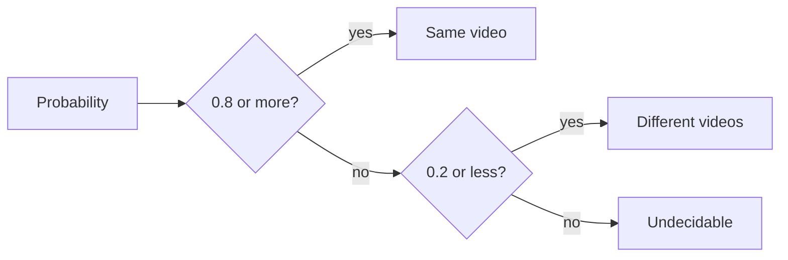
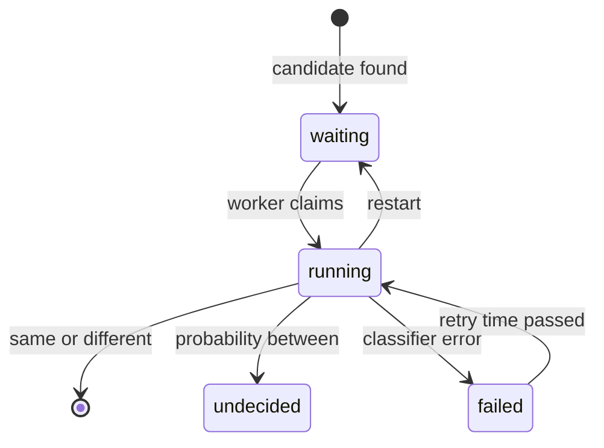
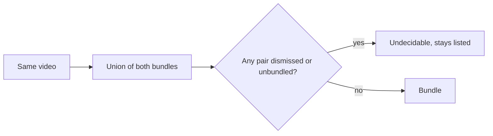

# Research: Judging possible duplicates automatically

Inherited decisions: fingerprints, candidates, dismissals and bundles are
[030 research R-6 to R-9](../030-video-versions/research.md); the classifier
port and the Ollama provider are [ai-layer.md](../../docs/design-docs/ai-layer.md);
the queue and worker shape follow
[auto-tagging.md](../../docs/design-docs/auto-tagging.md). This file records only
the decisions this feature adds.

## R-1: One yes/no question through the existing classifier port

**Decision**: A candidate is judged by asking `app.Classifier` one question,
whether the two files show the same picture, and reading the probability with
two fixed thresholds.

| Option | Port change | Provider today | Verdict |
| --- | --- | --- | --- |
| **One question to `app.Classifier`** | None | Clef in Ollama | Chosen |
| A generator port that answers same, different or undecidable | A new port and provider | Exists only on the unmerged `feature/053-ai-tag-generation` | Rejected: ties this feature to another feature's unmerged port |
| No AI, a stricter fingerprint distance | None | None | Rejected: requirement 1 asks for an AI judgement, and a distance cannot tell a shared opening from the same video |

**Rationale**: Clef scores a question it is given, which is exactly a pair
question. The provider is reached as auto-tagging reaches it, so the Ollama
settings, the connection test and a later provider serve both features.

## R-2: The images are four side-by-side frame pairs

**Decision**: The request carries 4 images; image `i` puts frame `i` of video A
on the left and frame `i` of video B on the right, both taken from the seek
preview at the middle of 4 equal parts of each video. The request has no facts.

The trial below used two 20 s synthetic videos, A at 640×360 and B the same
footage re-encoded at 320×180 (same), and C sharing only A's first 4 s
(different), with the question in [R-3](#r-3-the-question-wording-and-two-fixed-thresholds).
Each cell is P(yes) from Workers AI on 2026-10-15.

| Model | A and B (same) | A and C (opening only) |
| --- | --- | --- |
| `clef` | 0.97 | 0.02 |
| `clef-flash` | 0.29 | 0.09 |

| Option | Verdict |
| --- | --- |
| **4 side-by-side pairs** | Chosen |
| 8 separate images, A's then B's | Rejected: Workers AI's Clef takes 4 images, so the development relay tiles them into one image and the model loses which frame is whose |
| The two library thumbnails | Rejected: one scene each, so a shared opening reads as the same video (acceptance criterion 2) |
| Frames with ffmpeg from the source files | Rejected: only a scan reads the media folders' files ([ARCHITECTURE.md](../../ARCHITECTURE.md#cross-cutting-invariants)); the seek preview already exists for every candidate, since its fingerprint is built from it |

**Rationale**: Candidates have matching durations, so the same relative
positions are the same moments in both files, and a pair in one image asks the
model to compare two pictures rather than remember eight. Frames spread across
the whole video catch a video that only begins the same way.
`internal/artifacts` cuts and composes the pairs, as it already cuts seek
frames for auto-tagging, so `internal/app` decodes no image.

## R-3: The question wording and two fixed thresholds

**Decision**: The question is "Each image puts two frames side by side, taken
at the same moment from two video files. In every image, do the left half and
the right half show the same picture (ignoring differences in sharpness,
resolution or compression)?". A probability of 0.8 or more is "same video", 0.2
or less is "different videos", and anything between is "undecidable".

| Option | Verdict |
| --- | --- |
| **0.8 and 0.2, fixed** | Chosen |
| Owner-set thresholds, as auto-tagging has | Rejected: requirement 7 asks only for on and off, and a wrong "same" hides a video from the library |
| "Do A and B contain the same footage throughout?" | Rejected: in the same trial it scored 0.93 and 0.09 on `clef`, a narrower gap than the chosen wording |

**Rationale**: `clef-flash` scored the same footage 0.29, so with it a
same-video pair stays undecidable rather than being bundled wrongly, and only
clearly different pairs leave the list. The trial is synthetic footage; the
[quickstart](quickstart.md) repeats it on real files before the thresholds
are final.

## R-4: Judgements live in their own table beside the candidates

**Decision**: `video_version_judgements` holds the state of each judged
candidate, and a candidate with no row is waiting to be judged
([data-model.md](data-model.md#video_version_judgements)).

| Option | Verdict |
| --- | --- |
| **A judgement table that cascades from the candidate** | Chosen |
| A state column on `video_version_candidates` | Rejected: rebuilding a key's candidates deletes and reinserts its rows, and the column would reset with every fingerprint rebuild |
| Queue rows written when a candidate is inserted, as `auto_tag_queue` is | Rejected: turning the feature on would leave the candidates found while it was off unjudged |

**Rationale**: Deriving the queue from candidates means turning the feature on
judges every waiting candidate, and the cascade removes a judgement with its
candidate, so no row outlives the pair it is about. Judgements are index data:
asking again rebuilds them.

## R-5: A failed judgement retries on a backoff that never ends

**Decision**: A failed judgement becomes claimable again 10 minutes, 1 hour and
6 hours after its first, second and third failure, and every 24 hours after
that.

| Option | Verdict |
| --- | --- |
| **Backoff, then daily** | Chosen |
| Three retries, then wait for the owner (053's rule) | Rejected: this feature has no "judge again" action for the owner, so a pair would be judged never again |
| Retry when the next scan finishes | Rejected: a library that is not rescanned would never retry |

**Rationale**: The Edge Case asks for a retry later with nothing from the
owner. The candidate stays in the list throughout, so a slow retry costs only
the time the owner waits, and with Ollama stopped each candidate sends at most
one request a day.

## R-6: Bundling a "same" pair is refused when it would join a different pair

**Decision**: The store bundles a "same" pair only if no two members of the
resulting bundle are a dismissed pair or an unbundled pair; otherwise the
judgement is recorded as undecidable and the candidate stays.

| Option | Verdict |
| --- | --- |
| **Check the whole resulting bundle in the transaction** | Chosen |
| Check only the judged pair | Rejected: A–B and B–C both "same" with A–C dismissed would bundle A and C, breaking the Edge Case for conflicting judgements |
| Judge every pair of a group together | Rejected: the classifier sees one pair per request, and candidates arrive one fingerprint at a time |

**Rationale**: The domain decides from the member set and the recorded pairs;
the store re-reads both inside its transaction
([ARCHITECTURE.md](../../ARCHITECTURE.md#cross-cutting-invariants)), so a
dismissal saved by the owner while the model was answering still wins.

## R-7: The representative is the bundle's, else the larger picture

**Decision**: When one side is in a bundle, that bundle's effective
representative stays; when both are, the representative with more pixels
wins; when neither is, the video with more pixels (width × height) is
representative, then the larger file, then the smaller video id.

| Option | Verdict |
| --- | --- |
| **Keep a bundle's representative, else more pixels** | Chosen |
| The video added first | Rejected: says nothing about which file is better to play |
| Always the higher resolution, even over a bundle's representative | Rejected: the owner may have chosen that representative, and a new file would replace it unasked |

**Rationale**: By hand the owner picks the representative in the bundle
dialog, which has no default; the rule picks what an owner bundling a
re-encode would pick, and keeps a choice already made. Tags, position and
visibility then follow `VersionStore.Bundle` unchanged (requirement 2).

## R-8: Removing a version records the pairs and lists them again

**Decision**: "Remove from versions" writes the removed video paired with each
other member into `video_version_unbundles` (user data), and rebuilds the
removed video's candidates in the same transaction; an unbundled pair is never
judged, so it stays in the list for the owner.

| Option | Verdict |
| --- | --- |
| **A user-data table of unbundled pairs, candidates rebuilt** | Chosen |
| Record a dismissal ("different videos") | Rejected: the pair would leave the list, but removing a version returns to the state before bundling, where the pair was a candidate |
| Exclude unbundled pairs from candidates | Rejected: the owner could then never bundle them from the list |

**Rationale**: Requirement 6 only forbids bundling the pair automatically.
Rebuilding the candidates at once shows the pair again without waiting for a
fingerprint, which today never comes back on its own. The records follow a
content change at the same path as dismissals do (030 R-5).

## R-9: List items carry the existing `versions` summary

**Decision**: Every screen-API response that returns a `Video` fills
`versions` (`VideoVersionsRef`) for a bundle member, list items included; the
card shows the mark from it.

| Option | Verdict |
| --- | --- |
| **`versions` on every `Video`** | Chosen |
| A new boolean `hasVersions` on list items | Rejected: a second field for what `versions.count` already says |
| Fill it only on the listed endpoints | Rejected: groups, folders and search read through different queries, and one missed list shows no mark |

**Rationale**: The external API keeps its own schema and does not show bundles
(030 R-10), so it is unchanged. This supersedes "Bundling is not marked on
cards" in [030 ui-design.md](../030-video-versions/ui-design.md); the
`design` stage decides the mark.
