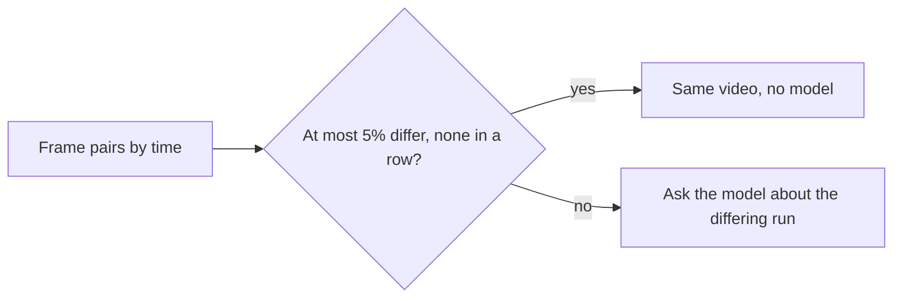
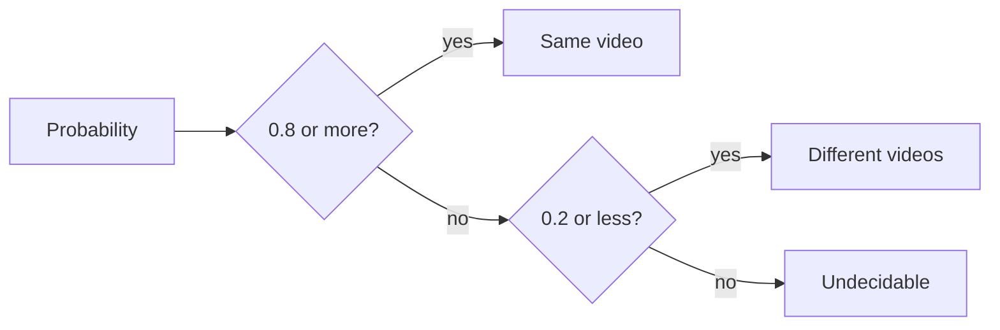
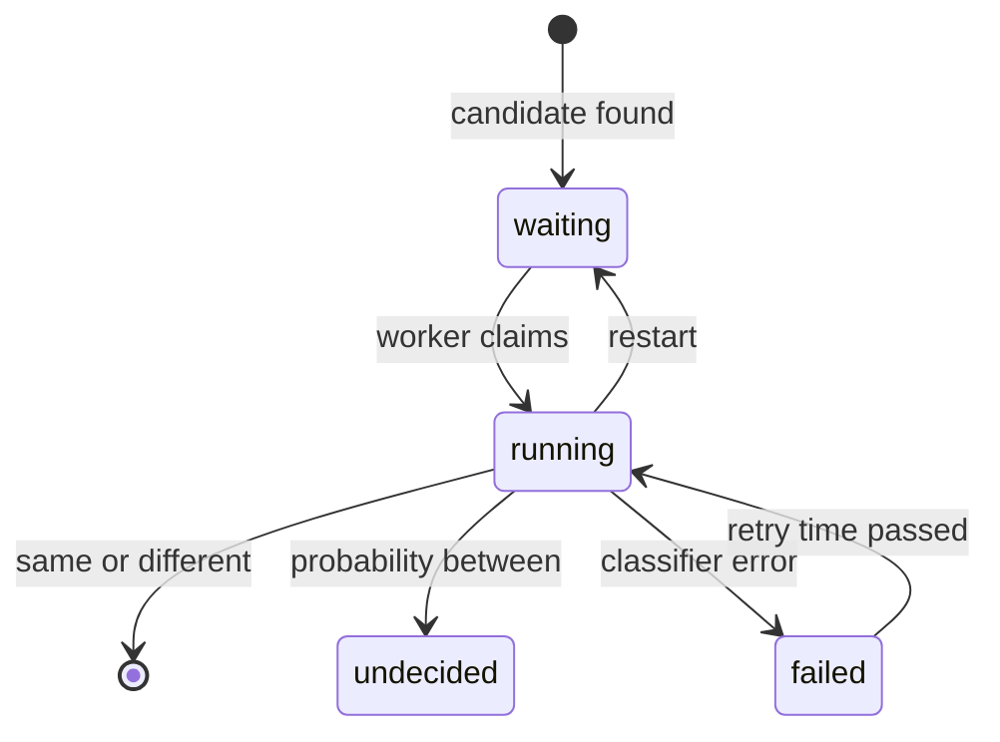
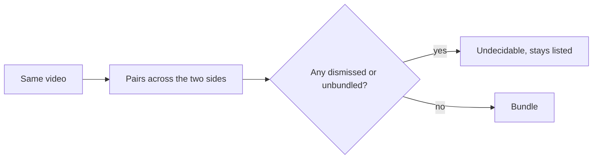

# Research: Judging possible duplicates automatically

Inherited decisions: fingerprints, candidates, dismissals and bundles are
[030 research R-6 to R-9](../030-video-versions/research.md); the classifier
port and the Ollama provider are [ai-layer.md](../../docs/design-docs/ai-layer.md);
the queue and worker shape follow
[auto-tagging.md](../../docs/design-docs/auto-tagging.md). This file records only
the decisions this feature adds.

## R-1: The fingerprints decide first; the model is asked only when a section differs

**Decision**: Each candidate is first judged from the per-frame distances of
the two fingerprints already stored. When the frames match all through the
video, the pair is "same video" without the model; when a run of frames
differs, the model is asked about that run.

A frame pair "differs" when its Hamming distance is over
`FingerprintMatchMaxDistance` (12), the cut-off candidates already use; frames
are paired by time and flat frames are skipped as `CompareFingerprints` does.

Today a candidate needs only the median distance to be 12 or less, so a video
whose middle was replaced still passes. One frame per second of three 20 s
synthetic videos against A (640×360):

| Pair | Distance per frame | Median | Rule |
| --- | --- | --- | --- |
| B, A re-encoded at 320×180 | 0 to 4 in all 20 | 0 | Same video |
| D, A with seconds 8 to 11 replaced | 0 × 8, then 32 to 34 × 4, then 0 × 8 | 0 | Ask about seconds 8 to 11 |
| C, sharing only A's first 4 s | 0 × 4, then 20 to 40 × 16 | 30 | Not a candidate |

| Option | Verdict |
| --- | --- |
| **Fingerprint rule first, the model for a differing run** | Chosen |
| Ask the model about every candidate | Rejected: the fingerprints already show B is A; asking cost a request per pair, and `clef-flash`, the default model, scored that pair 0.29, below "same" |
| Decide every candidate from the fingerprints alone | Rejected: a run of differing frames can be a different video or the same one with a changed scene, and only the pictures tell which (requirement 1 asks for an AI judgement) |
| Use the median as today | Rejected: D's median is 0, the same as B's |

**Rationale**: A re-encode or a different resolution, the cases 030 bundles,
leaves every frame within the cut-off, so the rule settles them with no
request and with any model. A single differing frame is allowed because
frames are paired within half an interval, and a pair across a scene cut can
show two scenes in two files of the same video. The rule runs only while the
feature is on, and needs no AI connection.

## R-2: The model sees the frames where the two files differ

**Decision**: The request carries up to 4 images, each the frame of A beside
the paired frame of B, taken from the longest run of differing frames (spread
across it when it is longer than 4) out of the two seek previews, and no facts.

The trial asked both Clef models through Workers AI on 2026-10-15, with the
question in [R-3](#r-3-the-question-wording-and-two-fixed-thresholds):

| Pair and images | `clef` | `clef-flash` |
| --- | --- | --- |
| A and D, 4 frames from seconds 8 to 11 | 0.06 | 0.08 |
| A and B, 4 frames spread across the video | 0.97 | 0.29 |
| A and C, 4 frames spread across the video | 0.02 | 0.09 |

| Option | Verdict |
| --- | --- |
| **Frames from the differing run, A beside B** | Chosen |
| 4 frames spread across the whole video | Rejected: for D they would mostly show the matching parts, and ask the model what the fingerprints already know |
| 8 separate images, A's then B's | Rejected: Workers AI's Clef takes 4 images, so the development relay tiles them into one and the model loses which frame is whose |
| Frames with ffmpeg from the source files | Rejected: only a scan reads the media folders' files ([ARCHITECTURE.md](../../ARCHITECTURE.md#cross-cutting-invariants)); the seek previews are what the fingerprints were built from |

**Rationale**: The differing run is the only part in question, and showing
it made both models answer clearly. `internal/artifacts` cuts and composes
the pairs, as it already cuts seek frames for auto-tagging, so `internal/app`
decodes no image.

## R-3: The question wording and two fixed thresholds

**Decision**: The question is "Each image puts two frames side by side, taken
at the same moment from two video files. In every image, do the left half and
the right half show the same picture (ignoring differences in sharpness,
resolution or compression)?". A probability of 0.8 or more is "same video", 0.2
or less is "different videos", and anything between is "undecidable". A reply
without an answer to the question is a failure, retried as in
[R-5](#r-5-a-failed-judgement-retries-on-a-backoff-that-never-ends), never a
probability of 0.

| Option | Verdict |
| --- | --- |
| **0.8 and 0.2, fixed** | Chosen |
| Owner-set thresholds, as auto-tagging has | Rejected: requirement 7 asks only for on and off, and a wrong "same" hides a video from the library |
| "Do A and B contain the same footage throughout?" | Rejected: on A and B with spread frames it scored 0.93 and 0.09 on `clef`, a narrower gap than the chosen wording |

**Rationale**: The model answers only for pairs the fingerprints could not
settle, and a wrong "same" is the costly error, so the band for "same" is
narrow. The trial is synthetic footage; the [quickstart](quickstart.md)
repeats it on real files before the thresholds are final.

## R-4: The judgement is columns on the candidate row

**Decision**: `video_version_candidates` gains the judgement state, attempts,
retry time, message and probability, and a candidate whose state is null is
waiting ([data-model.md](data-model.md#video_version_candidates)). Rebuilding
a key's candidates resets their judgements, so they are asked again.

| Option | Verdict |
| --- | --- |
| **Columns on the candidate row** | Chosen |
| A separate judgement table that cascades from the candidate | Rejected: the rebuild deletes the candidate rows, so the cascade loses the judgement just the same, at the cost of a second table and a foreign key |
| Queue rows written when a candidate is inserted, as `auto_tag_queue` is | Rejected: turning the feature on would leave the candidates found while it was off unjudged |

**Rationale**: A judgement lives and dies with its candidate, and deriving the
queue from candidates means turning the feature on judges every waiting one.
A key's candidates are rebuilt when its fingerprint is written again (a new
sprite or a new `FingerprintVersion`) and when it is removed from a bundle
([R-8](#r-8-removing-a-version-records-the-pairs-and-rebuilds-its-candidates)); judging
those pairs again then is cheaper than carrying old answers across a changed
fingerprint. Judgements are index data: asking the model again rebuilds them.

## R-5: A failed judgement retries on a backoff that never ends

**Decision**: A failed judgement becomes claimable again 10 minutes, 1 hour and
6 hours after its first, second and third failure, and every 24 hours after
that; the count of failures survives a claim and a restart.

| Option | Verdict |
| --- | --- |
| **Backoff, then daily** | Chosen |
| Three retries, then wait for the owner (053's rule) | Rejected: this feature has no "judge again" action for the owner, so a pair would be judged never again |
| Retry when the next scan finishes | Rejected: a library that is not rescanned would never retry |

**Rationale**: The Edge Case asks for a retry later with nothing from the
owner. The candidate stays in the list throughout, so a slow retry costs only
the time the owner waits, and with Ollama stopped each candidate sends at most
one request a day.

## R-6: A "same" pair joins two sides unless a pair across them is known to differ

**Decision**: The store bundles a "same" pair, with each side's bundle if it
has one, unless a video on one side and a video on the other are a dismissed
pair or an unbundled pair; then the judgement becomes undecidable and the
candidate stays. Pairs within one side, and pairs across the sides that are
unjudged or undecidable, do not block.

| Option | Verdict |
| --- | --- |
| **Check the pairs across the two sides** | Chosen |
| Check every pair of the resulting bundle | Rejected: an owner who removed B from {A, B} and bundled them again by hand would leave (A, B) recorded, and every new copy of A would stay undecidable for good |
| Check only the judged pair | Rejected: A–B and B–C "same" with A–C dismissed would bundle A and C, breaking the Edge Case for conflicting judgements |
| Also block on an unjudged or undecidable pair across the sides | Rejected: two "same" answers through B already say A and C are the same video, and waiting on A–C would leave most groups of three unbundled |

**Rationale**: Only a recorded "different" contradicts a bundle; the owner's
own bundles are taken as they are. The domain decides from the two member
sets and the recorded pairs; the store re-reads them inside its transaction
([ARCHITECTURE.md](../../ARCHITECTURE.md#cross-cutting-invariants)), so a
dismissal saved by the owner while the model was answering still wins.

## R-7: The representative is the bundle's, else the larger picture

**Decision**: When one side is in a bundle, that bundle's effective
representative stays; when both are, the representative with more pixels
wins; when neither is, the video with more pixels (width × height) is
representative, then the larger file, then the smaller video id.

| Option | Verdict |
| --- | --- |
| **Keep a bundle's representative, else more pixels** | Chosen |
| The video added first | Rejected: says nothing about which file is better to play |
| Always the higher resolution, even over a bundle's representative | Rejected: the owner may have chosen that representative, and a new file would replace it unasked |

**Rationale**: By hand the owner picks the representative in the bundle
dialog, which has no default; the rule picks what an owner bundling a
re-encode would pick, and keeps a choice already made. Tags, position and
visibility then follow `VersionStore.Bundle` unchanged (requirement 2).

## R-8: Removing a version records the pairs and rebuilds its candidates

**Decision**: "Remove from versions" writes the removed video paired with each
other member into `video_version_unbundles` (user data), and rebuilds the
removed video's candidates in the same transaction; an unbundled pair is never
judged, so a pair that is a candidate stays in the list for the owner.

| Option | Verdict |
| --- | --- |
| **A user-data table of unbundled pairs, candidates rebuilt** | Chosen |
| Record a dismissal ("different videos") | Rejected: the pair would leave the list, but removing a version returns to the state before bundling, where the pair was a candidate |
| Exclude unbundled pairs from candidates | Rejected: the owner could then never bundle them from the list |

**Rationale**: Requirement 6 only forbids bundling the pair automatically.
Rebuilding at once lists the pair again without waiting for a fingerprint,
which today never comes back on its own; a pair the owner bundled by hand that
never matched by fingerprint does not become a candidate. The rebuild also
resets the removed video's other judgements (R-4). The records follow a
content change at the same path as dismissals do (030 R-5).

## R-9: List items carry the existing `versions` summary, read per page

**Decision**: Every screen-API response that returns a `Video` fills
`versions` (`VideoVersionsRef`) for a bundle member, list items included, and
a list reads it for the whole page in one query; the card shows the mark from
it.

| Option | Verdict |
| --- | --- |
| **`versions` on every `Video`, one query per page** | Chosen |
| `bundleVersionsRef` for each item, as the detail reads it | Rejected: one query per item, up to the page size on every list |
| A new boolean `hasVersions` on list items | Rejected: a second field for what `versions.count` already says |
| Fill it only on the library and search endpoints | Rejected: groups and folders read through different queries, and one missed list shows no mark |

**Rationale**: The external API keeps its own schema and does not show bundles
(030 R-10), so it is unchanged. This supersedes "Bundling is not marked on
cards" in [030 ui-design.md](../030-video-versions/ui-design.md); the
`design` stage decides the mark.

## R-10: The Duplicates page refreshes on a candidates notification

**Decision**: A new domain event `VersionCandidatesChanged`, published after a
judgement result or a removal from versions commits, becomes a new screen
notification `candidates`, and the Duplicates page refetches on it.

| Option | Verdict |
| --- | --- |
| **A `candidates` notification** | Chosen |
| Refetch on every `scan` notification | Rejected: `scan` comes once per finished job during an import, and the page would refetch for each |
| Refetch on `video` notifications | Rejected: a dismissal changes no video, so its pair would stay on screen |

**Rationale**: Judging runs after the import ends, when the page's current rule
(refetch when a scan finishes) no longer fires, so an open page would keep
offering pairs already decided. The worker also wakes on this event, so
candidates listed again by a removal are judged without waiting for the next
job.

## R-11: The request carries no file names

**Decision**: The request has no facts; file names, folders and durations stay
out of it.

| Option | `clef` on A and B | `clef-flash` on A and B | `clef` on A and D | Verdict |
| --- | --- | --- | --- | --- |
| **No facts** | 0.97 | 0.29 | 0.06 | Chosen |
| The two file names (`movie.mp4` and `movie_360p.mp4`; `show_ep01.mp4` and `show_ep02.mp4`) | 0.91 | 0.52 | 0.04 | Rejected: moved no pair across a threshold, and names such as `IMG_0001` and `IMG_0002` would point the wrong way |

**Rationale**: Durations already match for every candidate, and the
fingerprints have used the frames; the pictures are the evidence the model
adds.
