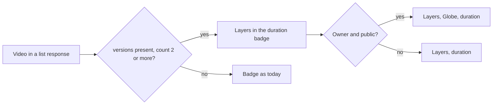
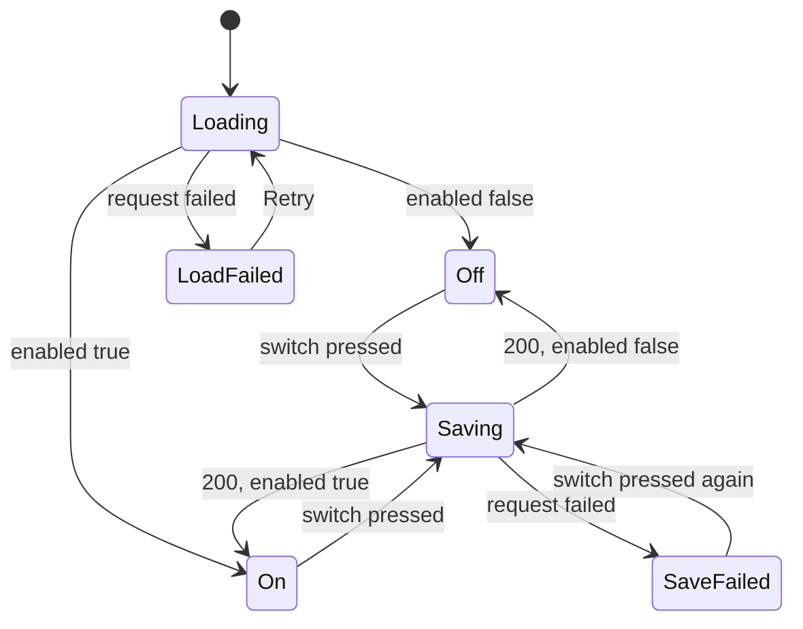

# UI design: A versions mark on cards and the duplicate judging switch

**Feature**: [parent Issue #1141](https://github.com/syudead/vv/issues/1141) ·
[plan.md](plan.md) ·
[research.md R-9](research.md#r-9-list-items-carry-the-existing-versions-summary-read-per-page) ·
[R-10](research.md#r-10-the-duplicates-page-refreshes-on-a-candidates-notification) ·
[R-13](research.md#r-13-the-model-is-asked-only-once-the-owner-has-saved-a-connection) ·
[contracts/screen-api.md](contracts/screen-api.md)

Sources that already decide things, linked rather than repeated here:

| Topic | Source |
| --- | --- |
| Tokens, closed scales, library density | [design-system.md, Foundations](../../docs/design-docs/design-system.md#foundations); the values in `@theme` of [`web/src/ui/tokens.css`](../../web/src/ui/tokens.css), named here and never copied |
| `VideoThumbnail` and its overlays, `Badge`, `Switch`, `Alert`, `Skeleton`: what each is for | [components.md](../../web/registry/rules/components.md) |
| `SettingsPage`, `PageSection`, `FormRow`: a switch acts at once, no save button | [patterns.md, Settings page](../../web/registry/rules/patterns.md#settings-page) and [Sections](../../web/registry/rules/patterns.md#sections) |
| The video card, the list-view row, the ordered rows of playlists and groups | [library-ui.md, Cards](../../docs/design-docs/library-ui.md#cards), [List view and selection](../../docs/design-docs/library-ui.md#list-view-and-selection), [`VideoCard.tsx`](../../web/src/videoList/VideoCard.tsx), [`ItemRowCells.tsx`](../../web/src/videoList/ItemRowCells.tsx) |
| The public mark, the precedent for a small icon in the duration badge | [016 UI design, Card](../016-single-account-auth/ui-design.md#card) |
| The corner marks (selection check, favorite heart, pickers) and what they leave free | [library-ui.md, Favorite mark](../../docs/design-docs/library-ui.md#favorite-mark), [035 UI design, Placement](../035-favorites/ui-design.md#placement) |
| The video page's versions item, the bundle dialog, the Duplicates page and its refresh | [030 UI design](../030-video-versions/ui-design.md), [`VersionsFact.tsx`](../../web/src/player/VersionsFact.tsx), [`DuplicatesPage.tsx`](../../web/src/versions/DuplicatesPage.tsx) |
| A settings section with one switch that saves on press | [042 UI design, Settings: Auto-import section](../042-folder-watch-import/ui-design.md#settings-auto-import-section), [`AutoImportSection.tsx`](../../web/src/settings/AutoImportSection.tsx) |
| The Ollama and Auto-tagging sections this one sits beside | [`OllamaSection.tsx`](../../web/src/settings/OllamaSection.tsx), [`AutoTaggingSection.tsx`](../../web/src/settings/AutoTaggingSection.tsx) |
| Guest degradation | [016 UI design, Guest degradation](../016-single-account-auth/ui-design.md#guest-degradation) |
| Screen text | [`web/src/i18n/en.ts`](../../web/src/i18n/en.ts) (`list.card`, `player.versions`, `settings`); this feature adds the words below |

This feature adds two things to the screens: a **versions mark** on every
video card and list row of a bundle's representative (requirement 5), and a
**Duplicate judging** section in Settings with one switch (requirement 7).
The Duplicates page changes only in when it refetches (R-10); its layout,
words and actions are 030's. The video page, the bundle dialog and the
selection bar do not change. The judgement itself has no screen: an
automatic bundle looks exactly like one the owner made (`UI品質`, the second
point), and a pair the model dismissed simply leaves the Duplicates page.

No token is added, and the contrast pairs in `web/src/theme/tokens.test.ts`
gain nothing: the mark uses the duration badge's own `foreground` on
`overlay`. The design system changes in one rule:
`VideoThumbnailDuration`'s sentence in
[components.md, VideoThumbnail](../../web/registry/rules/components.md#videothumbnail)
("a public mark may come first") becomes "a versions mark and a public mark
may come first", so the badge is still the one place for small facts and the
image carries no other text. The 030 rule that "bundling is not marked on
cards" is superseded (R-9); the implementation unit that adds the mark
rewrites that sentence and 030's review criterion 2 to point here.

## Why this shape

The mark is a `Layers` icon inside the duration badge, before the public
mark, and nothing else: no count, no word, no second badge. The badge at the
bottom right of the thumbnail is the one place a card already keeps small
facts about the file (the duration, and for the owner the public globe), and
a fact that belongs to the file rather than to the owner's actions reads
there as the same tier as the duration (`UI品質`, the first point: smaller and
quieter than the title and the thumbnail). The top corners were rejected: the
top-start corner is the selection check, the top-end corner holds the heart
and the two pickers, and a mark there would be read as a fourth control. A
band under the title or a `Badge` beside it was rejected because it adds a
line to the card, so a bundled card would be taller than its neighbours and
the grid's rows would no longer line up; the `UI品質` point asks for the mark
to fit inside what the card already has.

The count is left out on purpose. `VideoThumbnail`'s rule allows no text on
the image but the duration and the notice, a digit beside the duration would
be read as part of it at `card-0` width, and the count is one press away on
the video page's "3 versions" item, which is where the versions are listed
and switched. Comparable products that stack copies of one item (a photo
library's stack) mark the stack with a layered icon and show the members on
the item's own page; the mark on the card only says "there is more here".

`Layers` is the versions icon everywhere the product already names them: the
video page's item, "Bundle as versions" in the selection bar and the drop
menu, and the Duplicates entry in the sidebar. The risk of misreading it as
a group or a playlist is small, because a group is marked with `Folder` and a
playlist is never marked on a card (Q-5). The mark has no behaviour: pressing
the card opens the video, as it does today, and the video page's item is the
one control for versions. A tooltip was rejected: the public mark has none,
and a tooltip on a non-interactive icon inside a link would not open on
touch.

The switch is its own `PageSection`, "Duplicate judging", right after
"Auto-tagging": the two features are the two uses of the classifier set
under "Ollama", so the three sections read as one group (connection, then
what uses it). A `FormRow` inside "Auto-tagging" was rejected: that section
saves with a button because it carries thresholds, while this setting is one
switch that acts at once ([patterns.md, Settings
page](../../web/registry/rules/patterns.md#settings-page)), and the two
features are turned on and off independently (requirement 7 asks for its
own switch). A row in the "Ollama" section was rejected because the
feature works without a saved connection: the fingerprint rule still bundles
and dismisses, and only the pairs that need the model wait (R-13), so the
switch is not a property of the connection.

The section shows no queue count and no last error. The contract carries
only `enabled`, and the candidates the model has not settled are already on
the Duplicates page, which is the place to see what is waiting. Adding a
count here would duplicate that page's count line with a number that means
less (it would mix waiting, failed and undecidable pairs).

## Words

| Place | Text | Notes |
| --- | --- | --- |
| Card and row mark, screen readers only | 3 versions | `player.versions.count`, the same words as the video page's item; `sr-only` after the icon, as the public mark's "Public" |
| Settings section heading | Duplicate judging | `h2` of the `PageSection` |
| Section description | Judges each pair the scan lists as a possible duplicate: the two files are compared frame by frame, and the classifier set under Ollama is asked only about the frames that differ. Same videos are bundled as versions, different videos leave Duplicates, and the rest wait there for you. | One paragraph; the mechanics the owner needs to trust the switch |
| Switch row label | Judge possible duplicates automatically | `FormRow` label |
| Switch row description | Off: every possible duplicate waits on Duplicates for you. On: pairs that match throughout are bundled even without Ollama; pairs with a differing part wait until an Ollama connection is saved. | `FormRow` description; one text in both states |
| Saving line | Saving… | `settings.autoImport.saving`'s form |
| Save failed | Couldn't save the settings: {reason} | `destructive` `Alert` |
| Loading | Loading the duplicate judging settings | `aria-label` of the `Skeleton` |
| Load failed | Couldn't load the duplicate judging settings: {reason} | `ErrorState` title, with `Retry` |
| Ollama section description (changed) | Where VVMDM reaches Ollama and which model it uses. Auto-tagging and duplicate judging use it; the test works whether they are on or off. | Replaces "Auto-tagging uses it; the test works whether auto-tagging is on or off." |

## Versions mark

The diagram shows what decides whether a card or row carries the mark.

The mark follows the video page's rule: it is drawn when `Video.versions` is
present and `count` is 2 or more, for owners and guests alike, since `count`
already counts only the versions the viewer may see
([contracts/screen-api.md, `Video` delta](contracts/screen-api.md#video-delta)).
A representative whose other versions' files are all gone has `count` 1 and
no mark, as the video page then has no item.

| Place | Where the mark goes |
| --- | --- |
| Video card (library grid, folder pages, folder and library search results, the group page's grid) | Inside `VideoThumbnailDuration`, first: `Layers` (`size-3`, `shrink-0`, `aria-hidden`), then the public `Globe` when the owner sees it, then the duration, with the badge's own `gap-1.5` between them; the `sr-only` "3 versions" follows the icon |
| List-view row (`VideoRow`) | In the duration cell, before the public mark, in the same `inline-flex` with `gap-1.5`; the `sr-only` text as on the card |
| Ordered rows (playlist page, group page in list view, `ItemRowCells`) | Inside the row thumbnail's `VideoThumbnailDuration`, as on the card |
| Group card, playlist card, folder card | No mark: their badge is a total, not a video's |
| Related-videos column on the video page, history entries | Unchanged: the video page already shows the versions item for the video being watched, and a history entry is a viewing, not a library item |

The badge keeps its size and shape: `text-2xs`, `bg-overlay`, `rounded-sm`,
the same padding; only its width grows by one icon and one gap. The icon is
the badge's `foreground`, the same colour as the duration, not `primary`
and not `muted-foreground`: it is a fact of the file, not an action and not a
disabled thing. While the pointer scrubs the thumbnail, the duration text
changes to the scrub time as today and the marks stay where they are. A
bundled video that is also watched, public, favorite and unplayable shows
every one of those as today; the mark adds to the badge and takes nothing
from the corners, the progress edge or the notice.

Nothing on the card tells an automatic bundle from one the owner made, and
nothing says which version is the representative: the card is the
representative's, with its title, thumbnail and tags, as 030 decided.

### States

| State | What the card shows |
| --- | --- |
| Bundle member, 2 or more versions visible | The mark, before the public mark and the duration |
| Bundle member, 1 version visible | No mark; the card looks like an unbundled video's |
| Not bundled | No mark |
| Bundled while the list is open (an automatic bundle, or the owner's) | The list refetches on the `video` notification as today; the other member's card leaves the list and the representative's badge gains the mark in place, with no animation |
| Removed from versions while the list is open | The mark leaves the representative's badge in place when the bundle is down to one video, and the removed video's card appears with the list's next fetch |

## Settings: Duplicate judging section

A `PageSection` between "Auto-tagging" and "ComfyUI". The heading row holds
the title and the description and no action; the body is one `FormRow`.

| Row | Content |
| --- | --- |
| Switch row | `FormRow` with the label "Judge possible duplicates automatically", the description above it as its description, and a `Switch` as the one control, checked when `enabled` is `true` |
| Saving line | Only while a change is in flight: "Saving…" with a spinning `LoaderCircle`, `text-xs` `text-muted-foreground`, as the "Auto-import" section |
| Save failed | Only after a failed `PUT`: a `destructive` `Alert` under the switch row; the switch returns to the stored value |

The description is the same text in both states, so the row's height does
not change when the switch is pressed and the "ComfyUI" section below does
not move. Pressing the switch sends `PUT /api/settings/version-judging` at
once; there is no save button and no toast on success: the switch's new
position is the result, as in "Auto-import". Turning it on wakes the judging
worker, which then judges every waiting candidate
([contracts/screen-api.md, `PUT`](contracts/screen-api.md#put-apisettingsversion-judging));
nothing on this page shows that work. The owner sees it on the Duplicates
page, where judged pairs leave the list, and in the library, where bundled
cards gain the mark.

The section does not read or show the Ollama connection. The row's
description says what happens without one, and the "Ollama" section above is
where the connection is saved and tested.

### States

The diagram shows the states of the section and what moves it between them.

| State | What the section shows |
| --- | --- |
| Loading | The switch row with the label and a `Skeleton` the size of the switch in the control slot; no section flicker |
| Load failed | `ErrorState` in the body with "Couldn't load the duplicate judging settings: {reason}" and `Retry`; no switch |
| Off | Switch unchecked |
| On | Switch checked |
| Saving | The switch shows the state it was pressed to; the saving line; the switch does not react to a second press until the response |
| Save failed | The switch back at the stored value; the `destructive` `Alert` with the reason; the next press sends again |

## Duplicates page

The page's layout, words, actions and states are 030's. What changes is when
it refetches: the `candidates` notification on `/api/events` joins the `scan`
notification as a trigger, with 030's "Refresh" rules (the list looks
unchanged during the refetch, the scroll position is kept, pairs that are
gone disappear, new pairs join at the top). A pair the model judged leaves
the list this way with no toast and no line about it: the owner did not act,
so there is nothing to confirm, and the count line decreasing is the only
sign. A pair that stays, whether waiting for the model, undecidable, or
failed, looks like every other pair: the response carries no judgement
state, and the heading line stays "Same length · similar frames".

## Guest degradation

Guests see the mark on the cards and rows they see, under the same `count`
rule as the video page's item (requirement 5 says the mark is on the card,
and 030 shows versions to guests). Guests have no Settings page, so the
section needs no guest form.

## Responsive behaviour

Breakpoints are Tailwind's defaults only, applied in CSS
([library-ui.md, Width breakpoints](../../docs/design-docs/library-ui.md#width-breakpoints-in-css-and-the-sidebar-exception)).
The widths judged are 360px, 768px and 1280px, with the library grid at its
smallest card size (`card-0`) and its largest (`card-3`).

| Width | Mark | Settings section |
| --- | --- | --- |
| 1280px | The badge holds the mark, the globe and the duration on one line on every card size; on `card-0` it still sits clear of the progress edge and the corner marks | The switch row is label and description on the left, the switch on the right, as the rows above and below |
| 768px | Same; the list-view row shows the mark in the duration column | Same |
| 360px | The grid is one column; the badge is unchanged. The list-view row keeps the duration column, so the mark stays visible when the quality, size and date columns are hidden | The `FormRow` stacks: label, description, then the switch under them, as "Auto-import" does |

## Review criteria

Judged by looking at the real screen
([library-ui.md, Layout verified by people, not machines](../../docs/design-docs/library-ui.md#layout-verified-by-people-not-machines))
at the widths above, with a library that holds a bundled representative, a
public bundled video, a video with one version visible, and plain videos, and
with Settings before and after a saved Ollama connection. "It exists" alone
does not satisfy a criterion (Q-4).

1. **Visual hierarchy (cards)**: looking at a row of cards, the eye goes
   thumbnail → title → tags, and the mark is found last, with the duration.
   Side by side, a bundled video's card and a plain video's card have the
   same height, the same title position and the same tag row; the only
   difference is one icon inside the duration badge (`UI品質`, the first
   point).
2. **Information density**: a bundled card shows no count, no word, no
   second badge and no band; the versions themselves are seen only on the
   video page's "3 versions" item. The duration badge still reads as one
   badge, not as an icon beside a badge.
3. **Spacing rhythm**: the gap between the mark, the globe and the duration
   is the badge's one gap, the same as the gap between the globe and the
   duration today; the badge's padding and its distance from the thumbnail's
   corner are unchanged on `card-0` and `card-3`.
4. **Typography and colour**: the icon is the duration's height (`size-3`)
   and the duration's colour; nothing in the badge is `primary`, bold or
   larger than `text-2xs`. The mark cannot be told from the public globe by
   weight or colour, only by its shape.
5. **Priority of actions**: the mark is not pressable and changes nothing on
   hover; pressing the card opens the video; the corner controls (check,
   heart, pickers) are where they were and are not harder to reach.
6. **Same mark for both kinds of bundle**: a video bundled by the owner from
   the selection bar and one bundled by the judging worker carry the same
   mark, and "Remove from versions" on the video page removes the mark from
   the representative's card in the same way for both (`UI品質`, the second
   point; requirement 6).
7. **Every list**: the library grid, the library list view, a folder page,
   a folder's and the library's search results, the group page in both
   views, and the playlist page show the mark on the same bundled video, and
   a group card and a playlist card show none.
8. **Guest**: logged out, the same bundled video's card shows the mark (and
   no globe); a representative whose other versions are private shows none.
9. **Settings (hierarchy)**: "Duplicate judging" reads as a sibling of
   "Ollama" and "Auto-tagging": the same `text-lg` heading, the same `text-sm`
   `text-muted-foreground` description, the same card body; inside it the
   row label is the strongest element and the switch the only control. The
   section is one row high in Off and On.
10. **Settings (deciding)**: pressing the switch shows the saving line and
    then leaves the switch in its new position with no toast and no other
    change on the page; a failed save returns the switch and shows the
    reason under the row. Turning it on with waiting candidates makes pairs
    leave the Duplicates page without a reload of that page (acceptance
    criteria 1, 2 and 4).
11. **Duplicates page**: while the page is open and the worker judges, pairs
    leave the list in place, the pair being read does not move, no toast
    appears, and a pair that stays looks like any other pair.
12. **Examples that do not meet the requirement** (`UI品質`): the mark is
    in a top corner or beside the title; it carries a count or a word; it is
    `primary`-coloured or larger than the duration; a bundled card is taller
    than its neighbours; an automatic bundle is marked differently from a
    manual one; the Settings section holds a save button, a queue count or
    an Ollama status.

## Accessibility

The parent Issue does not ask for screen-reader or contrast design, so only
names are decided, as 016 and 030 did.

- The mark's icon is `aria-hidden` and the `sr-only` "3 versions" follows
  it, so a card's name stays the title and the badge reads "3 versions,
  Public, 12:34" in order.
- The switch is labelled by the `FormRow` label through `htmlFor`; the
  saving line is `role="status"`; the failed-save `Alert` is the component's
  own role.
