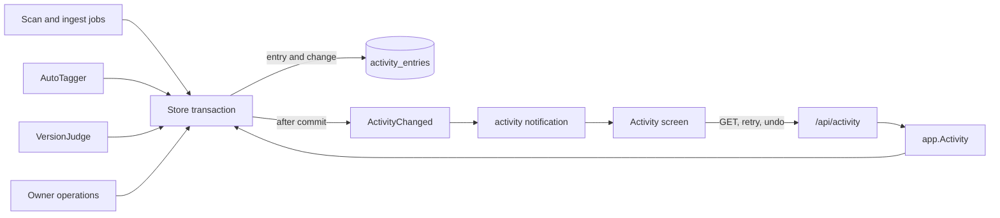
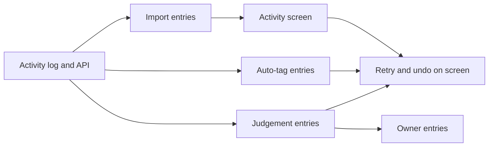

# Implementation Plan: Activity

**Branch**: `feature/055-activity` | **Parent Issue**: #1225

**Input**: The parent Issue. It is this feature's specification.

## Summary

Every process vv runs on a video or a pair (import, auto-tagging, duplicate
judging, work-information fetch, a failed scan) and every owner operation that
changes a video's tags or a version bundle writes an activity entry in the
same transaction as the change. The owner-only Activity screen lists the
entries newest first, filtered by status, refreshes on an `activity`
notification, and offers open, retry and undo where they apply.

| Concern | Decision |
| --- | --- |
| Storage | One user-data table, `activity_entries`, never pruned; "activity entry" apart from the in-memory scan activity ([R-1](research.md#r-1-a-persistent-activity-log-named-apart-from-the-scan-activity)) |
| Writing | In the store transaction of the change, through one helper ([R-2](research.md#r-2-an-entry-is-written-in-the-transaction-of-the-change-it-records)) |
| Granularity | One entry per run and subject; an import is one entry for its five stages; a scan only when it fails, closed by the next successful scan ([R-3](research.md#r-3-one-entry-per-run-and-subject-an-import-is-one-entry-for-all-its-stages)) |
| Status | `running` / `attention` / `done` with a reason or outcome; a newer run closes an older problem; startup marks claimed entries `interrupted`; a duplicate pair keeps one entry through its retries ([R-4](research.md#r-4-three-statuses-with-a-reason-and-a-newer-run-closes-an-older-problem)) |
| Decider | `ai` when the probability decided, `rule` for fixed rules and automatic triggers, `owner` for requests ([R-5](research.md#r-5-the-decider-is-who-made-the-recorded-decision-else-who-started-the-run)) |
| Owner operations | Tag and version-bundle changes and media-folder removal; not groups, playlists, tag definitions or thumbnail edits ([R-6](research.md#r-6-the-owner-operations-recorded)) |
| Undo | Restores the state when it still holds, always records the exclusion ([R-7](research.md#r-7-undo-restores-the-state-and-always-records-the-exclusion)) |
| Live update | `activity` notification, refetch ([R-8](research.md#r-8-the-screen-refreshes-on-an-activity-notification)) |
| Paging | Keyset by id, `status` filter, counts in the page ([R-9](research.md#r-9-keyset-paging-by-id-newest-first-filtered-by-status)) |
| Subject | Content keys with a label kept at write time ([R-10](research.md#r-10-the-subject-is-a-content-key-with-a-label-kept-at-write-time)) |
| Work-info fetch | A failed fetch is a finished entry, not a problem to retry ([R-11](research.md#r-11-a-failed-work-information-fetch-is-a-finished-entry-not-a-problem)) |

## How it works

The diagram shows where entries are written and how the screen reads them.



1. **A run opens an entry when it is queued.** Queuing a video's ingest jobs,
   auto-tagging, or a judgeable candidate writes a `running` entry with reason
   `waiting`, and the queue row keeps its id. A claim sets the reason to
   `processing`.
2. **Finishing updates the same entry.** The store method that finishes or
   fails the run sets `done` or `attention`, with the decider and, for the
   classifier's decisions, the probability.
3. **Owner operations write a `done` entry** in the transaction of the
   operation.
4. **Retry goes through `app.Activity`**, which dispatches by kind to the
   existing use cases (re-probe, manual scan, auto-tag queue, judging retry)
   and wakes the worker concerned.
5. **Undo is one `ActivityStore` transaction** that re-reads the target
   state, reuses the package-private steps of `Unbundle`, `Dismiss` and the
   tag rejection, records the exclusion and writes the owner's `undo` entry;
   `app.Activity` only wakes the workers afterwards
   ([R-7](research.md#r-7-undo-restores-the-state-and-always-records-the-exclusion)).

| Acceptance (parent Issue) | Where it is met |
| --- | --- |
| 1. Import, auto-tag, auto-bundle rows with decider and probability | `import`, `auto_tag`, `version_judgement` entries |
| 2. Owner bundle, unbundle, tag removal rows | Owner operation entries ([R-6](research.md#r-6-the-owner-operations-recorded)) |
| 3. No connection, then the result in the same row | `version_judgement` keeps one entry per pair |
| 4. Retry passes through running to a new result | `POST /api/activity/{id}/retry` opens a new entry; a duplicate pair's entry returns to `running` instead ([R-4](research.md#r-4-three-statuses-with-a-reason-and-a-newer-run-closes-an-older-problem)) |
| 5. Undo of a bundle, a tag, a "different" | [R-7](research.md#r-7-undo-restores-the-state-and-always-records-the-exclusion) |
| 6. Tabs match the counts | `status` filter and `counts` (`running`, `attention`, `done`) from one read |
| 7. New rows without reload | `activity` notification |
| 8. Guests | Owner-only route and operations |

## Technical Context

**Canonical definitions**:

| Topic | Source |
| --- | --- |
| Boundaries, store roles, events after commit, user data | [ARCHITECTURE.md](../../ARCHITECTURE.md), [.golangci.yml](../../.golangci.yml) (depguard) |
| Ingest jobs and import issues | [020 data-model](../020-seek-thumbnail-stage/data-model.md), [024 research](../024-import-progress/research.md) |
| Auto-tagging queue, suggested tags, rejections | [auto-tagging.md](../../docs/design-docs/auto-tagging.md) |
| Duplicate judging, unbundled pairs | [duplicate-judging.md](../../docs/design-docs/duplicate-judging.md), [054 data-model](../054-auto-dup/data-model.md) |
| Startup recovery | [process-lifecycle.md](../../docs/design-docs/process-lifecycle.md) |
| Owner-only access | [016 auth-api.md](../016-single-account-auth/contracts/auth-api.md) |
| Screen API and generated code | [api/openapi.yaml](../../api/openapi.yaml), `task generate` |
| Screens and Web tests | [design-system.md](../../docs/design-docs/design-system.md), [web-testing.md](../../docs/design-docs/web-testing.md), [i18n.md](../../docs/design-docs/i18n.md) |
| Checks | [Taskfile.yml](../../Taskfile.yml) (`task check`, `task check-docs`) |

**Feature-specific context**: the migration takes the next number on `main`
when its unit is written, since other feature branches add migrations too.
The screen's layout, row anatomy and the entry point in the shell are the
`design` stage's (`ui-design.md`).

## Constitution Check

Checked against ARCHITECTURE.md, core-beliefs.md and AGENTS.md; the rules this
design leans on:

| Rule | How the design meets it |
| --- | --- |
| The domain decides, the store enforces | Status transitions, the import roll-up, supersession and the retry and undo eligibility are `internal/domain`; the store re-reads the target state inside the undo transaction |
| No role calls another role's methods | Entries are written by a package-private helper inside each role's transaction; `ActivityStore` only lists, retries and undoes |
| Events after commit | `ActivityChanged` is published after the transaction that wrote the entry |
| User data survives a rebuild | Entries and holds are keyed by content keys and carry no foreign key to `videos` |
| Every read knows its viewer | `GET /api/activity` is owner only; `subject.videoIds` comes from an owner-audience read |
| Complexity 25 and no copied code | Retry and undo dispatch by kind to the existing use cases; the bundle undo is `VersionStore.Unbundle`'s steps |

Verdict: no violation.

## Project Structure

### Documentation (this feature)

```text
specs/055-activity/
├── plan.md
├── research.md            # R-1..R-11
├── data-model.md          # Three tables, three activity_id columns, the rules
└── contracts/
    └── screen-api.md      # /api/activity, retry, undo, the activity notification
```

No `quickstart.md`: every acceptance criterion is reached by store, handler,
Web and e2e tests with a fake classifier, so there is no manual run of its own.
The `design` stage adds `ui-design.md`.

### Source Code

**Affected boundaries**:

| Package | Change |
| --- | --- |
| `internal/domain` | Entry types, kinds, statuses, the import roll-up, supersession, retry and undo eligibility, `ActivityChanged`; probabilities on `AutoTagSelection` |
| `internal/store` | Migration, the entry helper, `ActivityStore` (list, counts, retry, undo), entries at every write site in [data-model.md, Kinds](data-model.md#kinds), startup recovery, holds in `judgeablePairs` and successions |
| `internal/app` | `Activity` use case (retry dispatch, worker wake-ups); `AutoTagger`, `Scans` and the work-info fetch pass the decider and probability; the ingest queue port takes the decider |
| `internal/httpapi`, `api/openapi.yaml` | The three operations and the `activity` notification |
| `cmd/mdm` | Wiring `Activity` and the notification in `events.go` |
| `web/src/activity` (new), `web/src/app`, `web/src/shell`, `web/src/auth` | The screen, its route, the shell entry point, `ownerOnlyPath` |

**New paths**: `internal/store/activity.go`, `internal/app/activity_log.go`
(`activity.go` is the scan activity), `web/src/activity/`, and
`docs/design-docs/activity.md`.

**Structure decision**: `ActivityStore` is its own role; the writes are not
its methods but a helper every recording role calls inside its own
transaction, so recording never crosses roles.

## Implementation Work

The diagram shows which units have to land first. The screen units also wait
for the `design` stage's `ui-design.md`.



### Store activity entries and list them in the screen API

**Scope**: The migration ([data-model.md](data-model.md)); the domain types,
statuses, supersession and eligibility rules; the entry helper and
`ActivityChanged`; `ActivityStore` list and counts; startup recovery to
`interrupted`; `GET /api/activity`, empty retry and undo routes answering
`409` for every kind, and the `activity` notification
([contracts/screen-api.md](contracts/screen-api.md)); `app.Activity` with the
dispatch table; `docs/design-docs/activity.md` linked from the index, the
subsystem map row, the user-data lists in ARCHITECTURE.md and running-vv.md
(all three new tables), and the recovery step in process-lifecycle.md.

**Dependencies**: None.

**Acceptance**: `task check` and `task check-docs` pass with no diff from
`task generate`; store tests show entries come back newest first, a `status`
filter returns only that status and its count matches, a cursor continues
without repeats while entries are added, a new entry supersedes an older
`attention` entry of the same kind and subject, and a `running` entry becomes
`attention`/`interrupted` after recovery; handler tests show a guest gets
`401 unauthenticated` from all three operations and an owner stream receives
`activity` after an entry is written.

### Record imports and failed scans, and retry them

**Scope**: The `import` entry opened when a video's ingest jobs are queued
with none pending, the jobs' `activity_id`, the roll-up on each job finish,
the decider by scan origin through the ingest queue port; the `scan` entry
for a failed scan and its closing by the next successful scan; retry for
both ([R-3](research.md#r-3-one-entry-per-run-and-subject-an-import-is-one-entry-for-all-its-stages),
[R-5](research.md#r-5-the-decider-is-who-made-the-recorded-decision-else-who-started-the-run)).

**Dependencies**: Store activity entries and list them in the screen API.

**Acceptance**: `task check` passes; store tests show a new file gives one
`import` entry that is `running` until its fingerprint job finishes and then
`done`, a stage that gives up makes it `attention`/`failed` with that stage in
`stage` and its message in `detail`, a rescan of the same file opens a second entry, and an entry
interrupted by a restart is superseded when its requeued job runs; a handler
test shows retry of a failed import answers `202` and a new `running` entry
follows; a failed scan's retry starts a manual scan, and when it ends `done` the `scan` entry is `superseded`; a scan interrupted by a restart writes no entry.

### Record auto-tagging runs and undo the tags they added

**Scope**: Probabilities on `AutoTagSelection`; the `auto_tag` entry opened on
queuing, its tags in `activity_entry_tags`, `attention`/`failed` on failure;
retry; per-tag undo through `auto_tag_rejections`; the entries and the undo
in auto-tagging.md
([R-7](research.md#r-7-undo-restores-the-state-and-always-records-the-exclusion)).

**Dependencies**: Store activity entries and list them in the screen API.

**Acceptance**: `task check` passes; app and store tests with a fake
classifier show a run that adds a tag at 0.91 and suggests one at 0.6 lists
both with those probabilities and decider `ai`; undo of the added tag removes
it from every bundle member, records a rejection, writes an owner `undo` entry,
and a later "Tag all again" does not add it; undo after the owner removed the
tag answers `already_reverted` and changes no tag, and so does undo after the
owner removed the tag and attached it again by hand, which keeps the owner's
attachment; retry of a failed run
queues the video, and answers `409 auto_tagging_off` while the feature is off.

### Record duplicate judgements and undo automatic bundles and dismissals

**Scope**: The `version_judgement` entry per judgeable candidate (and for
waiting candidates when judging is turned on), its status following the
candidate's judgement, the decider and probability of the result, closing as
`decided_by_owner` or `gone`, reattaching on a candidate rebuild; `ApplyJudgement` keeping the
probability and the joined side's keys; `video_version_judging_holds` and its
use in the claim and successions; retry of a failed pair; undo of `same` and
`different`; the holds and the entries in duplicate-judging.md and the claim
rule in 054 data-model.md
([R-4](research.md#r-4-three-statuses-with-a-reason-and-a-newer-run-closes-an-older-problem),
[R-7](research.md#r-7-undo-restores-the-state-and-always-records-the-exclusion)).

**Dependencies**: Store activity entries and list them in the screen API.

**Acceptance**: `task check` passes; store and app tests show a pair needing
the model with no saved connection is `attention`/`no_connection`, and after
the connection is saved and the fake classifier answers 0.9 the same entry is
`done`/`same` with decider `ai` and probability 0.9; a frame-rule bundle has
decider `rule`; undo of an automatic bundle removes the joined video from the
bundle and the pair is never claimed again; undo of an automatic dismissal
returns the pair to `GET /api/version-candidates` and the worker never claims
it; undo after the owner unbundled answers `already_reverted`; bundling an
`undecided` pair by hand closes its entry as `decided_by_owner`; rebuilding
one key's candidates keeps the pair's entry; undo of an automatic bundle of
the owner's bundle {B1, B2} (representative B1) with a bundle {A, C} leaves
{B1, B2} with representative B1 and {A, C} as they were, and records
`video_version_unbundles` only for pairs across the two sides.

### Record the owner's tag and version operations

**Scope**: Owner entries for the operations in
[R-6](research.md#r-6-the-owner-operations-recorded) at their store write
sites, including drag-organize, the external API's tag changes, the
organize undo and media-folder removal; the `work_info_fetch` and `work_info_apply` entries
([R-11](research.md#r-11-a-failed-work-information-fetch-is-a-finished-entry-not-a-problem)).

**Dependencies**: Record duplicate judgements and undo automatic bundles and
dismissals (the owner's version operations share its write sites).

**Acceptance**: `task check` passes; store tests show bundling, removing from
versions, making a representative, attaching and detaching a tag, keeping and
rejecting a suggested tag, and applying work information each write one
`done` entry per video with decider `owner`, and "Different videos" writes
one pair entry; a tag attached to three videos by drag-organize writes three
entries, and its undo writes `organize_undo` entries for them; a tag attached
through `/api/v1` writes an owner entry; removing a media folder writes one
`media_folder_remove` entry with the number of videos; a failed fetch writes
`done`/`failed` with the plugin's message; reordering a playlist writes none.

### Show the activity log on an owner-only Activity screen

**Scope**: The route, the shell entry point and `ownerOnlyPath`; the list
with the status tabs and counts from `ui-design.md`; open actions by subject;
refetch on `activity`; screen text in `en.ts`.

**Dependencies**: Record imports and failed scans, and retry them.

**Acceptance**: `task check` passes; Web tests show switching tabs lists only
that status and the tab counts match the response, an `activity` notification
refetches, and an entry whose subject has no video shows no open action; an
e2e test imports a file and sees its `import` row reach `done` without a
reload, and a guest has no entry point and is sent to login from `/activity`;
the screen passes a visual review at the widths in `ui-design.md`.

### Retry and undo from the Activity screen

**Scope**: The retry and undo actions on rows that offer them, with the
`already_reverted` and error messages, from `ui-design.md`.

**Dependencies**: Show the activity log on an owner-only Activity screen;
Record auto-tagging runs and undo the tags they added; Record duplicate
judgements and undo automatic bundles and dismissals.

**Acceptance**: `task check` passes; Web tests show retry and undo appear only
on rows whose `retryRun` and `undoable` are true, and that undo of an
already-reverted decision shows that message; an e2e test undoes an automatic
bundle and the video page no longer lists the version; the rows pass a visual
review at the widths in `ui-design.md`.
