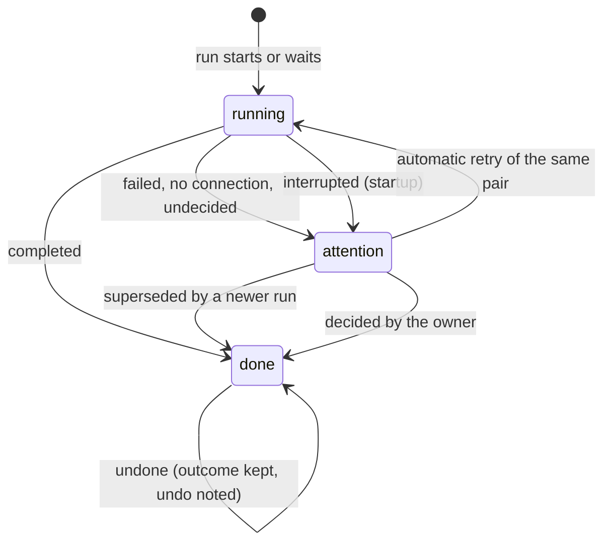

# Research: Activity

Inherited decisions: the stack and boundaries are
[ARCHITECTURE.md](../../ARCHITECTURE.md); the ingest queue is
[020 data-model](../020-seek-thumbnail-stage/data-model.md) and
[024 research](../024-import-progress/research.md); auto-tagging is
[auto-tagging.md](../../docs/design-docs/auto-tagging.md); duplicate judging is
[duplicate-judging.md](../../docs/design-docs/duplicate-judging.md) and
[054 research](../054-auto-dup/research.md); the screen-notification pattern
is [054 R-10](../054-auto-dup/research.md#r-10-the-duplicates-page-refreshes-on-a-candidates-notification).
This file records only the decisions this feature adds.

## R-1: A persistent activity log, named apart from the scan activity

**Decision**: Activity is one SQLite table, `activity_entries`, with its own
store role; the Go and API name is "activity entry", because
`domain.ScanActivity` already names the in-memory "what is running now" line
of the import progress (024 R-8).

| Option | Survives a restart | Keeps every run | Knows the decider | Verdict |
| --- | --- | --- | --- | --- |
| **One log table written at each change** | Yes | Yes | Yes | Chosen |
| Read the activity from `jobs`, `auto_tag_queue`, `video_version_candidates` and `scan_issues` | Yes | No: a row is overwritten by the next run, and candidates are rebuilt | No: an automatic bundle and dismissal write the owner's rows (054) | Rejected: requirements 3 and 10 cannot be met |
| Extend the in-memory `activities` of `internal/app` | No | No | Partly | Rejected: requirement 10 and the restart edge case |

**Rationale**: Every source the screen would read today forgets something the
parent Issue asks for. The table is user data: it is never rebuilt and never
pruned (requirement 10).

## R-2: An entry is written in the transaction of the change it records

**Decision**: Each store method that runs or finishes a recorded process, or
applies a recorded decision, writes or updates its entry through one
package-private helper in the same transaction, and publishes
`ActivityChanged` after commit.

| Option | Entry and change agree | Carries decider and probability | Verdict |
| --- | --- | --- | --- |
| **Write in the store transaction** | Always | The caller passes them | Chosen |
| An event-bus subscriber writes entries from domain events | No: a crash after commit loses the entry, and the subscriber runs later | No: events carry ids only | Rejected |
| `internal/app` writes the entry after the store call | No: two transactions | Yes | Rejected: an undo needs the entry that names its target to exist whenever the change does |

**Rationale**: ARCHITECTURE.md already routes work that spans roles through
package-private helpers in one transaction; the helper is one more of those,
so no role calls another role's methods.

## R-3: One entry per run and subject; an import is one entry for all its stages

**Decision**: A process run on one subject is one entry whose status moves.
A video's import is one entry covering its five ingest stages (probe,
thumbnail, seek preview, hover preview, fingerprint); a scan writes an entry
only when it ends `failed` for a reason other than `interrupted`, and the next
scan that ends `done` closes it as `superseded`.

| Option | Entries for 1,000 new files | Can open and retry one file | Verdict |
| --- | --- | --- | --- |
| **One import entry per video, stages inside** | 1,000 | Yes | Chosen |
| One entry per job | 5,000 | Yes | Rejected: the owner thinks of "importing this file", and a failed stage is already named in the reason |
| One entry per scan | 1 | No | Rejected: requirement 6 opens a video; requirement 7 retries one |
| A scan entry for every scan, failed or not | Thousands of empty watch scans | — | Rejected: a successful scan is the import entries it produced |

**Rationale**: The import entry is open while any of the video's jobs is
pending, which the jobs table already knows. Each job carries the id of the
entry it belongs to, so a job queued again later (a rescan, a re-probe, a
retry) opens a new entry instead of reviving a finished one (the edge case
"each run is its own row"). A scan's subject is the scan itself, because a
scan covers every media folder (`POST /api/scans` takes no folder); its retry
starts a manual scan. A scan closed as `interrupted` at startup writes no
entry, because startup already resumes it.

## R-4: Three statuses with a reason, and a newer run closes an older problem

**Decision**: An entry is `running`, `attention` or `done`; `attention` and
`running` carry a reason, and `done` carries an outcome. An `attention` entry
becomes `done` with outcome `superseded` when a newer entry of the same kind
on the same subject starts.

| Option | Attention count means | Verdict |
| --- | --- | --- |
| **A newer run closes the older problem** | Problems still open | Chosen |
| Problems stay `attention` until the owner dismisses them | Every problem ever seen | Rejected: bulk dismissal is out of scope, so the count would only grow |
| A retry revives the failed entry, for every kind | Problems still open | Rejected: acceptance 4 records the new result as a new row, and the history of the failure is lost |

**Rationale**: Startup, before the workers start, marks entries `running`
with reason `processing` as `attention`/`interrupted`
(process-lifecycle.md); entries still `waiting` were never started and stay
as they are. The requeued job then opens a new entry, which supersedes the
interrupted one, so the edge case holds. A scan's open `attention` entry is
closed by the next scan that ends `done`, since a successful scan writes no
entry of its own.

**Deviation for a duplicate pair**: its entry is the one that returns to
`running`, on its own backoff (054 R-5), after an interruption and on a retry
from the screen. Acceptance 3 asks for the same row to turn into the result,
and a pair is judged over hours of backoff; a new row per attempt would list
the same pair many times. Acceptance 4's new row therefore holds for every
kind except `version_judgement`.

## R-5: The decider is who made the recorded decision, else who started the run

**Decision**: `decider` is `ai` when the classifier's probability decided,
`rule` when a fixed rule decided or an automatic trigger started the run, and
`owner` when the owner's request did; an AI entry stores the probability.

| Entry | Decider |
| --- | --- |
| Import from a watch scan, a failed scan, or a startup resume | `rule` |
| Import from a manual scan, a re-probe or a retry | `owner` |
| Auto-tagging run started by import | `rule` until it finishes, then `ai` |
| Auto-tagging run started from Settings or the video page | `owner` until it finishes, then `ai` |
| Duplicate pair waiting, `no_connection` or `failed` | `rule` |
| Duplicate pair bundled because every frame matched, or undecided by the rule | `rule` |
| Duplicate pair bundled, dismissed or left undecided by the model's answer | `ai`, with the probability |
| Work-information fetch, any owner operation and any undo | `owner` |

**Rationale**: The probability of an added tag is discarded after selection
today, so `domain.AutoTagSelection` carries it to the store;
`domain.VersionJudgeResult` already carries the model's probability, and
`ApplyJudgement` now keeps it for `same` and `different` too. The ingest queue
port takes the decider, since the scanner queues jobs with no origin today.
Rejected: a decider of `rule` for every run that is not a model's, because a
manual scan is the owner's request and the row would say a rule started it.

## R-6: The owner operations recorded

**Decision**: The owner operations recorded are those that change a video's
tags or a version bundle, and removing a media folder; `まとまり` in the parent Issue is read as the version
bundle.

| Recorded | Not recorded |
| --- | --- |
| Bundle (Duplicates, video page, drag-organize), remove from versions, make representative, "Different videos" | Group edits other than turning a group into a tag, playlists, favorites, watch history |
| Attach and detach a tag on videos (video page, library selection, turning a group into a tag, external API), keep and reject a suggested tag | Tag definitions: create, rename, merge, delete, synonyms, kinds |
| Apply work information from a plugin | Display name, thumbnail position, uploaded and ComfyUI thumbnail edits |
| Remove a media folder, which removes its videos from the library | — |
| Undo of an automatic decision, and the drag-organize undo | — |

**Rationale**: These are the changes the automatic processes also make, so a
row from the owner explains why an automatic decision no longer holds.
Rejected: every mutating endpoint, because the log would be dominated by
reorders and favorites the parent Issue does not ask for. The parent Issue's
`削除` is the media-folder removal: there is no per-video delete, and a scan
that finds a file gone is not a decision. A tag-definition change touches many
videos at once and is about the tag, not a video. A thumbnail edit, uploaded
or made by ComfyUI, is the owner's own edit in its own dialog and decides
nothing an automatic process also decides; the import's thumbnail stage is in
the `import` entry.

## R-7: Undo restores the state and always records the exclusion

**Decision**: Undoing an automatic decision changes the current state only
when it still matches the decision, and always records the exclusion that
keeps the automatic process from deciding the same again.

| Undone decision | State change when it still holds | Exclusion recorded |
| --- | --- | --- |
| Bundled pair | Split the side that joined back out: a single video leaves the bundle; a side that was a bundle leaves as one bundle with its former representative | `video_version_unbundles`, only for pairs across the two sides (054 R-8) |
| "Different videos" | Delete the dismissal and rebuild both keys' candidates, so the pair returns to Duplicates | New `video_version_judging_holds` pair |
| Added or suggested tag | Delete the attachment at its user key, unless the owner changed that tag since | `auto_tag_rejections` ([auto-tagging.md](../../docs/design-docs/auto-tagging.md#tags-it-adds)) |

An automatic bundle joins two sides, and either may already be a bundle; the
side that joined is the one whose representative did not become the
bundle's. The entry keeps that side's member keys and its former
representative, so the undo restores the side as it was instead of breaking a
bundle the owner made into single videos; the side that leaves as a bundle
gets a copy of the merged bundle's user data, as `Unbundle` gives the
remaining member a copy. A member no longer in the library, no longer in the
merged bundle, or with an owner `bundle`, `unbundle` or `organize_undo` entry
newer than the judgement is skipped: the owner put it where it is.

An automatic tag is written on the bundle's user key; the entry keeps that key
and the tag. The undo deletes the `video_tags` row at that key, or at the
subject video's current key after bundling moved it, unless an owner
`tag_attach`, `tag_detach`, `tag_keep` or `tag_reject` entry for that video and
tag is newer than the `auto_tag` entry; then the owner's own attachment stays
as the owner left it.

A content change at the same path that carries the user data over to the new
key re-keys the entries with it, finished ones included, so the undo of an
entry decided before the change still finds the row ([data-model.md
"Rules"](data-model.md#rules)).

"Newer" is read from the log, never from the rows: entry ids are monotonic, so
an owner entry on the same subject with a greater id than the undone entry
means the owner decided again, as the owner `dismiss` entry does for an undone
"different". The rows the decisions write (`video_tags`,
`video_bundle_members`, `video_version_dismissals`) keep their second-precision
timestamps and gain no column; an owner's change within the same second as the
automatic run is still told apart. Rejected: match the row by its timestamp,
because the owner's re-attach in the same second was indistinguishable.
Rejected: record the entry id on the row, because it ties the user-data tables
to the log and the log already holds the owner's decision.

The undo is one `ActivityStore` transaction that re-reads
the target state, reuses the package-private steps of `Unbundle`, `Dismiss`
and the rejection, and writes the owner's `undo` entry
([R-2](#r-2-an-entry-is-written-in-the-transaction-of-the-change-it-records)).

When the state no longer matches (the owner already unbundled, already
removed the tag), nothing else changes and the response says it was already
reverted, as the edge case asks. Rejected: reuse `video_version_unbundles` for
an undone dismissal, because the table means "removed from a bundle" and the
undone pair was never bundled. Rejected: let the claim query read the log for
undone decisions, because the log would become an input of the judging rule.

## R-8: The screen refreshes on an `activity` notification

**Decision**: `ActivityChanged` becomes an `activity` notification with no
payload on `/api/events`, sent to the owner only and coalesced like
`candidates`; the screen refetches the counts and the entries it has loaded.

Rejected: entries in the notification payload, because every other
notification is re-read state and a payload would need its own ordering and
paging rules. Rejected: polling, because the page already holds the shared
event connection.

## R-9: Keyset paging by id, newest first, filtered by status

**Decision**: `GET /api/activity` pages by entry id descending with an opaque
cursor and an optional `status`; the response carries the `running`,
`attention` and `done` counts, so every tab of acceptance 6 has a count to
match.

Rejected: offset paging, because new entries arrive while the owner scrolls
and would shift every page. The table grows by about one import entry per
video plus one entry per judged run; 10,000 videos give tens of thousands of
rows, which an index on `(status, id)` serves without a retention rule.

## R-10: The subject is a content key with a label kept at write time

**Decision**: An entry names its subject by content key (a pair by two keys,
a scan by its id, a removed media folder by its path) and keeps the subject's
label as written;
the screen resolves the key to a current video when it reads.

Rejected: `videos.id`, because a rescan rebuilds it (ARCHITECTURE.md, "User
data survives a rebuild"). When the key resolves to no video the owner may
see, the entry stays and has no open action, as the edge case asks.

## R-11: A failed work-information fetch is a finished entry, not a problem

**Decision**: A work-information fetch writes a `done` entry with outcome
`failed` and the plugin's message; only the apply changes the video.

Rejected: an `attention` entry with retry, because a fetch is the owner's
interactive request, already answered on screen, and running it again needs
the owner to choose a search result. The entry opens the video's work
information, where the owner fetches again.
