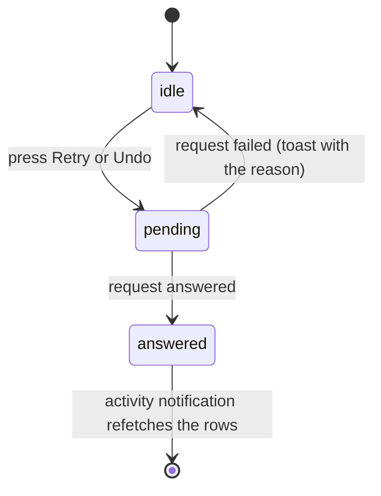

# UI design: Activity

Sources: [design-system.md](../../docs/design-docs/design-system.md) and its
rules ([patterns.md](../../web/registry/rules/patterns.md),
[components.md](../../web/registry/rules/components.md)); the History screen
(`web/src/history/HistoryPage.tsx`, [043 UI design](../043-watch-history/ui-design.md)),
which this screen follows for the page, the day groups and paging; the
counted tabs of the tag admin (`web/src/tags/TagsTabs.tsx`); the data and the
operations are [plan.md](plan.md) and
[contracts/screen-api.md](contracts/screen-api.md).

## Why this shape

Activity is a `ListPage` of `GroupedList` day groups, newest first, as History
is: both are a log the owner reads back in time, and History already settled
the day headings, a row grid that stacks below `lg` and paging by scrolling.
Each row is a text row with no thumbnail. A thumbnail would repeat on every
entry about the same video, a pair would need two, and a scan or a removed
folder has none; the status, the subject and the time are what the owner
scans for.

| Rejected | Why |
| --- | --- |
| A `DataTable` with columns for status, subject, decider and time | At 360px the columns leave the subject a few characters; the parent Issue asks that status, subject and time stay readable at narrow widths |
| `Tabs` for the status filter | The four choices narrow one list rather than switch between panels; the filter is the `ToggleGroup` History uses, with the counts the tag admin's tabs carry. The parent Issue's `タブ` is this filter |
| History's `JumpList` aside | It needs a list of the days that have entries, which the API does not give, and the status filter is how the owner narrows this log |
| A main action in the header | The parent Issue leaves bulk actions out |

## Words

Screen text as `web/src/i18n/en.ts` will hold it, under `t.activity` unless
noted. `{name}` and the like are the arguments of the catalog function.

| Place | Text | Notes |
| --- | --- | --- |
| Sidebar entry (`t.shell.nav.activity`) | `Activity` | |
| Sidebar count, read aloud | `1 needs attention`, `{count} need attention` | `selectPlural`; the visible text is the number |
| Page and document title | `Activity` | |
| Filter group label | `Show` | |
| Filter options | `All`, `Running`, `Needs attention`, `Done` | Each but `All` is followed by its count |
| Status badge | `Running`, `Needs attention`, `Done` | The same words as the filter |
| Decider | `Rule`, `AI`, `AI {percent}`, `You` | `AI 91%` only when the entry has a `probability`; `You` is the owner |
| Kind: `import` | `Import` | |
| Kind: `scan` | `Scan` | |
| Kind: `auto_tag` | `Auto-tagging` | |
| Kind: `version_judgement` | `Duplicate check` | |
| Kind: `work_info_fetch` | `Work info fetch` | |
| Kind: owner operations | `Bundled as versions`, `Removed from versions`, `Made representative`, `Marked as different videos`, `Added tag {name}`, `Removed tag {name}`, `Kept suggested tag {name}`, `Rejected suggested tag {name}`, `Applied work info`, `Removed media folder`, `Undid a drag-and-drop change` | One phrase per kind, in data-model order |
| `media_folder_remove` count | `1 video left the library`, `{count} videos left the library` | After the kind phrase, from `detail` |
| Kind: `undo` | `Undid: {kind} · {outcome}`, `Undid: tag {name}` | From `undoes`: the undone entry's kind and outcome phrases, or the tag of a per-tag undo |
| Reason `waiting` | `Waiting` | |
| Reason `processing` | `In progress` | |
| Reason `failed` | `Failed` | |
| Reason `failed`, `import` | `Failed at {stage}` | `{stage}` from `stage`: `analysis`, `thumbnail`, `seek thumbnails`, `preview`, `duplicate check`. `t.shell.scan.activity`'s words are verbs and do not read after `at` |
| Reason `failed`, `version_judgement` | `Failed · tries again at {time}` | `{time}` from `retryAt`: the local time (`14:05`) today, else the short date and time (`Oct 17, 14:05`) |
| Reason `interrupted` | `Stopped when vv shut down` | |
| Reason `no_connection` | `Needs the AI connection to decide` | |
| Reason `undecided` | `Couldn't tell whether these are the same video` | |
| Outcome `completed` | `Finished` | Owner operations show only their kind phrase |
| Outcome `completed`, `auto_tag` | `Added 1 tag`, `Added {count} tags`, `Added no tags` | |
| Outcome `same` | `Same video · bundled` | |
| Outcome `different` | `Different videos` | |
| Outcome `failed` | `Failed` | `work_info_fetch` only |
| Outcome `superseded` | `Replaced by a newer run` | |
| Outcome `decided_by_owner` | `You decided on Duplicates` | |
| Outcome `gone` | `A video left the library` | |
| Outcome `already_reverted` | `Already changed back by you` | |
| Undone mark | `Undone` | On the undone entry and on an undone tag |
| Subject of a scan | `Manual scan`, `Watch scan` | |
| Subject not in the library | `Not in the library` | As History's |
| Retry button | `Retry` | Read aloud `Retry {kind} for {subject}` |
| Undo button | `Undo` | Read aloud `Undo {kind} for {subject}` |
| Undo one tag | `Undo2` icon only | Tooltip and read aloud `Undo tag {name}` |
| Open Duplicates | `Open in Duplicates` | |
| Open the work info | `Work info` | `work_info_fetch` rows whose video is in the library |
| Open Settings | `Settings` | `no_connection` rows |
| Toast after undo | `Undone. vv won't decide this again on its own` | |
| Toast after an already reverted undo | `Already changed back. vv won't decide this again on its own` | |
| Toast on a failed retry or undo | `Couldn't retry: {reason}`, `Couldn't undo: {reason}` | `{reason}` from the error catalog |
| Error `activity_not_retryable` (error catalog) | `This can no longer be retried` | |
| Error `activity_not_undoable` (error catalog) | `This can no longer be undone` | |
| Empty, all | `No activity yet` / `Imports, auto-tagging, duplicate checks and your changes to tags and versions show up here.` | Title / description |
| Empty, running | `Nothing is running` | |
| Empty, needs attention | `Nothing needs your attention` | |
| Empty, done | `Nothing has finished yet` | |
| Empty for a filter, description and action | `Entries with another status are under All.` / `Show all` | |
| Load failed | `Couldn't load the activity` | With `Retry`, as History |

## Sidebar entry

`Activity` is the last entry of the main navigation, after `Duplicates`,
owner only, with the lucide `Activity` icon. While one or more entries need
attention, the entry carries the count from
[Changes to the design system](#changes-to-the-design-system); running entries
add no mark, because they come and go on every import. The count refreshes on
the `activity` notification on every screen.

## Activity page

`ListPage` with `toolbarRow="header"`: `PageHeader` with the title only, and a
`Toolbar` holding the filter. The selected filter is the `status` query
parameter of the page URL (none for `All`), pushed to history as History's
watch filter is, so back returns to the previous filter.

The filter is a single `ToggleGroup` (`outline`, `sm`), one option always
pressed. Each option but `All` ends with its count in `text-muted-foreground`
and `tabular-nums`, as the tag admin's tabs do; the count is absent until the
first page arrives. When the options do not fit the width, the group scrolls
sideways inside its own strip and the pressed option is scrolled into view, as
`TagsTabs` does; the page never scrolls sideways.

The body is a `GroupedList` with one group per local day of `createdAt`,
headed `Today`, `Yesterday` or the date as History heads them, then
`LoadMoreRow` while more pages load as the owner scrolls. Rows keep the order
of the API (newest entry first), so an entry stays in the day it started even
when it finishes later.

### Entry row

A `GroupedListItem` on the new row grid from
[Changes to the design system](#changes-to-the-design-system): the status,
the text and the time on one line, the time top-aligned at the end; the
actions under the text below `lg` and between the text and the time from
`lg`.

| Part | Content | Form |
| --- | --- | --- |
| Status | The status word with an icon: `Running` with a `Spinner`, `Needs attention` with `TriangleAlert`, `Done` with `Check` | `Badge`: `soft`, `warning`, `success`; first column, never shrinks |
| Subject | Each item's label; an item with a `videoId` is a link to the video page; a pair's two items are joined by `·` | Line 1, `text-sm font-medium`, one line, truncated with an ellipsis. History clamps its title at two lines; here line 1 also holds the status and the time, which must not move down |
| Time | The local time of `createdAt` (`14:05`) | Last column, `text-xs text-muted-foreground tabular-nums`, never shrinks |
| What happened | The kind phrase, `·`, the reason or outcome phrase, `·`, the decider, then `Undone` when undone | Line 2, `text-xs text-muted-foreground`, wraps |
| Not in the library | For a `video` or `pair` subject, after each item without a `videoId`: that label in plain text and `Not in the library` in the warning form History uses | Line 2's end; scans and folders never show it |
| Problem | For `attention` and a failed `work_info_fetch`: `detail` (the provider's or stage's message) | Line 3, `text-xs`, wraps, at most three lines (`line-clamp-3`) |
| Tags | For `auto_tag`: one `Badge` (`secondary`, with `TentativeMark` for a suggested tag) per tag holding the name and percentage, then that tag's undo button outside the chip | Line 3, wraps between tags, never inside one; the chip's `×` is the rule for removing, and this button undoes |
| Actions | `Retry`, `Undo`, `Open in Duplicates`, `Work info`, `Settings` | `ghost` `sm` buttons, so they weigh less than the status badge; only those the entry offers |

An undone entry keeps its row, its status and its phrase, and reads `Undone`
on line 2. An undone tag is drawn in `text-muted-foreground` with a line
through its name and no undo button.

Rows have no hover fill and no row-wide link: the subject links and the
action buttons are the targets, so a click on the text never opens or undoes
something by accident.

### Actions

The diagram shows what pressing `Retry` or `Undo` does to the row.

| Action | Shown when | After |
| --- | --- | --- |
| `Retry` on `import`, `auto_tag` | `retryRun` is true | A new `Running` row at the top; this row turns `Done`, `Replaced by a newer run` |
| `Retry` on `version_judgement` | `retryRun` is true | This row turns `Running`; no new row |
| `Retry` on `scan` | `retryRun` is true | A scan starts; this row stays `Needs attention` until a scan ends without failing, then reads `Replaced by a newer run` |
| `Undo` | `undoable` is true and the kind is not `auto_tag` | Toast; the row reads `Undone`; a new `You` row at the top |
| Undo one tag | An `auto_tag` entry's tag whose `undone` is false | Toast; the tag is drawn undone; a new `You` row at the top |
| `Open in Duplicates` | A pair whose `candidate` is true | Opens `/duplicates` |
| `Work info` | A `work_info_fetch` whose video is in the library | Opens the video's work info editor (`/videos/{id}/edit`) |
| `Settings` | Reason `no_connection` | Opens `/settings`, where the AI connection is saved |

While a request is pending its button shows a `Spinner`, and every button of
that row is disabled. Neither `Retry` nor `Undo` asks for confirmation: an
undo returns the state from before an automatic decision, which the owner can
make again by hand, and a retry starts what failed. A failed request leaves
the row as it was and shows the toast.

### Live updates

On the `activity` notification the page refetches the counts and every page it
has loaded, and replaces the rows in place. A row that no longer matches the
filter leaves the list; new rows join the top group. The scroll position stays
on the row the owner was reading (the browser's scroll anchoring), so rows
added above it do not push it away.

### States

| State | What the page shows |
| --- | --- |
| Loading | `LoadingState` with the grouped layout, under the header and filter |
| Load failed | `ErrorState` with `Couldn't load the activity` and `Retry` |
| No entries at all | `EmptyState` with the `Activity` icon, `No activity yet` and its description |
| No entries for the filter | `EmptyState` with the `ListFilter` icon, the filter's empty title, `Entries with another status are under All.` and `Show all`, which presses `All`; the counts on the other options stay |
| Entries | The day groups |
| Loading more | `LoadMoreRow` with a `Spinner` after the last group |
| Load more failed | `LoadMoreRow` with the message and `Retry` |

### Guests

Guests have no sidebar entry, and `/activity` sends them to sign in, as every
owner-only screen does ([016 UI design](../016-single-account-auth/ui-design.md)).

## Changes to the design system

**Rail count.** `Sidebar` gains a count on an entry: on the rail, a `Badge`
(`warning`) pinned to the top-right corner of the entry's icon; in the
narrow-width drawer, `SidebarMenuBadge` at the end of the row. `99+` above 99,
nothing at 0, and the caller appends the read-aloud text to the entry's
accessible name. The showcase draws a rail entry with counts 3 and 120. It goes
in [components.md, Sidebar](../../web/registry/rules/components.md#sidebar)
and the `sidebar` item.

| Rejected | Why |
| --- | --- |
| `SidebarMenuBadge` on the rail too | It is hidden when the sidebar is collapsed to icons, which is how vv's rail always is |
| A dot without a number | The owner cannot tell one problem from many without opening the page |

**Running status badge.** components.md's `Badge` rule names `soft` for a
selected or active chip and `destructive`, `warning`, `success` for status.
A process that is still running is active and not a problem or a success, so
the rule gains: `soft` with a `Spinner` for a running status, always with its
word.

**Activity row grid.** `tokens.css` gains the named utility
`grid-cols-activity-row`, beside `grid-cols-history-row`: below `lg` the
columns are the status, the text and the time, with the actions on a second
row under the text; from `lg`, the status, the text, the actions and the time.
History's utilities start with a thumbnail column, which this row does not
have.

## Responsive behaviour

| Width | Layout |
| --- | --- |
| 360px | Header, then the filter strip on its own row, scrolling sideways when the four options do not fit. A row: status, then the subject cut to one line, then the time; under the subject, what happened, then the problem or the tags; then the actions on their own line under the text |
| 768px | As 360px; the filter fits on one row; the subject has room for most labels |
| 1280px | Header and filter on one row. A row: status, the text lines, the actions, and the time last, all top-aligned with line 1 |

## Review criteria

1. At 360px, 768px and 1280px, a row whose subject is a 120-character file
   name keeps its status badge whole at the start and its time whole at the
   end of line 1; only the subject is cut, and nothing in the row overlaps or
   pushes the page sideways.
2. Scanning the list, `Needs attention` rows stand out from the rest by their
   `warning` badge before any text is read, and the ghost action buttons draw
   the eye less than the badges.
3. The subject reads before line 2: it is larger and brighter than the
   `text-xs` muted line under it.
4. On a `Needs attention` row, the reason is in line 2 and the provider's
   message under it, without opening anything; a 500-character message stops
   at three lines and the next row starts below those three lines without
   overlapping them.
5. The counts beside `Running`, `Needs attention` and `Done` equal the number
   of rows that filter lists, and the sidebar's count equals the
   `Needs attention` count.
6. An imported video's `Done` row has no buttons; a failed import shows only
   `Retry`; an automatic bundle shows only `Undo`; after undo it reads `Undone`
   and shows neither `Retry` nor `Undo`.
7. At 360px the actions sit on their own line under the text, and the filter
   strip scrolls instead of wrapping or overflowing the page.
8. With the page open, a finished import adds its row at the top of `Today`
   without a reload, and the row the owner was reading does not move.
9. A row whose video left the library shows its label as plain text with
   `Not in the library`, and no link.
10. At 1280px, rows, day groups and the page edges have the same spacing as
    History, and a `Done` row of two lines is no taller than a History row.
