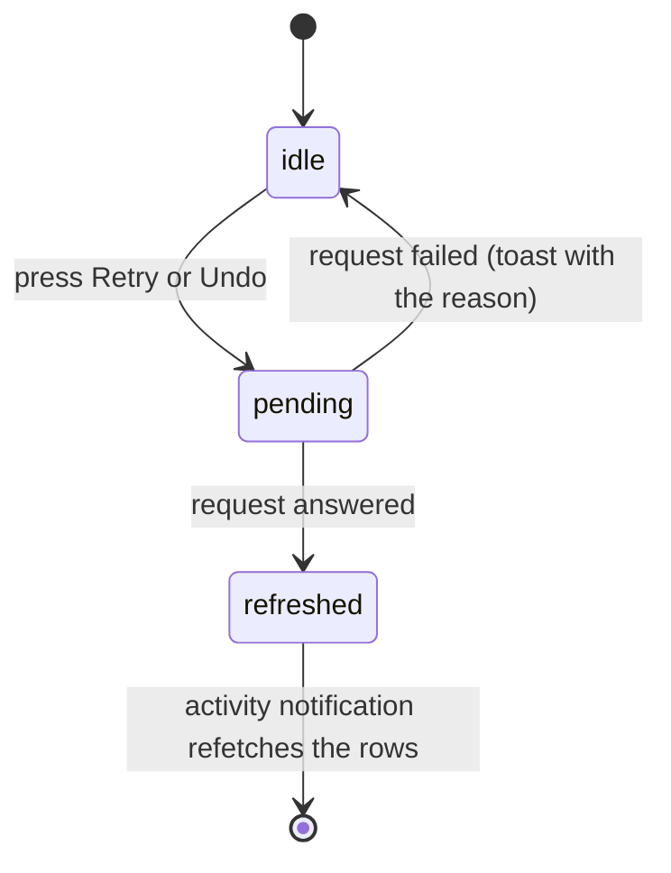

# UI design: Activity

Sources: [design-system.md](../../docs/design-docs/design-system.md) and its
rules ([patterns.md](../../web/registry/rules/patterns.md),
[components.md](../../web/registry/rules/components.md)); the History screen
(`web/src/history/HistoryPage.tsx`, [043 UI design](../043-watch-history/ui-design.md)),
which this screen follows for the page, the day groups and paging; the
counted tabs of the tag admin (`web/src/tags/TagsTabs.tsx`); the data and the
operations are [plan.md](plan.md) and
[contracts/screen-api.md](contracts/screen-api.md).

## Why this shape

Activity is a `ListPage` of `GroupedList` day groups, newest first, as History
is: both are a log the owner reads back in time, and History already settled
the day headings, the row grid that stacks below `lg` and paging by scrolling.
Each row is a text row with no thumbnail. A thumbnail would repeat on every
entry about the same video, a pair would need two, and a scan or a removed
folder has none; the status, the subject and the time are what the owner
scans for. Rejected: a `DataTable` with columns for status, subject, decider
and time, because at 360px the columns leave the subject a few characters, and
the parent Issue asks that status, subject and time stay readable at narrow
widths. Rejected: `Tabs` for the status filter, because the four choices
narrow one list rather than switch between panels; the filter is the
`ToggleGroup` History uses, with the counts the tag admin's tabs carry.

The page has no main action and no aside: the parent Issue leaves bulk
actions out, and there is no date list to jump through.

## Words

Screen text as `web/src/i18n/en.ts` will hold it, under `t.activity` unless
noted. `{name}` and the like are the arguments of the catalog function.

| Place | Text | Notes |
| --- | --- | --- |
| Sidebar entry (`t.shell.nav.activity`) | `Activity` | |
| Sidebar count, read aloud | `{count} need attention` | The visible text is the number |
| Page and document title | `Activity` | |
| Filter group label | `Show` | |
| Filter options | `All`, `Running`, `Needs attention`, `Done` | Each but `All` is followed by its count |
| Status badge | `Running`, `Needs attention`, `Done` | The same words as the filter |
| Decider | `Rule`, `AI {percent}`, `You` | `AI 91%`; `You` is the owner |
| Kind: `import` | `Import` | |
| Kind: `scan` | `Scan` | |
| Kind: `auto_tag` | `Auto-tagging` | |
| Kind: `version_judgement` | `Duplicate check` | |
| Kind: `work_info_fetch` | `Work info fetch` | |
| Kind: owner operations | `Bundled as versions`, `Removed from versions`, `Made representative`, `Marked as different videos`, `Added tag {name}`, `Removed tag {name}`, `Kept suggested tag {name}`, `Rejected suggested tag {name}`, `Applied work info`, `Removed media folder`, `Undid a drag-and-drop change` | One phrase per kind, in data-model order |
| Kind: `undo` | `Undid: {phrase}` | `{phrase}` is the undone entry's outcome phrase |
| Reason `waiting` | `Waiting` | |
| Reason `processing` | `In progress` | |
| Reason `failed` | `Failed` | |
| Reason `failed`, `import` | `Failed at {stage}` | `{stage}`: `analysis`, `thumbnail`, `seek thumbnails`, `preview`, `duplicate check`, for the five ingest stages in order. `t.shell.scan.activity`'s words are verbs and do not read after `at` |
| Reason `failed`, `version_judgement` | `Failed · tries again {time}` | `{time}` as the relative time of History |
| Reason `interrupted` | `Stopped when vv shut down` | |
| Reason `no_connection` | `Needs the AI connection to decide` | |
| Reason `undecided` | `Couldn't tell whether these are the same video` | |
| Outcome `completed` | `Finished` | Owner operations show only their kind phrase |
| Outcome `completed`, `auto_tag` | `Added {count} tags`, `Added 1 tag`, `Added no tags` | |
| Outcome `same` | `Same video · bundled` | |
| Outcome `different` | `Different videos` | |
| Outcome `failed` | `Failed` | `work_info_fetch` only |
| Outcome `superseded` | `Replaced by a newer run` | |
| Outcome `decided_by_owner` | `You decided on Duplicates` | |
| Outcome `gone` | `A video left the library` | |
| Outcome `already_reverted` | `Already changed back by you` | |
| Undone mark | `Undone` | On the undone entry and on an undone tag |
| Subject of a scan | `Manual scan`, `Watch scan` | |
| Subject gone | `Not in the library` | As History's |
| Retry button | `Retry` | Read aloud `Retry {kind} for {subject}` |
| Undo button | `Undo` | Read aloud `Undo {phrase} for {subject}` |
| Undo one tag | (icon only) | Tooltip and read aloud `Undo tag {name}` |
| Open Duplicates | `Open in Duplicates` | Pairs still on Duplicates |
| Open the AI connection | `AI connection settings` | `no_connection` rows; opens Settings at the Ollama section |
| Toast after undo | `Undone. vv won't decide this again on its own` | |
| Toast after an already reverted undo | `Already changed back. vv won't decide this again on its own` | |
| Toast on a failed retry or undo | `Couldn't retry: {reason}`, `Couldn't undo: {reason}` | `{reason}` from the error catalog |
| Empty, all | `No activity yet` / `Imports, auto-tagging, duplicate checks and your changes to tags and versions show up here.` | Title / description |
| Empty, running | `Nothing is running` | |
| Empty, needs attention | `Nothing needs your attention` | |
| Empty, done | `Nothing has finished yet` | |
| Load failed | `Couldn't load the activity` | With `Retry`, as History |

## Sidebar entry

`Activity` is the last entry of the main navigation, after `Duplicates`,
owner only, with the lucide `Activity` icon. While one or more entries need
attention, the rail item carries the count from
[Changes to the design system](#changes-to-the-design-system); running entries
add no mark, because they come and go on every import. The count refreshes on
the `activity` notification on every screen.

## Activity page

`ListPage` with `toolbarRow="header"`: `PageHeader` with the title only, and a
`Toolbar` holding the filter. The selected filter is the `status` query
parameter of the page URL (none for `All`), pushed to history as History's
watch filter is, so back returns to the previous filter.

The filter is a single `ToggleGroup` (`outline`, `sm`), one option always
pressed. Each option but `All` ends with its count in `text-muted-foreground`
and `tabular-nums`, as the tag admin's tabs do; the count is absent until the
first page arrives. When the options do not fit the width, the group scrolls
sideways inside its own strip and the pressed option is scrolled into view, as
`TagsTabs` does; the page never scrolls sideways.

The body is a `GroupedList` with one group per local day, headed `Today`,
`Yesterday` or the date as History heads them, then `LoadMoreRow` while more
pages load as the owner scrolls.

### Entry row

A `GroupedListItem` laid out as History's row grid without the thumbnail
column: below `lg` the text on top and the actions under it, from `lg` one
line.

| Part | Content | Form |
| --- | --- | --- |
| Status | The status word with an icon: `Running` with a `Spinner`, `Needs attention` with `TriangleAlert`, `Done` with `Check` | `Badge`: `soft`, `warning`, `outline`; first on line 1, never shrinks |
| Subject | The label; a link to the video page when the subject resolves to a video; for a pair, both labels joined by `·`, each a link when it resolves | Line 1, `text-sm font-medium`, truncated with an ellipsis, the full label in the link's accessible name |
| Time | The local time (`14:05`) | End of line 1, `text-xs text-muted-foreground tabular-nums`, never shrinks |
| What happened | The kind phrase, `·`, the reason or outcome phrase, `·`, the decider | Line 2, `text-xs text-muted-foreground`, wraps |
| Problem | For `attention` and a failed `work_info_fetch`: `detail` (the provider's or stage's message) | Line 3, `text-xs`, wraps, at most three lines (`line-clamp-3`) |
| Tags | For `auto_tag`: one `Badge` (`secondary`, `TentativeMark` for a suggested tag) per tag, name and percentage, each followed by its undo button | Line 3, wraps between tags, never inside one |
| Not in the library | When the subject resolves to no video | Line 2's end, in the warning form History uses |
| Actions | `Retry`, `Undo`, `Open in Duplicates`, `AI connection settings` | `outline` `sm` buttons; only those the entry offers |

An undone entry keeps its row, its status and its phrase, adds the `Undone`
mark (`Badge outline`) after the decider, and drops `Undo`. An undone tag is
drawn in `text-muted-foreground` with a line through its name and no undo
button.

Rows have no hover fill and no row-wide link: the subject links and the
action buttons are the targets, so a click on the text never opens or undoes
something by accident.

### Actions

The diagram shows what pressing `Retry` or `Undo` does to the row.

| Action | Shown when | While pending | After |
| --- | --- | --- | --- |
| `Retry` | `retryRun` is true | The button shows a `Spinner` and is disabled | The new entry appears at the top; this row turns `Done` with `Replaced by a newer run`, or, for a pair, `Running` |
| `Undo` | `undoable` is true | As `Retry` | Toast; the row gains `Undone`; a new `You` row appears at the top |
| Undo one tag | The tag is not undone | The tag's button shows a `Spinner` | Toast; the tag is drawn undone |
| `Open in Duplicates` | The entry is a pair and `candidate` is true | — | Opens `/duplicates` |
| `AI connection settings` | Reason `no_connection` | — | Opens Settings scrolled to the Ollama section |

Neither `Retry` nor `Undo` asks for confirmation: an undo returns the state
from before an automatic decision, which the owner can make again by hand, and
a retry starts what failed. A failed request leaves the row as it was and
shows the toast. While any request of a row is pending, that row's other
buttons are disabled.

### Live updates

On the `activity` notification the page refetches the counts and every page it
has loaded, and replaces the rows in place. A row that no longer matches the
filter leaves the list; new rows join the top group. The scroll position stays
on the row the owner was reading (the browser's scroll anchoring), so rows
added above it do not push it away.

### States

| State | What the page shows |
| --- | --- |
| Loading | `LoadingState` with the grouped layout, under the header and filter |
| Load failed | `ErrorState` with `Couldn't load the activity` and `Retry` |
| No entries at all | `EmptyState` with the `Activity` icon, `No activity yet` and its description |
| No entries for the filter | `EmptyState` with the filter's empty title and no action; the filter stays pressed and the other counts show where entries are |
| Entries | The day groups |
| Loading more | `LoadMoreRow` with a `Spinner` after the last group |
| Load more failed | `LoadMoreRow` with the message and `Retry` |

### Guests

Guests have no sidebar entry, and `/activity` sends them to sign in, as every
owner-only screen does ([016 UI design](../016-single-account-auth/ui-design.md)).

## Changes to the design system

**Rail count.** The sidebar rail has no way to show a count today. `Sidebar`
gains one: a rail item takes a count, drawn as a `Badge` (`warning`) pinned to
the top-right corner of the item's icon, `99+` above 99, hidden at 0, and
appended to the item's accessible name by the caller. In the narrow-width
drawer the same count sits at the end of the entry's row. The showcase draws a
rail item with counts 3 and 120. Activity is its first use; it goes in
[components.md, Sidebar](../../web/registry/rules/components.md#sidebar) and
the `sidebar` item in the same change. Rejected: a dot without a number,
because the owner cannot tell one problem from many without opening the page.

## Responsive behaviour

| Width | Layout |
| --- | --- |
| 360px | Header, then the filter strip on its own row, scrolling sideways when the four options do not fit. A row is two lines and more: line 1 status, subject (truncated) and time; line 2 what happened; then the problem or the tags; then the actions on their own line, left-aligned with the text |
| 768px | As 360px; the filter fits on one row beside nothing else; the subject has room for most labels |
| 1280px | Header and filter on one row. Each row is one band: status, then the text lines, then the actions, then the time, which stays at the end of line 1 |

## Review criteria

1. At 360px, 768px and 1280px, a row whose subject is a 120-character file
   name keeps its status badge whole at the start and its time whole at the
   end of line 1; only the subject is cut, and nothing in the row overlaps or
   pushes the page sideways.
2. Scanning the list, `Needs attention` rows stand out from the rest by their
   `warning` badge alone, before any text is read; `Running` and `Done` are
   told apart by their fill and icon.
3. On a `Needs attention` row, the reason is in line 2 and the provider's
   message under it, without opening anything; a 500-character message stops
   at three lines and the row below it starts where it should.
4. The counts beside `Running`, `Needs attention` and `Done` equal the number
   of rows that filter lists, and the rail's count equals the
   `Needs attention` count.
5. A row offers only the buttons its entry allows: an imported video's `Done`
   row has none; a failed import has `Retry` only; an automatic bundle has
   `Undo` only; an undone entry has none and reads `Undone`.
6. At 360px the actions sit on their own line under the text, and the filter
   strip scrolls instead of wrapping or overflowing the page.
7. With the page open, a finished import adds its row at the top of `Today`
   without a reload, and the row the owner was reading does not move.
8. A row whose video left the library shows its label as plain text with
   `Not in the library`, and no link.
9. The spacing between rows, between day groups and around the page is the
   same as on History.
