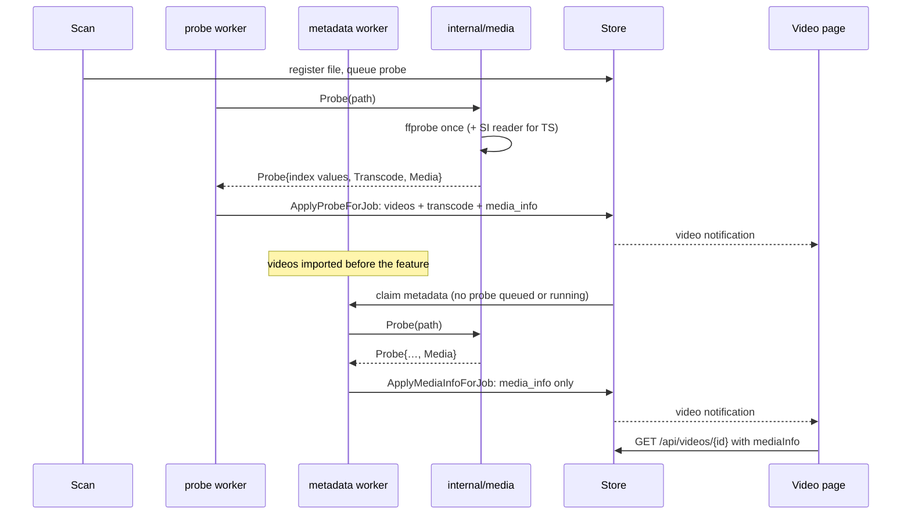
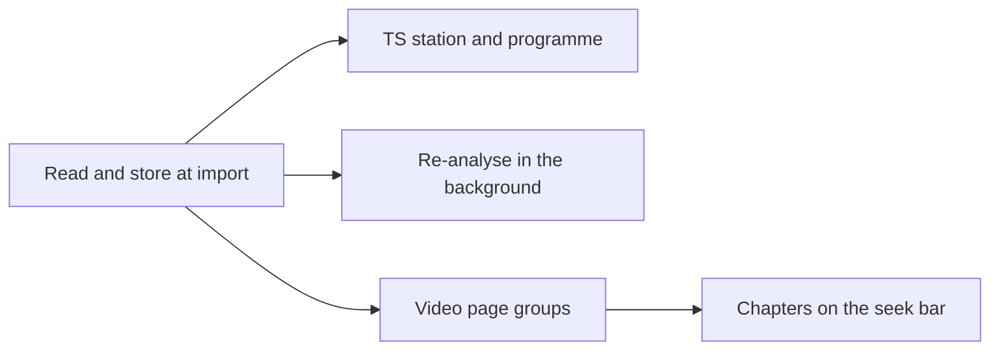

# Implementation Plan: Media information from the import probe, on the video page and the seek bar

**Branch**: `feature/056-media-info` | **Parent Issue**: #1227

**Input**: The parent Issue. It is this feature's specification.

## Summary

The import's single `ffprobe` run keeps what it already reads and discards
today: frame rate, bit depth, bit rate, interlacing, the HDR kind, 360-degree
and 3D signals, every audio and subtitle track, the embedded tags, the
shooting time, device and location, cover art and chapters. For a TS
recording, a small Go reader decodes the station and programme names that
`ffprobe` cannot. Everything is stored as one versioned JSON row per video,
shown on the video page in groups that appear only when the file has the
items, and the chapters reach the player as marks on the seek bar with a
chapters menu. Videos imported before the feature are read again by a
background job that yields to new imports.

| Concern | Decision |
| --- | --- |
| Storage | One versioned JSON row per video, `video_media_info` ([R-1](research.md#r-1-media-information-is-one-versioned-json-row-per-video)) |
| Source | The same `ffprobe` run, with `-show_chapters` and longer analysis limits for TS ([R-2](research.md#r-2-the-same-ffprobe-run-reads-chapters-and-reads-longer-for-mpeg-ts)) |
| Classification | HDR, projection, 3D and interlacing as pure domain rules ([R-3](research.md#r-3-hdr-projection-3d-and-interlacing-are-decided-by-pure-rules-in-internaldomain)) |
| TS names | A Go SI reader with an ARIB STD-B24 decoder, first 32 MiB ([R-4](research.md#r-4-station-and-programme-names-of-a-ts-recording-come-from-a-go-si-reader-with-an-arib-std-b24-decoder)) |
| Re-analysis | A `metadata` job kind, claimable only when no probe is queued or running ([R-5](research.md#r-5-imported-videos-are-re-analysed-by-a-metadata-job-that-yields-to-pending-probes)) |
| API | `mediaInfo` on the detail only, guests included ([R-6](research.md#r-6-mediainfo-is-part-of-the-video-detail-only-for-owners-and-guests-alike)) |
| Chapters | A `chapters` text track, marks in the video.js seek bar, the chapters button ([R-7](research.md#r-7-chapters-are-a-chapters-text-track-with-marks-drawn-in-the-videojs-seek-bar)) |
| Languages | Names through `Intl.DisplayNames` ([R-8](research.md#r-8-language-codes-are-shown-through-intldisplaynames)) |

## How it works

The sequence shows a new import and the background re-analysis of an
existing video; both end in the same row and the same page.



1. **The probe reads more and fails no more often.** `media.Probe` adds
   `-show_chapters` and, for a TS file, the longer analysis limits, and fills
   `domain.MediaInfo` beside the index values. A missing or unreadable item is
   omitted; only a missing duration fails the probe, as today
   ([data-model.md, Rules](data-model.md#rules)).
2. **A TS file gets its names.** For `.ts`, `.m2ts` and `.mts`, `internal/media`
   reads the first 32 MiB in Go, finds the SDT, the EIT present and following
   events of the first programme and the TOT, decodes the names with the ARIB
   decoder, and keeps the event that overlaps the recording longest, so a
   recording that starts before its programme is not named after the
   programme before it (R-4). The scan imports `.m2ts` and `.mts` as well as
   `.ts`.
3. **The store writes one row.** `ApplyProbeForJob` writes `video_media_info`
   in the transaction that updates `videos`, under the same identity check, so
   a file replaced during the probe leaves no row of the old file.
4. **Existing videos catch up.** The migration queues a `metadata` job per
   probed video; the scan queues one for a row that is missing or below the
   current version. The `metadata` worker claims only while no `probe` job is
   queued or running, runs the same `Probe`, and writes only the row. A failure at the
   limit keeps what the page shows today.
5. **The page shows groups.** `GET /api/videos/{id}` carries `mediaInfo`; the
   page renders Video, Audio, Subtitles, Embedded and Broadcast groups under
   the technical line, each only when it has an item, in the form the
   `design` stage specifies. The title, Created and Added facts are untouched.
6. **The player shows chapters.** The page builds a `chapters` text track from
   `mediaInfo.chapters`; a seek-bar component draws a mark per start, the seek
   preview names the chapter under the pointer, and the chapters button lists
   and seeks.

The reasons for each choice and the alternatives are in
[research.md](research.md); the stored value and its rules are in
[data-model.md](data-model.md); the API delta is in
[contracts/screen-api.md](contracts/screen-api.md); the checks on real files
are in [quickstart.md](quickstart.md).

## Technical Context

**Canonical definitions**:

| Topic | Source |
| --- | --- |
| Boundaries, store roles, events after commit, only a scan reads the files | [ARCHITECTURE.md](../../ARCHITECTURE.md), [.golangci.yml](../../.golangci.yml) (depguard) |
| The probe, its values and the live-transcode row | [`internal/media/probe.go`](../../internal/media/probe.go), [018 data-model](../018-live-transcode-seek/data-model.md) |
| Job queue, one worker per stage, claim conditions, re-queue of a missing fingerprint | [020 data-model](../020-seek-thumbnail-stage/data-model.md), [030 data-model, Fingerprints](../030-video-versions/data-model.md#fingerprints), [024 research](../024-import-progress/research.md) |
| Video page facts and the technical line | [033 ui-design](../033-video-dates/ui-design.md), [`web/src/player/VideoFacts.tsx`](../../web/src/player/VideoFacts.tsx) |
| Player, seek preview, subtitle menu | [021 research](../021-seek-thumbnail-sprite/research.md), [028 research R-10](../028-sidecar-subtitles/research.md#r-10-subtitle-button-and-menu-use-videojs-subscapsbutton) |
| Screen API and generated code | [api/openapi.yaml](../../api/openapi.yaml), `task generate` |
| Screens, Web tests, screen text | [design-system.md](../../docs/design-docs/design-system.md), [web-testing.md](../../docs/design-docs/web-testing.md), [i18n.md](../../docs/design-docs/i18n.md) |
| Checks | [Taskfile.yml](../../Taskfile.yml) (`task check`, `task check-docs`) |

**Feature-specific context**: the ARIB decoder's symbol table and the TS
analysis limits are checked on a real recording by the
[quickstart](quickstart.md) before the units that use them merge. Each
migration takes the next number on `main` when its unit is written.

## Constitution Check

Checked against ARCHITECTURE.md and AGENTS.md; the rules this design leans on:

| Rule | How the design meets it |
| --- | --- |
| The domain decides, the store enforces | The HDR, interlacing, chapter and string rules are `internal/domain`; the store writes the row under the job's identity check and the claim query carries the yield-to-probe condition |
| Adapters do not import each other | `internal/media/arib` is a pure package under `internal/media`, imported by `internal/media` only; depguard's rules for `internal/media` cover it |
| Only a scan reads the media folders' files | The SI reader runs inside the probe and `metadata` jobs, which already open the file for `ffprobe` |
| Every read knows its viewer | `mediaInfo` is read by the detail read that already takes the audience; guests get it for public videos only, as they get the detail |
| User data survives a rebuild | `video_media_info` is an index; the tables list in running-vv.md gains it |
| No copied code | The probe job and the `metadata` job share `media.Probe` and one store helper for the row |
| Complexity 25 per function | The parser is split per group (video, tracks, embedded, chapters); the ARIB decoder's tables are data, not branches |

## Project Structure

### Documentation (this feature)

```text
specs/056-media-info/
├── plan.md
├── research.md            # R-1..R-8
├── data-model.md          # video_media_info, domain.MediaInfo, the rules
├── quickstart.md          # Real HDR, phone, TS and chaptered files
└── contracts/
    └── screen-api.md      # Video.mediaInfo, the enum values, /api/events
```

The `design` stage adds `ui-design.md` for the groups on the video page and
the chapter marks, menu and preview on the player.

### Source Code

**Affected boundaries**:

| Package | Change |
| --- | --- |
| `internal/domain` | `MediaInfo` and `MediaInfoVersion`; HDR, interlacing, bit-depth, string, date, location, chapter and broadcast-programme rules; `JobMetadata`, `NoClaimableProbe`, `IndexedVideo.MediaInfoMissing`, the activity and issue kinds |
| `internal/media` | `-show_chapters`, the TS limits, the parser for the new items; the TS SI reader; `internal/media/arib` (the decoder) |
| `internal/store` | Two migrations; the row in `ApplyProbeForJob`; `ApplyMediaInfoForJob`; the read on the detail; the claim condition; `EnsureJob` for `metadata`; the scan index query |
| `internal/scanner` | `.m2ts` and `.mts` in `mediaExtensions`; queue `metadata` when `MediaInfoMissing` |
| `internal/app` | The `metadata` handler on `Ingest` |
| `cmd/mdm` | The worker for the new kind (from `domain.JobKinds`) and its wake-up after a probe finishes |
| `internal/httpapi`, `api/openapi.yaml` | `mediaInfo` on the detail; the two enum values |
| `web/src/player`, `web/src/i18n` | The groups on the video page; language names; the chapters track, the seek-bar marks, the preview title and the chapters button |

**New paths**: `internal/media/ts_si.go`, `internal/media/arib/`,
`internal/store/media_info.go`, `docs/design-docs/media-information.md`
(linked from the index), `web/src/player/MediaInfoGroups.tsx`,
`web/src/player/chapters.ts`.

**Structure decision**: The ARIB decoder is its own pure package so its
tables and tests stay apart from process handling, and the SI reader stays in
`internal/media` because it reads a media file, which no other adapter does.
The `metadata` stage is a job kind and not a worker of its own (unlike
`VersionJudge`), because it is per video and needs the queue's identity
check, attempt limit and issue record.

## Implementation Work

The diagram shows which units have to land first. The two screen units also
wait for the `design` stage's `ui-design.md`.



### Read and store media information at import

**Scope**: `domain.MediaInfo`, `MediaInfoVersion` and the rules of
[data-model.md, Rules](data-model.md#rules) except the chapter and TS ones'
consumers; the migration creating `video_media_info`; `media.Probe` with
`-show_chapters`, the TS analysis limits and the parser for every item of
[the stored value](data-model.md#stored-value-domainmediainfo) except
`Broadcast`; the row written in `ApplyProbeForJob` and read by the detail
read; `docs/design-docs/media-information.md` linked from the index, and the
tables entry in running-vv.md
([R-1](research.md#r-1-media-information-is-one-versioned-json-row-per-video)
to
[R-3](research.md#r-3-hdr-projection-3d-and-interlacing-are-decided-by-pure-rules-in-internaldomain)).

**Dependencies**: None.

**Acceptance**: `task check` and `task check-docs` pass; parser tests on
`ffprobe` JSON fixtures show HDR10, HLG, Dolby Vision and SDR classified, a
`Spherical Mapping` and a `Stereo 3D` entry kept, `tt` interlaced and
`unknown` omitted, two audio and one subtitle track with language, title and
dispositions, the Apple shooting tags giving `RecordedAt` with its offset,
device and location, an ISO 6709 string with an altitude parsed, an attached
picture giving `CoverArt`, three chapters with one cut to the duration and
one past it dropped, and a file with none of these giving a `Media` holding
`Video.HDR = sdr` only; a probe test shows the TS extension adds the limits
and an MP4 does not; store tests show the row after `ApplyProbeForJob`, no
row when the job's location version changed, and the row gone after the
video row is deleted.

### Read the station and programme names of TS recordings

**Scope**: The SI reader (PAT, SDT, EIT present/following, TOT/TDT, 32 MiB
cap, early stop, its own 10-second deadline) and `internal/media/arib` (JIS X
0208 and X 0201 sets, the additional symbols table, control codes), hooked
into `media.Probe` for `.ts`, `.m2ts` and `.mts`; `domain.SelectBroadcastProgram`;
`.m2ts` and `.mts` in the scanner's `mediaExtensions`; `Broadcast` on the
stored value
([R-4](research.md#r-4-station-and-programme-names-of-a-ts-recording-come-from-a-go-si-reader-with-an-arib-std-b24-decoder)).

**Dependencies**: Read and store media information at import.

**Acceptance**: `task check` passes; decoder tests show a kanji, hiragana,
katakana and half-width katakana sequence, an additional symbol (a circled
number and a square-bracketed glyph), a locking and a single shift, and an
unmapped code decoded to the expected string; reader tests on a TS built in
the test (PAT, PMT, SDT, EIT sections with ARIB strings, padding packets
before them) return both names, return nothing for a TS with no SDT and EIT in
the first 32 MiB, and stop reading after the names and the time are found;
domain tests show a recording starting 5 minutes before its programme gets the
following event, one starting inside a programme gets the present event, a
present event with an undefined duration ends at the following event, and no
time gives no `Program`; a scanner test shows `.m2ts` and `.mts` files are
imported; the [quickstart](quickstart.md) row for `rec.ts` passes with the
decoded names and the probe time recorded in the PR.

### Re-analyse imported videos in the background

**Scope**: `JobMetadata` in `domain.JobKinds` with `NoClaimableProbe` in its
claim condition; the migration rebuilding `jobs` and queueing the backfill;
`IndexedVideo.MediaInfoMissing` and the scan's `EnsureJob` for it;
`ApplyMediaInfoForJob` and the `metadata` handler on `Ingest`; the worker's
wake-up after a probe finishes; `metadata` in `ScanActivityKind` and
`metadata_failed` in `ScanIssueKind` with the SPA's words for them; the
failure rule
([R-5](research.md#r-5-imported-videos-are-re-analysed-by-a-metadata-job-that-yields-to-pending-probes),
[contracts/screen-api.md, Enumerations that gain a value](contracts/screen-api.md#enumerations-that-gain-a-value)).

**Dependencies**: Read and store media information at import.

**Acceptance**: `task check` passes with no diff from `task generate`; a
migration test shows a probed video with a registered location gets one
queued `metadata` job and a pending one gets none; store tests show
`metadata` is not claimed while a `probe` job is queued or running and is
claimed once it is done, a scan queues `metadata` for a video with no row and for a row at
an older version and not for a current one, `ApplyMediaInfoForJob` writes
nothing when the location version changed, and a failure at the limit leaves
the row and records `metadata_failed`; an app test with a fake generator
shows the handler writes the row and leaves `videos` untouched; the
[quickstart](quickstart.md) rows for the old database, the replaced file and
the unreadable file pass.

### Show media information on the video page

**Scope**: `mediaInfo` on `GET /api/videos/{id}` for owners and guests, with
the `api/openapi.yaml` schemas of
[contracts/screen-api.md](contracts/screen-api.md#get-apivideosid-mediainfo);
the groups under the technical line from `ui-design.md`, each shown only with
content, with the catalog words for the HDR kinds, dispositions and labels and
language names through `Intl.DisplayNames`
([R-6](research.md#r-6-mediainfo-is-part-of-the-video-detail-only-for-owners-and-guests-alike),
[R-8](research.md#r-8-language-codes-are-shown-through-intldisplaynames)).

**Dependencies**: Read and store media information at import.

**Acceptance**: `task check` and `task check-docs` pass with no diff from
`task generate`; handler tests show the owner and a guest get the same
`mediaInfo` for a public video, a guest gets `404` for a private one as
today, a video without a row has no `mediaInfo`, and a list item never has
it; Web tests show a video with every group renders all five and one with
`video` only renders one, `jpn` shows as Japanese and `und` shows nothing, and
the Length, Size, Added, Edited and Created facts are unchanged; an e2e
imports a fixture made with two audio tracks and embedded tags and checks the
Audio and Embedded groups; the [quickstart](quickstart.md) rows for the HDR,
dual-track and phone files pass; the groups pass a visual review at the
widths in `ui-design.md`, and the page with no new items looks as it does
today.

### Show chapters on the player's seek bar

**Scope**: The `chapters` text track built from `mediaInfo.chapters`, the
seek-bar marks component, the chapter title in the seek preview, and the
chapters button in the control bar, from `ui-design.md`
([R-7](research.md#r-7-chapters-are-a-chapters-text-track-with-marks-drawn-in-the-videojs-seek-bar)).

**Dependencies**: Show media information on the video page.

**Acceptance**: `task check` passes; Web tests show three chapters give three
cues and three marks at `start / duration` of the bar's width, an untitled
chapter is listed by its number, the preview at a position inside a chapter
shows its title, choosing a chapter seeks to its start, and a video without
chapters has no marks and no chapters button; an e2e imports a fixture made
with chapters, hovers a mark to see its title and chooses a chapter to play
from its start; the [quickstart](quickstart.md) row for `chapters.mkv`
passes; the marks, the menu and the preview pass a visual review at the
widths in `ui-design.md`, and seeking and playing with the pointer and the
keyboard work as before.
