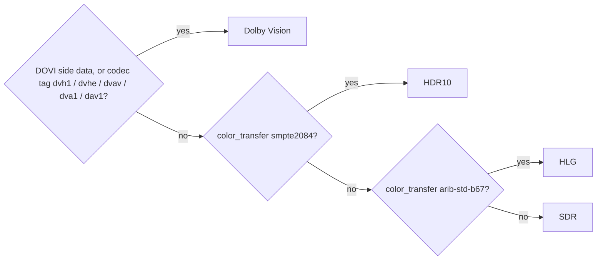
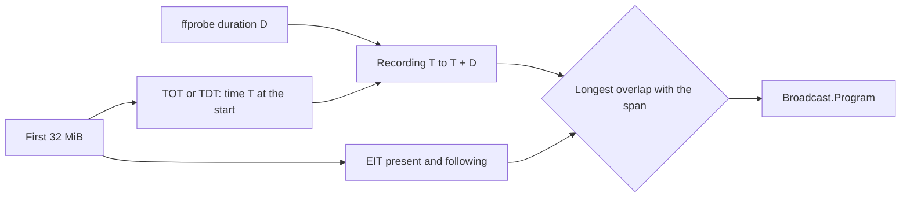
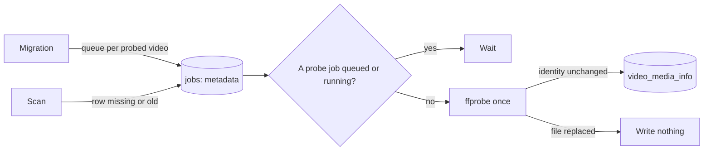

# Research: Media information from the import probe

Inherited decisions: the one `ffprobe` run per import and the values it keeps
are [`internal/media/probe.go`](../../internal/media/probe.go) and
[018 data-model](../018-live-transcode-seek/data-model.md); the job queue, one
worker per stage and the re-queue of a missing fingerprint are
[020 data-model](../020-seek-thumbnail-stage/data-model.md) and
[030 data-model, Fingerprints](../030-video-versions/data-model.md#fingerprints);
why nothing decodes the whole file is
[seek-sprite-generation.md](../../docs/design-docs/seek-sprite-generation.md).
This file records only the decisions this feature adds.

## R-1: Media information is one versioned JSON row per video

**Decision**: Everything this feature reads is stored as one JSON value per
video in a new index table, `video_media_info`, with a version column
([data-model.md](data-model.md)).

| Option | Read on the video page | Lists, sorting, filtering | Shape change | Verdict |
| --- | --- | --- | --- | --- |
| **One JSON row per video, versioned** | One row by `video_id` | Not needed (out of scope in the parent Issue) | Bump `MediaInfoVersion`; the old row reads as absent and is rebuilt | Chosen |
| Columns on `videos` | Already loaded | Available | About 30 nullable columns, read by every list query | Rejected: lists carry data no list shows, and every new item is a migration |
| Normalized tables (`video_streams`, `video_chapters`, `video_embedded_tags`) | Four queries | Available | Three migrations per shape change | Rejected: no query joins or filters on them, so the normalization buys nothing |

**Rationale**: The page reads the whole value at once and nothing else reads
it, so the shape of `video_transcode_probes` (one versioned JSON row, an index
that a probe rebuilds) fits. The version column is also what drives the
background re-analysis of [R-5](#r-5-imported-videos-are-re-analysed-by-a-metadata-job-that-yields-to-pending-probes):
a parser change bumps it, and every row below it is read again.

## R-2: The same ffprobe run reads chapters, and reads longer for MPEG-TS

**Decision**: The import's single `ffprobe` run adds `-show_chapters`, and for
a `.ts`, `.m2ts` or `.mts` file also `-analyzeduration 30M -probesize 100M`
(30 seconds, 100 MiB). No second process is started per item.

| Option | Verdict |
| --- | --- |
| **One run, `-show_chapters`, longer analysis for TS** | Chosen |
| A second `ffprobe` per item or per stream | Rejected: process start dominates the cost, as the comment on `Probe` records; a library of 10,000 videos would start 10,000 more processes |
| Longer analysis for every container | Rejected: an MP4 or MKV lists every stream in its header, so the longer limits change nothing there, while a TS is read up to the limits |
| Decoding frames for the items (peak brightness and the like) | Rejected: out of scope in the parent Issue, and [seek-sprite-generation.md](../../docs/design-docs/seek-sprite-generation.md) explains why import avoids decoding |

**Rationale**: `ffprobe` stops analysing a TS at 5 seconds or 5 MB by default,
and a second audio track or a caption stream of a broadcast recording can
send its first packet later than that, when the recording starts before the
programme does. 30 seconds covers the margin recorders add before the start,
and 100 MiB is 30 seconds of a 24 Mbps broadcast, so the two limits are
reached together. The read is bounded, and it happens once per file.

## R-3: HDR, projection, 3D and interlacing are decided by pure rules in `internal/domain`

**Decision**: `internal/media` passes the raw `ffprobe` values through and
`internal/domain` classifies them.

| Item | Rule |
| --- | --- |
| HDR kind | The diagram, in that order; a video with no colour information is SDR |
| 360-degree video | A `Spherical Mapping` entry in `side_data_list`; its `projection` value is kept |
| 3D | A `Stereo 3D` entry in `side_data_list`; its `type` value is kept |
| Interlaced | `field_order` `tt`, `bb`, `tb` or `bt` is interlaced; `progressive` is not; `unknown` or absent is omitted |
| Bit depth | `bits_per_raw_sample` when present, else the depth in `pix_fmt` (`yuv420p10le` is 10) |

| Option | Verdict |
| --- | --- |
| **Transfer characteristic and Dolby Vision signals** | Chosen |
| BT.2020 primaries or 10-bit depth as HDR | Rejected: a 10-bit BT.2020 SDR encode exists and would be shown as HDR |
| Reading the first frame's SEI for HDR10 metadata | Rejected: out of scope in the parent Issue |

**Rationale**: HDR10 and HLG are defined by their transfer function, which
every HDR encode signals in the container or the stream header, and Dolby
Vision is signalled by its configuration record. HDR10+ is HDR10 with dynamic
metadata and is shown as HDR10, which the parent Issue allows. The rules are
pure functions, so each case is a unit test with no process.

## R-4: Station and programme names of a TS recording come from a Go SI reader with an ARIB STD-B24 decoder

**Decision**: For a TS file the probe job also reads at most the first 32 MiB
of the file in Go, parses the PAT, the SDT (table 0x42), the EIT
present/following (table 0x4E, sections 0 and 1) of the first programme in the
PAT and the TOT or TDT (tables 0x73 and 0x70), and decodes the service name
and the event names with an ARIB STD-B24 8-bit character decoder in
`internal/media/arib`. Reading stops as soon as the service name, both events
and a time are found. The programme is the one of the two events that overlaps
the recording longest, not the present event at the start:

| Recording | Present event | Following event | Programme |
| --- | --- | --- | --- |
| 20:55 to 21:56 for a 21:00 to 21:54 drama | 20:00 to 21:00 news (5 minutes inside) | The drama (54 minutes inside) | The drama |
| 21:10 to 21:54, started late | The drama (44 minutes inside) | 21:54 next programme (none inside) | The drama |
| No TOT or TDT in the first 32 MiB | Any | Any | Absent: the start time is unknown, so the name is not guessed |

The choice is a pure rule in `internal/domain`
([data-model.md, Rules](data-model.md#rules)). A present event with an
undefined duration ends where the following event starts.

| Option | Station name | Programme name | Verdict |
| --- | --- | --- | --- |
| **Go SI reader with an ARIB decoder** | SDT, decoded | EIT present or following event, decoded and chosen by overlap | Chosen |
| The EIT present event at the start | Same as the chosen option | The programme before the recorded one, for a recording that starts before its programme | Rejected: recorders start a recording early, so the present event at the start is often the previous programme |
| `ffprobe -show_programs` | `service_name` as raw bytes: FFmpeg decodes the DVB character tables, not ARIB STD-B24, so a Japanese name is not readable | Not available: FFmpeg does not parse the EIT into metadata | Rejected: it meets neither half of requirement 5 |
| The EIT sections from `ffprobe -show_packets` of the `epg` data stream | Same as above | The same decoder would be needed on a far larger output | Rejected: the same work on more output |
| An external TS tool | Depends on the tool | Depends on the tool | Rejected: the container and the Windows app ship `ffmpeg` and `ffprobe` only |

**Rationale**: The SDT and the EIT present/following are repeated at least
every 2 seconds in a broadcast, and 2 seconds of a 24 Mbps stream is 6 MiB,
so 32 MiB finds them with room for a recording that opens with packets of
other tables; the TOT is sent every few seconds, and the
[quickstart](quickstart.md) row for `rec.ts` checks that it is inside the cap.
The present and following events at the start cover the recording's first
programme and the next one, which is the recorded programme whenever the
recording starts before it or inside it. The reader runs after `ffprobe`
under its own 10-second deadline, apart from the 30-second `probeTimeout` of
`ffprobe`, and a timeout or a read error omits the names and never fails the
probe. The decoder covers JIS X 0208 kanji and kana through
`golang.org/x/text/encoding/japanese`, JIS X 0201 katakana, and the ARIB
additional symbols (rows 85 to 94) from a table; it ignores the size and
position controls and drops a character it cannot map. A name with no
printable character after decoding is omitted. DVB (non-Japanese) recordings
are not decoded by this reader; their names are omitted.

## R-5: Imported videos are re-analysed by a `metadata` job that yields to pending probes

**Decision**: A new job kind, `metadata`, runs the same `media.Probe` and
writes only the `video_media_info` row. It is claimable only while no `probe`
job is queued or running for a video with a registered location, as a
`seek_thumbnail` job waits for `thumbnail` jobs (`NoClaimableThumbnail`), so a
running probe and a `metadata` run never read the disk at the same time. The migration queues one for every video whose probe is
done and that has a registered location; the scan queues one for a video whose
row is missing or below `MediaInfoVersion`, as it re-queues a missing
fingerprint. A new import never gets one, because its probe job writes the
row itself.

| Option | Verdict |
| --- | --- |
| **A `metadata` kind, claimable when no probe is queued or running** | Chosen |
| Re-queue the existing `probe` job with a priority column | Rejected: a probe that fails at the limit marks the video `failed`, which hides playback and the seek preview; the Edge Case keeps the existing information |
| A backfill goroutine started at startup | Rejected: no record of what was tried, a restart starts over, and it would run beside the probe worker on the same disk |
| A `media_info_version` column on `videos` | Rejected: the JSON row carries its version already; the scan's missing-row condition reads it as `FingerprintMissing` does |

**Rationale**: One worker per kind runs one `ffprobe` at a time, which reads
headers (and at most 100 MiB of a TS), so playback is not slowed. Yielding to
queued and running probes keeps a new import's own stages first, which is the
Edge Case's other half; the probe worker wakes the `metadata` worker when a
probe job leaves `running`, so the backfill resumes without waiting for a
poll. A failure at the limit leaves the row as it was, is
recorded as a `metadata_failed` issue when the video is in the latest scan's
set, and the next scan queues the job again. The `video` notification the job
sends on finish makes an open video page refetch, so the owner sees the
information appear without an action; a guest sees it on the next open.

## R-6: `mediaInfo` is part of the video detail only, for owners and guests alike

**Decision**: `GET /api/videos/{id}` carries `mediaInfo`
([contracts/screen-api.md](contracts/screen-api.md)); no list item carries
it, and a guest reading a public video gets the same value as the owner.

| Option | Verdict |
| --- | --- |
| **A field of the detail response** | Chosen |
| `GET /api/videos/{id}/media-info` | Rejected: one more request per page open, and the page already refetches the detail on the `video` notification, which is how the re-analysis result arrives |
| On every `Video`, lists included | Rejected: a JSON row per card for nothing a card shows; sorting and filtering by these items are out of scope |
| Omit the location and the device from guest responses | Rejected: requirement 8 treats them like the other items, and a public video is public as a whole |

**Rationale**: `workInfo` already follows this shape (detail only, owner
PUTs aside), so the server, the client and the tests have a pattern to copy.

## R-7: Chapters are a `chapters` text track with marks drawn in the video.js seek bar

**Decision**: The page builds a `chapters` text track from
`mediaInfo.chapters` and adds a cue per chapter; a component added to the
seek bar draws one mark per chapter start at `start / duration`; the seek
preview shows the title of the chapter under the pointer; video.js's
`ChaptersButton` in the control bar lists the titles and seeks to the chosen
one.

| Option | Verdict |
| --- | --- |
| **Text track, marks in the seek bar, the chapters button** | Chosen |
| The `videojs-markers` plugin | Rejected: last released for video.js 7 and unmaintained |
| A chapter strip of its own under the player | Rejected: two seek surfaces, and the parent Issue asks for the seek bar |
| A WebVTT chapters endpoint | Rejected: one more route and request for data the detail response holds |

**Rationale**: video.js's own chapters button and menu give the keyboard and
screen-reader behaviour for free, and the cues it reads are the same list the
marks and the preview use, so there is one source on the page. The
normalisation of a chapter list is a pure rule in `internal/domain`
([data-model.md, Rules](data-model.md#rules)): a chapter starting at or past
the duration is dropped and an end past the duration is cut, so the seek bar
never shows a mark past its end.

## R-8: Language codes are shown through `Intl.DisplayNames`

**Decision**: The API carries a track's language code as the file has it
(`jpn`, `eng`, `ja-JP`), and the page shows
`new Intl.DisplayNames([locale], { type: "language" }).of(code)`, which
canonicalises a three-letter code that has a two-letter equivalent; when the
call throws or returns the code unchanged, the code is shown as is, and
`und` is not shown.

| Option | Verdict |
| --- | --- |
| **`Intl.DisplayNames` on the page** | Chosen |
| A language table in the catalog | Rejected: hundreds of rows in two catalogs for names the browser already has |
| Names resolved on the server | Rejected: the server has no viewer locale, and the screen text is the page's ([i18n.md](../../docs/design-docs/i18n.md)) |

**Rationale**: Every browser the SPA supports has `Intl.DisplayNames`, and the
catalog keeps only the words the product defines.
