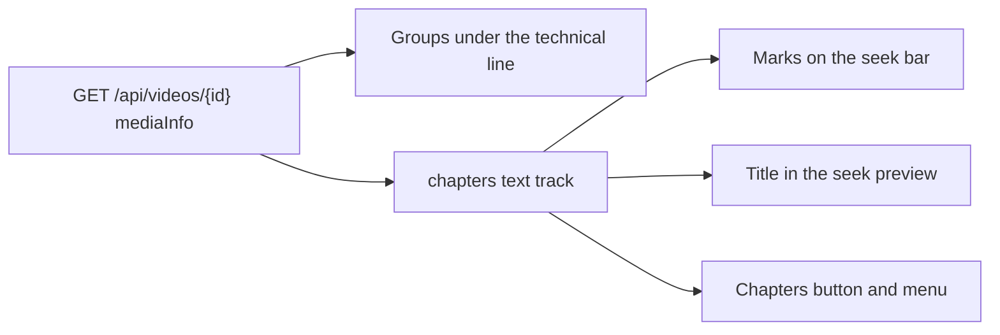
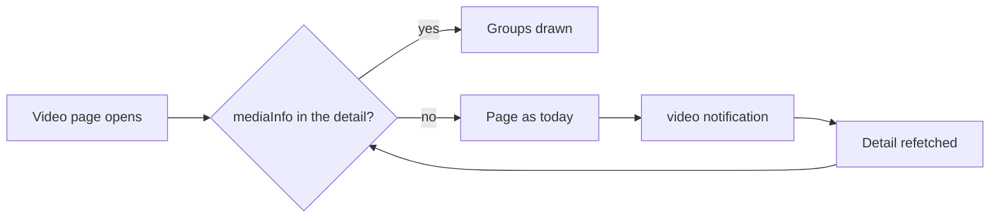
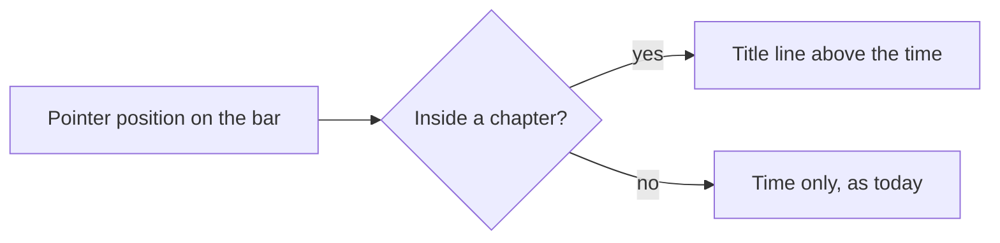

# UI design: Media information groups on the video page and chapters on the seek bar

**Feature**: [parent Issue #1227](https://github.com/syudead/vv/issues/1227) ·
[plan.md](plan.md) · [data-model.md, Stored value](data-model.md#stored-value-domainmediainfo) ·
[contracts/screen-api.md](contracts/screen-api.md) ·
[research.md R-6](research.md#r-6-mediainfo-is-part-of-the-video-detail-only-for-owners-and-guests-alike) ·
[R-7](research.md#r-7-chapters-are-a-chapters-text-track-with-marks-drawn-in-the-videojs-seek-bar) ·
[R-8](research.md#r-8-language-codes-are-shown-through-intldisplaynames)

Sources that already decide things, linked rather than repeated here:

| Topic | Source |
| --- | --- |
| Tokens, closed scales, the viewing density of the video page | [design-system.md, Foundations](../../docs/design-docs/design-system.md#foundations); the values in `@theme` of [`web/src/ui/tokens.css`](../../web/src/ui/tokens.css), named here and never copied |
| `Button`, `Popover`, `Badge`: what each is for | [components.md](../../web/registry/rules/components.md) |
| The video page's hierarchy (player > title > related videos > file information > technical information), the information rows, their right-hand action group | [012 UI design, Hierarchy and typography](../012-video-detail-ia/ui-design.md#hierarchy-and-typography), [Video facts](../012-video-detail-ia/ui-design.md#video-facts); [library-ui.md, Information rows](../../docs/design-docs/library-ui.md#information-rows); [`VideoFacts.tsx`](../../web/src/player/VideoFacts.tsx) |
| The work details row: `label value` items wrapping at the file row's gaps, long lists folded to three entries and `+{n} more`, a description folded to three lines | [047 UI design, Video page: work details row](../047-video-work-info/ui-design.md#video-page-work-details-row); [`WorkInfo.tsx`](../../web/src/player/WorkInfo.tsx) |
| The technical line: `text-xs uppercase tracking-wider`, muted, codecs in capitals (`formatCodec`) | [012 UI design, Hierarchy and typography](../012-video-detail-ia/ui-design.md#hierarchy-and-typography); [`properties.ts`](../../web/src/player/properties.ts) |
| The control bar's order and the box, text and menu of its menu buttons; Esc closing only the menu | [012 UI design, Control bar](../012-video-detail-ia/ui-design.md#control-bar); [027 UI design, Control bar: quality menu](../027-playback-quality/ui-design.md#control-bar-quality-menu); [library-ui.md, Control bar](../../docs/design-docs/library-ui.md#control-bar) |
| The subtitle button, which hides itself without tracks, and its menu | [028 research R-10](../028-sidecar-subtitles/research.md#r-10-subtitle-button-and-menu-use-videojs-subscapsbutton); [`subtitleMenu.ts`](../../web/src/player/subtitleMenu.ts) |
| The seek preview: the frame above the bar, its time pill, its width per player width, touch and pointer behaviour | [021 research](../021-seek-thumbnail-sprite/research.md); [`seekPreview.ts`](../../web/src/player/seekPreview.ts); the `.vv-seek-preview` rules in [`web/src/index.css`](../../web/src/index.css) and the `seek-preview-*` steps in `tokens.css` |
| Width breakpoints in CSS; layout checked by people on devices | [library-ui.md, Width breakpoints](../../docs/design-docs/library-ui.md#width-breakpoints-in-css-and-the-sidebar-exception), [Layout verified by people](../../docs/design-docs/library-ui.md#layout-verified-by-people-not-machines) |
| Screen text | [`web/src/i18n/en.ts`](../../web/src/i18n/en.ts) (`player.facts`, `player.workInfo`, `player.controls`); this feature adds `player.mediaInfo` and `player.chapters` |

This feature adds two things to the screens, for owners and guests alike
(R-6):

1. **Media information groups** under the technical line of the video page
   (`/videos/:id`): Video, Audio, Subtitles, Embedded and Broadcast, each
   drawn only when the file has an item for it (requirements 7 and 8,
   acceptance criteria 1 to 4, 6 and 7).
2. **Chapters on the player**: a mark per chapter on the seek bar, the
   chapter's title in the seek preview, and a chapters button in the control
   bar whose menu seeks to a chapter (requirement 9, acceptance criterion 5).

The diagram shows where each part sits.

Unchanged: the player's other controls, the title and tags, the visibility
toggle, the file facts (Length, Size, Added, Edited, Created), the work
details row, the technical line, cards and list rows (they carry no media
information, out of scope), and the title and the Created fact, which the
embedded title and the shooting time never replace (requirement 10). A video
without a `mediaInfo` value is pixel for pixel what it is today.

## Why this shape

**The groups are wrapping rows under the technical line, in the file row's
`text-sm` and gaps, with a small-capitals group name at the start of each.**
The Issue asks that the title, length and resolution stay primary and that
the additions read as secondary, group by group, in the spacing and type of
the existing information display. The information area already has that
form: the file row and the work details row wrap `label value` items at
`gap-x-4`, and the technical line is the last and most subdued row. The
groups continue that order downward: they come after the technical line
(plan, How it works), so the summary a glance needs (resolution, container,
codecs) stays where it is and the detail follows it. Each group name is set
like the technical line (`text-xs uppercase tracking-wider`, muted), so
`VIDEO`, `AUDIO` and `SUBTITLES` read as headings of the technical kind and
not as new facts. A `FactList` (one term and value per line) was rejected:
a TS recording with two audio tracks, a caption stream, a station and a
programme would be twelve lines tall, and the Issue rules out a listing that
buries the current information. A card or framed block was rejected by
[012](../012-video-detail-ia/ui-design.md#screen-boundary), which draws no
frame around details. A disclosure (`Details` closed by default) was
rejected: acceptance criteria 1 to 4 and 7 expect the HDR kind, the tracks,
the shooting information and the station to be seen on the page, and the
area has no control for reading today.

**The whole of a group is muted; values carry no label when their unit or
word says what they are.** The file facts are muted text with icons and no
labels, because `12:34` and `1.2 GB` explain themselves; the work details
are muted labels with body-colour values, because they are the owner's
content. The media information is the file's own description, below the
work details in importance, so every group stays `text-muted-foreground`,
and the Video, Audio and Subtitles items are bare words with units (`HDR10`,
`29.97 fps`, `10-bit`, `Stereo`, `Japanese`) rather than `label value` pairs,
which would double the item count. The Embedded and Broadcast items keep a
word label (`Title`, `Author`, `Station`), because a bare `NHK` or `John`
does not say what it is. Icons for the items were rejected: a frame rate,
a bit depth and an HDR kind have no glyph a viewer reads at `size-4`.

**A track is one item whose parts are joined by ` · `, numbered when the
group has two or more.** Acceptance criterion 2 is that every audio track
shows with its language; a viewer counts tracks by their numbers, and when
the row wraps, the number says where a track starts. One line per track was
rejected for the same reason the work details fold their lists: a remux may
carry 64 tracks, and the Issue keeps the area from growing tall. Instead a
group with more than six tracks shows six and `+{n} more`, the work details'
fold with a higher limit, because six tracks is what a disc remux commonly
carries and they fit on two lines at 1280px.

**Interlacing shows as the word `Interlaced` and only when the file says
so.** A progressive file is the norm; a `Progressive` item on nearly every
video would be noise, and a viewer who cares about interlacing looks for the
exception (a TS recording that combs). `Cover art` and `Closed captions`
follow the same rule: a word when true, nothing when false.

**Chapters are gaps in the seek bar, a title line in the seek preview, and a
menu button at the left end of the right-hand group.** The marks are drawn
in the player's dark surface (`navbar`) across the bar's height, the form
YouTube has made familiar: a chapter boundary looks like a break in the bar,
visible on the played (`primary`) and unplayed (`input`) parts alike. The
marks take no pointer events, so the bar under them seeks exactly as before
(`UI品質`: chapters never get in the way of seeking and playing). A viewer
learns a chapter's title where the time already is: the seek preview gains a
line with the chapter's title above the time, so hovering or scrubbing
across a mark names the chapter that starts there. The chapters button is a
video.js `ChaptersButton`, the same component family as the subtitle and
quality buttons, so it has their box, menu, keyboard handling and hiding
when there is nothing to list (R-7). It sits after the right-aligned spacer
and before the transcode indicator, nearest the time display, because it
navigates time; placing it between quality and speed was rejected because
027 pairs the indicator with quality and 028 keeps subtitles next to speed.
A chapter strip under the player and the plugin `videojs-markers` were
rejected in R-7. Showing the current chapter's title beside the time
display was rejected: at 360px the control bar has no room, and the preview
and the menu already name the chapter. A chapter list on the page was
rejected: requirement 7 names requirements 1 to 3 and 5 for the page, and a
second list of chapters would be a second seek surface.

## Words

The English is the draft the catalog takes; after implementation
[`web/src/i18n/en.ts`](../../web/src/i18n/en.ts) is canonical. Track titles,
embedded tags, station and programme names, device names and chapter titles
are user data and are embedded untranslated. Language names come from
`Intl.DisplayNames` (R-8) with the catalog's language (`en`); a code the
browser cannot name is shown as the code.

### Video page, groups

| Place | Text | Notes |
| --- | --- | --- |
| Group names | Video / Audio / Subtitles / Embedded / Broadcast | Visible, `text-xs uppercase tracking-wider`; each names its `ul` |
| HDR kind | SDR / HDR10 / HLG / Dolby Vision | From `hdr`; HDR10+ shows as HDR10 (R-3) |
| Frame rate | {rate} fps | Two decimals at most, trailing zeros dropped: `23.98 fps`, `30 fps`, `59.94 fps` |
| Bit depth | {n}-bit | `8-bit`, `10-bit` |
| Bit rate | {n} Mbps / {n} kbps | Mbps with one decimal (trailing zero dropped) at 1 Mbps and above, else kbps rounded: `12.3 Mbps`, `850 kbps` |
| Interlaced | Interlaced | Only when `interlaced` is `true`; nothing when `false` or absent |
| 360-degree video | 360° | When `projection` is present, whatever its value |
| 3D | 3D ({type}) | `type` is `stereo3d` as the file gives it: `3D (side by side)` |
| Track number | {n} | The first part of a track item when the group has two or more tracks; `1` upward in stream order |
| Audio codec | AAC / AC-3 / E-AC-3 / DTS / TrueHD / FLAC / Opus / MP3 / MP2 / PCM / Vorbis | A table for these `codec_name`s; any other through `formatCodec` (upper case) |
| Subtitle codec | SRT / ASS / SSA / PGS / DVD / WebVTT / MP4 text / ARIB / DVB / EIA-608 | `subrip`, `ass`, `ssa`, `hdmv_pgs_subtitle`, `dvd_subtitle`, `webvtt`, `mov_text`, `arib_caption`, `dvb_subtitle`, `eia_608`; any other through `formatCodec` |
| Channel layout | Mono / Stereo / {layout} / {n} ch | `mono` and `stereo` are catalog words; another layout as the file gives it (`5.1`, `7.1`); `{n} ch` when only the count is known |
| Track dispositions | Default / Forced / Hearing impaired | Each a part of the track item, in this order, after the title |
| Closed captions | Closed captions | An item of the Subtitles group when `video.closedCaptions` is `true` |
| Embedded labels | Title / Author / Comment / Description / Genre / Date / Recorded / Device / Location | `label value` items; `Date` is the file's text as stored, `Recorded` is `formatDateTime` of `recordedAt` in the viewer's zone, as the three date facts |
| Location value | {latitude}, {longitude} / {latitude}, {longitude} · {altitude} m | Four decimals, `tabular-nums`; the altitude rounded to a metre when present |
| Cover art | Cover art | A word item at the end of the Embedded group when `coverArt` is `true` |
| Broadcast labels | Station / Program | `label value` items |
| Folded tracks | +{n} more / Show fewer | `player.workInfo.more` and `showFewer`, reused; the `aria-label` `Show all {count} {group}` (`Show all 8 audio tracks`) |
| Folded comment or description | Show more / Show less | `player.workInfo.showMore` and `showLess`, reused |

### Player

| Place | Text | Notes |
| --- | --- | --- |
| Chapters button name, tooltip and menu title | Chapters | Through `playerDictionary()` (`Chapters`); no key |
| Menu item | {start} {title} | The start as `formatDuration` (`0:12`, `1:02:03`), `tabular-nums`, then the title |
| Untitled chapter | Chapter {n} | `n` is the chapter's position from 1 in start order; used in the menu and the preview |
| Seek preview title line | {title} | User data, one line, cut with an ellipsis at the preview's width |

## Video page: groups

The groups are drawn after the technical line in the information area
([library-ui.md, Information rows](../../docs/design-docs/library-ui.md#information-rows)),
so the area's `gap-3` separates them from the line and from one another. A
group is drawn only when it has at least one item; a video with a
`mediaInfo` value whose `video` object is present always has the Video group,
because `hdr` is always set (contracts). Chapters are not shown here; they
go to the player.

| Part | Form |
| --- | --- |
| Group | A `ul` with the file row's classes (`flex flex-wrap items-baseline gap-x-4 gap-y-2 text-sm sm:gap-x-5`), `text-muted-foreground` throughout. No divider, frame or icon |
| Group name | The first child of the row: `text-xs uppercase tracking-wider`, `lang="en"`, the technical line's form. It names the `ul` (`aria-labelledby`) |
| Word item | A `li` of one word or value (`HDR10`, `29.97 fps`, `Interlaced`, `Cover art`), `whitespace-nowrap`, `tabular-nums` for numbers |
| Labelled item | A `li` of label and value `gap-x-1.5` apart, both muted; the value `wrap-anywhere` so a long title or device name breaks inside itself and never scrolls the page |
| Track item | A `li` whose parts are joined by ` · ` in one text run: number (two or more tracks), codec, layout (audio), language name, title, `Default`, `Forced`, `Hearing impaired`; absent parts are skipped. `min-w-0 wrap-anywhere`: it breaks inside only when it alone is wider than the row |
| Comment, Description | Each a labelled paragraph under the Embedded row rather than an item in it: the label first, then the text `whitespace-pre-line max-w-prose`, folded to three lines with `Show more`, the work details' `Description` with a leading label and the muted tone |

The groups in order, and what each shows:

| Group | Items, in order | Absent when |
| --- | --- | --- |
| Video | HDR kind, frame rate, bit depth, bit rate, `Interlaced`, `360°`, `3D ({type})` | `video` absent |
| Audio | One track item per `audioTracks` entry, in stream order; more than six fold | `audioTracks` absent |
| Subtitles | One track item per `subtitleTracks` entry; `Closed captions` last | `subtitleTracks` absent and `closedCaptions` not `true` |
| Embedded | `Title`, `Author`, `Genre`, `Date`, `Recorded`, `Device`, `Location`, `Cover art`; then the `Comment` and `Description` paragraphs | `embedded` absent |
| Broadcast | `Station`, `Program` | `broadcast` absent |

Examples, as the rows read at 1280px:

| File | Rows |
| --- | --- |
| A phone clip | `VIDEO  SDR · 29.97 fps · 8-bit · 18.2 Mbps` / `AUDIO  AAC · Stereo` / `EMBEDDED  Recorded Sep 27, 2026, 3:04 PM · Device Apple iPhone 15 · Location 35.6895, 139.6917 · 40 m` (` · ` stands for the row's gap here) |
| `dual.mkv` from the quickstart | `AUDIO  1 · AAC · 5.1 · Japanese · Default   2 · AAC · Stereo · English` / `SUBTITLES  SRT · Japanese` |
| `rec.ts` | `VIDEO  SDR · 29.97 fps · 8-bit · 14.9 Mbps · Interlaced` / `AUDIO  1 · AAC · Stereo · Japanese   2 · AAC · Stereo · Japanese` / `SUBTITLES  ARIB · Japanese` / `BROADCAST  Station NHK総合 · Program {programme name}` |

A fold works as the work details' long lists: the first six track items,
then `+{n} more` as a `link` `sm` `Button` in the muted colour,
`hover:text-primary`, inside the row; pressing it shows every track in place
and moves the focus to the seventh; `Show fewer` folds again. Not remembered.

### States

The groups have no loading state of their own: `mediaInfo` arrives with the
video. The diagram shows when they appear.

| State | What the screen shows |
| --- | --- |
| No `mediaInfo` (imported before the feature, or row below the current version; existing videos are not re-analysed, [R-5](research.md#r-5-media-information-is-read-only-by-the-import-probe-of-new-or-changed-files)) | Nothing new; the file row, the work details and the technical line as today. No placeholder, no `Reading…` line: the technical line already says when the probe is pending or failed |
| `mediaInfo` arrives through a `video` notification while the page is open (owner) | The groups appear under the technical line in place; the rows above do not move or empty (acceptance criterion 6) |
| Some groups | Only those with content, in the fixed order |
| Guest | The same groups as the owner for a public video (R-6, requirement 8). A guest receives only the `group` notification ([048 contracts, `/api/events`](../048-groups/contracts/screen-api.md)), so a guest's open page does not refetch when the probe job finishes; the groups appear on the next load of the page or after the event stream reconnects. This feature adds no notification for guests |

## Player: chapters

The page builds a `chapters` text track from `mediaInfo.chapters`, one cue
per chapter from `startMs` to `endMs` with the title, or `Chapter {n}` when
untitled (R-7). The three parts below read that one track. A video without
chapters has no track, no marks and no button, and its player is as today
(acceptance criterion 5).

### Marks

| Aspect | Rule |
| --- | --- |
| Where | A mark per chapter on `.vjs-progress-holder` at `startMs / durationMs` of the bar's width, the first chapter's included (at `0` it sits on the bar's left edge, where it is unobtrusive, so the count of marks equals the count of chapters) |
| Form | The named step `chapter-mark` wide (2px), the bar's full height, colour `navbar`; it grows with the bar on hover as the bar does, and shows on the played and unplayed parts alike |
| Layering | Above the play-progress fill and below the seek preview and the slider's handle |
| Pointer | `pointer-events: none`; pressing, dragging and keyboard seeking on the bar are unchanged |
| Overlap | Two chapters with the same start draw one visible mark |
| Decoration | No label, number or colour per chapter |

Q-5: a mark cannot be operated. Its value is to show at a glance where the
chapters begin and how long each is. A viewer who takes it for a button and
presses it seeks to that position on the bar underneath, which is what the
press meant, so there is nothing to prevent.

### Seek preview title

The diagram shows how the preview names a chapter.

| Aspect | Rule |
| --- | --- |
| Which chapter | The one whose start is the latest at or before the position and whose end is after it; of chapters with the same start, the later in start order; with none, no title line. One shared function applies this rule, so the preview and the menu's selection (below) always name the same chapter |
| Form | A line inside the time pill above the time: the same `--text-seek-preview` size and `foreground` colour, centred, `white-space: nowrap`, cut with an ellipsis at the pill's width, which stops at the preview frame's width |
| Unavailable preview (sprite failed) | The pill alone, as today, with the title line above the time |
| No sprite URL (`seekThumbnailUrl` absent) | Today the player attaches no seek preview then. A video with chapters attaches it without a sprite, in the unavailable form from the start (the pill with the title line and the time, no frame, no sprite request); a video without chapters and without a sprite URL stays as today. When the URL arrives later, the preview is attached again with the sprite, as today |
| Touch | As the time: shown while the finger is down on the bar |

### Chapters button and menu

| Aspect | Rule |
| --- | --- |
| Place | After the right-aligned spacer and before the transcode indicator: spacer, **Chapters**, indicator, quality, subtitles, speed, PiP, fullscreen |
| Button | video.js `ChaptersButton` with its chapters icon, in the `.vjs-control` box the subtitle button has (`4em`, `3em` in the narrow container); hidden by video.js when there is no chapters track. No key, no `aria-keyshortcuts` |
| Menu | The video.js menu the subtitle and quality buttons use, `20em` wide (the quality menu's `10em` cuts a title short), the title `Chapters` as `vjs-menu-title`, one item per chapter in start order |
| Item | `{start} {title}`, left-aligned, one line, cut with an ellipsis at the menu's width. video.js's `ChaptersTrackMenuItem` labels an item with `cue.text` alone, and the cue text stays the title because the seek preview reads it; so the button is a `ChaptersButton` subclass whose items are a `ChaptersTrackMenuItem` subclass that builds the label from the cue's `startTime` (`formatDuration`) and its text |
| Selected item | The chapter playing now carries `vjs-selected`, moving as playback crosses a boundary. It is chosen by the seek preview's rule applied to the current time (the latest start, the later of equal starts), not by video.js's `activeCues[0]`, which names the earlier of overlapping chapters (data-model.md keeps overlaps); so the menu and the preview never disagree |
| Choosing | Seeks to the chapter's start, keeps playing or paused as it was, closes the menu |
| Many chapters | The list scrolls inside the menu, as a long subtitle list does; 1,000 chapters open without delay |
| Keys and Esc | As the quality menu: Tab, Enter or Space, arrows, Enter; Esc closes only the menu |
| Touch | The button opens and closes; an item chooses |

## Responsive behaviour

Only Tailwind's default breakpoints are used, switched in CSS. The widths
judged are 360px, 768px and 1280px (1280×820 for the two-column layout),
with the player at the width the page gives it at each.

| Width | Groups | Player |
| --- | --- | --- |
| 1280px | Under the technical line in the left column, each group one or two lines; `dual.mkv` takes two rows; the rows are reached by scrolling the column, and the file row and the action group stay at the top of the area | Marks 2px on a bar about the column's width; the preview with the title line at `--size-seek-preview-max`; the chapters menu opens upward at `20em` |
| 768px | As 1280px in the stacked layout; a group with three tracks wraps to two lines before the next group | The player edge to edge; the preview per its clamp; the control bar at its full `4em` boxes |
| 360px | Each group wraps item by item with `gap-x-4`; a track item wider than the row breaks inside itself; no horizontal scroll with a 2,000-character embedded title or a 64-track file folded to six; the group name stays on the first line of its row with the first item beside it when it fits | The narrow container: `3em` boxes; with the transcode indicator, subtitles and chapters all present the bar keeps every button inside the frame, narrowing the indicator's and the time display's padding before anything else and hiding no button; the preview's title line truncates at the narrower frame; the menu at `20em` fits inside the player |

## Review criteria

Judged by looking at the running screen in vv's one dark scheme
(library-ui.md, Layout verified by people). "It exists" alone does not pass
(Q-4).

1. **Visual hierarchy (page)**: the eye still goes player → title → tags →
   file facts → work details → technical line, and only then to the groups;
   on a page with every group the title, the length and the resolution are
   found as fast as on a page with none (`UI品質`: the main information
   stays the lead). The group names read as small headings of the technical
   kind, the same weight as the technical line, and no group item is darker
   or larger than a file fact.
2. **Groups read apart**: a viewer says without reading values which row is
   about the picture, the sound, the subtitles, the embedded tags and the
   broadcast; the `rec.ts` page tells `Station` from `Program` and the
   second audio track from the first by their numbers (acceptance criteria 2
   and 7).
3. **Information density**: a phone clip adds three rows and a TS recording
   five, none taller than two lines at 1280px; a video with one audio track
   and no subtitles shows no `Subtitles` row, no empty label and no `—`
   (`UI品質`: no blanks on a video with few items; acceptance criterion 3);
   an 8-track file shows six and `+2 more`; a 2,000-character description is
   three lines and `Show more`. The action group at the right end of the
   file row keeps its place at every width, and a video without
   `mediaInfo` is unchanged in every pixel of the rows.
4. **Spacing rhythm**: the gaps between items equal the file row's (`gap-x-4`,
   `gap-x-5` from `sm`); the area's `gap-3` separates the technical line,
   each group and the paragraphs; the group name sits on the items'
   baseline, and at 360px the wrapped lines of a group start at the row's
   left edge, under the group name, with no indent.
5. **Typography**: group names are the technical line's `text-xs uppercase
   tracking-wider`; items are the file row's `text-sm` muted colour; numbers
   (`29.97 fps`, `10-bit`, `12.3 Mbps`, `35.6895, 139.6917`, the track
   numbers) are `tabular-nums`; codecs are in capitals as on the technical
   line (`AAC`, `SRT`, `ARIB`); the HDR kind reads `HDR10`, `HLG`, `Dolby
   Vision` or `SDR` exactly (acceptance criterion 1); a language is a name,
   `Japanese` and `English`, never `jpn` (acceptance criterion 2), and an
   `und` track shows no language part.
6. **Values**: a phone clip shows `Recorded` with the date and time, `Device`
   with make and model, and `Location` with two four-decimal coordinates,
   while its title, Created and Added facts and its list card are as before
   the feature (acceptance criterion 4, requirement 10); a 10-bit HLG file
   shows `HLG · 10-bit`; a TS recording shows `Interlaced` and its station
   (acceptance criterion 7).
7. **Appearing by itself**: a video page the owner opened before the
   probe of a new or changed file finishes gains the groups under the
   technical line without a reload and without the rows above moving or
   emptying. Videos imported before the feature are not re-analysed (R-5).
8. **Action priority (player)**: on `chapters.mkv`, pressing and dragging
   the seek bar, pressing a mark, Space, F and M behave as on a video
   without chapters; the marks are thin breaks that do not draw the eye
   before the play-progress fill and the handle (`UI品質`: chapters do not
   get in the way of seeking and playing). The chapters button is one more
   muted box in the right-hand group, no larger or brighter than the
   subtitle button, and absent on a video without chapters.
9. **Chapter title**: hovering a mark shows the preview with the title of
   the chapter that starts there above the time; moving across a boundary
   changes the title at the mark; a position before the first chapter or
   after the last shows the time alone; a video with chapters and no seek
   sprite shows the same title above the time in the pill (acceptance
   criterion 5).
10. **Chapter menu**: the menu lists every chapter as `{start} {title}` in
    order, the playing one marked, and inside overlapping chapters the
    marked item is the chapter the preview names at that time; choosing
    one plays from its start and keeps the playing or paused state; an untitled chapter reads
    `Chapter 3`; a title wider than the menu ends with an ellipsis and the
    menu's width does not change; a chapter ending past the duration shows
    a mark and an item and its cue ends at the duration (quickstart,
    Edge Case: chapters past the duration).
11. **Phone width (player)**: at 360px with `chapters.mkv` playing through
    transcoding with a subtitle track, every control bar button is inside
    the frame and the fullscreen button is not clipped; the preview's title
    line is one line with an ellipsis; the menu opens inside the player.
12. **Guest**: signed out, a public `dual.mkv` shows the same `Audio` and
    `Subtitles` rows as for the owner, and a public `chapters.mkv` the same
    marks, preview title and menu.
13. **Examples that do not meet the requirement** (`UI品質`): the groups are
    a framed card, a table or a term-and-value list one item per line; they
    sit above the technical line or above the file facts; a group name is
    `text-sm` or body-coloured; items carry icons; the Video row shows
    `Progressive` on every file, or `Subtitles` with `None`; an empty video
    shows a `No media information` line or a spinner; the groups are behind
    a disclosure; the embedded title replaces the page title or the shooting
    time replaces Created; the marks are coloured, labelled or catch the
    pointer; the chapters button sits between quality and speed or shows on
    a video without chapters; the chapter title is drawn beside the time
    display in the control bar; the menu lists titles without their start
    times; at 360px a control bar button is hidden or clipped.

## Changes to the design system

No component, pattern or rule is added. `tokens.css` gains one named step,
`chapter-mark` (2px), beside the `seek-preview-*` steps of the player's
special section, because the mark's width is a value the spacing scale lacks;
the marks and the menu width live in `index.css` under the existing
`.vv-video-player` rules, as the quality menu's `10em` does. No colour token
is added and nothing is added to `pairs` in `web/src/theme/tokens.test.ts`:
the groups use `muted-foreground` on `background`, which is listed, and the
marks and the preview line are not text pairs. The work details' `ListItem`
takes its fold limit as a parameter and its `Description` takes a leading
label and the muted tone, so no code is copied (AGENTS.md). The icon is
video.js's own chapters icon.

## Accessibility

The parent Issue does not ask for screen reader or contrast design, so only
names are decided, as in 033 and 047.

- Each group's `ul` is named by its visible group name; a track item is one
  text run, read as `1 · AAC · Stereo · Japanese · Default`; a labelled item's
  label is visible text, so no hidden name is needed; the fold control is
  `Show all {count} {group}` while folded.
- The chapters button is `Chapters`, its menu title `Chapters`, each item its
  `{start} {title}` text with video.js's `, selected` suffix on the playing
  one; the marks are `aria-hidden`, as the seek preview is, because the
  menu lists the same chapters.
