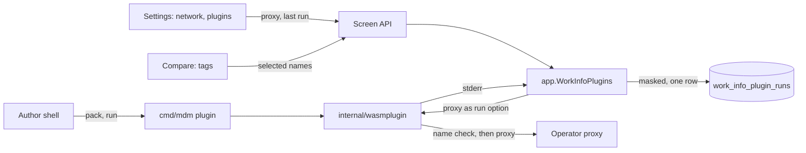
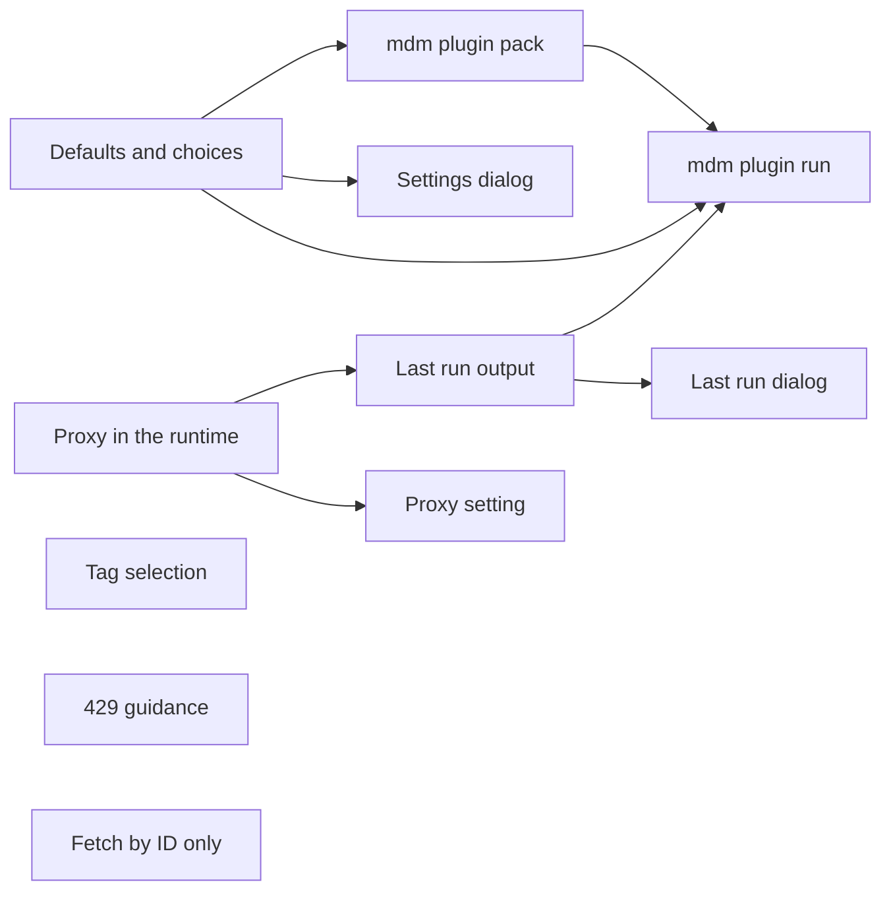

# Implementation Plan: Work-info plugin tooling for authors, operators and users

**Branch**: `feature/056-plugin-tooling` | **Parent Issue**: #1232

**Input**: The parent Issue. It is this feature's specification.

## Summary

Plugin authors get two host commands in the `mdm` binary: `mdm plugin pack`
checks a manifest and writes it into the module, and `mdm plugin run` runs the
module locally with the server's runtime and limits. The manifest's settings
gain a `default` and `options`, which the settings dialog shows and the run
receives when the owner entered nothing. Operators set a proxy for plugin
requests in the Network section; VVMDM still refuses a destination that
resolves to a non-public address, and keeps each plugin's last run's standard
error, with secret values masked, for the settings screen. On the comparison,
the owner picks the fetched tags one by one. The plugin contract stays
version 1.

The diagram shows the parts this feature adds or changes and what flows
between them.



| Concern | Approach |
| --- | --- |
| Local run and pack | Subcommands of `mdm` sharing the runtime and the parser; no database ([R-1](research.md#r-1-mdm-plugin-run-and-mdm-plugin-pack-reuse-the-servers-runtime-and-parser-and-open-no-database), [R-2](research.md#r-2-pack-replaces-the-vvplugin-section-and-writes-the-file-only-after-the-packed-module-passes-inspection), [contracts/plugin-cli.md](contracts/plugin-cli.md)) |
| Defaults and choices | `default` and `options` in the manifest; the effective value computed in `internal/domain` ([R-3](research.md#r-3-a-setting-declares-default-and-options-the-stored-value-or-the-default-is-what-the-run-receives), [contracts/plugin-contract.md](contracts/plugin-contract.md)) |
| Proxy | One `settings` row, read per run, passed to the runtime; destination names resolved and checked before each request and redirect ([R-4](research.md#r-4-the-proxy-is-one-url-in-settings-read-on-each-run-and-passed-to-the-runtime-as-a-run-option), [R-5](research.md#r-5-through-a-proxy-the-destination-is-checked-by-resolving-its-name-before-each-request-and-redirect)) |
| Last run's output | Returned by the runtime, masked by the app, one row per plugin bound to the generation and written in the order the runs end ([R-6](research.md#r-6-the-runtime-returns-each-runs-standard-error-and-the-app-keeps-the-last-one-per-plugin-with-the-secret-values-masked), [data-model.md](data-model.md)) |
| Tag selection | `tags` beside `fields` in the apply; tags on the video not selectable ([R-7](research.md#r-7-the-apply-takes-the-selected-tag-names-and-a-tag-already-on-the-video-is-not-selectable), [contracts/screen-api.md](contracts/screen-api.md)) |
| Where the proxy is set | The Network section on every build; the LAN switch stays desktop only ([R-8](research.md#r-8-the-network-section-shows-on-every-build-and-the-lan-switch-stays-desktop-only)) |
| `429` guidance | One retry after at most 5 s within 10 s of waits per run, then an error response ([R-9](research.md#r-9-on-a-429-a-plugin-waits-for-the-smaller-of-retry-after-and-5-seconds-retries-once-and-otherwise-reports-an-error)) |
| Fetch by ID only | The fetch request, the screen API and `mdm plugin run` carry a work ID and no URL, and each candidate carries the ID it is fetched by beside its page URL, which is only a link; the owner's text is the ID unchanged ([R-10](research.md#r-10-a-fetch-takes-a-work-id-only-and-vvmdm-never-fetches-a-url-the-owner-typed), [contracts/plugin-contract.md](contracts/plugin-contract.md), [contracts/plugin-cli.md](contracts/plugin-cli.md)) |

Requirements 14 to 16 were added to the parent Issue after the integration PR
was open. They revise the fetch input of
[049 screen-api.md](../049-work-info-plugins/contracts/screen-api.md) and
[049 ui-design.md](../049-work-info-plugins/ui-design.md), which this Plan's
last unit updates in place, since they are the living references the code
cites.

The Issue has the `ui` label, so the `design` stage writes `ui-design.md`
before the four screen units. It covers: in the settings dialog of
[049 ui-design.md, Settings dialog](../049-work-info-plugins/ui-design.md#settings-dialog),
how a default is shown apart from an entered value, the field for a setting
with options, and the note for a stale value; the proxy row of the Network
section in the form of the LAN switch row; the last-run output on the plugin
row and its dialog, with the empty, truncated and failed states and a long
output that keeps the layout; and on the comparison of
[049 ui-design.md, Compare](../049-work-info-plugins/ui-design.md#compare),
selecting tags one by one with the row's checkbox as select-all, the initial
selection, the not-selectable mark for a tag on the video, and a list of 25
or more tags that can be seen whole, within the Issue's `UI品質`.

Out of scope, as the parent Issue's `対象外` says: changing the default
`User-Agent`; VVMDM retrying a `429` for the plugin; a history of runs before
the last one; distributing or sharing plugins.

## Technical Context

**Canonical definitions**:

| Topic | Source |
| --- | --- |
| Boundaries, composition root, store roles, user data | [ARCHITECTURE.md](../../ARCHITECTURE.md) |
| Plugin sandbox, limits, network client, run and apply | [work-info-plugins.md](../../docs/design-docs/work-info-plugins.md), [049 research](../049-work-info-plugins/research.md), [internal/wasmplugin](../../internal/wasmplugin), [internal/app/work_info_fetch.go](../../internal/app/work_info_fetch.go) |
| Plugin contract for authors | [work-info-plugins.md (how-to)](../../docs/how-to/work-info-plugins.md) |
| Host commands of `mdm` | [016 account-cli.md](../016-single-account-auth/contracts/account-cli.md), [cmd/mdm/account.go](../../cmd/mdm/account.go) |
| Settings rows, the Network section and its API | [internal/store/settings.go](../../internal/store/settings.go), [037 network-settings-api.md](../037-windows-app/contracts/network-settings-api.md), [web/src/settings/NetworkSection.tsx](../../web/src/settings/NetworkSection.tsx) |
| Plugin rows, setting values, the fixture build helper | [049 data-model.md](../049-work-info-plugins/data-model.md), [internal/store/work_info_plugins.go](../../internal/store/work_info_plugins.go), [internal/wasmplugin/plugintest](../../internal/wasmplugin/plugintest) |
| Screen API, errors, generated code | [api/openapi.yaml](../../api/openapi.yaml), [023 error-api](../023-english-i18n/contracts/error-api.md), `task generate` |
| Settings dialog, fetch dialog, screen rules, Web tests | [web/src/settings/WorkInfoPluginSettingsDialog.tsx](../../web/src/settings/WorkInfoPluginSettingsDialog.tsx), [web/src/player/workInfoFetch/](../../web/src/player/workInfoFetch/), [design-system.md](../../docs/design-docs/design-system.md), [web-testing.md](../../docs/design-docs/web-testing.md) |
| Browser test and its fixture plugin | `web/e2e/work-info-plugins.e2e.ts` (since removed), `internal/wasmplugin/testdata/e2eworks/` (since removed) |
| Checks | [Taskfile.yml](../../Taskfile.yml) (`task check`, `task check-docs`) |

**Feature-specific context**:

- No new dependency. One migration, `00054_work_info_plugin_runs.sql`
  ([data-model.md, Migration](data-model.md#migration)).
- `WorkInfoPluginRuntime.Run` changes shape twice in this feature: it takes
  the proxy as `domain.WorkInfoRunNetwork` and returns the kept standard
  error beside the result. The two units that change it are ordered so each
  changes the signature once.
- The proxy tests run against a proxy the test starts on loopback, with the
  address rule's `local` function injected as the existing network tests do,
  so CI needs no internet. What CI cannot cover is in
  [quickstart.md](quickstart.md).
- PR #1233 (open against `main`) adds a `lookup` operation to the contract.
  `mdm plugin run` takes the operation as an argument and validates it against
  the manifest, so it needs no change of shape when that PR lands; the
  implementation of the command adds `lookup`'s input rule if the PR has
  merged by then.
- `internal/domain` imports no `os`, so the file reading and writing of the
  two commands stays in `cmd/mdm`, and the section rewriting in
  `internal/wasmplugin`.

## Constitution Check

| Rule (source) | Verdict |
| --- | --- |
| Imports point from `cmd` through `internal/app` and the adapters to `internal/domain`; adapters import neither each other nor `internal/app` (ARCHITECTURE.md, depguard) | Pass: `cmd/mdm` calls `internal/wasmplugin` and `internal/domain` directly for the commands, as `mdm account` calls `internal/store`; the runtime keeps importing only `internal/domain` |
| `cmd/mdm` holds no use case of its own (ARCHITECTURE.md) | Pass with a judgement: `pack` and `run` are host commands over the adapter and the domain rules, like `mdm account` over the store; the request assembly and the effective-value rule they need live in `internal/domain`, shared with `internal/app` |
| Store roles; one role per operation (ARCHITECTURE.md) | Pass: the run row and its deletion on replacement belong to `WorkInfoPluginStore`; the proxy row to `SettingsStore` |
| User data survives a rebuild (ARCHITECTURE.md) | Pass: `work_info_plugin_runs` hangs off `work_info_plugins`, which carries no link to `videos`; the proxy is a `settings` row |
| Every read knows its viewer (ARCHITECTURE.md) | Pass: every new route is owner only and absent from `accessRoutes` |
| Only `internal/wasmplugin` reaches addresses a plugin chooses (ARCHITECTURE.md, work-info-plugins.md) | Pass: the proxy support and the name check stay inside the adapter's client; the ComfyUI and Ollama clients are untouched |
| Do not hand-edit generated files (AGENTS.md) | Pass: `api/openapi.yaml` changes, then `task generate` |
| Complexity 25 or less; share code instead of copying it (AGENTS.md) | Pass: the custom-section writer moves out of `plugintest` and is shared by the command and the tests; the effective-value rule is one domain function used by the app, the entry and the CLI; the proxy URL rule is one domain function used by the API and the CLI |
| Read design-system.md before a screen; test at the lowest level (AGENTS.md, web-testing.md) | Pass: manifest rules, the effective value, the URL rule and the masking get Go unit tests; the proxy client and the stderr return get adapter tests; the routes handler tests; the dialogs page tests; the tag selection the existing browser test extended |
| Documentation with the change (AGENTS.md, core-beliefs.md) | Pass: each unit names the guide or design document section it changes, and the translator runs in the same PR |

No violation, so no complexity tracking. The verdicts hold after Phase 1.

## Project Structure

### Documentation (this feature)

```text
specs/056-plugin-tooling/
├── plan.md
├── research.md
├── data-model.md
├── quickstart.md
└── contracts/
    ├── plugin-cli.md
    ├── plugin-contract.md
    └── screen-api.md
```

`ui-design.md` is written by the `design` stage. `quickstart.md` exists
because CI reaches no real proxy or site and does not run the Windows app.

### Source Code

**Affected boundaries**:

| Boundary | What it owns in this feature |
| --- | --- |
| `internal/domain` | The manifest's `default` and `options` rules; the effective value and the stale value of a setting; the proxy URL rule; `WorkInfoRunNetwork`; the run log type; masking of secret values; the selected tag names in the apply |
| `internal/wasmplugin` | The exported section writer; the proxy in the client with the name check in the `Proxy` callback and the `407`/`CONNECT` mapping; `Run` returning the kept standard error |
| `internal/store` | The migration and `work_info_plugin_runs` on `WorkInfoPluginStore`, deleted on replacement; the proxy row on `SettingsStore` |
| `internal/app` | Reading the proxy per run; masking and saving the run log; filtering the apply's tags by the selection; the proxy settings use case |
| `internal/httpapi`, `api/openapi.yaml` | The entry fields, the last-run route, the proxy route, `tags` in the apply |
| `cmd/mdm` | `mdm plugin pack` and `mdm plugin run` beside `mdm account` |
| `web/src/api`, `web/src/settings`, `web/src/player/workInfoFetch`, `web/src/i18n` | The client functions and types; the dialog with defaults and options, the last-run dialog, the proxy row; the tag selection; the catalog text |
| `web/e2e`, `internal/wasmplugin/testdata/e2eworks` | The browser test with a deselected tag, a defaulted setting and the last-run output; the fixture writing to standard error |
| `docs/`, `ARCHITECTURE.md` | The authors' guide (pack, run, manifest fields, standard error, `429`, proxy), the design document (network and run sections), running-vv.md's recovery table, the subsystem row |

**New paths**: `cmd/mdm/plugin.go`,
`internal/store/migrations/00054_work_info_plugin_runs.sql`,
`web/src/settings/WorkInfoPluginRunDialog.tsx`.

**Structure decision**: The commands live in `cmd/mdm`, not in a package of
their own, because `mdm account` already lives there and the commands are the
composition of two existing packages
([R-1](research.md#r-1-mdm-plugin-run-and-mdm-plugin-pack-reuse-the-servers-runtime-and-parser-and-open-no-database)).
The proxy is a parameter of each run rather than state of the runtime
([R-4](research.md#r-4-the-proxy-is-one-url-in-settings-read-on-each-run-and-passed-to-the-runtime-as-a-run-option)),
so the runtime has one less owner setting to hold and the command and the
server call the same `Run`.

## Implementation Work

The diagram shows which units have to land first. The four screen units also
wait for the `design` stage's `ui-design.md`.



### Declare default values and choices for work-info plugin settings

**Scope**: `default` and `options` on `domain.WorkInfoPluginSetting` with the
rules of [contracts/plugin-contract.md, Manifest](contracts/plugin-contract.md#manifest);
the effective value and `staleValue` in `Entry`, in the request's `settings`
and in the `required` check
([R-3](research.md#r-3-a-setting-declares-default-and-options-the-stored-value-or-the-default-is-what-the-run-receives));
`WorkInfoPluginSetting` in `api/openapi.yaml` and the client type
([contracts/screen-api.md](contracts/screen-api.md#workinfopluginsetting));
the `Manifest` and `Request` sections of the authors' guide.

**Dependencies**: None.

**Acceptance**: `task check` and `task check-docs` pass with no diff from
`task generate`; domain tests show a manifest with a default outside its
options, one option, 51 options, a 201-character option, a repeated option
and a secret setting with a default each refused as `manifest_invalid`, and
one with a valid default and options accepted; a run request carrying the
default for an unset key, the stored value for a set key, and the default for
a stored value outside the options; a required key with a default not
reported missing; app tests show the entry of a stored value outside the
options with `set: true`, its `value` and `staleValue`; handler tests show `default`,
`options` and `staleValue` in the list body.

### Write and check a plugin manifest with mdm plugin pack

**Scope**: An exported function in `internal/wasmplugin` that replaces or
adds the `vv.plugin` section, used by `plugintest` and the browser test's
fixture build instead of their own copy; `mdm plugin pack` in `cmd/mdm` with
the inspection, the reason for a refused manifest (the field and the rule,
added to the domain parser's result for the command's use) and the atomic
write of [contracts/plugin-cli.md](contracts/plugin-cli.md#mdm-plugin-pack-modulewasm-manifestjson)
([R-2](research.md#r-2-pack-replaces-the-vvplugin-section-and-writes-the-file-only-after-the-packed-module-passes-inspection));
the guide's steps 5 and 6 replaced by one `pack` step and the
`Troubleshooting` rows that named `addsection` updated.

**Dependencies**: Declare default values and choices for work-info plugin
settings.

**Acceptance**: `task check` and `task check-docs` pass; adapter tests show
the writer adding a section to a module without one and replacing the
existing one, with wazero reading the new manifest; command tests show a
valid manifest written and the module then accepted by `Inspect` and
`Upload`, a manifest with a default outside its options refused with exit 2,
a message naming `default` and the file's bytes unchanged, a module that
imports an unsupported function refused with `import_unsupported` and the
file unchanged, `pack` run twice yielding one section, and a missing
argument answered with usage and exit 2.

### Send work-info plugin requests through an operator-chosen proxy while refusing non-public destinations

**Scope**: `domain.WorkInfoRunNetwork` and `ParseWorkInfoPluginProxyURL`;
`WorkInfoPluginRuntime.Run` taking the network options, with
`app.WorkInfoPlugins` passing none yet; in `internal/wasmplugin`, the proxy
on the transport per run, the destination name resolved and checked in the
`Proxy` callback for each request and redirect, and the `-3` and proxy-host
mapping of a proxy that is unreachable, refuses `CONNECT` or answers `407`
([R-5](research.md#r-5-through-a-proxy-the-destination-is-checked-by-resolving-its-name-before-each-request-and-redirect));
the network section of `docs/design-docs/work-info-plugins.md` with the
residual risk, and the `Addresses` section of the guide.

**Dependencies**: None.

**Acceptance**: `task check` and `task check-docs` pass; domain tests show
`http`, `https` and `socks5` URLs with and without user information accepted,
and a URL with a path, an `ftp` scheme, no host or over 2048 characters
refused; adapter tests with a proxy started on loopback and an injected
resolver show a plugin's request reaching the site through the proxy (the
proxy saw it), a destination name that resolves to a LAN address refused
with `blocked_address` and that name before the proxy saw a request, a
redirect to such a name refused the same way, a literal LAN address refused,
a proxy that is not listening and one answering `407` each making the run fail
with `network_error` and the proxy's host, and a run without a proxy
unchanged in behaviour.

### Keep the last run's standard error per work-info plugin

**Scope**: `Run` returning the kept standard error and its truncation flag on
success and on failure; the migration and `work_info_plugin_runs` on
`WorkInfoPluginStore`, written in the runtime's `record` call only for the
generation that ran and deleted by a replacing upload ([data-model.md](data-model.md)); masking of the run's
secret values and the save in `app.WorkInfoPlugins`
([R-6](research.md#r-6-the-runtime-returns-each-runs-standard-error-and-the-app-keeps-the-last-one-per-plugin-with-the-secret-values-masked));
`lastRunAt` on the entry and `GET /api/work-info-plugins/{id}/last-run`
([contracts/screen-api.md](contracts/screen-api.md#get-apiwork-info-pluginsidlast-run));
the client function; the run section of the design document; the recovery
table of running-vv.md.

**Dependencies**: Send work-info plugin requests through an operator-chosen
proxy while refusing non-public destinations.

**Acceptance**: `task check` and `task check-docs` pass with no diff from
`task generate`; adapter tests show the standard error returned for a
successful run, a run that timed out and a run that failed, and a 100 KiB
output returned as 64 KiB with the flag; an adapter test shows `record`
called before a second run can start; domain tests show a secret value
appearing twice replaced twice, a non-secret value left, an empty secret not
matched, and a truncated output ending in the first bytes of a secret with
those bytes masked; store and app tests show the row replaced by a second
run, a replacing upload leaving no row, a run whose plugin was replaced (with
the same bytes too) or deleted before the save writing nothing, and
`lastRunAt` in the list; handler tests
show the route's body for a kept run, `{}` with no run, `404` for an unknown
plugin and `401` for a guest.

### Run a work-info plugin locally with mdm plugin run

**Scope**: `mdm plugin run` in `cmd/mdm` as
[contracts/plugin-cli.md](contracts/plugin-cli.md#mdm-plugin-run-modulewasm-operation-input---set-keyvalue---proxy-url)
specifies: inspection, the request from the operation, its input and the
effective setting values, `--proxy`, the kept result as indented JSON, the
plugin's standard error and the failure line, and the exit codes
([R-1](research.md#r-1-mdm-plugin-run-and-mdm-plugin-pack-reuse-the-servers-runtime-and-parser-and-open-no-database));
a `run` step and a `Check the result` paragraph in the guide; the
`cmd/mdm` sentence of ARCHITECTURE.md's composition root naming the host
commands.

**Dependencies**: Declare default values and choices for work-info plugin
settings; Write and check a plugin manifest with mdm plugin pack; Keep the
last run's standard error per work-info plugin.

**Acceptance**: `task check` and `task check-docs` pass; command tests with
fixture plugins and a site on loopback with an injected resolver show a
`fetch` printing the kept `workInfo` with a line the plugin wrote on
standard error, a plugin that sleeps past the limit exiting 1 with
`timed_out`, a request to `127.0.0.1` exiting 1 with `blocked_address` and
the host, a module without a manifest exiting 2 with `manifest_missing`, an
undeclared `--set` key and a missing required key each exiting 2 with the
key, a request carrying a default for an unset key, a run through `--proxy`
seen by a loopback proxy, and `search` with a 201-character query exiting 2.

### Set the work-info plugin proxy in the network settings

**Scope**: The `settings` row on `SettingsStore`; a use case in `internal/app`
that validates and saves the URL and that `app.WorkInfoPlugins` reads before
each run ([R-4](research.md#r-4-the-proxy-is-one-url-in-settings-read-on-each-run-and-passed-to-the-runtime-as-a-run-option));
`GET` and `PUT /api/settings/plugin-proxy`
([contracts/screen-api.md](contracts/screen-api.md#get-and-put-apisettingsplugin-proxy));
the proxy row in `NetworkSection`, shown on every build as `ui-design.md`
specifies ([R-8](research.md#r-8-the-network-section-shows-on-every-build-and-the-lan-switch-stays-desktop-only));
catalog text.

**Dependencies**: Send work-info plugin requests through an operator-chosen
proxy while refusing non-public destinations; the `design` stage.

**Acceptance**: `task check` passes with no diff from `task generate`; app
tests with a fake runtime show a run after a save receiving the URL and a run
after clearing receiving none; handler tests show `GET` answering `""` before
a save and the saved value after, a `PUT` with a path answered `400`, and
both routes answering `401` to a guest; page tests show the section rendered
with the proxy row and no LAN switch when the network route answers `404`,
both rows when it answers `200`, a saved URL shown after reload, and a
refused URL shown with its error; the screen is checked visually at the
widths `ui-design.md` names.

### Show default values and choices in the plugin settings dialog

**Scope**: `WorkInfoPluginSettingsDialog` as `ui-design.md` specifies: the
default shown apart from an entered value, a choice among the options for a
setting with `options`, the stale value's note, and `Save` sending the chosen
value or `null`; the approval prompt's settings list naming the default;
catalog text.

**Dependencies**: Declare default values and choices for work-info plugin
settings; the `design` stage.

**Acceptance**: `task check` passes; page tests show a setting with a default
and no stored value displayed as the default and not as an entered value, a
setting with options offering only them with the default chosen, a stale
value's note with the field at the default, saving a chosen option sending
that value, and clearing an entered value sending `null`; the screen is
checked visually at the widths `ui-design.md` names.

### Show the last run's error output on the settings screen

**Scope**: The last-run action on the plugin row and
`WorkInfoPluginRunDialog` as `ui-design.md` specifies: the time, operation
and failure of the run, the output in a scrolling block that keeps the
page's layout, the truncation note, and the empty states for no run and for
a run that wrote nothing; catalog text; the fixture plugin `e2eworks`
writing its received settings to standard error and
`web/e2e/work-info-plugins.e2e.ts` extended to open the output after a fetch
and see the masked secret.

**Dependencies**: Keep the last run's standard error per work-info plugin;
the `design` stage.

**Acceptance**: `task check` passes and CI's `Browser E2E` passes with the
extended test; page tests show the dialog for a run with output, a 64 KiB
output rendered without widening the page, the truncation note, `No run
yet`, `The last run wrote nothing`, and a second fetch replacing the output;
the screen is checked visually at the widths `ui-design.md` names.

### Pick fetched tags one by one before applying them

**Scope**: `tags` in `ApplyWorkInfoFetchRequest`, validated against the
result and filtering the names the apply attaches, in `internal/app` and
`internal/httpapi` ([contracts/screen-api.md](contracts/screen-api.md#post-apivideosidwork-info-fetchesfetchidapply),
[R-7](research.md#r-7-the-apply-takes-the-selected-tag-names-and-a-tag-already-on-the-video-is-not-selectable));
the client function; the comparison's tags row in
`web/src/player/workInfoFetch/` as `ui-design.md` specifies: each fetched
tag a toggle, the row's checkbox as select-all, every tag not on the video
selected at first, tags on the video not selectable, a list of 25 or more
seen whole, and `fields` without `tags` when none is selected; catalog text;
`web/e2e/work-info-plugins.e2e.ts` extended to clear one tag before applying.

**Dependencies**: The `design` stage.

**Acceptance**: `task check` passes with no diff from `task generate` and
CI's `Browser E2E` passes with the extended test, which sees the cleared tag
absent and the others attached as tentative; app and handler tests show an
apply with two of three fetched names attaching those two, `skippedTags`
reporting a selected invalid name only, an empty `tags`, a name outside the
result and `tags` without `tags` in `fields` each answered `400`, and an
apply without `tags` attaching every name as before; page tests show every
tag not on the video selected when the step opens, a tag on the video not
selectable, clearing all tags sending `fields` without `tags`, the row
checkbox clearing and selecting all, and 30 tags all visible; the screen is
checked visually at the widths `ui-design.md` names.

### Recommend how a plugin handles a 429 response in the plugin guide

**Scope**: A `Rate limiting` section in `docs/how-to/work-info-plugins.md`
with the behaviour of
[R-9](research.md#r-9-on-a-429-a-plugin-waits-for-the-smaller-of-retry-after-and-5-seconds-retries-once-and-otherwise-reports-an-error)
and how it fits the run and request limits, linked from the `Limits` section.

**Dependencies**: None.

**Acceptance**: `task check-docs` passes; the guide's new section states the
wait bound, the 10 s of waits per run, the single retry and the error
response, and the `Limits`
section links to it.

### Fetch work information by a work ID only

**Scope**: Requirements 14 to 16 of the parent Issue
([R-10](research.md#r-10-a-fetch-takes-a-work-id-only-and-vvmdm-never-fetches-a-url-the-owner-typed)).
`POST /api/videos/{id}/work-info-fetches` takes `pluginId` and `id` and no
`url`; the fetch request to the plugin carries `id` only; a search candidate
carries a required `id`, checked by the ID rule, beside its required page
`url`, which stays an `http` or `https` link; `mdm plugin run ... fetch <id>`
takes the ID. The fetch dialog in `web/src/player/workInfoFetch/` sends the
typed text as the ID unchanged, fetches a chosen candidate by its `id`, keeps
the candidate's host and `Open page` link, and names the plugin's operation
`Fetch by ID`. Plugins built before this unit are rebuilt to read `id` and to
return `id` on candidates; the contract is not backward compatible here.
The guide, [049 screen-api.md](../049-work-info-plugins/contracts/screen-api.md),
[049 ui-design.md](../049-work-info-plugins/ui-design.md),
[contracts/plugin-contract.md](contracts/plugin-contract.md),
[contracts/plugin-cli.md](contracts/plugin-cli.md) and the e2e fixture plugin
state the ID-only fetch and the candidate's `id` beside its `url`.

**Dependencies**: None; it lands after the other units, before the
integration PR merges.

**Acceptance**: `task check` passes with no diff from `task generate` and
CI's `Browser E2E` passes with `web/e2e/work-info-plugins.e2e.ts` choosing a
candidate by its ID; domain tests show a fetch request with a URL-shaped ID
serialized as `id` unchanged, a candidate keeping its `url`, and a candidate
without an ID, with a blank ID, with a 201-character ID or without an `http`
or `https` URL failing the search; handler tests show a body with
`url` answered `400` and a URL-shaped `id` passed to the registry; the CLI
test runs `fetch` with an ID; page tests show a pasted URL searched as words
or sent as `id`, and a candidate fetched by its `id` while its `Open page`
link points at its `url` (acceptance criteria 12 to 14).
