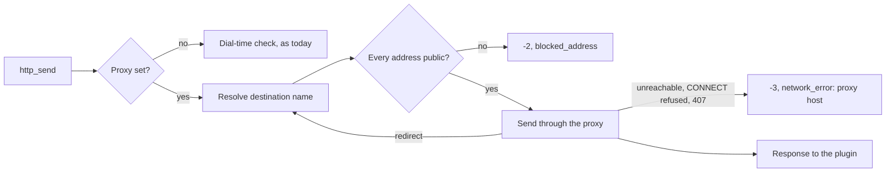

# Research: Work-info plugin tooling for authors, operators and users

Inherited decisions: [049 research.md](../049-work-info-plugins/research.md)
(wazero in the process, the WASI command contract, the manifest section, the
run limits, the dial-time address check, blob rows bound to a digest, the
in-memory fetch result, settings declared in the manifest),
[052 research.md](../052-plugin-work-info-fields/research.md) (the apply
merges the selected fields in one transaction) and the host-command shape of
[016 account-cli.md](../016-single-account-auth/contracts/account-cli.md)
(subcommands of `mdm`, exit codes 0, 1 and 2, reasons on standard error).
This file records only the decisions this feature adds.

## R-1: `mdm plugin run` and `mdm plugin pack` reuse the server's runtime and parser and open no database

**Decision**: Both commands are subcommands of the `mdm` binary
([contracts/plugin-cli.md](contracts/plugin-cli.md)). `run` builds the
request the server would build, inspects the module with
`wasmplugin.Runtime.Inspect`, runs it with the same `Run` and the same limits,
and prints what VVMDM would keep of the response; `pack` validates the
manifest with `domain.ParseWorkInfoPluginManifest` and inspects the packed
bytes before writing. Neither reads `MDM_DATA_DIR` or needs `ffmpeg`.

| Option | Same limits as the server | Extra code to keep in step | Verdict |
| --- | --- | --- | --- |
| **Subcommands of `mdm` calling `internal/wasmplugin` and `internal/domain`** | Yes: one runtime, one parser | None | Chosen |
| A separate `vvplugin` binary | Yes, when built from the same packages | A second build, release and Windows artefact | Rejected: the Windows app and the container already ship `mdm`, and `mdm account` set the pattern |
| A `POST /api/work-info-plugins/dry-run` route on the running server | Yes | A route that runs unapproved code on the owner's server | Rejected: 049 R-3 never runs a module the owner has not approved, and an author's loop is build, pack, run, which needs no server |

**Rationale**: Requirement 2 is met by construction when the command and the
server share `Run`; a second implementation of the limits would drift. The
request shape (`contract`, `settings`) is VVMDM's to assemble, so `run` takes
the operation, its input and `--set KEY=VALUE` flags instead of a JSON file
the author writes by hand. `run` inspects first and refuses the same problems
the upload refuses, so an author sees `manifest_missing` or
`import_unsupported` before adding the module to VVMDM. The desktop
`VVMDM.exe` keeps its own arguments (`--port`); the commands live in the
server binary only.

## R-2: `pack` replaces the `vv.plugin` section and writes the file only after the packed module passes inspection

**Decision**: `mdm plugin pack <module> <manifest>` removes any existing
`vv.plugin` custom section, appends the new one, inspects the result in
memory, and writes it over the module through a temporary file and a rename.
Any problem leaves the file as it was.

| Option | Re-running on a packed module | A broken manifest | Verdict |
| --- | --- | --- | --- |
| **Replace the section, inspect in memory, rename into place** | Idempotent | File unchanged, reason printed | Chosen |
| Append the section, as the how-to's `addsection` program does | A second section; wazero reads the first, so the new manifest is ignored | Written before any check | Rejected: the how-to had to warn authors to rebuild before each run |
| Write a new file beside the module (`plugin.packed.wasm`) | Idempotent | Not written | Rejected: a second file to pick on the settings screen, and the build output is what authors upload today |

**Rationale**: The section writer moves from the test helper
`plugintest.CustomSection` into `internal/wasmplugin` as an exported
function, so the command, the test helper and the browser test's fixture
build share it. Inspecting the packed bytes, not only the manifest, means an
import or export problem is also caught by `pack` (acceptance 3 and 4 of the
Issue, and the edge case of a default outside the options).

## R-3: A setting declares `default` and `options`; the stored value or the default is what the run receives

**Decision**: A manifest setting may carry `"default": "<value>"` and
`"options": ["<value>", …]`
([contracts/plugin-contract.md, Manifest](contracts/plugin-contract.md#manifest)).
The effective value of a setting is the stored value when one is set and
inside the options, otherwise the default; `required` is satisfied by the
effective value, and the run request carries the effective values. A stored
value outside the current options counts as unset and is reported to the
owner as `staleValue`
([contracts/screen-api.md](contracts/screen-api.md#workinfopluginsetting)).

| Rule | Why |
| --- | --- |
| `default` is 1 to 2000 characters, the stored value's limit | The default stands in for a stored value |
| `options` holds 2 to 50 distinct values of 1 to 200 characters | One option is not a choice; a select of over 50 is a text field in disguise |
| With `options`, `default` is one of them | The Issue's edge case refuses a default outside the options |
| A `secret` setting declares neither | A default would publish the secret in the module; options would enumerate it |
| A stored value outside the options is kept in `work_info_plugin_settings` and treated as unset | Deleting it in the upload's transaction would hide from the owner that the new version dropped their choice; the next save replaces it |

| Option | Where the default is applied | Verdict |
| --- | --- | --- |
| **The effective value is computed in `internal/domain` when the request is built and when `required` is checked** | One pure function the app and the CLI share | Chosen |
| Writing the default into `work_info_plugin_settings` at upload | The row | Rejected: the owner could not tell a default from their own entry, and a new version's default would not reach a plugin whose owner never opened the dialog |
| Leaving defaults to the plugin's code | The plugin | Rejected: that is the gap the Issue's `背景` names, and the owner cannot see the default before the run |

## R-4: The proxy is one URL in `settings`, read on each run and passed to the runtime as a run option

**Decision**: The owner's proxy is the `settings` row
`work_info_plugins.proxy_url`, written through `PUT /api/settings/plugin-proxy`
([contracts/screen-api.md](contracts/screen-api.md#get-and-put-apisettingsplugin-proxy)).
`app.WorkInfoPlugins` reads it before each run and passes it in
`domain.WorkInfoRunNetwork` to `WorkInfoPluginRuntime.Run`; `mdm plugin run`
fills the same value from `--proxy`. An empty value means no proxy, as today.

| Option | Changing the proxy while the server runs | Testable without a server | Verdict |
| --- | --- | --- | --- |
| **A run option read from the store per run** | Next run uses it | Yes: the runtime takes a value | Chosen |
| A mutable proxy on `wasmplugin.Runtime` set by the settings use case | Next run uses it | A setter shared by two callers | Rejected: the runtime would hold owner settings, and the CLI would set global state for one run |
| `MDM_HTTP_PROXY` in the environment | Needs a restart | Yes | Rejected: requirement 8 puts the proxy on the settings screen, and the Windows app has no environment to edit |
| Honouring `HTTP_PROXY` | Needs a restart | Yes | Rejected in 049 R-5 and still rejected: the operator could not turn it off for plugins alone |

**Rationale**: The URL takes the `http`, `https` and `socks5` schemes that
Go's transport proxies through, with optional user information for a proxy
that authenticates; the rule lives in `internal/domain`
(`ParseWorkInfoPluginProxyURL`), so the API, the store and the CLI refuse the
same values.

## R-5: Through a proxy, the destination is checked by resolving its name before each request and redirect

**Decision**: When a run has a proxy, the dial-time check of 049 R-5 cannot
see the destination, because the connection goes to the proxy. The client
therefore resolves the destination host (or parses the literal address) in
the transport's `Proxy` callback, which Go calls for every request and every
followed redirect, and refuses the request with `-2` and `blocked_address`
when any resolved address fails the same `addressRule`. The proxy's own
address is not checked: the operator chose it, and it usually sits on the
LAN. A proxy that cannot be reached, refuses the `CONNECT`, or answers `407`
makes the request answer `-3`, and a failed run then reports `network_error`
with the proxy's host.

The diagram shows one `http_send` with a proxy set.

| Option | Catches a name that resolves to the LAN | Verdict |
| --- | --- | --- |
| **Resolve and check in the `Proxy` callback, per request and redirect** | Yes, at the time of the request | Chosen |
| Trust the proxy to refuse LAN destinations | Only when the operator configured it so | Rejected: requirement 9 makes VVMDM refuse |
| Keep the dial-time check and let it see only the proxy | No | Rejected: the proxy's LAN address would fail every request, or the check would be disabled |

**Rationale**: 049 R-5 rejected a pre-resolution check for the direct path
because the connection resolves the name again; with a proxy the connection is
the proxy's, so the pre-resolution check is the only one available, and the
proxy is a component the operator runs. The residual risk, a name whose
answer changes between VVMDM's lookup and the proxy's, is named in the design
document.

## R-6: The runtime returns each run's standard error, and the app keeps the last one per plugin with the secret values masked

**Decision**: `Run` returns the kept standard error (the first 64 KiB, as
today) and whether it was truncated, on success and on failure.
`app.WorkInfoPlugins` replaces every occurrence of each secret setting value
the run received with `[secret]`, then stores it as the plugin's one
`work_info_plugin_runs` row, written only when the plugin still has the
digest that ran ([data-model.md](data-model.md)). A replacing upload deletes
the row in its transaction; deleting the plugin cascades. The server log keeps
receiving the output as before.

| Option | Survives a restart | Grows with runs | Verdict |
| --- | --- | --- | --- |
| **One row per plugin, replaced on each run** | Yes | No: 64 KiB at most per plugin | Chosen |
| In memory beside the fetch results | No | No | Rejected: an operator reads the output after the failed run, often after a restart on the Windows app |
| A table of all runs | Yes | Yes | Rejected: the Issue's `対象外` excludes history |

| Option | Masks a secret the owner changed later | Verdict |
| --- | --- | --- |
| **Mask with the values of that run before storing** | Yes: the stored text never held them | Chosen |
| Mask when the screen reads the row | No: a changed or forgotten secret stays in clear | Rejected |

**Rationale**: Masking by value catches the plugin printing a setting as it
received it, which is the leak the Issue names; a plugin that encodes the
value first is not caught, and the guide says so.

## R-7: The apply takes the selected tag names, and a tag already on the video is not selectable

**Decision**: `ApplyWorkInfoFetchRequest` gains `tags`, the fetched names to
attach; when present with `tags` in `fields`, it must be a non-empty subset of
the result's tags, and the app attaches those names only
([contracts/screen-api.md](contracts/screen-api.md#post-apivideosidwork-info-fetchesfetchidapply)).
On the screen every fetched tag not yet on the video starts selected; a tag
already on the video keeps its `On the video` mark and cannot be selected;
clearing every tag leaves `tags` out of `fields`.

| Option | Verdict |
| --- | --- |
| **A `tags` list beside `fields`** | Chosen |
| One `WorkInfoField` value per tag (`tags:<name>`) | Rejected: `WorkInfoField` is a closed enum the comparison rows and the skipped values are keyed by |
| A per-tag apply call | Rejected: 049 R-9 applies the selection in one transaction |

**Rationale**: Attaching a tag the video already has changes nothing, so
offering it as a choice would only make the count of selected tags lie; the
row's `Same as now` state already covers a result whose tags are all on the
video. `tags` is optional so the external callers of the route keep their
behaviour; the screen always sends it.

## R-8: The Network section shows on every build, and the LAN switch stays desktop only

**Decision**: The settings screen's `Network` section renders whenever either
`GET /api/settings/network` (desktop only, `404` elsewhere) or the new
`GET /api/settings/plugin-proxy` (every build) answers; the proxy row sits
under the LAN switch on the desktop app and alone in the container.

| Option | Verdict |
| --- | --- |
| **The existing section, one more row** | Chosen |
| A proxy row in the Work-info plugins section | Rejected: requirement 8 and the Issue's `UI品質` put it in the network settings, next to the other connection setting |
| Extending `NetworkSettings` with the proxy | Rejected: the route is `404` outside the desktop app, where the proxy is needed most |

## R-9: On a `429`, a plugin waits for the smaller of `Retry-After` and 5 seconds, retries once, and otherwise reports an error

**Decision**: The guide recommends: when a response is `429`, read
`Retry-After`; if it is a delay of at most 5 s, sleep that long (clocks and
`nanosleep` work in the sandbox) and send the request once more; otherwise,
or when the retry is `429` again, return an `error` response whose message
names the site and the delay. VVMDM does not retry for the plugin (the
Issue's `対象外`).

| Option | Fits 30 s and 16 requests | Verdict |
| --- | --- | --- |
| **One retry after at most 5 s** | Yes: a plugin that fetches up to 7 pages still has a retry per page within the request limit, and the waits stay under the run limit | Chosen |
| Exponential backoff until the run limit | No: a plugin that waits 25 s times out with no message for the owner | Rejected |
| No retry | Yes | Rejected: a single `429` on a burst-limited site would fail every fetch |

**Rationale**: A fetch is one owner's single action, not a crawl, so one
short wait is what a browser user would do; a longer wait is better spent
telling the owner to try again.
