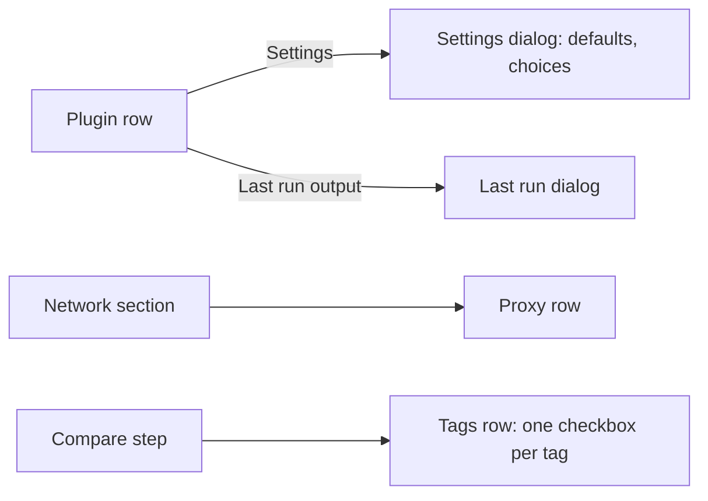
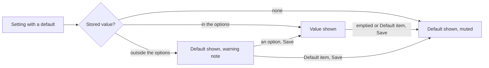
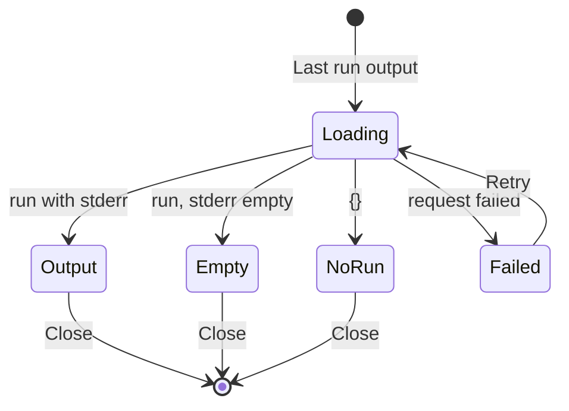
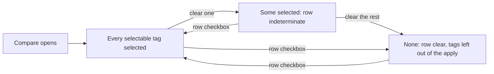

# UI design: Work-info plugin tooling for authors, operators and users

**Feature**: [parent Issue #1232](https://github.com/syudead/vv/issues/1232) ·
[plan.md](plan.md) · [contracts/screen-api.md](contracts/screen-api.md) ·
[research.md R-3](research.md#r-3-a-setting-declares-default-and-options-the-stored-value-or-the-default-is-what-the-run-receives) ·
[R-4](research.md#r-4-the-proxy-is-one-url-in-settings-read-on-each-run-and-passed-to-the-runtime-as-a-run-option) ·
[R-6](research.md#r-6-the-runtime-returns-each-runs-standard-error-and-the-app-keeps-the-last-one-per-plugin-with-the-secret-values-masked) ·
[R-7](research.md#r-7-the-apply-takes-the-selected-tag-names-and-a-tag-already-on-the-video-is-not-selectable) ·
[R-8](research.md#r-8-the-network-section-shows-on-every-build-and-the-lan-switch-stays-desktop-only)

Sources that already decide things, linked rather than repeated here:

| Topic | Source |
| --- | --- |
| Tokens, closed scales, density | [design-system.md, Foundations](../../docs/design-docs/design-system.md#foundations); the values in `@theme` of [`web/src/ui/tokens.css`](../../web/src/ui/tokens.css), named here and never copied |
| `PageSection`, `FormRow`, `FactList`, `FormDialog`, `ErrorState`, the settings page rules | [patterns.md](../../web/registry/rules/patterns.md) |
| `Input`, `Select`, `Checkbox`, `Field`, `Badge`, `Alert`, `DropdownMenu`, `Skeleton`, `Tooltip`, `TentativeMark` | [components.md](../../web/registry/rules/components.md) |
| The Work-info plugins section, its row, the approval prompt and the settings dialog | [049 UI design](../049-work-info-plugins/ui-design.md#settings-work-info-plugins-section); [`WorkInfoPluginRow.tsx`](../../web/src/settings/WorkInfoPluginRow.tsx), [`WorkInfoPluginSettingsDialog.tsx`](../../web/src/settings/WorkInfoPluginSettingsDialog.tsx) |
| The Network section, its switch row and its save status | [`NetworkSection.tsx`](../../web/src/settings/NetworkSection.tsx), [`SaveStatus.tsx`](../../web/src/settings/SaveStatus.tsx) |
| The comparison, its grid, rows and chips | [049 UI design, Compare](../049-work-info-plugins/ui-design.md#compare), [052 UI design, Compare](../052-plugin-work-info-fields/ui-design.md#compare); [`CompareStep.tsx`](../../web/src/player/workInfoFetch/CompareStep.tsx), [`TagChips.tsx`](../../web/src/player/workInfoFetch/TagChips.tsx) |
| Dates and relative times | [`web/src/i18n/format.ts`](../../web/src/i18n/format.ts) (`formatDateTime`, `formatRelative`) |
| Width breakpoints in CSS; layout checked by people | [library-ui.md, Width breakpoints](../../docs/design-docs/library-ui.md#width-breakpoints-in-css-and-the-sidebar-exception), [Layout verified by people](../../docs/design-docs/library-ui.md#layout-verified-by-people-not-machines) |
| Screen text | [`web/src/i18n/en.ts`](../../web/src/i18n/en.ts); this feature adds to `settings.workInfoPlugins`, `settings.network` and `player.workInfoFetch` |

This feature changes four places, all for the owner:

1. The **settings dialog** of a plugin shows a declared default apart from an
   entered value and offers declared options as a choice (requirements 5 to
   7, acceptance criterion 5).
2. The **Network section** gains the proxy for plugin requests, on every build
   (requirement 8, acceptance criteria 7 and 8).
3. The **plugin row** opens the **last run dialog**, the plugin's last
   standard error with secret values masked (requirements 12 and 13,
   acceptance criteria 10 and 11).
4. The **comparison** lets the owner pick the fetched tags one by one
   (requirement 11, acceptance criterion 9).

Unchanged: the approval prompt apart from one muted note per setting, the
add, revoke and delete flows, the fetch dialog's find and result steps, the
other comparison rows, and `mdm plugin run` and `pack`, which have no screen.

## Why this shape

A **default is shown where the value would be, in the muted colour, and never
put into the field as text**: the empty `Input` carries the default as its
`placeholder`, and a hint under the field names it. An entered value reads in
`text-foreground`, a default in `text-muted-foreground`, so the two are told
apart at a glance (the Issue's `UI品質`). Writing the default into the field
was rejected: the owner could not tell it from their own entry, and clearing
it to get the default back would look like deleting a value. Consistently,
the default is never stored as an entered value: an empty field, or the
`Select`'s `Default` item, saves `null`, so a new version's default reaches
the plugin ([R-3](research.md#r-3-a-setting-declares-default-and-options-the-stored-value-or-the-default-is-what-the-run-receives)).

A setting with `options` is a **`Select`**, whatever the count of options
(2 to 50): [components.md, Select and RadioGroup](../../web/registry/rules/components.md#select-and-radiogroup)
gives a `Select` to a settings row where the current value is what matters,
and its default trigger is `h-9`, the height of an `Input` (the `sm` trigger
is `h-8`, so it is not used), so a choice sits in the list of fields without a
visual break (the Issue's `UI品質`). A `RadioGroup` for few
options was rejected: two to six radios beside text fields make one setting
three times taller than its neighbours for no gain in a dialog the owner
opens to set values, not to compare them.

Returning to the default is a **`Default ({default})` item of its own** at
the top of the list, apart from the option that equals the default. Marking
the default's option and selecting it for a setting with no stored value was
rejected: when the stored value is that option or a stale one, the item the
owner would press to get the default back is already selected, a `Select`
reports no change for it, and `Save` stays disabled. The separate item keeps
the `Input`'s rule: the owner either follows the default or enters a value,
and an entered value equal to the default is still their entry.

The proxy is **one `FormRow` in the Network section** with an `Input`, saved
when the value changes, as the LAN switch saves when it changes (the Issue's
`UI品質`; [patterns.md, Settings page](../../web/registry/rules/patterns.md#settings-page)).
A `Save` button under the rows, as the Ollama and ComfyUI sections have, was
rejected: those sections save several values together; this is one value, and
the section it joins has no button. The section's description moves to the
switch row, because on a build without the switch the description was about a
setting that is not there ([R-8](research.md#r-8-the-network-section-shows-on-every-build-and-the-lan-switch-stays-desktop-only)).

The last run's output opens in a **dialog from the row menu**, not in the row.
A 64 KiB log cannot sit in a settings row without pushing the other plugins
off the screen, and reading an error is an occasional task of the operator,
so it is one more item of `More actions` beside `Revoke approval` and
`Delete`; the row's facts line says when the plugin last ran, so the operator
sees at a glance which plugin has something to read. A third button in the
row (`Last run`) was rejected: `Review and approve` and `Settings` already
fill the row at 360px, and the output is read far less often than settings
are changed.

On the comparison, each fetched tag not yet on the video is a **`Checkbox`
with the chip as its label**, and the row's own checkbox becomes the
select-all with the `indeterminate` state. `Checkbox` is the design system's
control for a choice inside a form that is applied later
([components.md, Checkbox and Switch](../../web/registry/rules/components.md#checkbox-and-switch));
chip toggles (`Toggle`) were rejected by the same rule, and a per-tag row
with a checkbox and text was rejected because 30 rows would hide the title and
the other fields. The fetched tag list is **never folded**: `+{n} more` hides
what the owner is meant to pick from, and the Issue asks for 25 or more tags
to be seen whole; the `Now` column keeps its fold, because the video's own
tags are not chosen here.

## Words

The English is the draft the catalog takes; after implementation
[`web/src/i18n/en.ts`](../../web/src/i18n/en.ts) is canonical. Default
values, option values, URLs and the plugin's output are user data and are
embedded untranslated.

### Settings dialog text

| Place | Text | Notes |
| --- | --- | --- |
| Default hint | Default: {default} | `FieldDescription`; the empty field shows `{default}` as its placeholder |
| Select, stale value | Default ({default}), or Not set without a default | The `Select`'s placeholder, muted; no item is selected |
| Select, item to follow the default | Default ({default}) | The first item, muted, only for a setting with a default; saves `null` |
| Select, item to clear | Not set | The first item, muted, only for a setting without a default; saves `null` |
| Select, option item | {option} | Every option in the manifest's order, the default's option included and unmarked |
| Stale value, with a default | "{value}" isn't one of this version's choices. The default is used until you save. | `text-warning` with lucide `CircleAlert` under the field |
| Stale value, no default | "{value}" isn't one of this version's choices. No value is sent until you save. | The same form |
| Save | Save | Unchanged; sends `null` for a field returned to its default |

### Section and approval prompt text

| Place | Text | Notes |
| --- | --- | --- |
| Settings summary, default in use | {label} default | Joins `{label} set` and `{label} not set` in `Settings: {list}` |
| Stale values | Choose again: {labels} | `text-warning` with lucide `CircleAlert`, under `Needs a value` when both apply |
| Last run (facts line) | Last run {when} | `{when}` from `formatRelative`, the full `formatDateTime` in `title`; only with `lastRunAt` |
| Row menu, last run | Last run output | Opens the [last run dialog](#last-run-dialog); not for `invalid` |
| Approval prompt, setting line | Default: {default} | `text-muted-foreground` after the `Secret` and `Required` badges |

### Last run dialog text

| Place | Text | Notes |
| --- | --- | --- |
| Title | Last run of {name} | |
| Description | What the plugin wrote to its error output during its last run. Values of secret settings are shown as [secret]. | |
| Facts | Ran · Did · Result | `FactList` terms |
| Did | Search · Fetch by ID | From `settings.workInfoPlugins.operations` |
| Result, success | Finished | |
| Result, failure | Failed: {reason} | `{reason}` from [049 Error reasons](../049-work-info-plugins/ui-design.md#error-reasons) by the run failure code, except the two below, whose `{host}` the run row does not keep |
| Result, `blocked_address` | Failed: The plugin tried to reach VVMDM itself or a device on your network. | |
| Result, `network_error` | Failed: The plugin couldn't reach a site. | |
| Truncated | The output was cut at 64 KB. | `text-warning` with lucide `CircleAlert`, above the output |
| Wrote nothing | The last run wrote nothing. | Muted, in place of the output |
| No run | No run yet. Run the plugin from a video page, then open this again. | Muted, in place of the facts and the output |
| Load failed | Couldn't load the last run: {reason} | `ErrorState` with `Retry` in the body |
| Close | Close | The footer's only button |

### Network section text

| Place | Text | Notes |
| --- | --- | --- |
| Section description | Connections to VVMDM, and from its plugins to other sites. | Replaces the current description |
| LAN switch description | By default only this PC can open VVMDM. Allow connections from your local network to open it from a phone or another computer on the same network. | The current section description, now the switch row's `description` |
| Proxy label | Proxy for plugin requests | |
| Proxy description | Plugin requests to other sites go through this proxy. Leave it empty to connect directly. Devices on your network are refused either way. | |
| Proxy placeholder | http://proxy.example:3128 | `placeholder`; an example, never saved |
| Refused URL | Enter a URL starting with http://, https:// or socks5://, with a host and no path. | `FieldError` under the field; the same rule the server applies ([contracts/screen-api.md](contracts/screen-api.md#get-and-put-apisettingsplugin-proxy)) |
| Saving | Saving… | `SaveStatus`, as the switch |
| Saved | Saved. | `role="status"`, muted, with lucide `CircleCheck`; until the field is edited again |
| Save failed | Couldn't save the proxy: {reason} | `SaveStatus`'s `destructive` `Alert` |
| Load failed | Couldn't load the network settings: {reason} | Unchanged; now also for the proxy request |

### Comparison text

| Place | Text | Notes |
| --- | --- | --- |
| Tag checkbox name | {name} | The chip is the `Label`; a tentative chip reads `{name}, Tentative` as today |
| Row checkbox | Tags | Unchanged; `indeterminate` while some tags are selected |
| Selected count | {n} of {m} selected | Replaces `{n} new` in the tags row; `{m}` counts the tags not on the video |
| Tag already on the video | On the video | Unchanged: a muted chip with lucide `Check`, no checkbox |

## Changes to the design system

One named layout step is added to `@theme` in `web/src/ui/tokens.css` by the
"Show the last run's error output on the settings screen" unit, before the
dialog uses it.

| Change | What it is |
| --- | --- |
| `run-output` | The maximum height of the last run dialog's output block (`max-h-run-output`): a share of the viewport's height, as `issue-list` is for the scan issue list, so the facts and the footer stay in view at 1280×800 and at 360×640 while a 64 KiB output scrolls inside the block |

Nothing else is added. `Checkbox` already has the `indeterminate` state,
`Select` its default `h-9` trigger and `max-w-popover` list (as
`TagKindSelect`), and `FormDialog` the `wide` size and the footer
without `Cancel`. No colour token is added and nothing is added to `pairs` in
`web/src/theme/tokens.test.ts`: the warning lines, the muted notes and the
output block use existing roles (`text-warning`, `text-muted-foreground`,
`bg-muted`). The icons are lucide `CircleAlert`, `CircleCheck`, `Check` and
`Ellipsis`, all in use already.

## Settings dialog

The dialog of [049, Settings dialog](../049-work-info-plugins/ui-design.md#settings-dialog)
keeps its order, its `Field` per setting, the secret fields and the `Save`
rule. The field of a setting changes by what the manifest declares.

| Setting | Field |
| --- | --- |
| No `default`, no `options` | As 049 |
| `default`, no `options` | `Input type="text"` with the stored value, or empty with `{default}` as `placeholder`; `Default: {default}` under it. Emptying the field, or leaving it empty, saves `null` |
| `options` | `Select` with the default trigger (`h-9`), full width of the field. The first item is `Default ({default})`, or `Not set` for a setting without a default; the options follow in the manifest's order. The selected item is the stored value's option when a value is stored, else the first item |
| `options`, stored value not among them (`staleValue`) | The `Select` with no item selected, so its muted placeholder reads `Default ({default})` or `Not set`, and the stale note under it in `text-warning`. Every item, the first included, is a change; choosing the first saves `null` and clears the note |
| Secret | As 049; a secret declares neither, so nothing changes |

`Save` stays disabled while no key has changed. Choosing the first item or
emptying a field with a default is a change only when a value is stored: it
sends `null`, and the field then shows the default as before. When a value is
stored, the first item is not the selected one (the stored option is, or none
for a stale value), so choosing it is always a change the `Select` reports.

A default may be 2000 characters and an option 200, with no space in them
([contracts/plugin-contract.md](contracts/plugin-contract.md#manifest)), so
nothing that shows them may widen the dialog or the screen:

| Part | Form |
| --- | --- |
| `Default: {default}` hint, stale note, approval prompt's `Default:` | `wrap-anywhere`, so a value without spaces breaks at the field's edge |
| `Select` list | `SelectContent` with `max-w-popover`, as `TagKindSelect`; the list is never narrower than the trigger, so it spans the field at 1280px and stays inside the 16px margin at 360px. Each item's text is a `span` with `wrap-anywhere`, so a long option wraps over several lines in the list |
| `Select` trigger | One line: the trigger's own `line-clamp-1` cuts a long value, and the trigger's `title` holds the whole selected text |
| `Input` with a long placeholder | The placeholder is cut at the field's edge; the hint under it shows the whole default |

The row's settings summary names a setting whose default is in use as
`{label} default`, so `Settings: Region default, Token set` tells the owner
what the plugin will receive without opening the dialog; a stale value is
`{label} not set` in the summary and named in the `Choose again` line under
the facts line, in the form of `Needs a value`. A required setting with a
default never appears in `Needs a value` ([R-3](research.md#r-3-a-setting-declares-default-and-options-the-stored-value-or-the-default-is-what-the-run-receives)).

In the approval prompt, each setting line that has a default ends with
`Default: {default}` in the muted colour, so the owner approving the plugin
sees what it receives when they enter nothing.

### States

| State | What the field shows |
| --- | --- |
| Default in use | The placeholder or the `Default ({default})` item in the muted colour, `Default: {default}` under it |
| Value entered | The value in `text-foreground`; `Default: {default}` stays under it |
| Stale | The default or `Not set`, the stale note in `text-warning` under it |
| Saving | Every field disabled, as 049 |

## Network section

The section renders when either `GET /api/settings/network` or
`GET /api/settings/plugin-proxy` has answered `200`
([R-8](research.md#r-8-the-network-section-shows-on-every-build-and-the-lan-switch-stays-desktop-only));
until then nothing, as today. Rows, top to bottom: the LAN switch (desktop
only) with its addresses or caution block, then the proxy row.

| Part | Form |
| --- | --- |
| Proxy row | `FormRow` with the label and description from [Words](#network-section-text); the control is an `Input type="url"` `sm:w-sm`, `autocomplete="off"`, with the saved URL or the placeholder |
| Saving | The value is sent when the field loses focus or Enter is pressed and the trimmed value differs from the saved one. `Saving…` under the row as the switch; the field stays editable. One save runs at a time: a blur or Enter while a save runs sends nothing then, and the latest value is sent when that save answers, if it differs from the URL just saved |
| Saved | The response's `url` replaces the field only when the field still holds the value that was sent; an edit made during the save stays in the field and is not lost. `Saved.` under the row until the next edit |
| Refused | A value that breaks the URL rule is not sent: `aria-invalid` and the `FieldError` under the field until the value changes. A `400` from the server shows the same error, so the two paths read alike |
| Failed | `Couldn't save the proxy: {reason}` in the `SaveStatus` `Alert`; the typed value stays |
| Cleared | An emptied field saves `""`; the run then uses no proxy. `Saved.` shows as for any value |

The user information of a proxy URL (`user:pass@`) is shown as saved: the
owner entered it on this screen, and the API returns it. The LAN switch's
caution block and address list are unchanged.

### States

| State | What the section shows |
| --- | --- |
| Loading | Nothing, until one request answers |
| Desktop | The switch row, its block, the proxy row |
| Container | The proxy row alone (`/api/settings/network` is `404`) |
| Load failed | `ErrorState` with `Retry` when the proxy request fails and the network request answered `404` or failed; with a switch loaded, the `ErrorState` takes the proxy row's place |
| Saving, saved, refused, failed | As the table above |

## Last run dialog

A `FormDialog` `size="wide"` without `cancelLabel`, opened by the row menu's
`Last run output`; the footer holds `Close`. On open it reads
`GET /api/work-info-plugins/{id}/last-run`, every time, so a run that ended
while the settings screen was open is shown (requirement 12).

| Part | Form |
| --- | --- |
| Facts | A `FactList`: `Ran` (`formatDateTime(ranAt)`), `Did` (the operation's text), `Result` (`Finished`, or `Failed: {reason}` in `text-destructive`) |
| Truncated | The `text-warning` line with its icon between the facts and the output, only with `truncated` |
| Output | A block in `font-mono text-xs` on `bg-muted` with `rounded-md` and `p-3`, `whitespace-pre-wrap` and `break-all` so a long line wraps instead of widening the dialog, at most `max-h-run-output` tall with its own vertical scroll. The text is the response's `stderr` as is; `[secret]` is part of it |
| Wrote nothing | `The last run wrote nothing.` in the muted colour in place of the block |
| No run | `No run yet…` in the muted colour; no facts, no block |

The output is the only `font-mono` block in the dialog and the only one that
scrolls, so the facts and the footer stay in view; the dialog itself keeps
`FormDialog`'s rule that only the body scrolls on a short screen.

### States

| State | What the dialog shows |
| --- | --- |
| Loading | Three `Skeleton` rows `h-5` for the facts and one `h-16` for the block |
| Failed | `ErrorState` with `Retry` in the body |
| No run | The `No run yet` line |
| Wrote nothing | The facts, then `The last run wrote nothing.` |
| Output | The facts, the truncation line when it applies, the block |

The row's facts line shows `Last run {when}` from the list's `lastRunAt`; it
updates when the list is read again, not when the dialog closes.

## Compare: tags row

The tags row keeps its place, its grid cell and its `Now` column
([049, Compare](../049-work-info-plugins/ui-design.md#compare)). The fetched
cell and the row's checkbox change.

| Part | Form |
| --- | --- |
| Fetched tag not on the video | A `Checkbox` and, as its `Label`, the `secondary` chip with `TentativeMark`, in one `inline-flex items-center gap-2` item; items wrap in the cell with `gap-x-3 gap-y-1`. Every one is selected when the step opens |
| Fetched tag on the video | The muted chip with lucide `Check` and the tooltip, with no checkbox, as today; it cannot be selected ([R-7](research.md#r-7-the-apply-takes-the-selected-tag-names-and-a-tag-already-on-the-video-is-not-selectable)) |
| Count | `{n} of {m} selected` after the last item, `text-xs text-muted-foreground`, where `m` counts the selectable tags |
| Row checkbox | Checked when every selectable tag is selected, `indeterminate` when some are, clear when none is; pressing it selects all when any is clear, otherwise clears all |
| Fold | None in the fetched cell; the `Now` cell keeps `+{n} more` |
| `Same as now` | Unchanged: when every fetched tag is on the video, the cell says so and the row cannot be selected |

The apply sends `tags` with the selected names when the row has a selected
tag, and leaves `tags` out of `fields` when none is selected
([contracts/screen-api.md](contracts/screen-api.md#post-apivideosidwork-info-fetchesfetchidapply)).
`Apply selected` stays disabled only while nothing at all is selected, so
clearing every tag with the title still selected applies the title alone (the
Issue's edge case). While the apply runs or the result is stale, every tag
checkbox is disabled with the row's, as the other rows are.

## Responsive behaviour

Only Tailwind's default breakpoints are used, switched in CSS. The widths
judged are 360px, 768px and 1280px, as 049.

| Width | Settings dialog | Network section | Last run dialog | Tags row |
| --- | --- | --- | --- | --- |
| 1280px | `max-w-lg`; a `Select` spans the field like an `Input`; the stale note wraps under it | The proxy row's label and description on the left, the `sm:w-sm` input on the right, as the switch row; `Saving…` and `Saved.` under the row | `max-w-2xl`; the facts in two columns; a 64 KiB output scrolls inside its block, the dialog's footer in view | The fetched cell holds about three items per line; 30 tags take about ten lines, the row's checkbox at the top of the row; the `Now` cell shows ten chips and `+{n} more` |
| 768px | As 1280px | As 1280px; the dialog and section fit inside the viewport's side margins | As 1280px | As 1280px with two items per line |
| 360px | The dialog spans the screen with the 16px margin; the `Select` and its note span the field | The proxy row stacks: label, description, then the full-width input; the status lines under it | The dialog spans the screen; the facts stack; a long line in the output wraps at the block's edge; no horizontal scroll | The row stacks as 049; the tag items wrap one or two per line under the `Fetched` heading; `{n} of {m} selected` after the last; no horizontal scroll |

## Review criteria

Judged by looking at the running screen in vv's one dark scheme
([Layout verified by people](../../docs/design-docs/library-ui.md#layout-verified-by-people-not-machines)).
"It exists" alone does not pass (Q-4).

1. **Visual hierarchy**: in the settings dialog an entered value reads in
   the body colour and a default in the muted colour, so a glance down the
   fields tells which settings the owner set; the stale note is the only
   `warning` colour in the dialog. In the Network section the proxy row has
   the weight of the switch row: the same label size, the same description
   colour, the control at the same right edge. In the last run dialog the
   facts are read before the output block, and a failure is the only
   `destructive` text.
2. **Information density**: a `Select` is as tall as an `Input`, so a dialog
   with three text settings and two choices reads as one list of five fields
   of one height. The last run dialog at 1280×800 shows the facts, the
   truncation line and at least twelve lines of output without scrolling the
   dialog body. On the comparison at 1280px, a result with 30 fetched tags
   shows every tag with its checkbox in the fetched cell, with no `more`
   button, and the title row stays visible above it.
3. **Spacing rhythm**: the default hint and the stale note sit at the
   `FieldDescription` distance under their field, as the secret hints do.
   The proxy row shares the section's row padding and divider with the
   switch row. Tag items share one gap in both directions, and the row's
   checkbox and label sit at the top of the row, aligned with the other rows'.
4. **Typography**: the output block is the only `font-mono` text in the last
   run dialog, in `text-xs`, and a 300-character line wraps inside the block
   without a horizontal scrollbar. The `Default ({default})` item is muted,
   so it reads apart from the options under it. `Last run {when}` in the facts line
   is `text-xs` like its neighbours.
5. **Action priority**: in the dialog, `Save` is the one filled button and is
   disabled until a value changes; returning a field to its default is one
   action (empty the field, or pick the `Default` item), from any stored
   value, stale or not. The proxy saves on
   leaving the field, with `Saving…` then `Saved.` as its only feedback, and
   the switch row's behaviour is unchanged. On the comparison, clearing one
   tag is one press and clearing all is one press on the row's checkbox;
   `Apply selected` stays the one filled button.
6. **Visible state**: after saving a chosen option and reloading, the
   `Select` shows it and the summary says `{label} set`; after returning it
   to the default and reloading, the `Select` shows `Default ({default})`, the
   summary says `{label} default`, and a run receives the default (acceptance
   criteria 5 and 6). A plugin replaced by a version without the saved option
   shows the stale note and `Choose again` (the Issue's edge case). After a
   fetch, `Last run {when}` appears on the row once the list is reread, and
   the dialog shows the output with `[secret]` where the plugin printed the
   secret (acceptance criteria 10 and 11); a second fetch replaces it. With a
   proxy saved, a fetch through it succeeds and a LAN destination still fails
   with its host (acceptance criteria 7 and 8). Applying with one tag cleared
   leaves that tag off the video and the others tentative (acceptance
   criterion 9).
7. **Phone width**: at 360px the `Select`, its list and its note span the
   field, a long default or option wraps inside them, the
   proxy row stacks without the input overflowing, the output block wraps
   every line, and the tag items wrap without sideways scrolling.
8. **Examples that do not meet the requirement**: the default is written into
   the field as if the owner had typed it; a setting with two options is a
   `RadioGroup` or a text field; the stale value is shown as the chosen item;
   the proxy has a `Save` button or sits in the Work-info plugins section;
   a 200-character option or a 2000-character default without spaces widens
   the dialog, the `Select` list or the screen; editing the proxy while it
   saves loses the edit; the output widens the dialog or the page; a run with
   no output shows an
   empty block with no words; the fetched tags fold at ten; a tag on the
   video has a checkbox; `+{n} more` appears in the fetched tags cell.

## Accessibility

The parent Issue does not ask for screen reader or contrast design, so only
names are decided.

- Each tag checkbox is labelled by its chip, so it reads as `{name},
  Tentative`; the row checkbox is labelled `Tags` and announces its mixed
  state.
- The proxy input is labelled by the row's label and described by the
  description; `aria-invalid` and the `FieldError` are set together.
- The last run dialog's output block is a labelled region named `Output`;
  the status lines use `role="status"` and the failure `role="alert"`.
