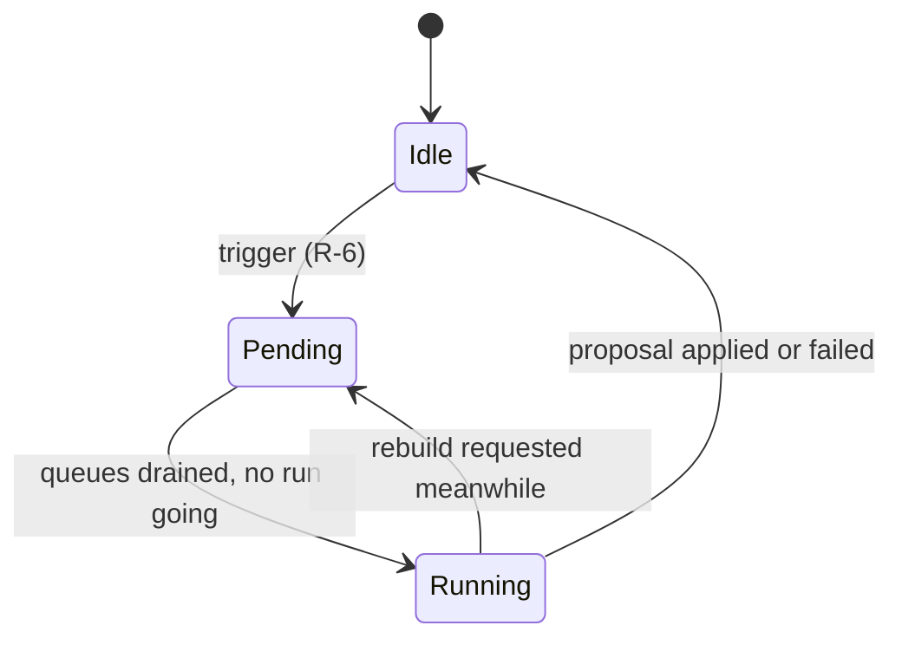

# Data model: A home of shelves the AI organizes

The rest of the model is unchanged: [052 data-model](../052-smart-folders/data-model.md)
for smart folders and the [migrations](../../internal/store/migrations/).

## Migration

`000NN_home_shelves.sql`, numbered when it lands, adds `home_position` to
`smart_folders` and the index `smart_folders_home_idx(home_position)` where
it is not null. No row gets a position, so the home starts with no folder
shelf until the first run (R-6) or the owner adds one.

## `smart_folders.home_position`

| Field | Type | Null | Meaning |
| --- | --- | --- | --- |
| `home_position` | integer | yes | The shelf's place on the home, smallest first; null when the folder is not a shelf |

Shelves are ordered by `home_position`, then `id`. Positions need not be
consecutive; a write that orders shelves rewrites every position as 1, 2, 3
and so on.

## Settings

The keys live in the existing `settings` table.

| Key | Value | Missing means |
| --- | --- | --- |
| `home.policy` | The owner's policy text, 0 to 2,000 characters after trimming | No policy |
| `home.organize.pending` | `rebuild` or `extend` | No run waiting |
| `home.organize.last` | JSON of the last finished run, below | No run has finished |

`home.organize.last`:

| Field | Meaning |
| --- | --- |
| `organizer` | `ai` or `rules` (R-1) |
| `run` | `rebuild` or `extend` |
| `outcome` | `done`, `failed`, or `unchanged` when the proposal changed nothing |
| `finishedAt` | Unix ms |
| `added`, `removed` | Shelves inserted and deleted |
| `error` | For `failed`, a short reason shown to the owner: `unreachable`, `invalidAnswer` or `other` |

## Organizer state

The state the home and Settings show is the pending run, whether a run is
going now (held in memory), and the last finished run.

## Proposed shelf

Both organizers return a list of proposed shelves; nothing stores it.

| Field | Meaning |
| --- | --- |
| `name` | 1 to 100 characters, the folder name rules of 052 |
| `rule` | A `SmartRule` using only `tags`, `tagKind`, `q`, `addedWithin`, `minDuration` and `maxDuration` (R-3) |

## Rules

| Rule | Enforced in |
| --- | --- |
| A proposed shelf whose rule fails `SmartRule.Validate`, repeats a rule already on the home, or matches no shown video is dropped | `domain` (validation, duplicate), `store` (match count) in the apply transaction |
| A rebuild deletes only folders with `owner_kept` 0 | `store`, apply transaction (R-5) |
| An extend inserts and never deletes or renames | `store`, apply transaction (R-5) |
| An owner write to `home_position` sets `owner_kept` to 1 | `store`, shelf order write (R-4) |
| At most 50 shelves are on the home; an organizer inserts no shelf past that | `domain` limit, `store` apply transaction |
| An AI or rule folder is a root folder with the folder sort `addedDesc` | `domain`, proposal to `SmartFolderCreate` |

## What does not change

`smart_folders.owner_kept` keeps the meaning of 052 R-10; the organizers are
the write path that R-10 left for this feature. Smart folder contents, cards,
favorites and playlist items do not change: a shelf is read as the folder it
is. No table records which video is on which shelf (R-8).
