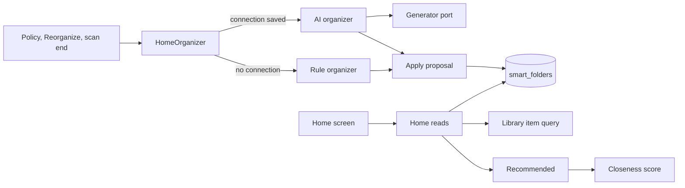
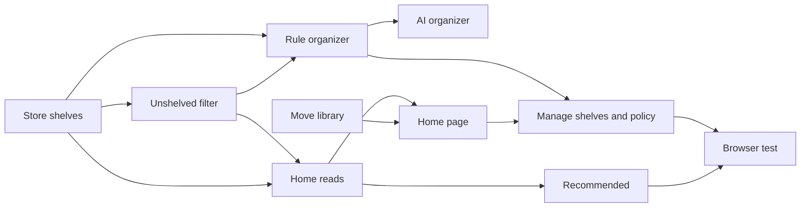

# Implementation Plan: A home of shelves the AI organizes

**Branch**: `feature/057-ai-home` | **Parent Issue**: #1140

**Input**: The parent Issue. It is this feature's specification.

## Summary

The top becomes a home of shelves: each shelf is a smart folder with a home
position, followed by the unshelved, recently added and recommended shelves,
and pressing a card plays. An organizer builds the folder shelves: the AI
organizer turns the owner's policy into shelves through 053's generator port
when Ollama is set up, and the rule organizer makes one shelf per well-used
tag with a kind when it is not, so the home works without AI. The library
screen moves to `/library`.

The diagram shows the parts this feature adds or changes and what each one
reads or writes.



| Concern | Approach |
| --- | --- |
| Without AI | The rule organizer ([R-1](research.md#r-1-two-organizers-behind-one-use-case-rules-work-with-no-ai), [R-2](research.md#r-2-the-rule-organizer-makes-one-shelf-per-well-used-tag-with-a-kind)) |
| With AI | One generator request, names resolved to ids ([R-3](research.md#r-3-the-ai-organizer-asks-the-generator-port-for-shelves-by-name)) |
| Shelves | Smart folders with `home_position` ([R-4](research.md#r-4-a-shelf-is-a-smart-folder-with-a-home-position), [data-model.md](data-model.md#smart_foldershome_position)) |
| Rebuild and extend | One transaction; owner-kept folders untouched ([R-5](research.md#r-5-a-rebuild-replaces-the-ais-folders-in-one-transaction-an-extend-only-adds)) |
| When it runs | A pending run in settings, triggered by events ([R-6](research.md#r-6-one-run-at-a-time-queued-in-settings-triggered-by-events), [R-7](research.md#r-7-an-extend-runs-when-20-or-more-shown-videos-are-unshelved)) |
| Unshelved | A library filter evaluated on read ([R-8](research.md#r-8-unshelved-means-matching-no-home-shelf-computed-on-read)) |
| Reads | Summaries, then items for the shelves on screen, 1 s budget ([R-9](research.md#r-9-the-home-lists-shelf-summaries-shelf-items-are-read-on-screen)) |
| Recommended | Owner only, closeness to plays and favorites ([R-10](research.md#r-10-recommended-is-the-owners-scored-against-favorites-and-plays)) |
| Playback | The video page with autoplay ([R-11](research.md#r-11-pressing-a-shelf-card-plays)) |
| Routes | Library at `/library`, old URLs redirected ([R-12](research.md#r-12-the-library-moves-to-library)) |
| Policy | One setting, stored without AI ([R-13](research.md#r-13-the-policy-is-one-setting-without-ai-it-is-stored-but-unused)) |
| Events | `HomeChanged` and the `home` screen event ([R-14](research.md#r-14-homechanged-tells-open-screens-to-read-the-home-again)) |

The maintainer asked that the home work to some extent without AI
(2026-10-16). Without an AI connection, the policy is not used and the
shelves come from tag kinds and tags; requirement 3 and acceptance criterion
3 need the AI organizer.

The Issue has the `ui` label, so the `design` stage writes `ui-design.md`
before the screen units: the home with its shelf rows, the search box and
`See all`, the empty home, how the fixed shelves and the organizer's state
read apart from the folder shelves, adding, removing and ordering shelves,
and the Settings section for the policy, judged against the parent Issue's
`UI品質`.

## Technical Context

**Canonical definitions**:

| Topic | Source |
| --- | --- |
| Boundaries, store roles, events after commit, the viewer of every read | [ARCHITECTURE.md](../../ARCHITECTURE.md), [.golangci.yml](../../.golangci.yml) (depguard) |
| Smart folders, rules, `owner_kept`, contents, cards, read budget | [052 plan](../052-smart-folders/plan.md), [052 data-model](../052-smart-folders/data-model.md), [052 research](../052-smart-folders/research.md) |
| Tag kinds | #1136, [`internal/domain/tag_kind.go`](../../internal/domain/tag_kind.go) |
| Classifier port, Ollama connection, "connection saved" | [ai-layer.md](../../docs/design-docs/ai-layer.md), [054 research, R-13](../054-auto-dup/research.md#r-13-the-model-is-asked-only-once-the-owner-has-saved-a-connection) |
| Generator port and provider | 053 plan and research R-1 to R-3 (#1138, plan PR #1164) |
| Closeness score | [related-videos.md](../../docs/design-docs/related-videos.md) |
| Watch history, favorites | [043 data-model](../043-watch-history/data-model.md), [035 data-model](../035-favorites/data-model.md) |
| Library screen, its URL and cards | [library-ui.md](../../docs/design-docs/library-ui.md), [`web/src/videoList/listCriteria.ts`](../../web/src/videoList/listCriteria.ts) |
| Screen API and generated code | [api/openapi.yaml](../../api/openapi.yaml), `task generate` |
| Screens and Web tests | [design-system.md](../../docs/design-docs/design-system.md), [web-testing.md](../../docs/design-docs/web-testing.md), [i18n.md](../../docs/design-docs/i18n.md) |
| Checks | [Taskfile.yml](../../Taskfile.yml) (`task check`, `task check-docs`, `task test-e2e`) |

**Feature-specific context**:

- One migration, numbered when it lands
  ([data-model.md, Migration](data-model.md#migration)).
- Six routes, one list parameter and one screen event kind on the screen API
  ([contracts/screen-api.md](contracts/screen-api.md)); the external API and
  MCP do not change.
- The AI organizer needs 053's generator port on `main`. Only the unit that
  says so waits for it; every other unit, and the home without AI, does not.
- `Scans.OnFinish` holds one callback today; it becomes a list
  ([R-6](research.md#r-6-one-run-at-a-time-queued-in-settings-triggered-by-events)).

## Constitution Check

| Rule (source) | Verdict |
| --- | --- |
| Adapters import neither each other nor `internal/app` (ARCHITECTURE.md, depguard) | Pass: `HomeOrganizer` in `internal/app` reaches the store and the generator through interfaces it declares; `internal/httpapi` declares a `Home` interface |
| The domain decides, the store enforces (ARCHITECTURE.md) | Pass: the proposal limits and the rule organizer's choice are pure domain rules; the apply transaction re-reads `owner_kept` and the match counts |
| Store roles (ARCHITECTURE.md) | Pass: a new `HomeStore` role; inserting and deleting folders inside its transaction uses package-private helpers shared with `SmartFolderStore` |
| Events after commit (ARCHITECTURE.md) | Pass: `HomeChanged` and `SmartFoldersChanged` are published after the apply transaction commits |
| User data survives a rebuild (ARCHITECTURE.md) | Pass: `home_position` is on `smart_folders`, keyed by its own id; the policy is a setting |
| Every read knows its viewer (ARCHITECTURE.md) | Pass: shelf items, unshelved and recent are cut to the viewer; recommended and the organizer state are owner only |
| Only a scan reads the media folders' files (ARCHITECTURE.md) | Pass: the organizers read SQLite and the generator only |
| Do not hand-edit generated files (AGENTS.md) | Pass: `api/openapi.yaml` changes, then `task generate` |
| Complexity 25 or less, no copied code (AGENTS.md) | Pass: unshelved negates the existing per-video match; shelf items call the library item query; recommended calls `ContentRelatedness` |
| Read design-system.md before a screen; test at the lowest level (AGENTS.md) | Pass: screens follow `ui-design.md`; the shelf row becomes a registry item; organizers get app tests with fakes, the store its tests and a benchmark, screens page tests, the acceptance criteria one browser test |

No violation, so no complexity tracking.

## Project Structure

### Documentation (this feature)

```text
specs/057-ai-home/
├── plan.md
├── research.md
├── data-model.md
└── contracts/
    └── screen-api.md
```

`ui-design.md` is written by the `design` stage. No `quickstart.md`: the
browser test runs the rule organizer, and the AI organizer's acceptance runs
in app tests with a fake generator, so nothing is left to run by hand.

### Source Code

**Affected boundaries**:

| Boundary | What it owns in this feature |
| --- | --- |
| `internal/domain` | Proposed shelves and their limits, the rule organizer's choice, `VideoQuery.Unshelved`, `HomeChanged`, the organizer state |
| `internal/store` | The migration, `HomeStore` (summaries, shelf items, order, apply), the unshelved condition, the seed query for recommended, the settings keys, the benchmark |
| `internal/app` | `HomeOrganizer` (triggers, pending run, the two organizers), recommended scoring and its cache, the `Scans.OnFinish` list |
| `internal/httpapi`, `api/openapi.yaml`, `cmd/mdm` | The routes, the `unshelved` parameter, the `home` event, the wiring |
| `web/src/home` (new), `web/src/app`, `web/src/shell`, `web/src/settings`, `web/src/smartFolders`, `web/src/ui`, `web/src/i18n` | The home page and shelf row, the routes and redirect, the sidebar, the Settings section, the folder page action |
| `docs/design-docs` | A new `home.md`, and updates to `ai-layer.md` and `library-ui.md` |
| `web/e2e` | Existing tests that open `/` for the library, and the new browser test |

**New paths**: `internal/store/migrations/000NN_home_shelves.sql`,
`internal/domain/home.go`, `internal/store/home.go`, `internal/app/home_organizer.go`,
`internal/httpapi/home.go`, `web/src/api/home.ts`, `web/src/home/`,
`docs/design-docs/home.md`, `web/e2e/home.e2e.ts`.

**Structure decision**: Follows the existing layout, with the home as a store
role, a use case and a screen folder of its own beside smart folders
([R-4](research.md#r-4-a-shelf-is-a-smart-folder-with-a-home-position)).

## Implementation Work

The diagram shows which units have to land first. The screen units also wait
for the `design` stage's `ui-design.md`, and the AI organizer waits for 053's
generator port on `main`.



### Store home shelves on smart folders and apply an organizer's proposal

**Scope**: The migration, the proposed shelf and its limits in the domain,
`HomeStore` with the shelf summaries, the shelf order write (setting
`owner_kept`), the apply transaction for a rebuild and an extend, the
`HomeChanged` event, and the settings keys
([data-model.md](data-model.md),
[R-4](research.md#r-4-a-shelf-is-a-smart-folder-with-a-home-position),
[R-5](research.md#r-5-a-rebuild-replaces-the-ais-folders-in-one-transaction-an-extend-only-adds)).

**Dependencies**: None.

**Acceptance**: `task check` passes; store tests show: a rebuild deletes an AI
folder whose rule the proposal does not repeat, keeps one whose rule it
repeats with the same id and favorite under the proposed name, drops a
proposal repeating an owner-kept shelf's rule, and leaves an owner-kept
folder as it was; an extend adds shelves after the last one and changes no
existing name or rule; a proposed rule that matches no video is dropped; ordering
shelves sets `owner_kept` to 1; `HomeChanged` is published after commit and
not after a rollback.

### Filter the library to videos in no home shelf

**Scope**: `VideoQuery.Unshelved`, its condition as the negation of the
per-video match of every home shelf's effective rule, the `unshelved` list
parameter with guest access, and its API client parameter; no screen change
([R-8](research.md#r-8-unshelved-means-matching-no-home-shelf-computed-on-read),
[contracts/screen-api.md, Schemas and parameters changed](contracts/screen-api.md#schemas-and-parameters-changed)).

**Dependencies**: Store home shelves on smart folders and apply an organizer's
proposal.

**Acceptance**: `task check` passes with no diff from `task generate`; store
tests show `unshelved=1` lists a video that matches no shelf, not one that
matches a child shelf's path, and lists again a video whose folder was removed
from the home; a guest sees no hidden video in it.

### Read the home's shelves and their first items

**Scope**: `GET /api/home`, `GET /api/home/shelves` for folder, unshelved and
recently added shelves, `PUT /api/home/shelves`, `onHome` on the smart folder,
the `home` screen event, the empty home's reason, and the R-9 benchmark
([contracts/screen-api.md](contracts/screen-api.md),
[R-9](research.md#r-9-the-home-lists-shelf-summaries-shelf-items-are-read-on-screen),
[R-14](research.md#r-14-homechanged-tells-open-screens-to-read-the-home-again)).

**Dependencies**: Filter the library to videos in no home shelf.

**Acceptance**: `task check` passes; handler tests show the shelves in their
order with the fixed shelves after them, a guest gets no organizer state and
no shelf whose folder has nothing visible, a folder shelf's items hold no
child folder, `keys` over 8 is `400
invalid_request`, and `PUT` with an unknown id is `404`; the benchmark at
20,000 videos and 50 shelves returns each read within 1 second.

### Recommend videos close to the owner's favorites and plays

**Scope**: The seed query (most played in 90 days, latest favorites), ranking
by the highest closeness to any seed, the 10-minute cache, and the
recommended shelf in the home reads for the owner only
([R-10](research.md#r-10-recommended-is-the-owners-scored-against-favorites-and-plays)).

**Dependencies**: Read the home's shelves and their first items.

**Acceptance**: `task check` passes; app tests with a fake scorer show the
shelf excludes seeds and completed videos and orders by the highest score;
store tests show the seeds; handler tests show the shelf is absent for a guest
and for an owner with no plays and no favorites.

### Organize the home from tag kinds without AI

**Scope**: `HomeOrganizer` with the pending run, its triggers (policy saved,
`Reorganize`, scan end after the queues drain, the first run), the
`Scans.OnFinish` list, the rule organizer, `POST /api/home/organize`, the
home settings routes, and `docs/design-docs/home.md` with its translation
([R-1](research.md#r-1-two-organizers-behind-one-use-case-rules-work-with-no-ai),
[R-2](research.md#r-2-the-rule-organizer-makes-one-shelf-per-well-used-tag-with-a-kind),
[R-6](research.md#r-6-one-run-at-a-time-queued-in-settings-triggered-by-events),
[R-7](research.md#r-7-an-extend-runs-when-20-or-more-shown-videos-are-unshelved),
[R-13](research.md#r-13-the-policy-is-one-setting-without-ai-it-is-stored-but-unused)).

**Dependencies**: Filter the library to videos in no home shelf.

**Acceptance**: `task check` and `task check-docs` pass; app tests show: with
no Ollama connection, a rebuild makes one shelf per tag with a kind on 5 or
more videos; a scan end with 20 unshelved videos runs an extend only after the
queues are empty, and with 19 runs nothing; a pending run survives a restart;
a rebuild requested during a run runs after it; handler tests show
`PUT /api/settings/home` over 2,000 characters is `400`.

### Organize the home by the owner's policy with the AI

**Scope**: The AI organizer: the generator request with the policy, kinds,
tags, kept shelves and unshelved titles, the answer's schema, name
resolution, the organizer choice by the saved connection, failure recorded
as the last run with the shelves unchanged, and the `ai-layer.md` feature row
with its translation
([R-3](research.md#r-3-the-ai-organizer-asks-the-generator-port-for-shelves-by-name)).

**Dependencies**: Organize the home from tag kinds without AI; 053's
generator port on `main`.

**Acceptance**: `task check` and `task check-docs` pass; app tests with a fake
generator show: a policy that asks for cooking videos and an answer naming the
tag `料理` make a shelf with that tag (acceptance criterion 3); an answer naming
an unknown tag adds no shelf; a generator error leaves the shelves as they
were and records `failed` with `unreachable`; with the connection saved the
organizer state reads `ai`.

### Move the library screen to /library

**Scope**: The `/library` route, the redirect of `/` with library parameters,
every in-app `/?tag=`, `/?person=` and `/?organization=` link, the sidebar's
`Home` and `Library` entries, `/` as a placeholder that redirects to
`/library` until the home page lands, the e2e tests that open `/` for the
library, and `library-ui.md` with its translation
([R-12](research.md#r-12-the-library-moves-to-library)).

**Dependencies**: None.

**Acceptance**: `task check` and `task check-docs` pass; page tests show `/?tag=3`
opens `/library?tag=3` with the tag filter applied and a tag chip on a video
page opens `/library?tag=<id>`; the browser tests pass against `/library`;
the screen changes, so a visual check of the sidebar is owed.

### Show the home's shelves and play from them

**Scope**: The home page at `/`: the shelf rows read on screen, the shelf row
as a registry item, pressing a card to play (R-11), the shelf heading opening
the folder, `See all` (folder page, `/library?unshelved=1`, `/library` sorted
by date added), the search box opening `/library?q=`, the empty home, the
organizer's state shown quietly, and reloading on `home` and `smartFolder`
events, following `ui-design.md`
([R-9](research.md#r-9-the-home-lists-shelf-summaries-shelf-items-are-read-on-screen),
[R-11](research.md#r-11-pressing-a-shelf-card-plays)).

**Dependencies**: Read the home's shelves and their first items; Move the
library screen to /library.

**Acceptance**: `task check` passes; page tests show one press on a shelf card
navigates to the video page with autoplay and `?smartFolder`, and typing in
the search box opens `/library?q=`; the screen changes, so a visual check of
the home on desktop and mobile widths is owed.

### Manage home shelves and the organizing policy

**Scope**: The Settings section with the policy, which organizer applies, the
last run and `Reorganize`; adding, removing and ordering shelves on the home;
`Add to home` and `Remove from home` on a smart folder page; following
`ui-design.md`
([R-4](research.md#r-4-a-shelf-is-a-smart-folder-with-a-home-position),
[R-13](research.md#r-13-the-policy-is-one-setting-without-ai-it-is-stored-but-unused)).

**Dependencies**: Show the home's shelves and play from them; Organize the
home from tag kinds without AI.

**Acceptance**: `task check` passes; page tests show saving the policy calls
`PUT /api/settings/home`, `Reorganize` calls `POST /api/home/organize`, and
moving a shelf sends the new order; without AI the section says the policy
applies once AI is set up; the screens change, so a visual check is owed.

### Cover the home in a browser test

**Scope**: One browser test of acceptance criteria 1, 2, 4, 5, 6 and 7 with
the rule organizer, adding `web/e2e/home.e2e.ts`; acceptance criterion 3 stays
with the AI organizer's app tests.

**Dependencies**: Manage home shelves and the organizing policy; Recommend
videos close to the owner's favorites and plays.

**Acceptance**: `task test-e2e -- e2e/home.e2e.ts` passes and CI's `Browser
E2E` job passes.
