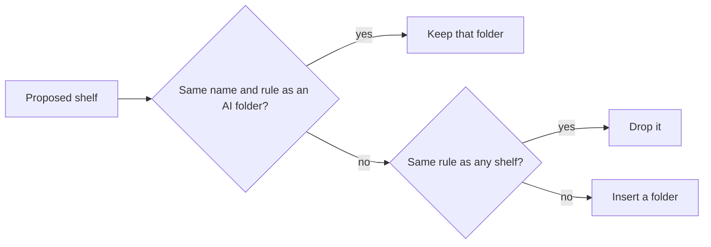

# Research: A home of shelves the AI organizes

Inherited decisions: smart folders, their rules, `owner_kept`, contents
computed on read and the read budget
([052 research](../052-smart-folders/research.md)); tag kinds (#1136); the
classifier port and the Ollama provider ([ai-layer.md](../../docs/design-docs/ai-layer.md));
the generator port, its Ollama `/api/chat` provider and the
`ollama.generation_model` setting (053 research R-1 to R-3, #1138); the
closeness score ([related-videos.md](../../docs/design-docs/related-videos.md)).
This file records only the decisions this feature adds.

## R-1: Two organizers behind one use case; rules work with no AI

**Decision**: `app.HomeOrganizer` builds shelves with the AI organizer when
the Ollama connection is saved, and with the rule organizer otherwise; both
return the same list of proposed shelves, and one apply step stores them.

| Option | Without an AI connection | Verdict |
| --- | --- | --- |
| **Rule organizer, AI organizer when connected** | Shelves from tag kinds and tags | Chosen |
| AI organizer only | No shelves until the owner sets up Ollama | Rejected by the maintainer (2026-10-16): the home has to work to some extent without AI |
| Rule organizer always, AI only names the shelves | Shelves exist | Rejected: the policy could not change which shelves exist (requirement 4) |

**Rationale**: The connection test of 054 R-13 (`OllamaConnectionSaved`)
already decides "AI is set up" for duplicate judging, so the owner sees one
meaning of it. An AI that is set up but fails does not fall back to rules:
falling back would replace the AI's shelves with different ones, and the
Issue's Edge Case keeps the shelves as they are.

## R-2: The rule organizer makes one shelf per well-used tag with a kind

**Decision**: The rule organizer proposes one shelf per tag that has a kind
and is on at least 5 shown videos, named after the tag, with the rule
`{"tags": [id]}`, at most 24 shelves, ordered by kind (kind id, so the presets
first) and then by video count descending; with no tag that has a kind, it
uses tags without a kind the same way.

| Option | Verdict |
| --- | --- |
| **One shelf per tag with a kind** | Chosen |
| One shelf per kind (`tagKind` rule) | Rejected: a `Genre` shelf holds every video with any genre tag, which sorts nothing |
| Shelves from folder names | Rejected: the Issue's background says folder and file names do not tell what a video is |
| Fixed shelves only (recent, unwatched) | Rejected: they do not organize by content, and the home already has a recently added shelf |

**Rationale**: A tag with a kind is a tag the owner or the AI tag creation
(#1138) has classified, so it is the best content signal without a model.
The minimum of 5 videos keeps a shelf from being one row of one card. The
policy is not read by this organizer; Settings says so (R-13).

## R-3: The AI organizer asks the generator port for shelves by name

**Decision**: The AI organizer sends one text-only request to the generator
port (053 R-1) with the policy, the kinds with up to 30 tags each and their
video counts (500 tags in all at most), the shelves the owner keeps, the
number of unshelved videos and up to 50 of their titles, and a JSON Schema
for at most 20 shelves (5 when it extends), each a name and a rule whose tags
and kind are given by name.

| Option | Verdict |
| --- | --- |
| **Generator port, names in the answer, resolved by the organizer** | Chosen |
| A port of this feature's own | Rejected: 053 R-1 made the generator port task-agnostic so the next generative feature reuses it |
| Ids in the answer | Rejected: a model copies ids less reliably than names, and a wrong id silently points at another tag |
| Images of the videos | Rejected: the shelves come from tags and facts the model already has as text, and images multiply the request size by the number of videos |

**Rationale**: Names resolve through exact name and synonym lookup as in 053
R-5; a shelf whose tag or kind does not resolve, whose rule fails
`SmartRule.Validate`, or that matches no shown video is dropped, so a wrong
answer adds nothing instead of an empty shelf. The rule members offered are
`tags`, `tagKind`, `q`, `addedWithin`, `minDuration` and `maxDuration`; watch
state and favorites change with each play, so they do not make a lasting
shelf.

## R-4: A shelf is a smart folder with a home position

**Decision**: A smart folder is on the home when its `home_position` is set;
the organizers create root folders with `owner_kept` 0 and a position, and
the owner adds, removes and orders any folder.

| Option | Verdict |
| --- | --- |
| **A position column on `smart_folders`** | Chosen |
| A separate shelves table that refers to folders | Rejected: a shelf has no field of its own beside its order, so a second table only adds a join and a delete rule |
| Every root folder is a shelf, ordered by name | Rejected: the owner cannot remove or order a shelf (requirement 10) |

**Rationale**: Requirement 2 makes a shelf a smart folder, and the folder's
page is already where "open the whole folder" leads. Any owner change to a
folder's home position sets `owner_kept` to 1, as 052 R-10 does for every
other owner write, so the AI does not undo it (requirement 9).

## R-5: A rebuild replaces the AI's folders in one transaction; an extend only adds

**Decision**: A rebuild deletes every folder with `owner_kept` 0 that the
proposal does not repeat, keeps one whose name and rule the proposal repeats
(so its id, favorites and playlist items stay), inserts the rest, and sets
the positions, all in one transaction; an extend only inserts, after the
current shelves.

| Option | Verdict |
| --- | --- |
| **One transaction, keep repeated folders** | Chosen |
| Delete all AI folders, insert all | Rejected: a favorite or playlist item on an AI shelf would vanish on every rebuild, even when the shelf comes back unchanged |
| Rename and edit AI folders in place | Rejected: matching an old folder to a new proposal by similarity is a guess, and requirement 8 allows a rebuild to delete and rename |

**Rationale**: The home reads the old shelves until the transaction commits,
so a home opened during a rebuild shows the previous shelves (Edge Case).

## R-6: One run at a time, queued in settings, triggered by events

**Decision**: The organizer keeps at most one pending run, `rebuild` or
`extend` (a rebuild absorbs an extend), in the setting
`home.organize.pending`, runs it on its own goroutine, and resumes it at
startup.

| Trigger | Run |
| --- | --- |
| The policy is saved with a change | `rebuild` |
| The owner presses `Reorganize` | `rebuild` |
| A scan finishes as done, and the job queue and the auto-tag queue are then empty for 2 minutes | `extend` when R-7 holds |
| No run has ever finished, the queues are empty and at least one tag is on a shown video | `rebuild` |

| Option | Verdict |
| --- | --- |
| **A pending setting and an organizer goroutine** | Chosen |
| A kind in the `jobs` table | Rejected: `jobs` rows belong to one video and its location, and a new kind needs a table rebuild for its check |
| A timer that runs every few hours | Rejected: requirement 7 ties adding shelves to the end of a scan |

**Rationale**: New videos get their tags from auto-tagging after the scan
finishes, so the extend waits for the queues to drain; otherwise every new
video would count as unshelved before it had a tag. `Scans.OnFinish` holds one
callback (auto-import's), so it becomes a list of callbacks.

## R-7: An extend runs when 20 or more shown videos are unshelved

**Decision**: An extend runs when at least 20 videos the owner sees are in no
shelf, and it proposes shelves only for those videos.

| Option | Verdict |
| --- | --- |
| **A fixed count of 20** | Chosen |
| A share of the library (10%) | Rejected: at 20,000 videos it waits for 2,000 unshelved videos, at 50 it runs on 5 |
| Every scan | Rejected: a scan that adds two videos would ask the model for new shelves each time |

**Rationale**: 20 is one shelf's first screen of cards, so a new shelf fills
at least that much.

## R-8: Unshelved means matching no home shelf, computed on read

**Decision**: A shown video is unshelved when it matches the effective rule
of no home shelf; the library gains an `unshelved` filter that lists them, and
the unshelved shelf and its `See all` read through it.

| Option | Verdict |
| --- | --- |
| **A filter evaluated on read** | Chosen |
| A stored membership table | Rejected: 052 R-2 computes folder contents on read so they never go stale; a stored set would need every tag write to update it |
| Unshelved as matching no smart folder at all | Rejected: a folder the owner removed from the home would still hide its videos from the unshelved shelf |

**Rationale**: The filter is the negation of the per-video match the cards
read already builds (`smartMatchFor`), so it adds no second translation of a
rule.

## R-9: The home lists shelf summaries; shelf items are read on screen

**Decision**: `GET /api/home` returns the ordered shelf summaries and the
organizer state, and `GET /api/home/shelves` returns the first 24 items of up
to 8 named shelves; with 20,000 videos and 50 shelves, each returns within 1
second on the development host, measured by a store benchmark.

| Option | Verdict |
| --- | --- |
| **Summaries, then items for the shelves on screen** | Chosen |
| Every shelf's items in one read | Rejected: 50 shelves are 50 folder reads, as 052 R-13 found for the library cards |
| Items from the smart folder items route, one request per shelf | Rejected: a screen of 6 shelves costs 6 round trips, and the unshelved, recent and recommended shelves are not folders |

**Rationale**: It is the pattern of 052 R-14 for folder cards, so a home with
many shelves opens without waiting (Edge Case).

## R-10: Recommended is the owner's, scored against favorites and plays

**Decision**: For the owner only, the recommended shelf ranks shown videos
not completed by the highest closeness to any of up to 10 videos played most
in the last 90 days and up to 10 latest favorites, keeps the first 24, and
holds the result in memory for 10 minutes; with no such seed video it is not
shown.

| Option | Verdict |
| --- | --- |
| **Highest closeness to any seed** | Chosen |
| Sum of closeness to all seeds | Rejected: videos near one large cluster of seeds fill the whole shelf |
| Recommended for guests from the owner's seeds | Rejected: the watch history is the owner's only (043 R-7), and the shelf would show guests what the owner watches |
| Computed on every home read | Rejected: one closeness pass loads every video's clues (related-videos.md), and 20 passes do not fit R-9's second |

**Rationale**: Reusing `ContentRelatedness` keeps one meaning of "close in
content" across the video page and the home.

## R-11: Pressing a shelf card plays

**Decision**: A video card on a shelf opens the video page with autoplay (and
`?smartFolder=<id>` on a folder shelf, so the next video follows the shelf),
and a group card opens the group's open video with autoplay and `?group`.

| Option | Verdict |
| --- | --- |
| **The video page, autoplaying** | Chosen |
| A player inside the home | Rejected: it duplicates the video page's player, its quality and subtitle controls and its keyboard rules |
| A group card opens the group page | Rejected: requirement 2 and `UI品質` require one press to play |

**Rationale**: The video page already autoplays on `state.autoplay` for "play
next", so the home only sets it.

## R-12: The library moves to `/library`

**Decision**: The home takes `/`, the library screen moves to `/library` with
the same query parameters, and `/` with a library parameter redirects to
`/library` with them.

| Option | Verdict |
| --- | --- |
| **Library at `/library`, redirect old URLs** | Chosen |
| Home at `/home` | Rejected: requirement 1 makes the top the home |
| No redirect | Rejected: bookmarks and links of the form `/?tag=` would open the home and lose the filter |

**Rationale**: Every in-app link of the form `/?tag=`, `/?person=` and
`/?organization=` moves to `/library`, and the sidebar gains `Home` above
`Library`.

## R-13: The policy is one setting; without AI it is stored but unused

**Decision**: The policy is the setting `home.policy`, at most 2,000
characters; saving a changed policy queues a rebuild (R-6), and with no AI
connection Settings says the policy applies once AI is set up.

| Option | Verdict |
| --- | --- |
| **One setting, stored even without AI** | Chosen |
| Refuse to save without AI | Rejected: the owner can write the policy before setting up Ollama, and it applies on the first AI rebuild |
| A policy per shelf | Rejected: the Issue's `対象外` keeps the policy one setting |

**Rationale**: 2,000 characters is far more than the Issue's example and
keeps the prompt within 053's `num_ctx` of 16,384 tokens beside 500 tags.

## R-14: `HomeChanged` tells open screens to read the home again

**Decision**: The store publishes `HomeChanged` after a change to the shelf
set or order, and the organizer after each change of its state; the HTTP
layer sends it as the screen event `home` to the owner and guests.

| Option | Verdict |
| --- | --- |
| **A new event** | Chosen |
| Only `SmartFoldersChanged` | Rejected: it names folders whose rule matched a write, and a run that fails changes no folder but must reach the screen |

**Rationale**: Shelf contents still follow `SmartFoldersChanged`, which the
home handles as the library does, so `HomeChanged` carries no ids.
