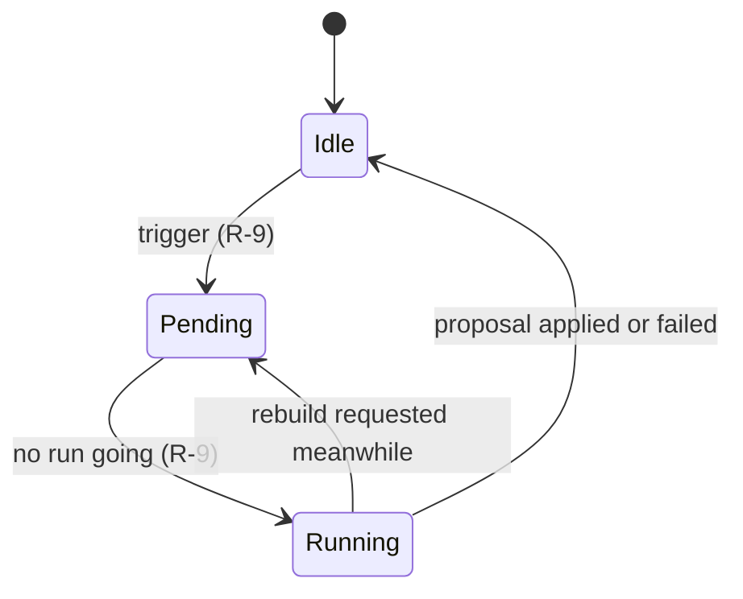

# Data model: A home of shelves, started by onboarding

The rest of the model is unchanged: [052 data-model](../052-smart-folders/data-model.md)
for smart folders, [051 data-model](../051-tag-kinds/data-model.md) for tag
kinds and the [migrations](../../internal/store/migrations/).

## Migration

`00056_home_shelves.sql` adds `home_position` to `smart_folders` and the
index `smart_folders_home_idx(home_position)` where it is not null. No row
gets a position, so the home starts with no folder shelf until onboarding,
the first run (R-9) or the owner adds one.

`00057_group_closure.sql` adds the [group closure](#group-closure) tables
with their backfill and triggers, and the indexes the shelf read walks
(R-12): `video_locations_mtime_idx(mtime, video_id)`,
`video_locations_created_idx(coalesce(file_created_at, mtime), video_id)` and
`playback_progress_updated_idx(updated_at, content_key)`.

## `smart_folders.home_position`

| Field | Type | Null | Meaning |
| --- | --- | --- | --- |
| `home_position` | integer | yes | The shelf's place on the home, smallest first; null when the folder is not a shelf |

Shelves are ordered by `home_position`, then `id`. Positions need not be
consecutive; a write that orders shelves rewrites every position as 1, 2, 3
and so on.

## Group closure

The shelf read decides group cards from persisted group structure instead of
a recursive query per read
([R-12](research.md#r-12-the-home-lists-shelf-summaries-shelf-items-are-read-on-screen)).

`group_closure`, one row per (group, descendant video item):

| Field | Type | Meaning |
| --- | --- | --- |
| `root_id` | integer | The group; every group is a root here, so favorite-only shelves can use nested groups |
| `content_key` | text | The descendant item's key: the video's content key, or the bundle's user key for a bundled video |
| `sort_key` | text | The play-order key, the position at each level as 10 digits (the descendants CTE of 048) |

Index `group_closure_key_idx(content_key, root_id)` answers "which groups hold
this video".

`group_root_values`, one row per (group, `audience`: 1 the owner, 0 a
guest), the card values over the descendants that viewer is shown:

| Field | Meaning |
| --- | --- |
| `members` | Shown descendants; 0 when none |
| `added_at`, `mtime`, `created_at`, `played_at` | The largest value among them |
| `duration_ms`, `size_bytes` | Their sums |
| `watched`, `started` | Descendants completed, and completed or started; the group's watch state follows 048 |
| `playable` | Whether any descendant plays in the browser |
| `added_member`, `mtime_member`, `created_member`, `played_member` | The descendant with the largest value (ties by the larger id); a shelf walking that sort key places the card at this video |

`home_shelved_videos` holds the user key of every video the owner is shown
that matches some folder shelf's effective rule as a video
([R-11](research.md#r-11-unshelved-means-matching-no-home-shelf-computed-on-read));
`home_shelved_dirty` lists keys to recompute, and `home_shelved_state` holds
the flag that every key is to be recomputed. `group_closure_dirty` holds one
row with a flag.

| Rule | Enforced in |
| --- | --- |
| Every write that changes group structure rebuilds `group_closure` in the same transaction | `store`: `writeGroups` (group and organize writes), `rebuildFolderIndex` (folder groups, media folders, bundles, successions, undo), `rekeyGroupItems` |
| A write to `groups` or `group_items` sets the dirty flag; the maintenance after the next committed write rebuilds | SQL triggers; `store` `maintainHomeIndexes` |
| A write to `videos`, `video_locations` or `playback_progress` deletes the values of the groups holding that video for both viewers; a write to `public_videos` deletes the guest's; a write to `media_folders`, `video_bundles` or `video_bundle_members` deletes them all | SQL triggers |
| A write to `videos`, `video_locations`, `video_tags`, `playback_progress`, `video_favorites` or the work-info links marks the video's key; a write to `smart_folders`, `tags`, `tag_names`, `video_folder_names`, `media_folders` or `video_bundle_members` flags every key | SQL triggers |
| After every committed write (`publishEvents`) and after `Migrate`, the maintenance refills the missing values for both viewers, recomputes the marked keys (all of them when flagged) and rebuilds the closure if its flag is set; a read never writes | `store` `maintainHomeIndexes` |
| A read whose values are still missing aggregates those groups' descendants itself; a read that finds shelved marks pending evaluates the shelf rules per walked row instead of the table | `store` shelf read |

## Settings

The keys live in the existing `settings` table.

| Key | Value | Missing means |
| --- | --- | --- |
| `onboarding.step` | `folders`, `scan`, `interests` or `done` (R-3) | `done` when a media folder exists, else `folders` |
| `home.organize.pending` | `rebuild` or `extend` | No run waiting |
| `home.organize.last` | JSON of the last finished run, below | No run has finished |

`home.organize.last`:

| Field | Meaning |
| --- | --- |
| `run` | `rebuild` or `extend` |
| `outcome` | `done`, `failed`, or `unchanged` when the proposal changed nothing |
| `finishedAt` | Unix ms |
| `added`, `removed` | Shelves inserted and deleted |

## Organizer state

The state the home and Settings show is the pending run, whether a run is
going now (held in memory), and the last finished run.

## Interest catalog

`domain.InterestCatalog` is code, not a table (R-5). Each interest has a
stable id, the tag name and a synonym; the screen lists them in this order.

| Id | Tag name | Synonym |
| --- | --- | --- |
| `anime` | Anime | `アニメ` |
| `movies` | Movies | `映画` |
| `drama` | Drama | `ドラマ` |
| `documentary` | Documentary | `ドキュメンタリー` |
| `comedy` | Comedy | `お笑い` |
| `music` | Music | `音楽` |
| `live` | Live performances | `ライブ` |
| `games` | Games | `ゲーム` |
| `sports` | Sports | `スポーツ` |
| `fitness` | Fitness | `フィットネス` |
| `cooking` | Cooking | `料理` |
| `travel` | Travel | `旅行` |
| `animals` | Animals | `動物` |
| `nature` | Nature | `自然` |
| `family` | Family | `家族` |
| `kids` | Kids | `子供向け` |
| `education` | Education | `教育` |
| `science` | Science | `科学` |
| `technology` | Technology | `テクノロジー` |
| `cars` | Cars | `車` |
| `crafts` | Crafts | `工作` |
| `art` | Art | `アート` |
| `fashion` | Fashion | `ファッション` |
| `news` | News | `ニュース` |

## Proposed shelf

The organizer returns a list of proposed shelves; nothing stores it.

| Field | Meaning |
| --- | --- |
| `name` | 1 to 100 characters, the folder name rules of 052 |
| `rule` | A `SmartRule` with exactly one of `tags` (one id), `person` or `organization` (R-2) |

## Rules

| Rule | Enforced in |
| --- | --- |
| A proposed shelf whose rule fails `SmartRule.Validate` or matches no shown video is dropped | `domain` (validation), `store` (match count) in the apply transaction |
| A proposed shelf repeating an organizer folder's rule keeps that folder under the proposed name in a rebuild; one repeating an owner-kept shelf's rule, or any shelf's rule in an extend, is dropped | `domain` (rule equality), `store` apply transaction (R-8) |
| A rebuild deletes only folders with `owner_kept` 0 | `store`, apply transaction (R-8) |
| An extend inserts and never deletes or renames | `store`, apply transaction (R-8) |
| An owner write to `home_position` sets `owner_kept` to 1 | `store`, shelf order write (R-7) |
| An interest uses the tag whose name or synonym equals its tag name or synonym, else a new tag with the synonym; a tag with no kind gets `Genre`, made again when missing | `store`, interests transaction (R-5, R-6) |
| An interest whose rule is already a home shelf's adds no shelf | `store`, interests transaction (R-6) |
| At most 50 shelves are on the home; neither the organizer nor onboarding inserts a shelf past that | `domain` limit, `store` transactions |
| An organizer or interest folder is a root folder with the folder sort `addedDesc` | `domain`, proposal to `SmartFolderCreate` |
| The onboarding step is one of the four values; a write sets the step it names | `domain` (values), `store` (setting write) (R-3) |

## What does not change

`smart_folders.owner_kept` keeps the meaning of 052 R-10; the organizer is
the write path that R-10 left for this feature. Smart folder contents, cards,
favorites and playlist items do not change: a shelf is read as the folder it
is. No table records which video is on which shelf (R-11); the group closure
records group structure, not shelf membership. Media folders,
scans, tags and auto-tagging keep their tables; onboarding writes through
them.
