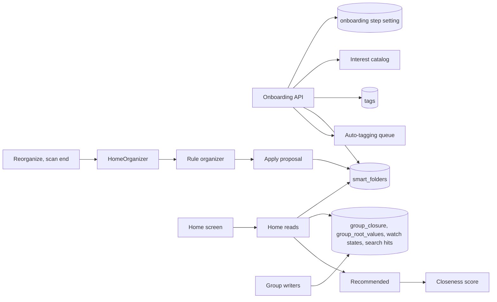
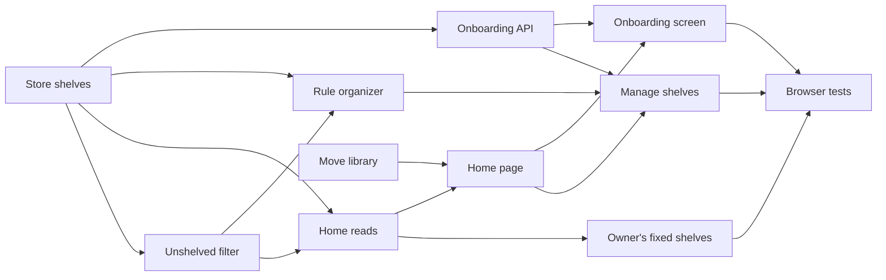

# Implementation Plan: A home of shelves, started by onboarding

**Branch**: `feature/057-ai-home` | **Parent Issue**: #1140

**Input**: The parent Issue. It is this feature's specification.

## Summary

The top becomes a home of shelves: each shelf is a smart folder with a home
position, followed by the continue watching, recently added, unshelved and
recommended shelves, and pressing a card plays. Onboarding walks the owner
through adding a media folder, starting a scan and picking interests from a
built-in list; each interest becomes a tag with a kind and a shelf of the
owner's. The rule organizer adds shelves for well-used tags, people and
organizations. Nothing needs AI; when auto-tagging is set up it fills the
interest shelves. The library screen moves to `/library`.

The diagram shows the parts this feature adds or changes and what each one
reads or writes.



| Concern | Approach |
| --- | --- |
| No AI | One organizer, by rules; AI organizing is #1307 ([R-1](research.md#r-1-one-organizer-by-rules-ai-organizing-is-left-to-1307)) |
| Organizer shelves | Tags, people and organizations on 5 or more shown videos ([R-2](research.md#r-2-the-rule-organizer-makes-shelves-from-tags-people-and-organizations)) |
| Onboarding progress | One step in a setting, read by any client ([R-3](research.md#r-3-onboarding-progress-is-one-step-held-in-a-setting)) |
| Onboarding and screens | Its own routes for the step and interests; folders and scans keep theirs; the Web app checks the step on every route ([R-4](research.md#r-4-onboarding-adds-routes-for-its-step-and-interests-only)) |
| Interests | A catalog in the domain, under the kind `Genre` ([R-5](research.md#r-5-the-interest-catalog-is-built-in-and-files-its-tags-under-genre)) |
| Interest shelves | An owner shelf per interest; auto-tagging asked again ([R-6](research.md#r-6-a-picked-interest-becomes-an-owner-shelf-and-auto-tagging-is-asked-again)) |
| Shelves | Smart folders with `home_position` ([R-7](research.md#r-7-a-shelf-is-a-smart-folder-with-a-home-position), [data-model.md](data-model.md#smart_foldershome_position)) |
| Rebuild and extend | One transaction; owner-kept folders untouched ([R-8](research.md#r-8-a-rebuild-replaces-the-organizers-folders-in-one-transaction-an-extend-only-adds)) |
| When it runs | A pending run in settings, triggered by events ([R-9](research.md#r-9-one-run-at-a-time-queued-in-settings-triggered-by-events), [R-10](research.md#r-10-an-extend-runs-when-20-or-more-shown-videos-are-unshelved)) |
| Unshelved | A library filter evaluated on read; the unshelved shelf reads the write-maintained `home_shelved_videos` ([R-11](research.md#r-11-unshelved-means-matching-no-home-shelf-computed-on-read), [R-12](research.md#r-12-the-home-lists-shelf-summaries-shelf-items-are-read-on-screen)) |
| Reads | Summaries, then items for the shelves on screen by an index walk over persisted group structure, 1 s budget ([R-12](research.md#r-12-the-home-lists-shelf-summaries-shelf-items-are-read-on-screen), [data-model.md](data-model.md#group-closure)) |
| Fixed shelves | Continue watching and recommended for the owner; recent and unshelved for all ([R-13](research.md#r-13-four-fixed-shelves-two-of-them-the-owners-only)) |
| Playback | The video page with autoplay ([R-14](research.md#r-14-pressing-a-shelf-card-plays)) |
| Routes | Library at `/library`, old URLs redirected ([R-15](research.md#r-15-the-library-moves-to-library)) |
| Events | `HomeChanged` and the `home` screen event ([R-16](research.md#r-16-homechanged-tells-open-screens-to-read-the-home-again)) |

The Issue was split on 2026-10-16: the maintainer asked that the home work
without AI and depend on no unimplemented Issue, so the owner's policy and the
AI organizer moved to #1307, and initial tag presets stay with #1137. The
shelf items read was redesigned on 2026-10-17
([R-12](research.md#r-12-the-home-lists-shelf-summaries-shelf-items-are-read-on-screen)):
the maintainer rejected reading each shelf through the library items query,
which evaluated every video before taking a shelf's first 24 items.

The Issue has the `ui` label, so the `design` stage writes `ui-design.md`
before the screen units: onboarding with its three steps and skipping, the
home with its shelf rows, the search box and `See all`, the empty home, how
the fixed shelves read apart from the folder shelves, adding, removing and
ordering shelves, and the Settings section that restarts onboarding and
reorganizes, judged against the parent Issue's `UI品質`.

## Technical Context

**Canonical definitions**:

| Topic | Source |
| --- | --- |
| Boundaries, store roles, events after commit, the viewer of every read | [ARCHITECTURE.md](../../ARCHITECTURE.md), [.golangci.yml](../../.golangci.yml) (depguard) |
| Smart folders, rules, `owner_kept`, contents, cards, read budget | [052 plan](../052-smart-folders/plan.md), [052 data-model](../052-smart-folders/data-model.md), [052 research](../052-smart-folders/research.md) |
| Tag kinds and the seeded `Genre` | [051 data-model](../051-tag-kinds/data-model.md), [`internal/domain/tag_kind.go`](../../internal/domain/tag_kind.go) |
| Tags, synonyms | [`internal/store/tags.go`](../../internal/store/tags.go) |
| Auto-tagging, its candidates and "Tag all videos again" | [auto-tagging.md](../../docs/design-docs/auto-tagging.md) |
| Media folders and scans | `/api/media-folders` and `/api/scans` in [api/openapi.yaml](../../api/openapi.yaml) |
| People, organizations and their videos | [047 data-model](../047-video-work-info/data-model.md) |
| Account setup and the auth gate | [016 data-model](../016-single-account-auth/data-model.md), [`web/src/auth/AuthGate.tsx`](../../web/src/auth/AuthGate.tsx) |
| Closeness score | [related-videos.md](../../docs/design-docs/related-videos.md) |
| Watch history, favorites | [043 data-model](../043-watch-history/data-model.md), [035 data-model](../035-favorites/data-model.md) |
| Library screen, its URL and cards | [library-ui.md](../../docs/design-docs/library-ui.md), [`web/src/videoList/listCriteria.ts`](../../web/src/videoList/listCriteria.ts) |
| Screen API and generated code | [api/openapi.yaml](../../api/openapi.yaml), `task generate` |
| Screens and Web tests | [design-system.md](../../docs/design-docs/design-system.md), [web-testing.md](../../docs/design-docs/web-testing.md), [i18n.md](../../docs/design-docs/i18n.md) |
| Checks | [Taskfile.yml](../../Taskfile.yml) (`task check`, `task check-docs`, `task test-e2e`) |

**Feature-specific context**:

- Three migrations: the home position, the group closure with the sort-key
  indexes, and the card columns, watch states and search hits
  ([data-model.md, Migration](data-model.md#migration)).
- Eight routes, one list parameter and one screen event kind on the screen API
  ([contracts/screen-api.md](contracts/screen-api.md)); the external API and
  MCP do not change.
- No unit waits for another Issue: the home uses tags, tag kinds, smart
  folders, auto-tagging, work information, watch history and favorites as
  they are on `main`.
- `Scans.OnFinish` holds one callback today; it becomes a list
  ([R-9](research.md#r-9-one-run-at-a-time-queued-in-settings-triggered-by-events)).

## Constitution Check

| Rule (source) | Verdict |
| --- | --- |
| Adapters import neither each other nor `internal/app` (ARCHITECTURE.md, depguard) | Pass: `Onboarding` and `HomeOrganizer` in `internal/app` reach the store and the auto-tagger through interfaces they declare; `internal/httpapi` declares `Home` and `Onboarding` interfaces |
| The domain decides, the store enforces (ARCHITECTURE.md) | Pass: the catalog, the step order and the rule organizer's choice are pure domain rules; the apply transaction re-reads `owner_kept` and the match counts |
| Store roles (ARCHITECTURE.md) | Pass: a new `HomeStore` role; inserting and deleting folders inside its transactions uses package-private helpers shared with `SmartFolderStore` and `TagStore` |
| Events after commit (ARCHITECTURE.md) | Pass: `HomeChanged`, `SmartFoldersChanged` and the tag events are published after the transactions commit |
| User data survives a rebuild (ARCHITECTURE.md) | Pass: `home_position` is on `smart_folders`, keyed by its own id; the onboarding step is a setting |
| Every read knows its viewer (ARCHITECTURE.md) | Pass: shelf items, unshelved and recent are cut to the viewer; continue watching, recommended, the organizer state and onboarding are owner only |
| Only a scan reads the media folders' files (ARCHITECTURE.md) | Pass: onboarding starts a scan through the existing scan route and reads no file |
| Do not hand-edit generated files (AGENTS.md) | Pass: `api/openapi.yaml` changes, then `task generate` |
| Complexity 25 or less, no copied code (AGENTS.md) | Pass: unshelved negates the existing per-video match; shelf items apply the library items' rules row by row over persisted group structure, with the library read as the test oracle and its condition, order, descendants and item loaders shared; interests reuse tag creation and synonyms; recommended calls `ContentRelatedness` |
| Read design-system.md before a screen; test at the lowest level (AGENTS.md) | Pass: screens follow `ui-design.md`; the shelf row becomes a registry item; the organizer and onboarding get app tests with fakes, the store its tests and a benchmark, screens page tests, the acceptance criteria browser tests |

No violation, so no complexity tracking.

## Project Structure

### Documentation (this feature)

```text
specs/057-home/
├── plan.md
├── research.md
├── data-model.md
└── contracts/
    └── screen-api.md
```

`ui-design.md` is written by the `design` stage. No `quickstart.md`: the
browser tests cover onboarding and the home, with auto-tagging's result put in
place by the test's API calls, so nothing is left to run by hand.

### Source Code

**Affected boundaries**:

| Boundary | What it owns in this feature |
| --- | --- |
| `internal/domain` | The interest catalog, the onboarding step and its order, proposed shelves and their limits, the rule organizer's choice, `VideoQuery.Unshelved`, `HomeChanged`, the organizer state |
| `internal/store` | The migrations, `HomeStore` (summaries, shelf items, order, apply, interest shelves), the group closure and its maintenance by the group writers, the unshelved condition, the seed queries for recommended and continue watching, the settings keys, the benchmark |
| `internal/app` | `Onboarding` (step, interests, asking auto-tagging again), `HomeOrganizer` (triggers, pending run, rule organizer), recommended scoring and its cache, the `Scans.OnFinish` list |
| `internal/httpapi`, `api/openapi.yaml`, `cmd/mdm` | The routes, the `unshelved` parameter, the `home` event, the wiring |
| `web/src/onboarding` (new), `web/src/home` (new), `web/src/app`, `web/src/auth`, `web/src/shell`, `web/src/settings`, `web/src/library`, `web/src/smartFolders`, `web/src/ui`, `web/src/i18n` | The onboarding page and its gate, the home page and shelf row, the routes and redirect, the sidebar, the Settings section, the empty library, the folder page action |
| `docs/design-docs` | A new `home.md`, and updates to `library-ui.md` and `auto-tagging.md` |
| `web/e2e` | Existing tests that open `/` for the library, and the new browser tests |

**New paths**: `internal/store/migrations/000NN_home_shelves.sql`,
`internal/domain/home.go`, `internal/domain/onboarding.go`,
`internal/store/home.go`, `internal/app/home_organizer.go`,
`internal/app/onboarding.go`, `internal/httpapi/home.go`,
`internal/httpapi/onboarding.go`, `web/src/api/home.ts`,
`web/src/api/onboarding.ts`, `web/src/onboarding/`, `web/src/home/`,
`docs/design-docs/home.md`, `web/e2e/onboarding.e2e.ts`,
`web/e2e/home.e2e.ts`.

**Structure decision**: Follows the existing layout, with the home and
onboarding as use cases and screen folders of their own beside smart folders
([R-7](research.md#r-7-a-shelf-is-a-smart-folder-with-a-home-position)).

## Implementation Work

The diagram shows which units have to land first. The screen units also wait
for the `design` stage's `ui-design.md`.



### Store home shelves on smart folders and apply an organizer's proposal

**Scope**: The migration, the proposed shelf and its limits in the domain,
`HomeStore` with the shelf summaries, the shelf order write (setting
`owner_kept`), the apply transaction for a rebuild and an extend, the
`HomeChanged` event, and the organizer settings keys
([data-model.md](data-model.md),
[R-7](research.md#r-7-a-shelf-is-a-smart-folder-with-a-home-position),
[R-8](research.md#r-8-a-rebuild-replaces-the-organizers-folders-in-one-transaction-an-extend-only-adds)).

**Dependencies**: None.

**Acceptance**: `task check` passes; store tests show: a rebuild deletes an
organizer folder whose rule the proposal does not repeat, keeps one whose rule
it repeats with the same id and favorite under the proposed name, drops a
proposal repeating an owner-kept shelf's rule, and leaves an owner-kept folder
as it was; an extend adds shelves after the last one and changes no existing
name or rule; a proposed rule that matches no video is dropped; ordering
shelves sets `owner_kept` to 1; `HomeChanged` is published after commit and
not after a rollback.

### Filter the library to videos in no home shelf

**Scope**: `VideoQuery.Unshelved`, its condition as the negation of the
per-video match of every home shelf's effective rule, the `unshelved` list
parameter with guest access, and its API client parameter; no screen change
([R-11](research.md#r-11-unshelved-means-matching-no-home-shelf-computed-on-read),
[contracts/screen-api.md, Schemas and parameters changed](contracts/screen-api.md#schemas-and-parameters-changed)).

**Dependencies**: Store home shelves on smart folders and apply an organizer's
proposal.

**Acceptance**: `task check` passes with no diff from `task generate`; store
tests show `unshelved=1` lists a video that matches no shelf, not one that
matches a child shelf's path, and lists again a video whose folder was removed
from the home; a guest sees no hidden video in it.

### Read the home's shelves and their first items

**Scope**: `GET /api/home`, `GET /api/home/shelves` for folder, unshelved and
recently added shelves, `PUT /api/home/shelves`, `onHome` on the smart folder,
the `home` screen event, the empty home's reason, and the R-12 benchmark
([contracts/screen-api.md](contracts/screen-api.md),
[R-12](research.md#r-12-the-home-lists-shelf-summaries-shelf-items-are-read-on-screen),
[R-16](research.md#r-16-homechanged-tells-open-screens-to-read-the-home-again)).

**Dependencies**: Filter the library to videos in no home shelf.

**Acceptance**: `task check` passes; handler tests show the shelves in their
order with the fixed shelves after them, a guest gets no organizer state and
no shelf whose folder has nothing visible, a folder shelf's items hold no
child folder, `keys` over 8 is `400 invalid_request`, and `PUT` with an
unknown id is `404`; the benchmark at 20,000 videos and 50 shelves returns
each read within 1 second.

### Add the owner's continue watching and recommended shelves

**Scope**: The continue watching shelf (videos in progress, latest played
first), the recommended seed query (most played in 90 days, latest
favorites), ranking by the highest closeness to any seed, the 10-minute
cache, and both shelves in the home reads for the owner only
([R-13](research.md#r-13-four-fixed-shelves-two-of-them-the-owners-only)).

**Dependencies**: Read the home's shelves and their first items.

**Acceptance**: `task check` passes; store tests show continue watching lists
a video stopped halfway and not a completed or unplayed one, latest played
first (acceptance criterion 6); app tests with a fake scorer show recommended
excludes seeds and completed videos and orders by the highest score; handler
tests show both shelves are absent for a guest and recommended is absent for
an owner with no plays and no favorites.

### Organize the home by rules

**Scope**: `HomeOrganizer` with the pending run, its triggers (`Reorganize`,
scan end after the queues drain, the first run), the `Scans.OnFinish` list,
the rule organizer over tags, people and organizations,
`POST /api/home/organize`, and `docs/design-docs/home.md` with its
translation
([R-1](research.md#r-1-one-organizer-by-rules-ai-organizing-is-left-to-1307),
[R-2](research.md#r-2-the-rule-organizer-makes-shelves-from-tags-people-and-organizations),
[R-9](research.md#r-9-one-run-at-a-time-queued-in-settings-triggered-by-events),
[R-10](research.md#r-10-an-extend-runs-when-20-or-more-shown-videos-are-unshelved)).

**Dependencies**: Filter the library to videos in no home shelf.

**Acceptance**: `task check` and `task check-docs` pass; app tests show: a
rebuild makes one shelf per tag, person and organization on 5 or more shown
videos and none for a tentative tag or one on 4; a scan end with 20 unshelved
videos runs an extend only after the queues are empty and adds the new tag's
shelf without renaming another (acceptance criterion 5), and with 19 runs
nothing; a pending run survives a restart; a rebuild requested during a run
runs after it; a rebuild leaves an owner-kept shelf and an interest shelf as
they were (acceptance criterion 7).

### Keep onboarding's step and turn picked interests into shelves

**Scope**: The interest catalog, the onboarding step setting and its default
for an existing library, `GET` and `PUT /api/onboarding`,
`GET /api/onboarding/interests`, `POST /api/onboarding/interests` (find or
create the tag and the kind, create the owner shelf, ask auto-tagging again),
and the `auto-tagging.md` note that picking interests queues every video
([R-3](research.md#r-3-onboarding-progress-is-one-step-held-in-a-setting),
[R-4](research.md#r-4-onboarding-adds-routes-for-its-step-and-interests-only),
[R-5](research.md#r-5-the-interest-catalog-is-built-in-and-files-its-tags-under-genre),
[R-6](research.md#r-6-a-picked-interest-becomes-an-owner-shelf-and-auto-tagging-is-asked-again)).

**Dependencies**: Store home shelves on smart folders and apply an organizer's
proposal.

**Acceptance**: `task check` and `task check-docs` pass; store and app tests
show: picking two interests makes two tags of kind `Genre` and two owner
shelves (acceptance criterion 3); an interest whose name or synonym is already
a tag uses that tag and makes no second one; a deleted `Genre` kind is made
again; picking an interest twice makes one shelf; with auto-tagging on, every
video is queued, and with it off nothing is queued and the shelves are still
made; handler tests show the step defaults to `done` when a media folder
exists and to `folders` when none does, a guest gets `403`, an unknown step or
interest id is `400`, and two `PUT`s leave the later step (Edge Case).

### Move the library screen to /library

**Scope**: The `/library` route, the redirect of `/` with library parameters,
every in-app `/?tag=`, `/?person=` and `/?organization=` link, the sidebar's
`Home` and `Library` entries, `/` as a placeholder that redirects to
`/library` until the home page lands, the e2e tests that open `/` for the
library, and `library-ui.md` with its translation
([R-15](research.md#r-15-the-library-moves-to-library)).

**Dependencies**: None.

**Acceptance**: `task check` and `task check-docs` pass; page tests show
`/?tag=3` opens `/library?tag=3` with the tag filter applied and a tag chip on
a video page opens `/library?tag=<id>`; the browser tests pass against
`/library`; the screen changes, so a visual check of the sidebar is owed.

### Show the home's shelves and play from them

**Scope**: The home page at `/`: the shelf rows read on screen, the shelf row
as a registry item, pressing a card to play (R-14), the shelf heading opening
the folder, `See all` (folder page, `/library?unshelved=1`, `/library` sorted
by date added, `/history` for continue watching), the search box opening
`/library?q=`, the empty home, and reloading on `home` and `smartFolder`
events, following `ui-design.md`
([R-12](research.md#r-12-the-home-lists-shelf-summaries-shelf-items-are-read-on-screen),
[R-14](research.md#r-14-pressing-a-shelf-card-plays)).

**Dependencies**: Read the home's shelves and their first items; Move the
library screen to /library.

**Acceptance**: `task check` passes; page tests show one press on a shelf card
navigates to the video page with autoplay and `?smartFolder`, and typing in
the search box opens `/library?q=`; the screen changes, so a visual check of
the home on desktop and mobile widths is owed.

### Manage home shelves and reorganize

**Scope**: Adding, removing and ordering shelves on the home; `Add to home`
and `Remove from home` on a smart folder page; the Settings section with
`Reorganize`, the last run and `Start onboarding again`; following
`ui-design.md`
([R-7](research.md#r-7-a-shelf-is-a-smart-folder-with-a-home-position),
[R-9](research.md#r-9-one-run-at-a-time-queued-in-settings-triggered-by-events)).

**Dependencies**: Show the home's shelves and play from them; Organize the
home by rules; Keep onboarding's step and turn picked interests into shelves
(`Start onboarding again` writes the step through `PUT /api/onboarding`).

**Acceptance**: `task check` passes; page tests show `Reorganize` calls
`POST /api/home/organize`, moving a shelf sends the new order, and
`Start onboarding again` sets the step to `folders`; the screens change, so a
visual check is owed.

### Walk the owner through onboarding from any screen

**Scope**: The onboarding page with its three steps (add a media folder
through `/api/media-folders`, start a scan through `/api/scans` and show its
progress, pick interests), skipping each step, the gate in the app shell that
sends the owner to onboarding from any route while the step is not `done`, the
empty library's action, and reloading on the step's change, following
`ui-design.md`
([R-3](research.md#r-3-onboarding-progress-is-one-step-held-in-a-setting),
[R-4](research.md#r-4-onboarding-adds-routes-for-its-step-and-interests-only)).

**Dependencies**: Keep onboarding's step and turn picked interests into
shelves; Show the home's shelves and play from them.

**Acceptance**: `task check` passes; page tests show the owner opening
`/library` or `/settings` with the step `scan` lands on the scan step, a guest
is never sent there, skipping writes the next step, and finishing opens the
home; the screens change, so a visual check on desktop and mobile widths is
owed.

### Cover onboarding and the home in browser tests

**Scope**: `web/e2e/onboarding.e2e.ts` for acceptance criteria 3 and 4, with
the interest tag put on a video through the API in place of auto-tagging, and
`web/e2e/home.e2e.ts` for acceptance criteria 1, 2, 5, 6, 7 and 8.

**Dependencies**: Walk the owner through onboarding from any screen; Manage
home shelves and reorganize; Add the owner's continue watching and recommended
shelves.

**Acceptance**: `task test-e2e -- e2e/onboarding.e2e.ts e2e/home.e2e.ts`
passes and CI's `Browser E2E` job passes.
