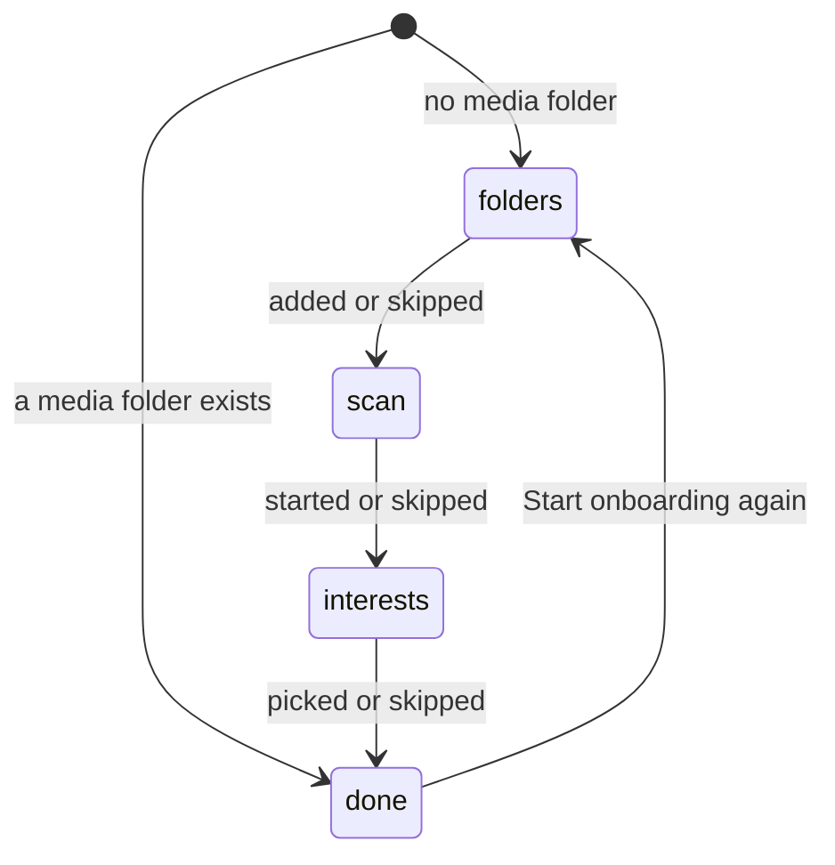
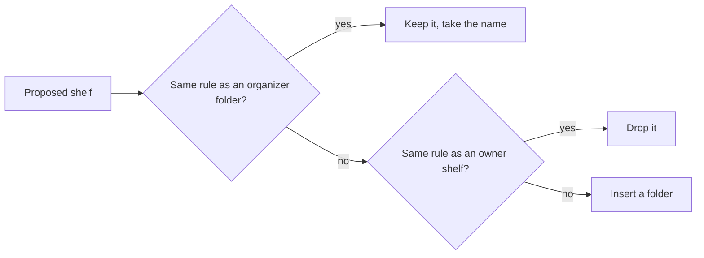

# Research: A home of shelves, started by onboarding

Inherited decisions: smart folders, their rules, `owner_kept`, contents
computed on read and the read budget
([052 research](../052-smart-folders/research.md)); tag kinds and the seeded
`Genre` ([051 research, R-2](../051-tag-kinds/research.md#r-2-preset-kinds-are-seeded-rows-with-no-special-status));
auto-tagging and its candidates ([auto-tagging.md](../../docs/design-docs/auto-tagging.md));
the closeness score ([related-videos.md](../../docs/design-docs/related-videos.md)).
This file records only the decisions this feature adds.

## R-1: One organizer, by rules; AI organizing is left to #1307

**Decision**: `app.HomeOrganizer` builds shelves with the rule organizer
only; it returns a list of proposed shelves, and one apply step stores them,
so #1307 can add an organizer that returns the same list.

| Option | Verdict |
| --- | --- |
| **Rules only** | Chosen |
| An AI organizer through the generator port of #1138 | Rejected by the maintainer (2026-10-16): the feature must not depend on an unimplemented Issue, and the owner's policy moved to #1307 |
| Rule candidates ranked by the classifier against a policy | Rejected: the classifier on `main` answers yes or no, so it could only reorder the rule organizer's shelves, and the policy that would steer it is #1307's |

**Rationale**: Every input the rule organizer reads (tags, people,
organizations, the library) is on `main` with or without an Ollama
connection, so the home behaves the same on every install.

## R-2: The rule organizer makes shelves from tags, people and organizations

**Decision**: The rule organizer proposes one shelf per ordinary tag on at
least 5 shown videos (rule `{"tags": [id]}`), one per person
(`{"person": id}`) and one per organization (`{"organization": id}`) linked to
at least 5 shown videos, each named after its tag, person or organization, at
most 24 in all; tags with a kind come first by kind id, then tags without a
kind, then people, then organizations, each by video count descending.

| Option | Verdict |
| --- | --- |
| **Tags, people and organizations** | Chosen |
| Tags with a kind only | Rejected by the maintainer (2026-10-16): a library without kinded tags got no content shelf, and people and organizations already tell what a video is |
| One shelf per kind (`tagKind` rule) | Rejected: a `Genre` shelf holds every video with any genre tag, which sorts nothing |
| Shelves from folder names or durations | Rejected: the Issue's `対象外` |

**Rationale**: The minimum of 5 videos keeps a shelf from being one row of
one card. A tentative tag is not used: it is the auto-tagger's guess, not a
tag the owner accepted. People and organizations come from work information
(047), so they appear as soon as it is fetched, without AI.

## R-3: Onboarding progress is one step held in a setting

**Decision**: The setting `onboarding.step` holds `folders`, `scan`,
`interests` or `done`; any owner client reads and writes it, and a write sets
the step it names, so of two clients the later write wins. A missing setting
reads as `done` when a media folder exists and as `folders` otherwise.

| Option | Verdict |
| --- | --- |
| **One step in a setting** | Chosen |
| Browser storage | Rejected: requirement 4 resumes onboarding on another device |
| Derived from facts (folders, scans, interest shelves) | Rejected: a skipped step leaves no fact, so a skipped interest step would come back on every visit |
| A list of finished steps | Rejected: the steps run in one order, so the current step says everything, and two clients cannot leave a list half merged |

**Rationale**: The default keeps an existing install with a library out of
onboarding after the upgrade; its owner can start it again from Settings.
Writing the named step instead of "advance" makes a repeated or late write
harmless (Edge Case on two devices).

## R-4: Onboarding adds routes for its step and interests only

**Decision**: Onboarding adds `GET` and `PUT /api/onboarding` for the step
and `GET` and `POST /api/onboarding/interests`; adding a media folder and
starting a scan use `/api/media-folders` and `/api/scans` as they are. The Web
app checks the step in the app shell, so an owner who opens any route while it
is not `done` lands on onboarding.

| Option | Verdict |
| --- | --- |
| **Step and interests routes; existing folder and scan routes** | Chosen |
| Onboarding routes that wrap adding a folder and starting a scan | Rejected: they would copy two existing operations and their errors |
| Onboarding shown from the empty library screen | Rejected by the maintainer (2026-10-16): onboarding must not depend on a screen; requirement 4 replaces the empty library's link to Settings |

**Rationale**: The state is on the server, so the external API or another
client can drive the same steps later; the screens only read and write the
step. Guests never see onboarding: the step routes are owner only.

## R-5: The interest catalog is built in and files its tags under `Genre`

**Decision**: `domain.InterestCatalog` is a fixed list of interests, each
with a stable id, an English name and a Japanese synonym ([data-model.md,
Interest catalog](data-model.md#interest-catalog)); a picked interest's tag
gets the kind named `Genre`, made again when the owner deleted it.

| Option | Verdict |
| --- | --- |
| **A list in the domain** | Chosen |
| The presets of #1137 | Rejected by the maintainer (2026-10-16): #1137 is not implemented |
| A file the owner edits | Rejected: picking interests is the first thing a new owner does, before there is anything to edit |
| Free text entry only | Rejected: a new owner does not know which names the auto-tagger answers well, and a list is one press per interest |

**Rationale**: The screen is English only (i18n.md), so the tag takes the
English name; the Japanese synonym makes an existing Japanese tag of the
same meaning match instead of a second tag (Edge Case), and search finds the
tag by either name. `Genre` is the seeded kind of 051 for this kind of tag.

## R-6: A picked interest becomes an owner shelf, and auto-tagging is asked again

**Decision**: `POST /api/onboarding/interests` runs one transaction per
request that finds each interest's tag by name or synonym or creates it with
the synonym, sets its kind to `Genre` when it has none, and creates a root
smart folder `{"tags": [id]}` with `owner_kept` 1 and the next home position
unless a home shelf already has that rule; after commit, when auto-tagging is
on, it queues every video as "Tag all videos again" does.

| Option | Verdict |
| --- | --- |
| **Owner shelves, every video queued** | Chosen |
| Organizer shelves (`owner_kept` 0) | Rejected: a rebuild would delete an interest shelf that has no video yet (requirement 9) |
| Queue only videos not yet judged | Rejected: a video judged before the interest was picked would never be asked about the new tag (auto-tagging.md, candidates) |
| Make the shelves without asking auto-tagging | Rejected: the interest shelves would fill only by hand (acceptance criterion 3) |

**Rationale**: Onboarding runs while the first scan runs, so few videos have
been judged and queuing all costs little; picking interests again later costs
what "Tag all videos again" costs, and the screen says so. A shelf with no
video is not shown (R-12), so an interest shelf appears once auto-tagging or
the owner puts its tag on a video (Edge Case). An existing tag keeps its own
kind: changing it would move the owner's tag.

## R-7: A shelf is a smart folder with a home position

**Decision**: A smart folder is on the home when its `home_position` is set;
the organizer creates root folders with `owner_kept` 0 and a position,
onboarding creates them with `owner_kept` 1, and the owner adds, removes and
orders any folder.

| Option | Verdict |
| --- | --- |
| **A position column on `smart_folders`** | Chosen |
| A separate shelves table that refers to folders | Rejected: a shelf has no field of its own beside its order, so a second table only adds a join and a delete rule |
| Every root folder is a shelf, ordered by name | Rejected: the owner cannot remove or order a shelf (requirement 10) |

**Rationale**: Requirement 2 makes a shelf a smart folder, and the folder's
page is already where "open the whole folder" leads. Any owner change to a
folder's home position sets `owner_kept` to 1, as 052 R-10 does for every
other owner write, so the organizer does not undo it (requirement 9).

## R-8: A rebuild replaces the organizer's folders in one transaction; an extend only adds

**Decision**: A rebuild keeps a folder with `owner_kept` 0 whose rule the
proposal repeats, taking the proposed name (so its id, favorites and playlist
items stay), drops a proposed shelf whose rule an owner-kept shelf already
has, inserts the rest, deletes the folders with `owner_kept` 0 the proposal
did not repeat, and sets the positions, all in one transaction; an extend
only inserts, after the current shelves, and drops a proposed shelf whose rule
any shelf already has.

The diagram shows what a rebuild does with each proposed shelf.

| Option | Verdict |
| --- | --- |
| **One transaction, keep folders whose rule repeats** | Chosen |
| Delete all organizer folders, insert all | Rejected: a favorite or playlist item on an organizer shelf would vanish on every rebuild, even when the shelf comes back unchanged |
| Keep only a folder whose name and rule both repeat | Rejected: a renamed proposal with the same rule would be dropped as a duplicate of the old folder, and the old folder then deleted, so the shelf would vanish |

**Rationale**: The home reads the old shelves until the transaction commits,
so a home opened during a rebuild shows the previous shelves (Edge Case).

## R-9: One run at a time, queued in settings, triggered by events

**Decision**: The organizer keeps at most one pending run, `rebuild` or
`extend` (a rebuild absorbs an extend), in the setting
`home.organize.pending`, runs it on its own goroutine, and resumes it at
startup.

| Trigger | Run |
| --- | --- |
| The owner presses `Reorganize` | `rebuild` |
| A scan finishes as done, and the job queue and the auto-tag queue are then empty for 2 minutes | `extend` when R-10 holds |
| No run has ever finished and the queues are empty after a scan | `rebuild` |

| Option | Verdict |
| --- | --- |
| **A pending setting and an organizer goroutine** | Chosen |
| A kind in the `jobs` table | Rejected: `jobs` rows belong to one video and its location, and a new kind needs a table rebuild for its check |
| A timer that runs every few hours | Rejected: requirement 8 ties adding shelves to the end of a scan |

**Rationale**: New videos get their tags from auto-tagging after the scan
finishes, so the extend waits for the queues to drain; otherwise every new
video would count as unshelved before it had a tag. `Scans.OnFinish` holds one
callback (auto-import's), so it becomes a list of callbacks.

## R-10: An extend runs when 20 or more shown videos are unshelved

**Decision**: An extend runs when at least 20 videos the owner sees are in no
shelf, and it proposes shelves only from those videos.

| Option | Verdict |
| --- | --- |
| **A fixed count of 20** | Chosen |
| A share of the library (10%) | Rejected: at 20,000 videos it waits for 2,000 unshelved videos, at 50 it runs on 5 |
| Every scan | Rejected: a scan that adds two videos would reshuffle the shelves' order each time |

**Rationale**: 20 is one shelf's first screen of cards, so a new shelf fills
at least that much.

## R-11: Unshelved means matching no home shelf, computed on read

**Decision**: A shown video is unshelved when it matches the effective rule
of no home folder shelf; the library gains an `unshelved` filter that lists
them, and the unshelved shelf and its `See all` read through it.

| Option | Verdict |
| --- | --- |
| **A filter evaluated on read** | Chosen |
| A stored membership table | Rejected: 052 R-2 computes folder contents on read so they never go stale; a stored set would need every tag write to update it |
| Unshelved as matching no smart folder at all | Rejected: a folder the owner removed from the home would still hide its videos from the unshelved shelf |

**Rationale**: The filter is the negation of the per-video match the cards
read already builds (`smartMatchFor`), so it adds no second translation of a
rule.

## R-12: The home lists shelf summaries; shelf items are read on screen

**Decision**: `GET /api/home` returns the ordered shelf summaries and, for
the owner, the organizer state, and `GET /api/home/shelves` returns the first
24 items of up to 8 named shelves; a shelf with no item is left off the
screen; with 20,000 videos and 50 shelves, each returns within 1 second on
the development host, measured by a store benchmark.

Revised 2026-10-17: the shelf items are read by a query of their own, apart
from the library items read, and no step of a read touches every video. The
group structure is persisted ([data-model.md, Group
closure](data-model.md#group-closure)): every writer that changes groups
rebuilds the closure in its transaction; the per-group card values of both
viewers and each video's "on some shelf" flag are invalidated by triggers and
recomputed by the maintenance that follows every committed write, so a read
never writes and an unshelved shelf is an indexed `not exists`. A shelf
walks the base table of its sort key by index (videos by added date,
locations by modified and created date, playback progress by last play) in
keyset batches, applies visibility and the rule to each walked row through
indexed lookups, and stops after one page and one more item; a walked video
is a video item when it is in no group or in a group that is not whole, and a
group card appears at its member with the largest value once the group is
whole, so the group decision (all descendants match, with `is not true` for a
NULL rule result) is made only for the roots that appear. The sorts whose
card value is not one member's (total length and size, the group's own title
and favorite time, shuffle) read the matched videos and assemble the items
instead; none of the benchmark's 50 shelves uses them. A group card on a
shelf is built from the stored values alone: the counts, sums, dates, watch
state, the open video and the preview thumbnails come from
`group_root_values`, and one query per page reads the groups' names and the
chosen videos' thumbnail versions, so no shelf loads a card's members. The
shelf item therefore carries the card's values without the member ids and
the member tags (`HomeShelfItem` with `LibraryGroupCard`,
[contracts/screen-api.md](contracts/screen-api.md)); the library item keeps
its shape. A shelf whose rule is a watch state alone reads the groups with
that state and the ungrouped videos with that state from the persisted watch
states (`group_root_values.watch_state`, `video_watch_states`) instead of
walking the sort index, and a search shelf reads its hits from
`home_search_hits`, which the maintenance recomputes only after a write that
can change a search result. A shelf whose rule depends on the clock (added
within N days) is left out of the persisted "on some shelf" set and tested
per walked row, so the unshelved shelf follows the calendar without a write.
`total` is counted up to one more than a page (25), where 25 means more than
a page; the screen only reads whether it is 0. The items and their order and
every card value are the library's
([R-14](#r-14-pressing-a-shelf-card-plays)), checked by a test against the
library items read for every sort and both viewers. The 10-minute shelf cache
(PR #1335) stays for repeated opens of the home; it no longer carries the
budget.

| Option | Verdict |
| --- | --- |
| **Summaries, then items for the shelves on screen** | Chosen |
| Every shelf's items in one read | Rejected: 50 shelves are 50 folder reads, as 052 R-13 found for the library cards |
| Items from the smart folder items route, one request per shelf | Rejected: a screen of 6 shelves costs 6 round trips, and the fixed shelves are not folders |
| **A shelf query of its own: an index walk over the base tables with persisted group structure, group cards decided for the roots that appear** | Chosen (2026-10-17) |
| Indexed temporary tables over all shown videos and groups, built once per read | Rejected by the maintainer (2026-10-17): still builds a table over every video per read; 0.9 to 1.0 s for 8 shelves |
| Group structure held in memory across reads | Rejected by the maintainer (2026-10-17): persisted and maintained by the writers instead, so a read never rebuilds it |
| Each shelf through the library items query (the decision until 2026-10-17) | Rejected by the maintainer (2026-10-17): it evaluates the rule over every video, rebuilds the group descendants and every item row before taking 24 items, and joins unindexed `with` tables through automatic indexes; 2.3 to 3.0 s for 8 shelves at 20,000 videos, and the cache helped warm reads only |
| Shelves of videos only | Rejected by the maintainer (2026-10-17): a shelf shows the group cards the library shows (R-14) |
| An exact `total` | Rejected by the maintainer (2026-10-17): counting every item is a full pass over the matched videos; the screen reads only whether the count is 0, so the count stops at 25 |
| Serving `total` from the group structure | Rejected: the count of video items depends on the rule, not only on the groups |
| Building all items and sorting them for every sort | Rejected by the maintainer (2026-10-17): a full match-then-sort per shelf; kept only for the sorts whose card value is not one member's |
| Group descendants recomputed per read by the recursive query | Rejected: 65 to 180 ms per read that every shelf shares; the writers maintain `group_closure` instead |
| **Shelf cards from the stored root values, with the open video and the previews stored per group; the shelf item without member ids and tags** | Chosen (2026-10-17) |
| Shelf cards through the library's group loader | Rejected by the maintainer (2026-10-17): it loads every member of 24 cards per shelf (about 45 ms) and then reads their tags for a union the home never shows |
| **Persisted watch states per video and per group, read by index for watch-only shelves** | Chosen (2026-10-17): a sparse watch shelf walked the whole sort index (about 100 ms) |
| **Persisted search hits per search expression, recomputed only after writes that can change a search result** | Chosen (2026-10-17): the maintenance after a probe or progress write otherwise ran every search shelf's full-text query (about 125 ms per committed write) |
| The clock-dependent rule in the persisted shelved set | Rejected: a video added within N days would stay "on a shelf" after the N days with no write to recompute it |

**Rationale**: It is the pattern of 052 R-14 for folder cards, so a home with
many shelves opens without waiting (Edge Case). On the host of the 2026-10-17
change, `BenchmarkHomeReads` went from 2.25 to 2.5 s to 0.14 to 0.24 s for the
owner's 8 shelves (0.15 to 0.26 s right after a progress write, maintenance
included), from 2.7 s to 0.19 to 0.35 s for a guest's (0.20 to 0.33 s after a
write), and from 0.60 s to 0.003 s for the continue watching shelf alone; the
lower figures are the shelf benchmarks run alone, the higher ones the whole
benchmark, where the recommended benchmarks run first, and the development
host measured the old read at 2.7 to 3.0 s. The maintenance after a progress
write went from 125 ms to 12 to 23 ms. What remains: a shelf whose rule
matches many videos but shows the viewer none (the benchmark's tag shelves for
a guest, whose matched videos are all private) still walks its whole sort
index, about 60 to 90 ms each at 20,000 videos, since the persisted sets are
the owner's.

## R-13: Four fixed shelves, two of them the owner's only

**Decision**: After the folder shelves come continue watching, recently
added, unshelved and recommended. Continue watching lists the shown videos in
progress, latest played first. Recommended ranks shown videos not completed by
the highest closeness to any of up to 10 videos played most in the last 90
days and up to 10 latest favorites, keeps the first 24, holds the result in
memory for 10 minutes, and is not shown with no such seed video. Both are the
owner's only.

| Option | Verdict |
| --- | --- |
| **Highest closeness to any seed** | Chosen |
| Sum of closeness to all seeds | Rejected: videos near one large cluster of seeds fill the whole shelf |
| Continue watching and recommended for guests | Rejected: the watch history is the owner's only (043 R-7), and the shelves would show guests what the owner watches |
| Recommended computed on every home read | Rejected: one closeness pass loads every video's clues (related-videos.md), and 20 passes do not fit R-12's second |

**Rationale**: Reusing `ContentRelatedness` keeps one meaning of "close in
content" across the video page and the home. Continue watching reads the
watch state the library's `watch=inProgress` filter reads, so the two agree.

## R-14: Pressing a shelf card plays

**Decision**: A video card on a shelf opens the video page with autoplay (and
`?smartFolder=<id>` on a folder shelf, so the next video follows the shelf),
and a group card opens the group's open video with autoplay and `?group`; a
folder shelf's items leave out its child folders, which have no video to play.

| Option | Verdict |
| --- | --- |
| **The video page, autoplaying** | Chosen |
| A player inside the home | Rejected: it duplicates the video page's player, its quality and subtitle controls and its keyboard rules |
| A group card opens the group page | Rejected: requirement 2 and `UI品質` require one press to play |
| Child folder cards on a shelf | Rejected: a folder card opens a page, not a video, and the shelf heading already opens the folder with its children |

**Rationale**: The video page already autoplays on `state.autoplay` for "play
next", so the home only sets it.

## R-15: The library moves to `/library`

**Decision**: The home takes `/`, the library screen moves to `/library` with
the same query parameters, and `/` with a library parameter redirects to
`/library` with them.

| Option | Verdict |
| --- | --- |
| **Library at `/library`, redirect old URLs** | Chosen |
| Home at `/home` | Rejected: requirement 1 makes the top the home |
| No redirect | Rejected: bookmarks and links of the form `/?tag=` would open the home and lose the filter |

**Rationale**: Every in-app link of the form `/?tag=`, `/?person=` and
`/?organization=` moves to `/library`, and the sidebar gains `Home` above
`Library`.

## R-16: `HomeChanged` tells open screens to read the home again

**Decision**: The store publishes `HomeChanged` after a change to the shelf
set or order, and the organizer and onboarding after each change of their
state; the HTTP layer sends it as the screen event `home` to the owner and
guests.

| Option | Verdict |
| --- | --- |
| **A new event** | Chosen |
| Only `SmartFoldersChanged` | Rejected: it names folders whose rule matched a write, and a run or a step change touches no folder but must reach every open screen |

**Rationale**: Shelf contents still follow `SmartFoldersChanged`, which the
home handles as the library does, so `HomeChanged` carries no ids. A client
on another device sees the onboarding step change through the same event.
