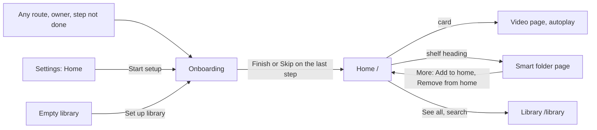
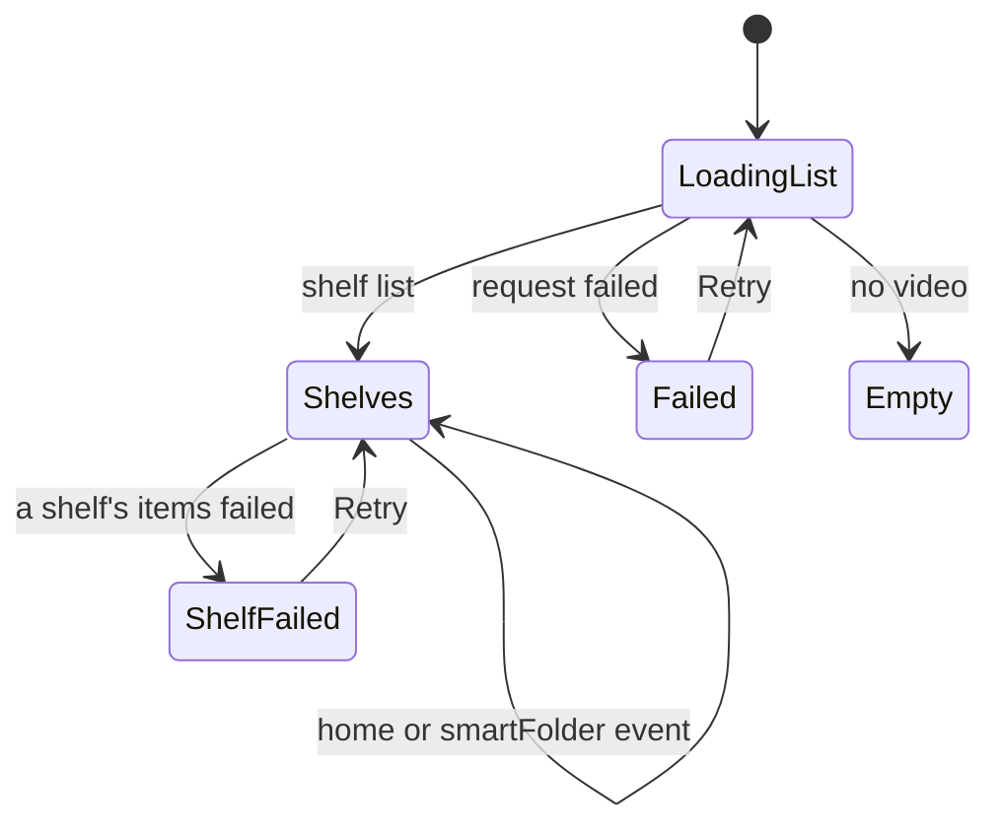
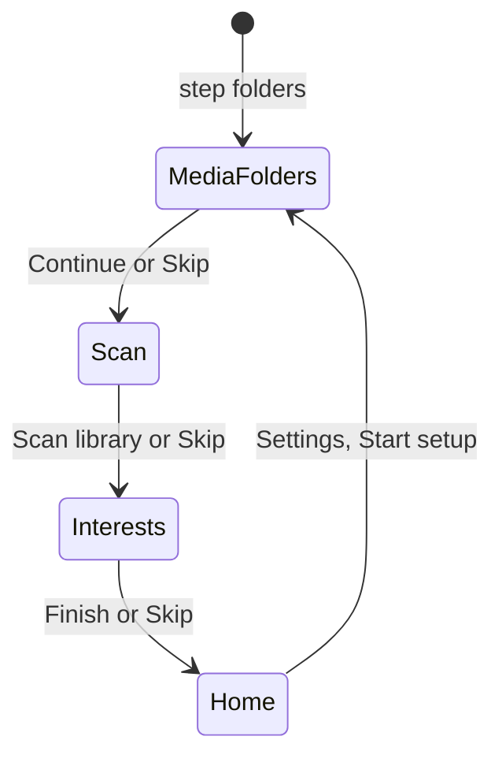

# UI design: A home of shelves, started by onboarding

**Feature**: [parent Issue #1140](https://github.com/syudead/vv/issues/1140) ·
[plan.md](plan.md) ·
[research.md R-3](research.md#r-3-onboarding-progress-is-one-step-held-in-a-setting) ·
[R-4](research.md#r-4-onboarding-adds-routes-for-its-step-and-interests-only) ·
[R-6](research.md#r-6-a-picked-interest-becomes-an-owner-shelf-and-auto-tagging-is-asked-again) ·
[R-12](research.md#r-12-the-home-lists-shelf-summaries-shelf-items-are-read-on-screen) ·
[R-13](research.md#r-13-four-fixed-shelves-two-of-them-the-owners-only) ·
[R-14](research.md#r-14-pressing-a-shelf-card-plays) ·
[R-15](research.md#r-15-the-library-moves-to-library) ·
[contracts/screen-api.md](contracts/screen-api.md)

Sources that already decide things, linked rather than repeated here:

| Topic | Source |
| --- | --- |
| Tokens, closed scales, library density | [design-system.md, Foundations](../../docs/design-docs/design-system.md#foundations); the values in `@theme` of [`web/src/ui/tokens.css`](../../web/src/ui/tokens.css), named here and never copied |
| `ListPage`, `PageHeader`, `Toolbar`, `PageSection`, `FormRow`, the state blocks | [patterns.md](../../web/registry/rules/patterns.md) |
| `Button`, `Toggle`, `ToggleGroup`, `DropdownMenu`, `Combobox`, `Progress`, `Alert`, `Skeleton`, `Sonner`: what each is for | [components.md](../../web/registry/rules/components.md) |
| The video card, the group card, their thumbnails, progress edge and favorite heart | [library-ui.md, Cards](../../docs/design-docs/library-ui.md#cards), [Favorite mark](../../docs/design-docs/library-ui.md#favorite-mark) |
| The top bar, its toolbar portal and the sidebar's rail and drawer | [library-ui.md, Shell and toolbar](../../docs/design-docs/library-ui.md#shell-and-toolbar) |
| The media folder picker dialog | [`web/src/settings/FolderPicker.tsx`](../../web/src/settings/FolderPicker.tsx) and the `Media folders` section of Settings |
| Starting a scan, its states and words, the bottom-right indicator | [library-ui.md, Scan entry and progress](../../docs/design-docs/library-ui.md#scan-entry-and-progress), [Import pipeline](../../docs/design-docs/import-pipeline.md) |
| The smart folder page and its `More` menu | [Catalog organization](../../docs/design-docs/catalog-organization.md) |
| The video page's autoplay and folder context | [Catalog organization](../../docs/design-docs/catalog-organization.md), [library-ui.md, Group members](../../docs/design-docs/library-ui.md#group-members) |
| Guest degradation | [Authentication](../../docs/design-docs/authentication.md) |
| Width breakpoints in CSS; layout checked by people | [library-ui.md, Width breakpoints](../../docs/design-docs/library-ui.md#width-breakpoints-in-css-and-the-sidebar-exception), [Layout verified by people](../../docs/design-docs/library-ui.md#layout-verified-by-people-not-machines) |
| Screen text | [`web/src/i18n/en.ts`](../../web/src/i18n/en.ts); this feature adds `home`, `onboarding` and the words below |

The diagram shows the screens this feature adds or changes and where each
action leads.

Unchanged: the library screen's content (only its address moves to
`/library`), the video card and group card themselves, the video page, the
smart folder page apart from two menu items, the media folder picker, and the
scan indicator.

## Why this shape

The home is rows of cards, one row per shelf, each row scrolling sideways,
which is the form current video products have converged on for browsing
(`UI品質`, the first point). A grid of shelves or a list of folder cards was
rejected: a folder card hides the videos behind one more press, and the issue
asks to see thumbnails first and play in one press. Cards on a shelf are the
library's video and group cards at the smallest card step, `card-0`, without
the tag row and the selection check: the home is for choosing what to watch,
not for managing, so the row shows more thumbnails and less text than the
library. Pressing a card plays (R-14), and the heading of a folder shelf
opens the folder, so the two actions on a shelf never share a target.

The search box is the library's search in the top bar, so a person used to
the old top finds it where it was (`UI品質`, the third point); submitting it
opens `/library?q=` rather than filtering the home, because the home's rows
are not one list to filter. Each shelf's `See all` names where it leads by
the shelf's own name, so nothing about the library's move has to be learned.

Onboarding is a page of its own outside the shell, as the first setup is,
with its three steps in a header strip and one step's content at a time. The
gate brings the owner back to it from any route until the step is `done`
(R-4), so the sidebar would only lead back to it; drawing the shell around
it was rejected. A dialog over the home was rejected because the home has
nothing to show before the first scan, and because a dialog closed by Esc
reads as "done" when the step is not. Every step has `Skip` beside its main
action, so skipping is never hidden (`UI品質`, the fourth point), and the
interests step shows the scan's progress above the interests, so the owner
picks while the scan runs instead of waiting for it.

Interests are toggle chips that wrap, not a list of checkboxes: 24 short
names fit a few lines of the onboarding column, and a pressed chip reads as chosen
at a glance. An interest already on the home is drawn pressed and disabled,
so picking again from Settings never makes a second shelf (R-6).

Arranging the home is done on the home itself: the owner's `More` on each
folder shelf moves it up or down or removes it, and `Add shelf` in the
header adds any smart folder. A separate arrange dialog with drag handles
was rejected: shelves are few, two menu items do the ordering, and the
owner sees the result in place.

## Changes to the design system

The home and onboarding need one section, one skeleton and one loading
layout the design system lacks; the units that build these screens add them
to the registry, their example blocks and [patterns.md](../../web/registry/rules/patterns.md)
first, then use them.

| Addition | Kind | What it is |
| --- | --- | --- |
| `ShelfRow` | Section (`shelf-row`) | A heading row (title, optional `leading` icon, optional `href` making the title a link, `actions` at the right end) above one row of cards that scrolls sideways, cards `card-0` wide and `gap-3` apart, snapping to a card's start; from `md` with a pointer that hovers, `ghost` `icon-sm` previous and next buttons over the row's ends while the row is hovered or focused, each absent at its end. Holds a `LoadingState`, an `Alert` or the cards |
| `StepsPage` | Skeleton (`steps-page`) | A page outside the shell: a header band `navbar` high with `BrandHomeLink` at the left and the step strip in the middle, then one column at most `max-w-2xl`, centered, `p-4` (`p-6` from `sm`), holding the step's `title` (`h1`, `text-xl`), `description`, `content`, and a `footer` row with `Skip` (`ghost` `sm`) at the left and the one `default` `sm` action at the right. The strip is the steps' names with a number each, the current one in `primary`, done ones with a check; below `sm` it shows `Step 2 of 3` and the current name only |
| `LoadingState` `layout="shelves"` | State | `Skeleton` heading bars over rows of `card-0` card skeletons, three rows |

Nothing is added to the tokens or to the contrast pairs in
`web/src/theme/tokens.test.ts`.

## Words

| Place | Text | Notes |
| --- | --- | --- |
| Sidebar entry, `/` | `Home` | Above `Library`, for the owner and guests; icon `House` |
| Home, page title (for screen readers only) | `Home` | `PageHeader` `titleHidden` |
| Home, search field placeholder | `Search the library` | Submitting opens `/library?q=` |
| Home, header action (owner) | `Add shelf` | `outline` `sm`; opens the smart folder `Combobox` |
| `Add shelf` combobox, empty | `Every smart folder is already on your home.` | |
| `Add shelf` combobox, none exist | `No smart folders yet. Save a library filter as a smart folder first.` | |
| Fixed shelf, in progress | `Continue watching` | Owner only |
| Fixed shelf, recent | `Recently added` | |
| Fixed shelf, unshelved | `Not on any shelf` | |
| Fixed shelf, recommended | `Recommended` | Owner only |
| Shelf heading, end | `See all` | `link` `sm` |
| Folder shelf `More` (owner) | `Move up`, `Move down`, `Remove from home` | `Move up` absent on the first folder shelf, `Move down` on the last |
| Toast after `Remove from home` | `Removed "{name}" from your home.` | With `Undo`, which adds it back at its place |
| Toast after `Add shelf` | `Added "{name}" to your home.` | |
| Shelf, items failed | `Couldn't load this shelf: {reason}` | `Retry` |
| Home, failed | `Couldn't load your home: {reason}` | `ErrorState` with `Retry` |
| Home, no video, title | `No videos yet` | `EmptyState` |
| Home, no video, owner description | `Add a media folder and scan it, and your shelves appear here.` | Action `Set up library` |
| Home, no video, guest description | `There's nothing to watch here yet.` | No action |
| Home, organizer running (owner) | `Organizing your shelves…` | `text-xs` muted line under the last folder shelf, with a `Spinner` |
| Smart folder page `More` (owner) | `Add to home`, `Remove from home` | One of the two, by `onHome` |
| Settings section | `Home` | `PageSection` after `Media folders` |
| Settings row | `Shelves` · `Rebuild the shelves VVMDM made from your tags, people and organizations. Shelves you made, changed or picked as interests stay.` · button `Reorganize` | |
| Settings row, last run | `Last organized {time}: {added} added, {removed} removed.` / `Last organized {time}: nothing changed.` / `Last organizing failed {time}.` / `Not organized yet.` | Under the description, `text-xs` muted |
| Settings row | `Setup` · `Add media folders, scan and pick interests again.` · button `Start setup` | Sets the step to `folders` |
| Onboarding, step names | `Media folders`, `Scan`, `Interests` | The strip |
| Onboarding, step 1 title | `Where are your videos?` | |
| Onboarding, step 1 description | `Add the folders on the server that hold your videos. You can change them later in Settings.` | |
| Onboarding, step 1 action | `Add folder` (`outline` `sm`), `Continue` (`default`) | `Continue` disabled with no folder |
| Onboarding, step 2 title | `Scan your library` | |
| Onboarding, step 2 description | `VVMDM reads the folders and makes thumbnails. It keeps going in the background, so you can continue while it runs.` | |
| Onboarding, step 2 action | `Scan library` (`default`) | Disabled with `Add a media folder first.` when there is none |
| Onboarding, step 3 title | `What do you watch?` | |
| Onboarding, step 3 description | `Pick what your videos are about. Each becomes a shelf on your home that fills in as videos get these tags.` | |
| Onboarding, step 3 note, auto-tagging off | `Auto-tagging is off, so these shelves fill in only as you tag videos. You can turn it on in Settings.` | `Alert`, default variant |
| Onboarding, step 3, interest already on the home | `On your home` | `Tooltip` on the disabled chip |
| Onboarding, step 3 action | `Finish` (`default`) | With picks it adds them, then finishes |
| Onboarding, every step | `Skip` | `ghost` `sm`, footer left |
| Onboarding, scan line on step 3 | `Scanning: {done} of {total}` / `Scan finished` / `Scan failed. See Settings.` | Above the interests, with `Progress` while scanning |
| Onboarding, step write failed | `Couldn't save your progress: {reason}` | `Alert` above the footer; the step stays |
| Onboarding, picks failed | `Couldn't add the shelves: {reason}` | `Alert` above the footer; picks kept |
| Toast after `Finish` with picks | `Added {n} shelves to your home.` | |
| Empty library, owner action | `Set up library` | Replaces the link to `Scan status`; sets the step to `folders` |

## Home

`ListPage` at `/`, library density. `header` is `PageHeader` with the title
for screen readers only and, for the owner, `Add shelf` in `actions`.
`toolbar` is a `Toolbar` with `placement="topBar"` holding only the search
field; it has no filters or view controls. The body is the shelves, top to
bottom, `gap-6` apart, each a `ShelfRow`:

| Shelf | Heading | `See all` leads to | Cards |
| --- | --- | --- | --- |
| Folder shelf | The folder name as a link to `/smart-folders/{id}`, `FolderSearch` icon before it; owner's `More` at the end | `/smart-folders/{id}` | Videos and groups in the folder's sort |
| `Continue watching` | Text | `/history` | Videos in progress, latest played first |
| `Recently added` | Text | `/library` (its default sort is newest first) | Newest first |
| `Not on any shelf` | Text | `/library?unshelved=1` | Newest first |
| `Recommended` | Text | None | By closeness |

A shelf's cards are the library's video card and group card at `card-0`,
without the tag row, the location row and the selection check, keeping the
thumbnail, the duration, the progress edge, the title, the owner's heart and
a group's count panel. Pressing a video card opens the video page with
autoplay, adding `?smartFolder=<id>` on a folder shelf; pressing a group card
opens the group's open video with autoplay and `?group` (R-14). The hover
preview works as in the library.

Shelves are read as they come into view: the shelf list first, then the
items of the shelves in the viewport and the next two, up to 8 shelves per request
(R-12). A shelf whose total is 0 is not drawn, and the rows below it close
the gap without a jump: its row is drawn only once its items say it has some.

The owner's folder shelf `More` (`ghost` `icon-sm`, `aria-label` `More
actions for {name}`) holds `Move up`, `Move down` and `Remove from home`;
each acts at once and the rows reorder in place. `Add shelf` opens a
`Combobox` of the smart folders not on the home, by name; choosing one adds
it after the last folder shelf. Fixed shelves have no menu.

While the organizer runs, the owner sees `Organizing your shelves…` under
the last folder shelf; the rows change when the `home` event arrives, and
the line goes.

### States

| State | What the screen shows |
| --- | --- |
| Loading the shelf list | `LoadingState layout="shelves"` in the body; the search stays usable |
| Shelf list loaded, a shelf's items loading | The shelf's heading, then `card-0` `Skeleton`s in its row |
| A shelf's items failed | The shelf's heading, then an `Alert` in its row with `Retry`; other shelves unaffected |
| Shelf list failed | `ErrorState` with `Retry` |
| No video the viewer can see | `EmptyState` (`Film` icon) with the owner's or the guest's description; `Set up library` for the owner |
| Videos exist, every shelf empty | Only the fixed shelves that have items; `Recently added` always has some |
| Guest | No `Add shelf`, no `More`, no `Continue watching` or `Recommended`, no hearts |

## Onboarding

`StepsPage` at `/welcome`, for the owner only. Any route the owner opens while
the step is not `done` replaces itself with `/welcome`; the step strip shows
the stored step. A guest is never sent there, and the owner's `/welcome`
with the step `done` goes to `/`.

| Step | Content | Main action | Skip |
| --- | --- | --- | --- |
| `Media folders` | The added folders as rows (path, truncated from the start, full in `title`) and `Add folder`, which opens the media folder picker dialog | `Continue`, disabled with no folder | Writes `scan` |
| `Scan` | Nothing beside the description; a scan already running counts as started | `Scan library` starts a scan through `/api/scans` and writes `interests` | Writes `interests` |
| `Interests` | The scan line with `Progress`, the auto-tagging note when it is off, then the 24 interests as a `ToggleGroup type="multiple"` of `outline` `sm` toggles that wrap, `gap-2` | `Finish` adds the pressed interests, then writes `done` and opens `/` | Writes `done` and opens `/` |

Each step write goes to `/api/onboarding`; the footer's buttons are disabled
while it is pending. When the step changes on another device, the `home`
event moves this page to that step. A failed write shows its `Alert` above
the footer and keeps the step; a failed pick keeps the pressed chips.

## Smart folder page and Settings

The smart folder page's owner `More` gains `Add to home` or `Remove from
home` after `Edit…`, by the folder's `onHome`, each with the home's toasts.

Settings gains the `Home` `PageSection` after `Media folders`, with two
`FormRow`s: `Shelves` with `Reorganize` (`outline` `sm`, disabled with a
`Spinner` while a run is pending or running) and the last run under its
description; `Setup` with `Start setup` (`outline` `sm`), which writes
`folders` and opens `/welcome`.

## Sidebar and library

The sidebar gains `Home` above `Library` for the owner and guests; `Library`
now opens `/library`. The empty library's owner action becomes `Set up
library`, which writes `folders` and opens `/welcome`.

## Responsive behaviour

| Width | Home | Onboarding |
| --- | --- | --- |
| 360px | Shelves full width under the drawer's ☰; a row shows about one and a half cards, swiped sideways; no previous or next buttons; heading truncates before `See all`; `Add shelf` in the header | Strip as `Step 2 of 3` and the name; one column with `p-4`; interests wrap to about two per line; footer `Skip` and the action on one row |
| 768px | Rail sidebar; about three cards per row and a part of the next; previous and next buttons on rows with a hovering pointer | Full strip; column `max-w-2xl`; interests about four per line |
| 1280px | Rail sidebar; about four and a half cards per row; previous and next buttons on hover | Same as 768px, centered with space at both sides |

## Review criteria

1. At 1280px, the first view of a home with three folder shelves is mostly
   thumbnails: each row's cards are larger in area than its heading row, and
   the gap between shelves is larger than the gap between cards.
2. A shelf row's last visible card is cut at the right edge at every width,
   so the row reads as scrolling sideways without an arrow.
3. Pressing a card on any shelf starts playback on the video page with one
   press; the heading of a folder shelf, not its cards, opens the folder.
4. The search field sits where the library's does in the top bar, and
   submitting it shows the library with the results.
5. Fixed shelves read apart from folder shelves: a folder shelf's heading is
   a link with the `FolderSearch` icon and an owner's `More`; a fixed shelf's
   heading is plain text without either.
6. While shelves load, the body shows shelf skeletons in place, and shelves
   that turn out empty do not leave gaps.
7. On every onboarding step, `Skip` and the main action sit in one footer
   row, `Skip` quieter than the action, and the strip shows which step is
   current.
8. On the interests step during a scan, the scan line sits above the
   interests and the pressed chips read as chosen without reading the label.
9. An interest already on the home is pressed and cannot be unpressed, and
   its tooltip says why.
10. At 360px, no onboarding step or home row scrolls the page sideways.
