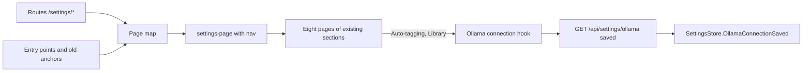
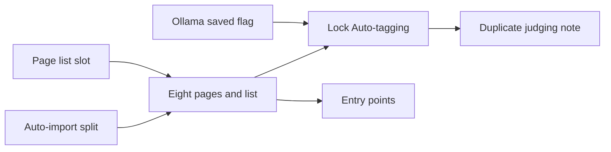

# Implementation Plan: Settings split into eight pages by how often they are opened

**Branch**: `feature/058-settings-pages` | **Parent Issue**: #973

**Input**: The parent Issue. It is this feature's specification.

## Summary

The one `/settings` screen of eleven sections becomes eight pages under
`/settings/<page>`, each with its own address and a list of the eight pages
beside it; `/settings` shows the Scan page, and below `sm` it shows the list
alone. The sections keep their components and move to the page the parent
Issue's table names; the Auto-import section splits into its watch state (Scan)
and its switch (Library). The Ollama settings resource gains `saved`, and the
Auto-tagging page locks its controls while no connection is saved, with a link
to the Connections page.

The diagram shows the parts this feature adds or changes and what reads what.



| Concern | Approach |
| --- | --- |
| Addresses | Routes `/settings/<page>`, unknown slug replaced by `/settings/scan` ([R-1](research.md#r-1-each-settings-page-is-a-route-under-settings)) |
| Entry points | Links move to the pages; `/settings#<anchor>` is forwarded ([R-2](research.md#r-2-the-old-anchor-addresses-are-forwarded-and-the-entry-points-move-to-the-pages)) |
| Narrow screens | One markup; CSS shows the list or the page ([R-3](research.md#r-3-the-page-list-is-a-column-beside-the-page-from-sm-and-the-whole-of-settings-below-it)) |
| Connection state | `saved` on `OllamaSettings`, one hook in the SPA ([R-4](research.md#r-4-ollamasettings-reports-whether-the-connection-was-saved), [contracts/screen-api.md](contracts/screen-api.md)) |
| Locked Auto-tagging | Gated from the read, fail open, values visible ([R-5](research.md#r-5-the-auto-tagging-page-is-gated-by-the-connection-with-three-other-states)) |

The Issue has the `ui` label, so the `design` stage writes `ui-design.md`
before the screen units: the page list and its current entry, the page
title and the back link below `sm`, the split Auto-import rows, the locked
Auto-tagging page with its link, the note under the duplicate judging switch,
the Network page's line outside the desktop app, and the words of the eight
entries, judged against the parent Issue's
`UI品質`.

No `data-model.md`: the feature adds no entity and changes no table. No
`quickstart.md`: the acceptance criteria are page tests, e2e tests and the
visual review `ui-design.md` asks for.

## Technical Context

**Canonical definitions**:

| Topic | Source |
| --- | --- |
| Web layer, routes, the auth gate, generated code | [ARCHITECTURE.md](../../ARCHITECTURE.md) |
| Width breakpoints, the sidebar, scan entry and the indicator | [library-ui.md](../../docs/design-docs/library-ui.md) |
| Settings page pattern, page sections | [patterns.md](../../web/registry/rules/patterns.md), [design-system.md](../../docs/design-docs/design-system.md) |
| Ollama connection, "connection saved" | [ai-layer.md](../../docs/design-docs/ai-layer.md), [054 research, R-13](../054-auto-dup/research.md#r-13-the-model-is-asked-only-once-the-owner-has-saved-a-connection) |
| The sections' own designs | [024 UI design](../024-import-progress/ui-design.md), [042 UI design](../042-folder-watch-import/ui-design.md), [045 UI design](../045-comfyui-thumbnails/ui-design.md), [049 UI design](../049-work-info-plugins/ui-design.md), [054 UI design](../054-auto-dup/ui-design.md) |
| Screen API and generated code | [api/openapi.yaml](../../api/openapi.yaml), `task generate` |
| Web tests and their levels | [web-testing.md](../../docs/design-docs/web-testing.md), [i18n.md](../../docs/design-docs/i18n.md) |
| Checks | [Taskfile.yml](../../Taskfile.yml) (`task check`, `task check-docs`, `task test-e2e`) |

**Feature-specific context**: Requirement 9 keeps every section's behaviour,
so the sections' components, API calls and tests move with them; only the
Auto-import section is split and only the Auto-tagging and Duplicate judging
sections gain a state. The e2e specs that open `/settings` or
`/settings#<anchor>` (`settings`, `scan-progress`, `scan-issues`,
`auto-import`, `folders`, `work-info-plugins`, `unconfigured.setup`) change
with the units that move their targets.

## Constitution Check

Checked against ARCHITECTURE.md and AGENTS.md; the rules this design leans on:

| Rule | How the design meets it |
| --- | --- |
| Pages never call `fetch`; `api/` is the one place that talks to the server | `saved` arrives through the existing `getOllamaSettings` in `web/src/api/client.ts` |
| The gate sends a guest away from owner-only screens | `ownerOnlyPath` already matches `/settings/` and below; the edge case for a guest is the current behaviour |
| Width in CSS, the sidebar excepted | R-3 reads no width in JavaScript |
| Rules out of pages | The page map and the anchor forward are a pure module with logic tests |
| No copied code, complexity 25 | The sections move as components; the two gated sections share one hook |

## Project Structure

### Documentation (this feature)

```text
specs/058-settings-pages/
├── plan.md
├── research.md            # R-1..R-5
└── contracts/
    └── screen-api.md      # OllamaSettings.saved
```

The `design` stage adds `ui-design.md`.

### Source Code

**Affected boundaries**:

| Package | Change |
| --- | --- |
| `internal/httpapi`, `internal/app` (`OllamaConnection`), `api/openapi.yaml` | `saved` on the Ollama settings responses, read through the store's `OllamaConnectionSaved`; `UpdateOllamaSettingsRequest` for the `PUT` body |
| `web/src/app` | `/settings/*` as one deferred route |
| `web/src/settings` | The page map, the eight pages, the Auto-import split, the connection hook, the gated sections |
| `web/src/ui/patterns`, `web/registry` | The `settings-page` pattern's `nav` slot and its rule |
| `web/src/shell` | The sidebar's `Settings` entry matching the pages below `/settings`; the scan indicator's link |
| `web/src/library`, `web/src/folders`, `web/src/player` | The entry links to the pages |
| `web/e2e` | The specs that open settings |
| `docs/design-docs/library-ui.md` | The scan entry's address |

**New paths**: `web/src/settings/settingsPages.ts` (the page map), one file
per page under `web/src/settings/pages/`, `web/src/settings/useOllamaConnection.ts`.

**Structure decision**: The sections stay where they are and the pages
compose them, so a section's tests and its `ui-design.md` keep their paths;
the page map is the only place that says which page carries which section.

## Implementation Work

The diagram shows which units have to land first. The screen units also
wait for the `design` stage's `ui-design.md`.



### Report whether the Ollama connection was saved in the settings API

**Scope**: `saved` on `OllamaSettings` in `api/openapi.yaml` and the
`UpdateOllamaSettingsRequest` schema for the `PUT` body, the generated code,
the `OllamaConnection` port and handler answering `saved` from the store's
`OllamaConnectionSaved`, `getOllamaSettings` in the SPA client, and
`updateOllamaSettings` sending `endpoint` and `model` only
([contracts/screen-api.md](contracts/screen-api.md),
[R-4](research.md#r-4-ollamasettings-reports-whether-the-connection-was-saved)).

**Dependencies**: None.

**Acceptance**: `task check` passes with no diff from `task generate`; handler
tests show `GET /api/settings/ollama` answers `saved: false` before any save
and `saved: true` after a `PUT`, the `PUT` response carries `saved: true`, and
a `PUT` body with `saved` is answered `400`; a page test shows the Ollama
section saves a connection it read with `saved` and the request body holds
`endpoint` and `model` only; the Settings screen is unchanged.

### Give the settings page pattern a slot for a page list

**Scope**: The `nav` slot of the `settings-page` pattern, its registry item,
example block and [patterns.md](../../web/registry/rules/patterns.md) rule:
the list beside the body from `sm`, and below `sm` the list alone or the body
under a back link, from `ui-design.md`
([R-3](research.md#r-3-the-page-list-is-a-column-beside-the-page-from-sm-and-the-whole-of-settings-below-it)).

**Dependencies**: None.

**Acceptance**: `task check` and `task check-docs` pass; the example block passes a visual review at the widths in
`ui-design.md`, the list beside the body from `sm` and the list alone and the
back link below it; the Settings screen, which passes no `nav`, is unchanged.

### Split the Auto-import section into its watch state and its switch

**Scope**: `AutoImportSection` split into two components, the watch state and
its problem, and the switch, each keeping the reloads it needs; both still
shown in the one Settings screen
([R-1](research.md#r-1-each-settings-page-is-a-route-under-settings)).

**Dependencies**: None.

**Acceptance**: `task check` passes; the Auto-import section's page tests,
moved to the two components, pass; the `auto-import` e2e spec passes
unchanged.

### Split Settings into eight pages with their own addresses and a page list

**Scope**: The `/settings/*` route and the page map (slugs, sections, the
anchors each page carries, the unknown-slug rule); the eight pages from
`ui-design.md`, each composing the sections R-1's table names in the pattern's
`nav` slot, with the Auto-import watch state on Scan and its switch on
Library; the Network page's line where the network read answers `404`;
`/settings` as the Scan page from `sm` and the list below it, and the forward
of `/settings#<anchor>`; the sidebar's `Settings` entry matching the pages
below `/settings`; the media folder count reported to the scan state from the
Library page; the e2e specs that open `/settings` to add a folder
([R-1](research.md#r-1-each-settings-page-is-a-route-under-settings) to
[R-3](research.md#r-3-the-page-list-is-a-column-beside-the-page-from-sm-and-the-whole-of-settings-below-it)).

**Dependencies**: Give the settings page pattern a slot for a page list;
Split the Auto-import section into its watch state and its switch.

**Acceptance**: `task check` and `task check-docs` pass; logic tests show an
unknown slug maps to `scan` and `#comfyui` maps to the Connections page; page
tests show each of the eight addresses renders only its page's sections, the
list marks the current page, `/settings/nowhere` is replaced by
`/settings/scan`, `/settings#comfyui` lands on `/settings/connections#comfyui`
with the ComfyUI heading focused, and moving from the list to another page
and back restores the previous page; page tests show the sidebar marks
`Settings` current on `/settings` and on `/settings/library`, and that with
the network read answering `404` `/settings/network` shows the desktop-app
line; a page test shows adding a media folder
on the Library page and opening the Scan page enables `Scan library`; the
existing settings e2e spec passes against the Library page; the pages pass a
visual review at the widths in `ui-design.md`, including the list alone and
the back link below `sm`.

### Send the settings entry points to their pages

**Scope**: The links in `ScanProgressIndicator`, `EmptyLibrary`,
`FolderView`, `RootView`, `EditEntry` and `FindStep` to the page addresses of
[R-2](research.md#r-2-the-old-anchor-addresses-are-forwarded-and-the-entry-points-move-to-the-pages);
the scan entry's address in
[library-ui.md](../../docs/design-docs/library-ui.md); the e2e specs that
assert or open the old addresses.

**Dependencies**: Split Settings into eight pages with their own addresses and
a page list.

**Acceptance**: `task check` and `task check-docs` pass; page tests show the
indicator opens `/settings/scan#scan-status` with the scan status visible, the
video page's edit entry links to `/settings/connections#comfyui`, the
work-info fetch dialog's `Open Settings` links to
`/settings/plugins#work-info-plugins`, and the empty root folder's
`Open Settings` links to `/settings/library`; the `scan-progress`,
`scan-issues`, `auto-import`, `folders` and `work-info-plugins` e2e specs pass
against the new addresses.

### Lock the Auto-tagging page until the Ollama connection is saved

**Scope**: `useOllamaConnection` reading `saved`; the Auto-tagging page's
controls and run buttons taking their state from
[R-5](research.md#r-5-the-auto-tagging-page-is-gated-by-the-connection-with-three-other-states)'s
table, the line with the link to `/settings/connections` and the
failed-read line with `Retry`, from `ui-design.md`.

**Dependencies**: Report whether the Ollama connection was saved in the
settings API; Split Settings into eight pages with their own addresses and a
page list.

**Acceptance**: `task check` passes; page tests show that with `saved: false`
the switches, inputs, `Save`, `Test judging` and the run buttons are
`aria-disabled` with the saved values visible and the link leads to
`/settings/connections`, that pressing each switch and button and typing in
each input changes no value shown and sends no request, that after saving the connection there and going
back they are pressable, that with `saved: true` and auto-tagging turned off
and saved the run buttons are hidden as today, and that a failed read leaves
the controls pressable and shows the failed-read line; the page passes a
visual review at the widths in `ui-design.md`.

### Say under the duplicate judging switch that differing pairs need the Ollama connection

**Scope**: The Library page's Duplicate judging section reading
`useOllamaConnection` and showing the note with the link to
`/settings/connections` while `saved` is false, from `ui-design.md`
([R-5](research.md#r-5-the-auto-tagging-page-is-gated-by-the-connection-with-three-other-states)).

**Dependencies**: Lock the Auto-tagging page until the Ollama connection is
saved.

**Acceptance**: `task check` passes; page tests show the switch toggles and
saves with `saved: false` and the note links to `/settings/connections`, and
that with `saved: true` or a failed read there is no note; the section passes
a visual review at the widths in `ui-design.md`.
