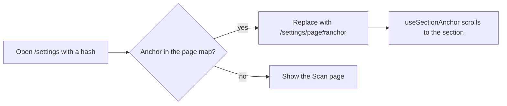

# Research: Settings split into eight pages

Inherited decisions: [ARCHITECTURE.md](../../ARCHITECTURE.md),
[library-ui.md](../../docs/design-docs/library-ui.md),
[design-system.md](../../docs/design-docs/design-system.md),
[ai-layer.md](../../docs/design-docs/ai-layer.md) and
[054 research, R-13](../054-auto-dup/research.md#r-13-the-model-is-asked-only-once-the-owner-has-saved-a-connection).
This file records only the decisions this feature adds.

## R-1: Each settings page is a route under `/settings`

**Decision**: The eight pages are the routes `/settings/<page>` with the
slugs in the table, `/settings` shows the Scan page, and a slug that is not in
the table is replaced by `/settings/scan`.

| Page (parent Issue) | Route | Sections it carries |
| --- | --- | --- |
| Scan | `/settings/scan` | Scan status with `Scan library` and the videos with problems; the auto-import watch state and its problem |
| Library | `/settings/library` | Media folders; the auto-import switch; the duplicate judging switch |
| Auto-tagging | `/settings/auto-tagging` | Queue and run buttons; the switch, after-import, the thresholds |
| Connections | `/settings/connections` | Ollama; ComfyUI |
| Plugins | `/settings/plugins` | Work-info plugins |
| Video conversion | `/settings/conversion` | Video conversion |
| Network | `/settings/network` | Network |
| API | `/settings/api` | API tokens |

| Option | Own address per page | Browser back | Lazy chunk | Verdict |
| --- | --- | --- | --- | --- |
| **Routes `/settings/<page>`** | Yes | Yes | One chunk for `/settings` and below, as the other screens | Chosen |
| `/settings?page=<page>`, as the tag admin's `tab` | Yes | Yes | Same | Rejected: a query names a state of one screen; the pages are screens with their own entry points, and `AuthGate` and the sidebar already match on path |
| Tabs that change no URL | No | No | Same | Rejected: requirement 1 asks for an address per page and acceptance criterion 2 for back |

**Rationale**: The parent Issue's entry points (`#scan-status`, `#comfyui`,
`#work-info-plugins`) address a page, and a path is what the shell's active
entry, the gate's owner-only list and `deferredRoute` already read. The slugs
are English nouns so that the address, the list entry and the page title use
one word (W-8); the screen text itself is settled in `ui-design.md`.

The page map (slug, title key, sections, the section anchors a page carries)
is one pure module next to the page, so the unknown-slug rule and the anchor
mapping of R-2 have logic tests
([web-testing.md, Rules out of pages](../../docs/design-docs/web-testing.md#rules-out-of-pages)).

Only the current page's sections are mounted. A page change unmounts the
previous page, so an unsaved draft is lost as the parent Issue's edge case
states, and a page reads only its own resources.

The parent Issue's table also puts a work-info plugin proxy on the Network
page. No such setting exists today, and the Issue leaves adding settings out
of scope, so the Network page carries the Network section alone.

The Network section renders nothing where `GET /api/settings/network`
answers `404` (vv is not the Windows desktop app). There the Network page
keeps its entry in the list and shows a line saying LAN access is set in the
Windows desktop app, in place of the section.

| Option | Verdict |
| --- | --- |
| **Keep the entry, show the line on the page** | Chosen |
| Leave the page empty | Rejected: the owner reaches a page with a title and nothing under it, and cannot tell why |
| Drop the entry outside the desktop app | Rejected: requirement 2 lists the eight pages on every page, and the list would need the network read before it could render |

The shell sidebar's `Settings` entry marks itself current
on `/settings` and every page below it (`matchDescendants`), since today it
matches `/settings` exactly.

## R-2: The old anchor addresses are forwarded, and the entry points move to the pages

**Decision**: The entry points link to the page that carries their section
(`/settings/scan#scan-status`, `/settings/connections#comfyui`,
`/settings/plugins#work-info-plugins`, and the empty root folder's
`Open Settings` to `/settings/library`), and `/settings#<anchor>` with an
anchor the page map knows is replaced by that page's address with the anchor
kept.

| Option | Verdict |
| --- | --- |
| **Change the links and forward the old form** | Chosen |
| Keep every link at `/settings#<anchor>` and forward | Rejected: on a narrow screen `/settings` is the list (R-3), so the forward would be the only way to reach the section, and a bookmark would show the list for a moment |
| Change the links only | Rejected: a bookmark or an open tab with the old address would land on the Scan page instead of its section |

**Rationale**: `useSectionAnchor` keeps working unchanged once the section's
page is open, so the forward is a lookup in the page map and a `replace`
navigation, and the links say where they go.

## R-3: The page list is a column beside the page from `sm`, and the whole of `/settings` below it

**Decision**: Every page renders the list of eight pages and its own body;
CSS shows both from `sm` (640px) and, below `sm`, shows the list alone on
`/settings` and the body with a link back to `/settings` on `/settings/<page>`.

| Width | `/settings` | `/settings/<page>` |
| --- | --- | --- |
| `sm` and wider | List beside the Scan page | List beside that page, the entry marked current |
| Below `sm` | The list only | The page body under a link back to the list |

| Option | Verdict |
| --- | --- |
| **One markup, CSS decides what shows** | Chosen |
| `useIsMobile` chooses the list or the page | Rejected: [library-ui.md](../../docs/design-docs/library-ui.md#width-breakpoints-in-css-and-the-sidebar-exception) keeps width in CSS except for the sidebar; the pages need no state CSS cannot express |
| The list as a second sidebar in the shell | Rejected: the shell's rail is 68px of icons for every screen, and the settings list belongs to one screen |

**Rationale**: `/settings` is the Scan page from `sm` (requirement 4) and the
list below it (requirement 3) with no JavaScript reading the width, because
the Scan page is rendered in both cases and only its visibility changes. The
list is a `nav` slot of the `settings-page` pattern, so the registry item and
[patterns.md](../../web/registry/rules/patterns.md) carry the rule, and
`ui-design.md` settles the look of the list, the current entry and the back
link.

## R-4: `OllamaSettings` reports whether the connection was saved

**Decision**: `GET /api/settings/ollama` gains `saved`, true when the owner
has saved the connection ([contracts/screen-api.md](contracts/screen-api.md));
the pages that depend on the connection read this resource. The `PUT` request
body gets its own schema with `endpoint` and `model` only, because today it
refers to the response schema and the handler rejects any other field.

| Option | Requests on the Auto-tagging page | Verdict |
| --- | --- | --- |
| **`saved` on `OllamaSettings`** | 2 (auto-tagging, ollama) | Chosen |
| A readiness resource, as `/api/thumbnail-edits/readiness` | 3 | Rejected: the thumbnail one exists because the video page has no reason to read the settings; a settings page reads them anyway |
| `saved` on `AutoTaggingSettings` and `VersionJudgingSettings` | 2 | Rejected: it would say the same fact in two resources, and the fact belongs to the connection ([054 R-13](../054-auto-dup/research.md#r-13-the-model-is-asked-only-once-the-owner-has-saved-a-connection)) |

**Rationale**: The store already answers the question for the duplicate
judge (`OllamaConnectionSaved`), the read returns defaults when nothing is
saved so the SPA cannot tell from `endpoint`, and one field keeps the SPA's
reading in one place: a hook in `web/src/settings` that both pages use.

## R-5: The Auto-tagging page is gated by the connection, with three other states

**Decision**: The settings, `Save`, `Test judging` and the run buttons of the
Auto-tagging page take their enabled state from the connection read as the
table says; the values stay visible in every state.

| Connection read | Controls | What the page adds |
| --- | --- | --- |
| Loading | Not yet rendered (the existing skeleton) | Nothing |
| `saved: true` | As today | Nothing |
| `saved: false` | Not pressable (`aria-disabled`, values visible) | A line saying the Ollama connection is needed, with a link to `/settings/connections` |
| Failed | As today | A line saying the connection could not be read, with `Retry` |

| Option | Verdict |
| --- | --- |
| **Gate from the connection read, fail open** | Chosen |
| Gate from `Test judging`'s result | Rejected: that needs a running model, and the parent Issue gates on the saved address only |
| Fail closed when the read fails | Rejected: the parent Issue's edge case says not to decide either way |
| Hide the controls while unsaved | Rejected: the parent Issue keeps the current values readable |

**Rationale**: `aria-disabled` keeps the values readable and the focus order,
as the page's buttons already do while saving. The attribute stops nothing by
itself (`Button`, `Switch` and `Input` still fire their events), so each
handler on the page returns without changing the draft or sending a request
while `saved` is false, as the save handlers already return while saving. The run buttons keep today's
rule of appearing only while auto-tagging is on, so turning it off keeps
acceptance criterion 6.

The duplicate judging switch on the Library page is never gated; with
`saved: false` it gets a line that pairs with differing frames need the
connection, with the same link, and a failed read adds nothing, because the
switch works either way.
