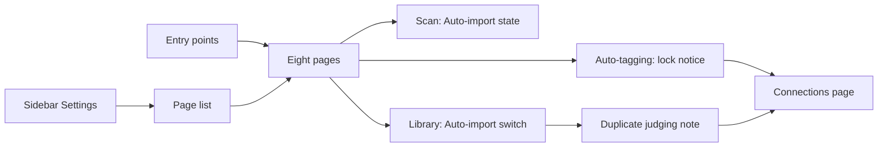
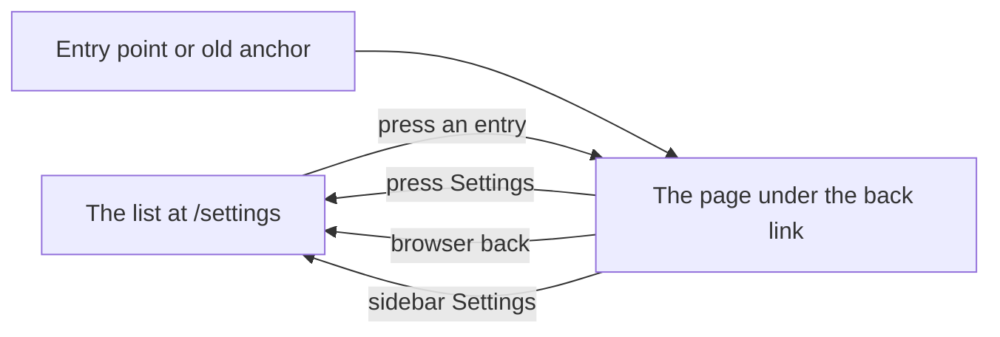
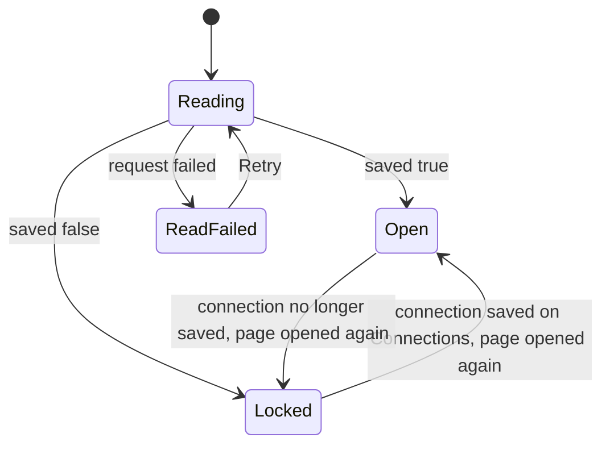

# UI design: Settings split into eight pages

**Feature**: [parent Issue #973](https://github.com/syudead/vv/issues/973) ·
[plan.md](plan.md) ·
[research.md R-1](research.md#r-1-each-settings-page-is-a-route-under-settings) ·
[R-3](research.md#r-3-the-page-list-is-a-column-beside-the-page-from-sm-and-the-whole-of-settings-below-it) ·
[R-5](research.md#r-5-the-auto-tagging-page-is-gated-by-the-connection-with-three-other-states) ·
[contracts/screen-api.md](contracts/screen-api.md)

Sources that already decide things, linked rather than repeated here:

| Topic | Source |
| --- | --- |
| Tokens, closed scales, library density | [design-system.md, Foundations](../../docs/design-docs/design-system.md#foundations); the values in `@theme` of [`web/src/ui/tokens.css`](../../web/src/ui/tokens.css), named here and never copied |
| `SettingsPage`, `PageHeader`, `PageSection`, `FormRow`, `FactList`; the state blocks | [patterns.md, Settings page](../../web/registry/rules/patterns.md#settings-page), [Sections](../../web/registry/rules/patterns.md#sections), [States](../../web/registry/rules/patterns.md#states) |
| `Button`, `Switch`, `Input`, `Alert`, `Skeleton`, `Sidebar`: what each is for, and that disabled is `opacity-50` everywhere | [components.md](../../web/registry/rules/components.md) |
| The sidebar's current entry (`SidebarMenuButton` with `isActive`), the rail from `sm` and the drawer below it | [components.md, Sidebar](../../web/registry/rules/components.md#sidebar), [library-ui.md, Width breakpoints](../../docs/design-docs/library-ui.md#width-breakpoints-in-css-and-the-sidebar-exception) |
| The scan entry, `Scan library` and the bottom-right indicator | [library-ui.md, Scan entry and progress](../../docs/design-docs/library-ui.md#scan-entry-and-progress), [024 UI design, Settings Scan Status](../024-import-progress/ui-design.md#settings-scan-status) |
| The sections that move unchanged: their rows, states and words | [042 UI design, Settings: Auto-import section](../042-folder-watch-import/ui-design.md#settings-auto-import-section), [045 UI design, Settings: ComfyUI section](../045-comfyui-thumbnails/ui-design.md#settings-comfyui-section), [049 UI design, Settings: Work-info plugins section](../049-work-info-plugins/ui-design.md#settings-work-info-plugins-section), [054 UI design, Settings: Duplicate judging section](../054-auto-dup/ui-design.md#settings-duplicate-judging-section), the components in [`web/src/settings`](../../web/src/settings) |
| The entry points that open a settings section | `ScanProgressIndicator`, `EmptyLibrary`, `FolderView`, `RootView` ([library-ui.md](../../docs/design-docs/library-ui.md#scan-entry-and-progress)), the video page's `EditEntry` ([045 UI design, Video page: edit entry](../045-comfyui-thumbnails/ui-design.md#video-page-edit-entry)), the fetch dialog's `FindStep` ([049 UI design, Find](../049-work-info-plugins/ui-design.md#find)) |
| The text links inside a settings section | The guide links of the Video conversion, ComfyUI, Work-info plugins and API tokens sections (`text-primary underline underline-offset-4`) |
| Screen text | [`web/src/i18n/en.ts`](../../web/src/i18n/en.ts) (`settings`); this feature adds and changes the words below |

This feature changes four things on the screen: the one Settings screen
becomes **eight pages** with a **page list** beside them (requirements 1 to
4); the Auto-import section **splits** into its watch state on Scan and its
switch on Library (requirement 5); the **Auto-tagging page locks** while no
Ollama connection is saved, with the way to the Connections page
(requirement 7); and the **Duplicate judging switch** gains a note with the
same link (requirement 8). Every section keeps its rows, controls, states and
words except where the [Words](#words) table says otherwise (requirement 9).

The diagram shows the parts this document covers and where each one leads.

Each page is one `SettingsPage` with the list in its `nav` slot; the lock
notice and the note are the only parts that link to Connections.

## Why this shape

The page list is a quiet column at the left of the page, not a row of tabs
and not a second sidebar. A settings area of eight destinations is what
desktop products and web consoles have converged on (a left column of plain
names, the current one filled), and a column reads as a map of the whole
area while the page body stays the subject (`UI品質`, visual hierarchy).
Tabs were rejected because eight labels do not fit on one line at 768px and
[components.md, Tabs](../../web/registry/rules/components.md#tabs) keeps
tabs for views of one content, not for moving to another screen. A second
shell sidebar was rejected in
[R-3](research.md#r-3-the-page-list-is-a-column-beside-the-page-from-sm-and-the-whole-of-settings-below-it).
The entries carry no icons: eight icons would compete with the sections'
own icons and badges, and the names are short enough to be read as a list.
The current entry uses the sidebar's own mark (`bg-secondary`,
`text-foreground`, `font-medium`), so the two navigation levels say
"you are here" the same way.

Below `sm` the list is the whole of `/settings` and each page opens under a
back link, the form a phone's settings app uses, because a column beside a
360px page leaves the sections too narrow for a `FormRow`'s label and
control on one line. The list keeps the same rows at every width (no card,
no chevrons), as the shell's drawer keeps the rail's entries, and below `sm`
no entry is marked current: there the list is a menu of destinations, not a
map of where the viewer is.

The page title is the list entry's word, as `UI品質` asks, and nothing else:
no description under it, so the first section's heading is the second thing
the eye meets. A page whose only section had the page's own name would show
the word twice, one line apart, so those two sections are renamed to the
noun their rows are about: `Network` becomes `Local network` and
`Video conversion` becomes `Encoder`. Hiding the page title instead was
rejected because the back link and the page name belong together below
`sm`, and the pages would then differ in where their title sits.

The Auto-tagging page splits its one section into `Progress` and
`Classifier`, in that order, so the run buttons are the first row the page
shows and the switches and thresholds come after them (`UI品質`, priority of
actions). Putting the run buttons in the `Progress` heading's `actions`, as
`Scan library` sits in `Scan status`, was rejected: two buttons with
four-word names do not fit beside a heading at 360px.

The lock is one notice under the page title, not a line per control: the
reason is the same for every control on the page, and one `Alert` with the
way to fix it is read once (`UI品質`, the last point). The controls keep
their values and take the component's disabled look, so the page reads as
"here is what you set, and here is why you cannot change it now" rather than
as a page with a missing section.

The words that pointed at a place on the one screen ("below", "under Scan
status") now name the page and link to it, so a line that says what is
missing also says where to go.

## Words

| Place | Text | Notes |
| --- | --- | --- |
| Page list entries and page titles | Scan · Library · Auto-tagging · Connections · Plugins · Video conversion · Network · API | `settings.pages.<slug>` with the slugs of [R-1](research.md#r-1-each-settings-page-is-a-route-under-settings); one word for the entry, the `h1` and the browser title |
| Page list heading | Settings | `settings.title`, as today's page title; also the `nav`'s accessible name |
| Back link below `sm` | Settings | `settings.title`, after an `ArrowLeft` |
| Section heading, Network page | Local network | Replaces `Network` (`settings.network.heading`) |
| Section heading, Video conversion page | Encoder | Replaces `Video conversion` (`settings.transcoding.heading`) |
| Auto-tagging page, first section heading | Progress | New section, see [Auto-tagging page](#auto-tagging-page) |
| Auto-tagging page, second section heading | Classifier | Replaces `Auto-tagging` as the section's heading |
| `Classifier` description | Asks the classifier set in Connections which existing tags fit each video, … | Replaces "under Ollama" in `settings.autoTagging.description`; `Connections` is a text link to `/settings/connections` |
| Duplicate judging description | … the classifier set in Connections is asked only about the frames that differ. … | Replaces "under Ollama" in `settings.versionJudging.description`; `Connections` is a text link |
| `Progress` description while auto-tagging is on | Waiting 3 · Tagging 1 · Done 340 · Failed 2 | The existing queue line (`settings.autoTagging.queue`), moved from the body to the heading |
| `Progress` description while auto-tagging is off | Auto-tagging is off. | One sentence |
| `Progress` body while auto-tagging is off | Turn on "Use auto-tagging" under Classifier to tag videos. | One `
` row |
| Lock notice title | Ollama connection needed | `AlertTitle` of a default `Alert` |
| Lock notice body | Save the Ollama URL and model in Connections to use auto-tagging. | `AlertDescription`; `Connections` is a text link to `/settings/connections`, so the notice has no `AlertAction` |
| Connection read failed | Couldn't read the Ollama connection: {reason} | `destructive` `Alert` with `Retry` (`common.retry`) in `AlertAction` |
| Duplicate judging note | No Ollama connection is saved. Pairs with a differing part wait until you save one in Connections. | `Connections` is a text link to `/settings/connections` |
| Scan status, `Scan library` blocked | Add a media folder in Library to scan. | Replaces "Add a media folder below to scan."; `Library` is a text link to `/settings/library` |
| Auto-import state, no media folder | Add a media folder in Library to watch it. | Replaces "Add a media folder below to watch it."; `Library` is a text link |
| Auto-import state, off | Off. Changes are picked up by the next scan. Turn it on in Library. | Adds the last sentence; `Library` is a text link |
| Auto-import switch description | The watch state is on the Scan page. | Replaces the state line as the `FormRow` description; `Scan` is a text link to `/settings/scan` |
| Auto-import section description | … picked up by "Scan library" on the Scan page. | Replaces "under Scan status" in `settings.autoImport.description`; both pages' Auto-import sections share it |
| Media folders description | … start a scan with "Scan library" on the Scan page. … | Replaces "under Scan status" in `settings.mediaFolders.description` |
| Network page outside the desktop app | This setting is in the Windows desktop app. This VVMDM isn't running as the desktop app, so there's nothing to set here. | One `
` row under the `Local network` heading |

The entry points keep their words: `Open Settings` in the empty root folder,
the thumbnail edit entry and the fetch dialog still says where the link
goes, and only the address changes
([R-2](research.md#r-2-the-old-anchor-addresses-are-forwarded-and-the-entry-points-move-to-the-pages)).

## Changes to the design system

The `settings-page` pattern gains two slots, in its registry item, its
example block, [patterns.md, Settings page](../../web/registry/rules/patterns.md#settings-page)
and [design-system.md](../../docs/design-docs/design-system.md#page-patterns).
Each change is made by the plan unit that first uses it, before its page
does: the "Give the settings page pattern a slot for a page list" unit makes
the `nav` slot, `settings-nav`, `grid-cols-settings-page` and the
`max-w-4xl` width; the "Lock the Auto-tagging page until the Ollama
connection is saved" unit makes the `notice` slot, the `Alert` rule below
and the `aria-disabled` look.

| Change | What it is |
| --- | --- |
| `nav` slot | The page list: a `nav` of links with a heading. From `sm` a column `settings-nav` wide at the left of the body, stuck under the top bar; below `sm` the list alone, or the body alone, as [Page list and skeleton](#page-list-and-skeleton) says. Without it the skeleton is unchanged |
| `notice` slot | One line between the header and the sections, for a condition that applies to the whole page: an `Alert`. Without it nothing is drawn |
| `Alert` rule | [components.md, Alert](../../web/registry/rules/components.md#alert) allows an `Alert` in a page pattern's `notice` slot as well as inside a section, for a condition of the whole page |
| `settings-nav` | A named layout step in `tokens.css`: the width of the list column, wide enough for `Video conversion` on one line at `text-sm` with the row's `px-2` |
| `grid-cols-settings-page` | A named utility, as `grid-cols-list-aside`: the list column `settings-nav` wide, then the body |
| `max-w-4xl` with `nav` | The skeleton's width becomes `max-w-4xl` when `nav` is passed, so the body keeps about the width it has today beside the column |
| `aria-disabled` look | `Button`, `Switch` and `Input` draw `aria-disabled="true"` as they draw `disabled` (`opacity-50`, the `not-allowed` cursor), without `pointer-events-none`, so a locked control keeps its focus and its value |

No colour token is added and nothing is added to `pairs` in
`web/src/theme/tokens.test.ts`: the list uses `muted-foreground`,
`foreground`, `accent` and `secondary`, the roles the sidebar already pairs.
The icons are lucide `ArrowLeft`, `Unplug` and `CircleAlert`.

## Page list and skeleton

Every page is one `SettingsPage` with the list in `nav`, the page's title in
`header` and its sections as children. The list is a `nav` named `Settings`
holding the heading and a `ul` of eight router links in the order of
[R-1](research.md#r-1-each-settings-page-is-a-route-under-settings), the
current one with `aria-current="page"`.

| Part | From `sm` | Below `sm` |
| --- | --- | --- |
| List heading | `Settings`, `text-sm font-semibold text-muted-foreground`, the first row of the column | `Settings`, `text-xl font-semibold`: it is the page's title there |
| Entry row | `h-8`, `px-2`, `rounded-md`, `text-sm`, `text-muted-foreground`, full width of the column, left aligned; hover `bg-accent text-foreground`; `gap-1` between rows | The same row at the page's full width |
| Current entry | `bg-secondary text-foreground font-medium`, as the sidebar's current entry | No mark |
| Column | `settings-nav` wide, `gap-6` from the body, `sticky` under the top bar (`top-navbar`), so it stays in view on a long Scan page | Not a column: on `/settings` the list fills the page and the body is not drawn; on `/settings/<page>` the list is not drawn |
| Back link | Not drawn | `ghost` `sm` `Button` as a link to `/settings` in the `PageHeader`'s `leading`: `ArrowLeft`, then `Settings` |
| Page title | The page's name, `h1` `text-xl`, with no description | Same, under the back link |

The diagram shows how the viewer moves between the list and a page below
`sm`; from `sm` every arrow is a press on the column and the list never
leaves the screen.

Pressing an entry is a push navigation, so the browser's back returns to the
page the viewer came from (acceptance criterion 2). The sidebar's `Settings`
entry goes to `/settings` and is marked current on every page below it, so
below `sm` it is a second way back to the list.

### States

| State | What the screen shows |
| --- | --- |
| `/settings`, from `sm` | The column with `Scan` current and the Scan page |
| `/settings`, below `sm` | The list alone under its heading |
| `/settings/<page>` | The column with that entry current and the page; below `sm`, the page under the back link |
| `/settings/<unknown>` | Replaced by `/settings/scan`; the screen is the Scan page |
| `/settings#<anchor>` with a known anchor | Replaced by the page's address with the anchor; the section's heading is scrolled to and focused as today |
| A page's section fails to load | That section shows its own `ErrorState`; the column, the title and the other sections are unchanged |
| Guest | Sent away as from `/settings` today; no page renders |

## Pages and their sections

The table is the page map's content; the slugs are
[R-1](research.md#r-1-each-settings-page-is-a-route-under-settings)'s.
The sections are the existing components in the order given, each with the
heading of its `PageSection` as today unless [Words](#words) renames it.

| Page | Sections, top to bottom | Anchor |
| --- | --- | --- |
| Scan | `Scan status` (with `Scan library`, the bar, the videos with problems); `Auto-import` as the watch state ([Scan page](#scan-page-auto-import-state)) | `#scan-status` |
| Library | `Media folders`; `Auto-import` as the switch; `Duplicate judging` ([Library page](#library-page)) | — |
| Auto-tagging | `Progress`; `Classifier` ([Auto-tagging page](#auto-tagging-page)) | — |
| Connections | `Ollama`; `ComfyUI` | `#comfyui` |
| Plugins | `Work-info plugins` | `#work-info-plugins` |
| Video conversion | `Encoder` | — |
| Network | `Local network` ([Network page](#network-page-outside-the-desktop-app)) | — |
| API | `API tokens` | — |

Sections keep `gap-8` between them and the rows, padding and states of
their own designs. The media folder dialogs (the picker, the remove
confirmation) open from the Library page exactly as they open today.

## Scan page: Auto-import state

A `PageSection` headed `Auto-import` after `Scan status`, with the section
description of [Words](#words) and no action. Its body is the watch state
and, when there is one, the problem.

| Row | Content |
| --- | --- |
| State line | One `
` with the state line of [042 UI design, States](../042-folder-watch-import/ui-design.md#states), the two lines of [Words](#words) replacing their old form, `text-sm`; `text-muted-foreground` for Off and the rest in `foreground` |
| Problem row | Only while `watch.state` is `limited`: the `warning` `Alert` as today |

| State | What the section shows |
| --- | --- |
| Loading | A `Skeleton` the height of one line in the state row |
| Load failed | `ErrorState` with "Couldn't load the auto-import settings: {reason}" and `Retry`, as today |
| Off | "Off. Changes are picked up by the next scan. Turn it on in Library." |
| On, no media folder | "Add a media folder in Library to watch it." |
| Starting, Active, Limited | The state line as today; Limited adds the problem row |

The section re-reads the state on the events 042 lists (mount, window
focus, the latest scan ending); the media folder change trigger no longer
applies here because folders are changed on another page, and opening the
Scan page after a change mounts the section again.

## Library page

`Media folders` first, with `Add folder` in its heading's actions and its
rows, dialogs and the scan lock line as today. Then `Auto-import` as one
`FormRow`: the label `Pick up changes as they happen`, the description of
[Words](#words) with its link to the Scan page, and the `Switch`; the saving
line and the failed save `Alert` as in 042. The row's description is the
same text in both states, so the row's height does not change on a press.

`Duplicate judging` is 054's section with one row added:

| Row | Content |
| --- | --- |
| Switch row | As 054: `Judge possible duplicates automatically`, its description, the `Switch` |
| Connection note | Only while the connection read answered `saved: false`: one `
` row, `text-sm text-muted-foreground`, with the note of [Words](#words) and its text link to `/settings/connections` |

The switch is pressable in every state, as
[R-5](research.md#r-5-the-auto-tagging-page-is-gated-by-the-connection-with-three-other-states)
says; a loading or failed connection read adds no row, so the section is one
row high until the read answers `false`.

## Auto-tagging page

Two `PageSection`s. `Progress` comes first: its heading's description is
the queue line, and its body holds the run buttons and the last failure.
`Classifier` holds the rows of today's section in today's order: the two
switches, the two thresholds, then the row with `Save` and `Test judging`
and their status lines.

| `Progress` row | Content |
| --- | --- |
| Run row | `Tag videos not yet tagged` (`outline` `sm`) then `Tag all videos again` (`ghost` `sm`), wrapping below `sm` |
| Last failure | Only while the queue reports one: the `warning` `Alert` as today |

While auto-tagging is off (the saved `enabled` is `false`) the section stays
in place with the off description and the one `
` row of [Words](#words),
and no run row, so saving the switch off does not make the `Classifier`
section jump up (acceptance criterion 6).

The lock follows
[R-5](research.md#r-5-the-auto-tagging-page-is-gated-by-the-connection-with-three-other-states):
the page reads the Ollama connection, and while `saved` is `false` every
control of both sections is `aria-disabled` and drawn at `opacity-50` with
its value visible: the switches keep their position, the inputs their
numbers, and the run row stays drawn when auto-tagging is on. The `notice`
slot holds the lock notice, a default `Alert` with `Unplug`, the title and
the body with its `Connections` link. The sections' own loading
skeletons and `ErrorState`s are unchanged.

### States

The diagram shows the page's states from the connection read and what moves
it between them; the sections' own loading and saving states are unchanged.

| State | What the page shows |
| --- | --- |
| Reading | The sections' loading skeletons; no notice |
| Open | No notice; the controls as today |
| Locked | The lock notice between the title and `Progress`; every switch, input and button of both sections `aria-disabled` at `opacity-50`, values visible; a press or a keystroke changes nothing and sends nothing |
| Read failed | A `destructive` `Alert` in the `notice` slot with the failed-read line and `Retry`; the controls as in Open |

## Network page outside the desktop app

Where the network read answers `404`, the page shows a `PageSection` headed
`Local network` with the section description as today and one `
` row,
the line of [Words](#words), `text-sm text-muted-foreground`. No switch, no
`Alert`, no state block: nothing failed and nothing is empty. In the desktop
app the section is today's, under the new heading.

## Entry points

| Entry | Goes to | What the viewer sees on arrival |
| --- | --- | --- |
| Bottom-right indicator; `Scan library` of the empty library and the empty folder | `/settings/scan#scan-status` | The Scan page with `Scan status` at the top; below `sm`, under the back link |
| `Open Settings` of the empty root folder | `/settings/library` | The Library page, `Media folders` first |
| `Open Settings` of the thumbnail edit entry | `/settings/connections#comfyui` | The Connections page scrolled to `ComfyUI`, its heading focused |
| `Open Settings` of the fetch dialog | `/settings/plugins#work-info-plugins` | The Plugins page, `Work-info plugins` at the top |
| Lock notice, Duplicate judging note | `/settings/connections` | The Connections page, `Ollama` first |
| Sidebar `Settings` | `/settings` | The Scan page from `sm`; the list below it |

## Responsive behaviour

Breakpoints are Tailwind's defaults only, applied in CSS
([library-ui.md, Width breakpoints](../../docs/design-docs/library-ui.md#width-breakpoints-in-css-and-the-sidebar-exception));
`sm` is 640px. The widths judged are 360px, 768px and 1280px.

| Width | Layout |
| --- | --- |
| 1280px | The rail, then the page at `max-w-4xl` centred: the column `settings-nav` wide at the left, the body beside it; every `FormRow` is label left, control right |
| 768px | The same two columns with the body narrower; the `FormRow`s of every page still sit label left, control right; the run row and the `Save` row keep their buttons on one line |
| 360px | The drawer's ☰ in the top bar; `/settings` is the list alone, `/settings/<page>` the page under the back link; `FormRow`s stack; the run row wraps to two lines; the lock notice's body wraps under its title |

## Review criteria

Judged by looking at the real screen
([library-ui.md, Layout verified by people, not machines](../../docs/design-docs/library-ui.md#layout-verified-by-people-not-machines))
at the widths above, on every one of the eight pages, with Settings before
and after a saved Ollama connection, with and without a media folder, and
outside the desktop app. "It exists" alone does not satisfy a criterion
(Q-4).

1. **Visual hierarchy**: on every page from `sm`, the eye goes page title →
   first section heading → its rows, and the column is found after them;
   the column's heading is smaller and quieter than the page title, and no
   entry but the current one has a fill. The current entry is found in one
   glance at the column without reading the names (`UI品質`, visual
   hierarchy).
2. **Information density**: at 1280px, Library, Connections, Plugins, Video
   conversion, Network and API show every row without scrolling; Scan and
   Auto-tagging show their first section whole and the second section's
   heading. No page shows a section the table in
   [Pages and their sections](#pages-and-their-sections) does not give it
   (`UI品質`, density; acceptance criterion 1).
3. **Spacing rhythm**: the sections on every page sit `gap-8` apart with the
   same card, row padding and dividers as today's screen; the column's rows
   are `h-8` with `gap-1`, and the gap between the column and the body is
   the same on every page. Moving between pages, the page title and the
   first section heading stay at the same vertical position.
4. **Typography**: the page title is the same word as its entry, `text-xl`;
   no page shows its own name twice in a row; the column's entries and the
   back link are `text-sm` and nothing in the column is bolder than the
   current entry's `font-medium`.
5. **Priority of actions**: on Scan, `Scan library` is the first button on
   the page; on Auto-tagging, the two run buttons are above every switch
   and input; on Library, `Add folder` is above the switches. The column's
   entries never look like buttons (no border, no fill except the current
   one).
6. **Narrow width**: at 360px, `/settings` is a list the thumb can read
   without a current mark, pressing an entry opens the page under a back
   link that says `Settings`, the back link returns to the list, and the
   browser's back does the same (requirement 3, acceptance criteria 2 and
   9).
7. **Locked page**: with no Ollama connection saved, the Auto-tagging page
   shows one notice under its title and every control at half opacity with
   its value still readable; pressing a switch, typing in a threshold or
   pressing `Save`, `Test judging` or a run button changes nothing on the
   screen; the notice's `Connections` link lands on `Ollama`; after saving a connection
   there and pressing back, the notice is gone and the controls are at full
   opacity (acceptance criterion 7, `UI品質`, the last point).
8. **Failed connection read**: the page shows the failed-read `Alert` with
   `Retry` and the controls at full opacity; nothing on the page is locked.
9. **Duplicate judging**: with no connection saved, the switch toggles and
   saves, and the note under it links to Connections; with a saved
   connection the section is one row high (acceptance criterion 8).
10. **Scan and Library**: with no media folder, `Scan library` is disabled
    and its line links to Library; adding a folder there and opening Scan
    enables the button without a reload (acceptance criterion 5); the
    Auto-import state on Scan and the switch on Library show the same
    on/off after a press on Library and a return to Scan.
11. **Entry points**: the bottom-right indicator, the two `Open Settings`
    links and the empty library's `Scan library` land on the pages of
    [Entry points](#entry-points) with the named section at the top and its
    heading focused where an anchor is given (acceptance criteria 3 and 4).
12. **Examples that do not meet the requirement** (`UI品質`): the column
    shows icons or looks like a toolbar; the current entry is marked below
    `sm`; a page carries a description under its title; `Network` or
    `Video conversion` appears as both the title and the heading; the run
    buttons sit below the thresholds; locked controls are hidden or look
    pressable; the lock reason is repeated per row; the Network page is
    empty outside the desktop app.

## Accessibility

The parent Issue does not ask for screen-reader or contrast design, so only
names are decided, as 054 did.

- The list is a `nav` whose accessible name is `Settings`; the current
  entry carries `aria-current="page"`; the `h1` is the page's name, and
  below `sm` on `/settings` the list's heading is the visible title.
- The back link is a link, not a button, named `Settings`.
- Locked controls are `aria-disabled="true"`, keep their focus order, and
  the lock notice is the first element after the title so it is read before
  them; the failed-read `Alert` is the component's own role.
- The text links in the state lines and the note are router links with the
  page's name as their text.
