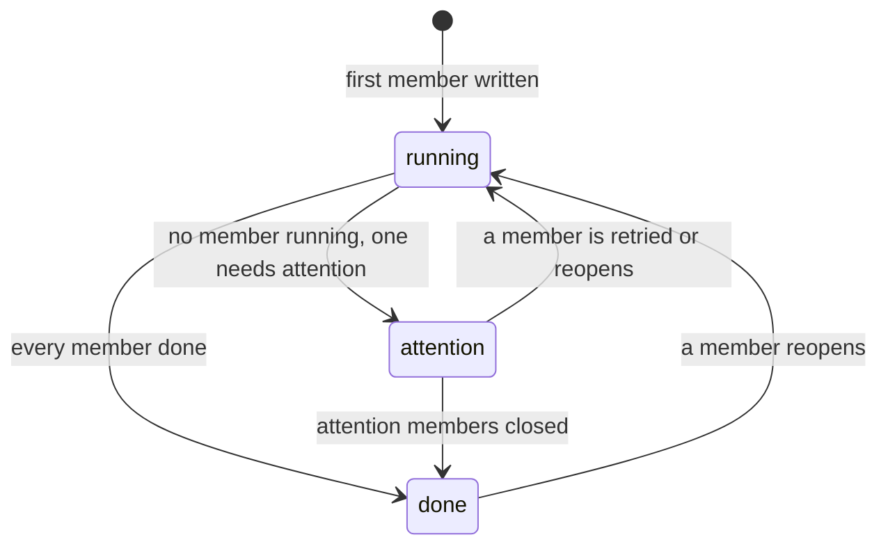

# Data model: import pipelines in the activity log

The rest of the model is unchanged:
[`00055_activity.sql`](../../internal/store/migrations/00055_activity.sql) and
[`internal/domain/activity_entry.go`](../../internal/domain/activity_entry.go).

## Migration

One migration with the next free number in `internal/store/migrations/`
creates `activity_pipeline_members` and `activity_entry_stages`, adds
`activity_entries.superseded_by`, and adds `pipeline` to the accepted kinds.
It creates no pipeline for existing entries
([R-10](research.md#r-10-earlier-entries-stay-standalone)).

## `activity_entries` changes

| Field | Type | Null | Meaning |
| --- | --- | --- | --- |
| `kind` | text | No | Adds `pipeline`; its feature is `import`, its subject is the video (`subject_kind = video`, content key, label as written) |
| `superseded_by` | integer | Yes | The entry that closed this one as `done`/`superseded`, written by the supersede step of `recordActivity` |

A `pipeline` entry has no `stage`, `detail`, `probability` or `undo_keys`, and
its decider is the decider of its first member.

## `activity_pipeline_members`

| Field | Type | Null | Meaning |
| --- | --- | --- | --- |
| `pipeline_id` | integer | No | The `pipeline` entry |
| `entry_id` | integer | No | A member entry (`import`, `auto_tag`, `version_judgement`) |
| `joined_at` | integer | No | Milliseconds; orders members inside the detail |

**Relationships**: Primary key `(pipeline_id, entry_id)`, an index on
`entry_id`, no foreign key; entries are never deleted, like the rest of the log.

## `activity_entry_stages`

| Field | Type | Null | Meaning |
| --- | --- | --- | --- |
| `entry_id` | integer | No | An `import` entry |
| `stage` | text | No | `probe`, `thumbnail`, `seek_thumbnail`, `preview`, `fingerprint` |
| `state` | text | No | `waiting`, `processing`, `done`, `failed`, `gone` |
| `detail` | text | Yes | The stage's last error message, untranslated |
| `updated_at` | integer | No | Milliseconds |

**Relationships**: Primary key `(entry_id, stage)`. A stage the entry never held
has no row; that is how "not part of this run" differs from "waiting".

## Rules

| Rule | Enforced in |
| --- | --- |
| A new `import` entry opens a pipeline unless it continues another entry ([R-3](research.md#r-3-a-new-import-entry-opens-a-pipeline-continuations-join-it)) | `internal/store` (`joinImportActivity`, `recordLocationImport`) |
| An entry that continues another one (retry, claim reopen) joins every pipeline of the entry it continues | `internal/store`, next to `recordActivity` |
| After-import auto-tagging joins the pipeline of the finishing seek job's `import` entry ([R-4](research.md#r-4-after-import-auto-tagging-is-queued-in-the-seek-stage-transaction)) | `internal/store` (seek result and seek failure transactions) |
| A new pair entry joins the unfinished pipelines of both keys ([R-5](research.md#r-5-a-pair-entry-joins-the-open-pipelines-of-its-two-videos)) | `internal/store` (`syncPairActivity`) |
| Every member write re-rolls its pipelines in the same transaction ([R-6](research.md#r-6-parent-status-is-stored-and-rolled-up-in-the-members-transaction)) | `internal/store` helper that writes entry states; the rule in `internal/domain` |
| A pipeline is never a member, and is never retried or undone | `internal/domain` (`RetryOffered`, `UndoOffered`) |
| Settling an `import` entry rewrites its stage rows from the jobs it holds | `internal/store` (`settleImportActivity`) |

## State transitions

The diagram shows a pipeline's state as its members change.

The roll-up (`PipelineState` in `internal/domain`) reads the members that are
not **replaced**, a member being replaced when its `superseded_by` is a member
of the same pipeline.

| Members | Pipeline |
| --- | --- |
| Any `running` | `running`, reason `processing` when any is `processing`, else `waiting` |
| None `running`, any `attention` | `attention` with the reason of the oldest such member |
| All `done`, the `import` member `gone` | `done`/`gone` |
| All `done`, the `import` member superseded from outside the pipeline | `done`/`superseded` |
| All `done` otherwise | `done`/`completed` |

A pipeline returns to `running` only through its own members: a retry joins the
retried member's pipelines, and a pair entry that reopens (an undone
drag-organize bundle) stays in its pipelines. A later, separately started run
opens its own pipeline.

## What does not change

`jobs.activity_id`, `auto_tag_queue.activity_id` and
`video_version_candidates.activity_id` still point to the member entries, and
retry and undo still dispatch by the member's kind
([activity.md](../../docs/design-docs/activity.md#retry-and-undo-are-dispatched-by-kind)).
