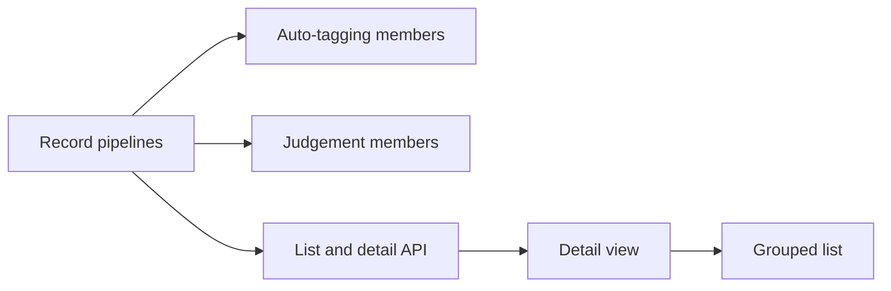

# Implementation Plan: import pipelines in the activity log

**Branch**: `feature/activity-pipeline` | **Parent Issue**: #1356

**Input**: The parent Issue. It is this feature's specification.

## Summary

The owner can open any activity entry's detail, and each video's import run
becomes one parent entry whose members are the `import` entry (its five ingest
stages are that entry's breakdown, not members), the auto-tagging run and the
duplicate judgements that import starts. The parent is a new
`pipeline` activity entry linked to its members by a table, rolled up in each
member's transaction, and the list pages parents and standalone entries only
([research.md](research.md)).

## Technical Context

**Canonical definitions**: [activity.md](../../docs/design-docs/activity.md),
[auto-tagging.md](../../docs/design-docs/auto-tagging.md#activity-entries-and-undo),
[duplicate-judging.md](../../docs/design-docs/duplicate-judging.md#each-pair-keeps-one-activity-entry),
[import-pipeline.md](../../docs/design-docs/import-pipeline.md),
[the screen API schema](../../api/openapi.yaml),
[validation commands](../../docs/how-to/development.md#validate-changes).

**Feature-specific context**:

- One migration (two tables, one column, one kind):
  [data-model.md](data-model.md#migration).
- A process that an import's stage result starts (a follow-up) joins that
  import's pipeline through one rule and one store helper, so later
  follow-ups need no change to the pipeline, the list or the screen
  ([R-11](research.md#r-11-follow-up-processes-join-through-one-rule)).
  Auto-tagging and duplicate judging are the two today.
- After-import auto-tagging moves from the `VideoIngestChanged` subscriber into
  the seek stage's result transaction
  ([R-4](research.md#r-4-after-import-auto-tagging-is-queued-in-the-seek-stage-transaction)).
- The list changes its unit from entries to top-level entries, and a detail
  read is added: [contracts/activity-api.md](contracts/activity-api.md).
- The screen layout is decided by the `design` stage, since the parent Issue
  carries the `ui` label. The maintainer has fixed two points for it: the
  detail is its own page, and a pipeline whose work is in progress (`running`
  with reason `processing`) is shown expanded in the list with each member's
  progress (the `import` member by stage), collapsing once nothing in it is
  processing; a waiting pipeline stays collapsed, so a large scan lists many
  collapsed cards and a few expanded ones; the owner can expand or collapse any
  pipeline card. Everything beyond the member summary is on the detail page. The member summary carries the stage
  states this needs ([contract](contracts/activity-api.md#get-apiactivity)).
- No new dependency. No open question.

## Constitution Check

Checked against [ARCHITECTURE.md](../../ARCHITECTURE.md),
[core-beliefs.md](../../docs/design-docs/core-beliefs.md) and
[AGENTS.md](../../AGENTS.md), before and after Phase 1.

| Rule | Verdict |
| --- | --- |
| Dependency direction | Pass: `PipelineState` and the retry/undo exclusion are pure rules in `internal/domain`; SQL stays in `internal/store` |
| The domain decides, the store enforces | Pass: the roll-up is a domain rule applied inside the member's transaction (R-6) |
| Store roles | Pass: membership, roll-up and the after-import queue write are package-private helpers called inside the existing roles' transactions; no role calls another's public method |
| Events after commit | Pass: members and parents publish the existing `ActivityChanged` after commit; no new event |
| User data survives a rebuild | Pass: the new tables key on entry ids and carry no foreign key to `videos`, so stage rows outlive the video (R-8) |
| Every read knows its viewer | Pass: `getActivity` is owner-only like the other activity operations, and `videoId` is resolved for the owner audience |
| Generated code | Pass: `api/openapi.yaml` changes and `task generate` writes `internal/httpapi/gen/` and `web/src/api/gen/` |
| Complexity 25 and no copying | Watch: the list filter gains member matching; it extends `activityFilter` rather than adding a second query builder |
| Documentation with the change | Pass: each unit updates the design document it changes; nothing cites this directory |

## Project Structure

### Documentation (this feature)

```text
specs/059-activity-pipeline/
├── plan.md
├── research.md                # R-1..R-10
├── data-model.md              # migration, member and stage tables, roll-up
├── quickstart.md              # end-to-end observation with real workers
└── contracts/
    └── activity-api.md        # list unit change, getActivity
```

`ui-design.md` is added by the `design` stage.

### Source Code

**Affected boundaries**:

| Boundary | What changes |
| --- | --- |
| `internal/domain` | `pipeline` kind, `PipelineState`, member summary and detail values |
| `internal/store` | Migration, membership and roll-up helpers, stage rows, after-import queueing, list and detail reads |
| `internal/app` | `AutoTagger.VideoImagesFinished` only wakes the worker; `Activity` adds the detail read |
| `internal/httpapi`, `api/openapi.yaml` | `getActivity`, list response changes |
| `web/src/activity`, `web/src/api` | Detail view and grouped list |

**New paths**: `internal/store/activity_pipelines.go` (membership and roll-up),
one migration.

**Structure decision**: Follows the existing layout; the pipeline code sits
beside `activity_import.go`, which it rolls up one level higher.

## Implementation Work

The graph shows which units must land first.



### Record import pipelines and their ingest stages in the activity log

**Scope**: The migration, the `pipeline` kind and `PipelineState`,
`scan_id`, `superseded_by`, membership and roll-up helpers, opening a pipeline with a new
`import` entry and joining continuations (activity retry, claim reopen), the
follow-up helper, and the `import` entry's stage rows
([data-model.md](data-model.md), R-1, R-2, R-3, R-6, R-8, R-10, R-11). Update
[activity.md](../../docs/design-docs/activity.md) with the lasting rules,
including how a new follow-up process joins a pipeline.

**Dependencies**: None

**Acceptance**:

- Domain logic test of `PipelineState` with one case per roll-up row in
  [data-model.md, State transitions](data-model.md#state-transitions),
  including a replaced member that is ignored.
- Store tests on SQLite (the rule lives in SQL transactions): two videos
  queued in one scan get two pipelines; a rescan after the first run finished
  opens a second pipeline; `RetryImport` adds the new entry to the same
  pipeline and marks the old one replaced; a claim reopen joins the
  superseded entry's pipeline; the follow-up helper called with a job's
  `import` entry joins the new entry to that entry's pipelines, and to none
  for a job of an entry from before the migration; stage rows stay readable after the video is
  deleted; an `import` entry already `running` before the migration stays
  without a pipeline.
- Existing `activity_import_test.go` cases pass unchanged.

### Attach after-import auto-tagging runs to their import pipeline

**Scope**: Queue after-import auto-tagging in the seek stage's final result
transaction and join the pipeline of the job's `import` entry through the
follow-up helper (R-11); the subscriber
only wakes the worker; auto-tag retry and claim reopen join through the rule
from the first unit (R-4). Update
[auto-tagging.md](../../docs/design-docs/auto-tagging.md#queue-and-when-a-video-is-judged).

**Dependencies**: Record import pipelines and their ingest stages in the
activity log

**Acceptance**:

- Store tests: with both settings on, finishing or finally failing the seek
  stage writes an `auto_tag` member and the pipeline stays `running` after the
  `import` member is done; with either setting off, or a queue row already
  present, no member is written and the pipeline ends `done`; a failed run
  makes the pipeline `attention` while the `import` member stays `done`.
- Store test: "Suggest tags" on the video page writes a standalone entry.
- The app test of `VideoImagesFinished` asserts a wake and no queue call
  (revised existing case).

### Attach duplicate judgements to the import pipelines of both videos

**Scope**: A newly opened `version_judgement` entry joins the finishing
fingerprint job's pipeline through the follow-up helper (R-11) and the other key's newest pipeline when it is
unfinished or of the same scan; reattach adds nothing (R-5). Update
[duplicate-judging.md](../../docs/design-docs/duplicate-judging.md#each-pair-keeps-one-activity-entry).

**Dependencies**: Record import pipelines and their ingest stages in the
activity log

**Acceptance**:

- Store tests: the second video's fingerprint opens a pair entry that is a
  member of both videos' pipelines when both were opened by one scan, also
  after the first video's pipeline finished (which returns it to `running`);
  a first video imported by an earlier scan gets no membership; with
  judging off no member is written; turning judging on later writes standalone
  entries; retrying a failed pair returns its pipelines to `running` without a
  second entry.

### Serve the activity list by pipeline and an entry's detail

**Scope**: `api/openapi.yaml` and generated code, the top-level list with
member summaries, member-matching filters and counts, and `getActivity`
([contracts/activity-api.md](contracts/activity-api.md), R-7, R-9). Update
[activity.md](../../docs/design-docs/activity.md#the-list-pages-by-id-and-counts-in-the-same-read).

**Dependencies**: Record import pipelines and their ingest stages in the
activity log

**Acceptance**:

- Store tests: a member that matches `feature`, `decider` or `q` lists its
  pipeline once with that member `matched` (also with `status` combined, per
  the contract's `matched` table); counts equal the number of
  listed entries; a pair in two pipelines is listed under both; members are
  never listed on their own; the cursor stays stable while members join.
- HTTP adapter tests with a fake `Activity`: `getActivity` returns members,
  pipelines and stages, `404 not_found` for an unknown id, `401` without an
  owner session;
  retry and undo of a `pipeline` id answer `409`.
- `task generate` leaves no diff in CI.

### Show an activity entry's full detail on the Activity screen

**Scope**: Open any entry's detail from the Activity screen: subject, process,
status, decider, times, the full reason, auto-tag probabilities, stage rows or
"not recorded", members and pipelines, retry and undo on the member, refetch
on the `activity` event, layout per `ui-design.md`.

**Dependencies**: Serve the activity list by pipeline and an entry's detail

**Acceptance**:

- Logic tests of the detail formatting (stage states, "not recorded", missing
  video without an Open action).
- Page test with the fake server: opening a detail shows the full message; an
  `activity` event refetches it; Retry on a member sends the request for that
  member's id.
- Visual review at desktop width and 360 px against `ui-design.md`, including a
  long message and a long video name.

### Group the Activity list by import pipeline

**Scope**: Parent cards with their member summary, expanded with each
member's progress while the pipeline is processing and collapsed otherwise,
matched members under filters and search, the path from a parent or member to its detail separate
from opening the video, and counts labelled as runs, per `ui-design.md`.

**Dependencies**: Show an activity entry's full detail on the Activity screen

**Acceptance**:

- Component tests of the parent card: expanded with member and stage progress
  while `running`/`processing`, collapsed when waiting, needing attention or
  `done`, and expandable by the owner; a member needing
  attention visible on the parent; a `matched` member marked.
- Page test: an `activity` event that finishes a pipeline collapses its card;
  filtering by "Needs attention" lists the parent and the detail link opens
  that member.
- Visual review at desktop width and 360 px against `ui-design.md`: two runs of
  one video and a pipeline's members are told apart.
- The steps of [quickstart.md](quickstart.md) pass on a local server.
