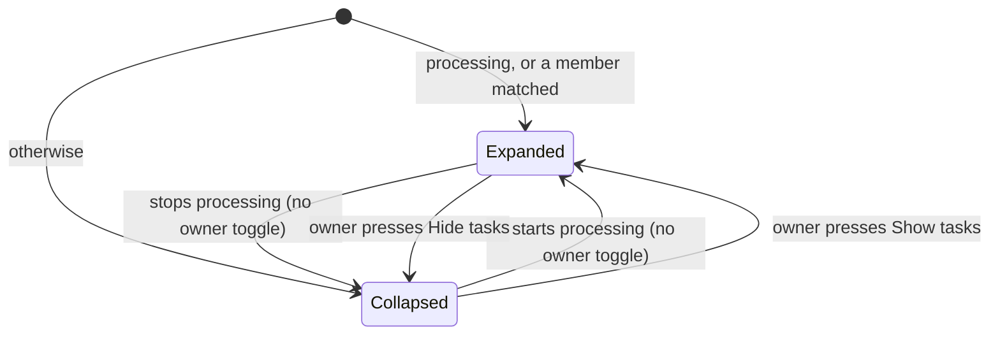

# UI design: import pipelines in the activity log

Sources: [design-system.md](../../docs/design-docs/design-system.md) and its
rules ([patterns.md](../../web/registry/rules/patterns.md),
[components.md](../../web/registry/rules/components.md)); the current Activity
screen (`web/src/activity/ActivityPage.tsx`, `ActivityCard.tsx`), whose
`CardList` cards, status icons, tones, result phrases and `Retry`/`Undo`
buttons this design keeps; the Settings page's back link and column
(`web/src/settings/SettingsPage.tsx`); the data is [plan.md](plan.md) and
[contracts/activity-api.md](contracts/activity-api.md).

## Why this shape

A pipeline is one `CardList` card whose member rows open inside the card, and
every entry's detail is a page of its own at `/activity/{id}` inside the
shell. The card's border holds one run, so the gap between cards separates
runs and the absence of borders between member rows keeps a run together; a
member never becomes a card of its own, so nothing reads as counted twice.
The card's title opens the detail and the `Open` icon opens the video, so
reading and leaving for the video are different targets.

| Rejected | Why |
| --- | --- |
| Members as indented cards under the parent | Each member looks like a run, and two runs of one video blur into one column of cards |
| The subject staying a link to the video, with a separate `Details` button | Two links on one card where the larger one does not read the record; the detail becomes the least visible path |
| The detail in a side panel or dialog | Fixed by the maintainer: the detail is a page ([plan.md](plan.md#technical-context)) |
| `DetailPage` for the detail | It is a media page outside the shell at viewing density; an entry has no media, and the owner returns to the list it came from |
| A stage meter with one segment per stage on the card | A new component for what the existing progress bar and the stage name already say; the per-stage states are on the detail page |

## Words

Screen text as `web/src/i18n/en.ts` will hold it, under `t.activity`.
Existing phrases (status words, kinds, reasons, outcomes, stage names) are
reused unchanged.

| Place | Text | Notes |
| --- | --- | --- |
| Kind `pipeline` (card badge) | `Import run` | The `import` member keeps `Import` |
| Card summary, processing | `{kind} in progress · {done} of {total} tasks done` | `{kind}`: the first processing member's kind word; `task` when `{total}` is 1 |
| Card summary, waiting | `Waiting · {done} of {total} tasks done` | |
| Card summary, needs attention | `{kind}: {reason}` | The member that gives the pipeline its reason; `{reason}` is that member's existing reason phrase |
| Card summary, done | `Finished · {total} tasks`, `Finished · 1 task` | `gone` and `superseded` keep their existing outcome phrases |
| Member row of a pair | `Duplicate check · with {label}` | `{label}`: the other video of the pair; needs the member summary's `subject` ([below](#data-this-design-needs)) |
| Member row, finished `auto_tag` | `Added {count} tags`, `Added 1 tag` | No tags reads the existing `No tags added` |
| Matched member | `Matches` | `Badge` `soft` on the member row |
| Expand button | (icon only) | Tooltip `Show tasks` / `Hide tasks`; read aloud `Show tasks for {subject}` / `Hide tasks for {subject}` |
| Card title link, read aloud | `Details of {kind} for {subject}` | |
| Detail back link | `Activity` | `ArrowLeft`, as the Settings back link |
| Detail document title | `{subject} · Activity` | |
| Detail sections | `Summary`, `Tasks`, `Stages`, `Tags`, `Part of` | |
| Detail facts | `Status`, `Process`, `Video`, `Videos`, `Decided by`, `Started`, `Updated`, `Result` | `Videos` for a pair; a scan uses `Process` only |
| Stage state | `Waiting`, `In progress`, `Done`, `Failed`, `Left the library`, `Not run` | `Not run`: a stage still waiting while its entry is not running |
| Stage not part of the run | `Not part of this run` | A stage with no row |
| Stages not recorded | `Stage details weren't recorded for this import.` | Entries written before this feature |
| Replaced member, detail | `Replaced by a newer run` | Existing outcome phrase, on the replaced row |
| Detail not found | `This activity entry doesn't exist` / `Back to Activity` | Title / action |
| Detail load failed | `Couldn't load this activity entry` | With `Retry` |
| Footer | unchanged | Its numbers count cards (below) |

## Activity list

The page is unchanged apart from the cards: `ListPage`, toolbar, footer,
paging and refresh as today. Standalone entries (owner operations, scans,
entries from before this feature, a "Suggest tags" run) keep today's card,
except that the title links to the detail.

### Pipeline card

A `CardListItem` with an expand button and member rows
([Changes to the design system](#changes-to-the-design-system)).

| Part | Content |
| --- | --- |
| Expand button | `ghost` `icon-sm`, `ChevronRight`, turned down while expanded; first in the card |
| Icon | The pipeline's status icon and tone, by the same rules as an entry (`processing` is `primary`, a failure `destructive`, `no_connection`/`undecided` `warning`) |
| Title | The video's label, a link to the pipeline's detail |
| Badge | `Import run` |
| Detail | The card summary phrase; while processing, the processing member's progress bar and count as today's import card shows them |
| Time | When the pipeline started |
| Actions | `Open` (the video) when the video is in the library; never `Retry` or `Undo` |

Member rows sit under the card's first line, inside its border, divided from
it by one `border-t` and from each other by nothing, inset to the title
column. Replaced members are left out of the card; the detail lists them.

| Part | Content |
| --- | --- |
| Icon | The member's status icon at `size-4` |
| Title | The member's kind word (`Import`, `Auto-tagging`, `Duplicate check · with {label}`), a link to its detail |
| Detail | The member's result phrase, truncated; for a processing `import` member, the current stage name, the progress bar and `{done}/{total}`; `Matches` when `matched` |
| Actions | The member's `Retry` or `Undo`, in the card's action column. An `auto_tag` member's per-tag undo is on its detail page, since the summary carries no tags |

### Expanded or collapsed

The diagram shows when a card shows its member rows.

| Card | Starts |
| --- | --- |
| `running` with reason `processing` | Expanded |
| `running` with reason `waiting`, `attention`, `done` | Collapsed |
| Any, with a `matched` member | Expanded |

Once the owner presses the button, that card keeps the owner's choice for as
long as the page is open, through refreshes and status changes. The choice is
not stored in the URL.

### States of a pipeline card

| State | What the card shows |
| --- | --- |
| Waiting | Collapsed, default tone, `Waiting · 0 of 1 task done` |
| Processing | Expanded, `primary` tone; the `import` member with its stage and bar, later members `Waiting` |
| Import done, auto-tagging still running | `running` icon and tone; the `import` row `Done`, the `Auto-tagging` row in progress |
| A member needs attention | Collapsed, `destructive` or `warning` tone, `{kind}: {reason}`; expanding shows the other members as `Done` and the failing one with its `Retry` |
| Done | Collapsed, default tone, `Finished · {total} tasks` |
| Video left the library | `A video left the library`; no `Open` |

## Entry detail

`/activity/{id}`, inside the shell with `Activity` current in the sidebar,
for any entry kind. The page is a `RecordPage`; the sections appear in this
order and only when the entry has them.

| Section | Content |
| --- | --- |
| Header | Back link `Activity` in `leading` (it goes back when the owner came from the list, else to `/activity`); title the subject label, wrapping in full instead of truncating; description the kind word; `Open` (`outline` `sm`) when the subject is a video in the library |
| Notice | For `attention`: an `Alert` (`destructive`, or `warning` for `no_connection`/`undecided`) titled with the reason phrase, the full `detail` under it with its line breaks kept and long words broken, and `Retry` in `AlertAction` when `retryRun` |
| `Summary` | `FactList`: `Status` (icon and word), `Process`, `Video`/`Videos` (links, or the label with `Not in the library`), `Decided by` (`Rule`, `AI {percent}`, `You`), `Started`, `Updated` (full date and time), `Result` (the outcome phrase), with `Undo` after the result when `undoable` and the entry is not `auto_tag` |
| `Tasks` (pipeline) | Every member in join order, replaced ones included and marked `Replaced by a newer run`; each row as a card's member row, with its result phrase wrapping in full and its start time |
| `Stages` (`import`) | One row per stage in ingest order: name, state icon and word, updated time, and under a failed stage its full message; `Not part of this run` for a stage without a row; the not-recorded line instead when `stagesRecorded` is false |
| `Tags` (`auto_tag`) | One row per tag: name, `(suggested)`, probability, and its undo button; an undone tag is muted with its name struck through |
| `Part of` (member) | One row per pipeline, newest first: status icon, subject, start time, a link to that pipeline's detail |

A member and its pipeline link both ways, so the owner can go from a failed
`Auto-tagging` row to its full reason, retry it there, and return to the run.
A pair in two pipelines lists both under `Part of`.

### States of the detail page

| State | What the page shows |
| --- | --- |
| Loading | The back link, then `LoadingState` |
| Not found | The back link, then `EmptyState` with `This activity entry doesn't exist` and `Back to Activity` |
| Load failed | `ErrorState` with `Couldn't load this activity entry` and `Retry` |
| Loaded | The sections above |
| A notification arrives | The page refetches and replaces the sections in place; a failed refetch keeps what is shown |
| Retry or undo pending | The pressed button shows a `Spinner`; every `Retry`/`Undo` on the page is disabled until the refetch, as on the list |

## Data this design needs

A member row's result phrase is today's card phrase, computed from the
member summary in
[contracts/activity-api.md](contracts/activity-api.md#get-apiactivity), which
carries no `detail` and no `tags`. This stage adds to the summary the fields
that phrase reads: `subject` (a pipeline with several duplicate checks tells
them apart), `decider`, `probability`, `retryAt`, `undone` and, for
`auto_tag`, `tagCount`.

| Card phrase that needs `detail` or `tags` | Member row reads instead |
| --- | --- |
| `Failed at {stage}: {detail}`, `Failed: {detail}` | `Failed at {stage}`, `Failed`; the message is on the detail page |
| `+ {name} {percent}` per tag (`auto_tag`) | `Added {count} tags`, `Added 1 tag`, or the existing `No tags added` |

Everything else on the card and the page was already in the contract.

## Changes to the design system

Each goes into the design system, its rules and the showcase in the same
change that first uses it.

| Change | What it is |
| --- | --- |
| `collapsible` | shadcn's Collapsible on the Radix base, taken as upstream |
| `CardListItem` with `members` | Optional `expanded`, `onExpandedChange`, `toggleLabel` and member rows (`CardListMember`: `icon`, `title`, `detail`, `actions`). Adds the expand button before the icon and the member rows inside the border, as in [Pipeline card](#pipeline-card). While any card of a list is expandable, cards without members keep an empty space of the button's width so status icons line up down the list |
| `RecordPage` | A skeleton for reading one record inside the shell: the `SettingsPage` column without `nav` (`max-w-3xl`, library density), `PageHeader` with the back link in `leading`, an optional `notice`, then `PageSection`s. Added to the skeleton table as "Shows one record to read, with its parts and full messages". It shares the column with `SettingsPage` instead of copying it |

## Responsive behaviour

| Width | Layout |
| --- | --- |
| 360px | Cards are two lines as today, the expand button before the icon. A member row is one line: icon, kind word (truncated last), result truncated, actions at the end; the progress bar hides as on today's cards and `{done}/{total}` stays. The detail is one column; `FactList` keeps its term column; stage messages and the notice wrap in full |
| 768px | As 360px; member rows have room for the result phrase |
| 1280px | Cards are one line as today; member rows line their actions up with the card's action column. The detail column stops at its maximum width, centered |

## Review criteria

1. At 1280px and 360px, two videos imported in one scan are two cards, and a
   second import of one of them is a third card with a different time; the
   gap between cards is the same everywhere, and a card's member rows sit
   inside its border with no gap or line between them.
2. A processing pipeline is expanded with the `import` row showing its stage
   and count; once nothing in it is processing it collapses without a reload,
   unless the owner toggled it.
3. When the import has finished and auto-tagging is still running, the card
   keeps the running icon and tone, and the expanded `Auto-tagging` row reads
   in progress; nothing on the card reads `Finished`.
4. A pipeline whose auto-tagging failed is a `destructive` card whose summary
   names `Auto-tagging` and the reason, seen without expanding it; expanded,
   the `Import` row reads `Done` and `Retry` sits on the `Auto-tagging` row only.
5. Pressing a card's title opens its detail; pressing `Open` opens the video
   page. On a card, the video's label is never itself a link to the video.
6. Under `Needs attention`, a pipeline found through its failed member is
   listed once, expanded, with `Matches` on that member; the filter's count
   equals the number of cards listed.
7. On a detail page, a 2,000-character stage message is readable in full at
   360px without horizontal scrolling, with its line breaks kept; a
   120-character video name wraps in the title instead of being cut.
8. A retried member's detail chain is followable: the pipeline's `Tasks`
   lists the failed member marked `Replaced by a newer run` above its retry.
9. A member's detail lists its pipelines under `Part of`; a pair entry in two
   videos' runs lists both, and each link opens that run.
10. With a detail page open, finishing the process it shows updates its status
    and stages without a reload, and a reload shows the same tasks and
    pipelines.
11. The detail of an entry whose video left the library shows the label with
    `Not in the library`, no `Open`, and its result; an import from before
    this feature reads `Stage details weren't recorded for this import.`
    instead of an empty stage list.
12. In a stage list, `Waiting` (with a clock, only while the import runs),
    `Not run` and `Not part of this run` read differently from each other and
    from `Done`.
